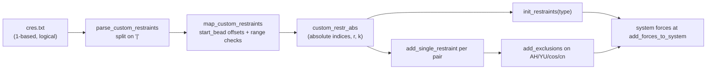
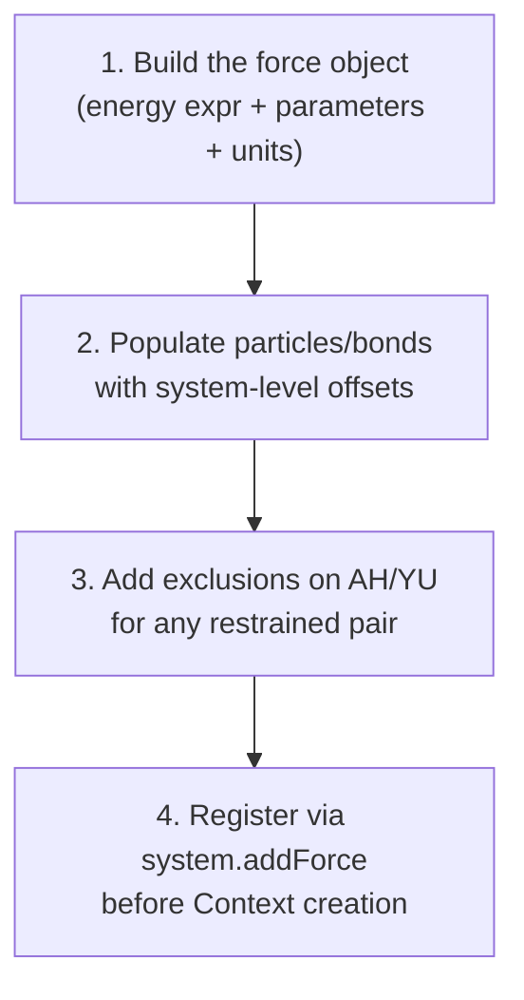

Every CALVADOS system is ultimately an OpenMM `openmm.System`, and everything beyond the built-in Ashbaugh-Hatch and Debye-Hückel pair physics is injected through a deliberate extension layer: a set of **force factory functions** in `calvados/interactions.py`, an orchestration pipeline in `calvados/sim.py`, and a **declarative configuration surface** in `calvados/inputmodels.py`. This page covers the three supported extension pathways — declarative external forces (`ext_force`), file-driven custom restraints (`custom_restraints`), and programmatic composition of the factory layer — showing exactly where forces are created, validated, populated, excluded from nonbonded interactions, and registered in the final system.

## The Extension Architecture at a Glance

The extension surface follows a strict **factory → orchestrator → system** data flow. Factory functions never mutate global state: each one constructs a fresh OpenMM force object (e.g., `openmm.CustomNonbondedForce`, `openmm.CustomBondForce`, `openmm.CustomExternalForce`) configured with energy expressions, per-particle/per-bond parameters, force groups, and periodic boundary settings. The `Sim` class then owns those objects, populates them particle-by-particle as molecules are placed, and finally hands everything to `openmm.System` in `add_forces_to_system` before serializing to `sysname.xml`.

```mermaid
flowchart TB
    subgraph Input["Declarative inputs"]
        CFG["config.yaml<br/>ext_force / ext_force_expr<br/>custom_restraints / _type / _file"]
        CRESC["cres.txt<br/>name copy bead&#124;name copy bead&#124;r k"]
    end
    subgraph Validation["inputmodels.py"]
        V["SimulationInput + validators<br/>(slab_eq xor ext_force)"]
    end
    subgraph Factories["interactions.py force factories"]
        F1["init_nonbonded_interactions → AH, YU"]
        F2["init_restraints → HarmonicBond / CustomBond"]
        F3["init_slab_restraints → CustomExternalForce"]
        F4["init_scaled_LJ / init_scaled_YU / init_wcafene"]
    end
    subgraph Orch["Sim.build_system (sim.py)"]
        MC["make_components: component-owned forces"]
        AE["add_ext_restraints (per particle)"]
        MCR["map_custom_restraints → add_custom_restraints"]
        AF["add_forces_to_system"]
    end
    SYS["openmm.System → sysname.xml"]
    CFG --> V --> Orch
    CRESC --> MCR
    F1 --> AF
    F2 --> MCR
    F3 --> AE
    F4 --> MC
    MC --> AF
    AE --> AF
    MCR --> AF
    AF --> SYS
```

Three distinct extension pathways exist, differing in trigger mechanism and effort level. The table below anchors the rest of this page.

| Pathway | User-facing trigger | OpenMM force produced | Code entry point |
|---|---|---|---|
| Declarative external potential | `ext_force=True` + `ext_force_expr` string | `CustomExternalForce` | `Sim.__init__` / `add_ext_restraints` |
| File-driven custom restraints | `custom_restraints=True` + restraint file | `HarmonicBondForce` or `CustomBondForce` (go) | `parse/map/add_custom_restraints` |
| Programmatic force composition | Python imports of `interactions.*` factories | Any factory return type | `Sim.build_system` pattern |

Sources: [interactions.py](calvados/interactions.py#L54-L176), [sim.py](calvados/sim.py#L157-L204), [sim.py](calvados/sim.py#L306-L319)

## Force Factory Layer: `interactions.py`

`interactions.py` is the module to study before writing any custom force, because it codifies CALVADOS's conventions for OpenMM force construction. Each factory builds an energy expression as an f-string (physical constants interpolated numerically), registers per-particle or per-bond parameters, enables periodic boundary conditions where relevant, and assigns a **force group** — `AH` sits in group 0 and `YU` in group 1 ([interactions.py](calvados/interactions.py#L89), [interactions.py](calvados/interactions.py#L111-L115)) — which is what makes per-force energy decomposition possible at runtime.

The restrained-force factories are especially relevant for extension work. `init_restraints(restraint_type)` returns a plain `openmm.HarmonicBondForce` for `'harmonic'` or a `CustomBondForce` implementing the 10–12 Go potential `k*(5*(s/r)^12-6*(s/r)^10)` with per-bond parameters `s` and `k` for `'go'` ([interactions.py](calvados/interactions.py#L161-L176)). `RestType = Literal['harmonic', 'go']` is the single type alias governing both component restraints and custom restraints, so any extension that accepts a restraint type should reuse it ([interactions.py](calvados/interactions.py#L13)).

| Factory | Returns | Purpose |
|---|---|---|
| `init_nonbonded_interactions` | `(CustomNonbondedForce, CustomNonbondedForce)` | AH + YU pair physics |
| `init_lipid_interactions` | cosine + charge-nonpolar forces | Membrane components |
| `init_restraints` | `HarmonicBondForce` \| `CustomBondForce` | Harmonic or Go restraints (custom & component) |
| `init_scaled_LJ` / `init_scaled_YU` | `CustomBondForce` | Intra-molecular scaled AH/YU for Go-type components |
| `init_slab_restraints` | `CustomExternalForce` | Box-center equilibration restraints |
| `init_wcafene` | `CustomBondForce` | WCA-FENE bonds at energy scale `3*eps_lj` |
| `init_bonded_interactions` / `init_angles` | `HarmonicBondForce` / `HarmonicAngleForce` | Chain connectivity & RNA angles |

Pairwise population helpers complete the pattern: `add_single_restraint` adds one bond and returns a **one-based record** for output files, converting units per type (`dij*nanometer, k*kJ/mol/nm²` for harmonic; `[dij*nanometer, k*kJ/mol]` for go), and `add_exclusion` registers a pair exclusion on a nonbonded force ([interactions.py](calvados/interactions.py#L237-L297)). Note the unit discipline: distances in nm, force constants in kJ·mol⁻¹·nm⁻², energy scales in kJ/mol — always wrapped in OpenMM units.

Sources: [interactions.py](calvados/interactions.py#L54-L115), [interactions.py](calvados/interactions.py#L156-L176), [interactions.py](calvados/interactions.py#L237-L297)

## Declarative External Forces: `ext_force`

The lightest-weight extension requires no code at all. Setting `ext_force=True` in the configuration causes `Sim.__init__` to construct `openmm.CustomExternalForce(self.config.ext_force_expr)` directly from your energy expression string ([sim.py](calvados/sim.py#L81-L82)). During `build_system`, every component whose `ext_restraint` flag is `True` (the default) contributes all of its beads to this force via `add_ext_restraints`, which loops `rcent.addParticle(i+offset)` over the component's beads with the system-level offset ([sim.py](calvados/sim.py#L550-L555)). The application is gated at the per-molecule level by `(self.slab_eq or self.config.ext_force) and comp.params.ext_restraint` ([sim.py](calvados/sim.py#L287-L289)), so individual molecules can opt out via the component's `ext_restraint` field ([inputmodels.py](calvados/inputmodels.py#L70)).

The default expression, `"step(d2-18)*d2; d2=periodicdistance(x, y, z, 0, 0, z)^2"`, applies a confining cost to beads far from the z-axis and is the shipped example of what an external potential looks like ([inputmodels.py](calvados/inputmodels.py#L164-L165)). Validation enforces that `slab_eq` and `ext_force` are **mutually exclusive**, since both bind the same `rcent` slot ([inputmodels.py](calvados/inputmodels.py#L210-L216)). The lifecycle is also fully managed: after slab equilibration completes, `simulate` scans `system.getForces()` for the first `CustomExternalForce` instance and removes it from the system before rebuilding the simulation ([sim.py](calvados/sim.py#L734-L738)).

> [!TIP]
> Unlike `init_slab_restraints`, the `ext_force` path registers **no** global parameter — not even `k` — so your `ext_force_expr` must be fully self-contained: hardcode constants inline (as the default expression does with `18`) or reference only OpenMM built-in variables like `x`, `y`, `z` and `periodicdistance`. An expression referencing `k` will fail at context creation, not at config validation.

Sources: [sim.py](calvados/sim.py#L41-L82), [sim.py](calvados/sim.py#L287-L289), [sim.py](calvados/sim.py#L550-L555), [sim.py](calvados/sim.py#L734-L738), [inputmodels.py](calvados/inputmodels.py#L164-L177), [inputmodels.py](calvados/inputmodels.py#L210-L216)

## File-Driven Custom Restraints

Custom restraints solve a different problem: **bespoke pair restraints between arbitrary beads, potentially in different molecules, without touching library code**. Three config fields control the feature: `custom_restraints` (enable), `custom_restraint_type` (`'harmonic'` or `'go'`), and `fcustom_restraints` (path to the restraint file, default `custom_restraints.txt`) ([inputmodels.py](calvados/inputmodels.py#L175-L177)). A full working configuration is shown in the shipped example, where A1 with folded domains is restrained via `fcustom_restraints = f'{cwd}/input/cres.txt'` ([examples/custom_restraints/prepare.py](examples/custom_restraints/prepare.py#L44-L46), [examples/custom_restraints/README.md](examples/custom_restraints/README.md#L1-L9)).

The input file uses a pipe-delimited, **one-based** record format parsed by `Sim.parse_custom_restraints`:

| Field | Position | Content | Example |
|---|---|---|---|
| Endpoint i | before first `\|` | `name copy bead` (space-separated) | `hnRNPA1S 1 4` |
| Endpoint j | between pipes | `name copy bead` | `hnRNPA1S 1 10` |
| Parameters | after second `\|` | `r k` (distance, force constant) | `1.0 700.0` |

Because component placement order is not user-stable (`reorder_components` moves solutes before lipids and crowders), the file references **logical** addresses that `map_custom_restraints` translates into absolute OpenMM particle indices: it first computes each component's `start_bead` as the cumulative sum of `nmol * nbeads`, then resolves `x_abs = start_bead + (copy-1)*nbeads + (bead-1)` ([sim.py](calvados/sim.py#L589-L624)). The regression test pins this down exactly — components A (2×3), B (1×4), C (2×5) yield `start_bead` values `[0, 6, 10]`, and a restraint from B copy 1 bead 4 to C copy 2 bead 1 maps to absolute pair `[9, 15]` ([tests/test_custom_restraints.py](tests/test_custom_restraints.py#L29-L58)).

Mapping is deliberately strict. Every endpoint is validated, and violations raise `ValueError` with precise messages — unknown component names, and out-of-range copy or bead indices — as verified parametrically in the test suite ([tests/test_custom_restraints.py](tests/test_custom_restraints.py#L60-L90)):

| Invalid endpoint | Raised message |
|---|---|
| `["missing", 1, 1]` | component 'missing' is not in the system |
| `["A", 3, 1]` (nmol=2) | copy 3 is outside the valid range 1-2 |
| `["A", 1, 4]` (nbeads=3) | bead 4 is outside the valid range 1-3 |
| `["A", 0, 1]` / `["A", 1, 0]` | copy/bead 0 is outside the valid range |

Population happens **after every molecule is placed**, at the end of `build_system`: `map_custom_restraints()` followed by `add_custom_restraints()` ([sim.py](calvados/sim.py#L291-L293)). `add_custom_restraints` instantiates the force via `interactions.init_restraints(self.config.custom_restraint_type)`, adds each bond through `interactions.add_single_restraint`, and — critically — collects the pair list into an `exclusion_map` that `add_exclusions` turns into exclusions on **every** nonbonded force (`ah`, `yu`, plus lipid `cos`/`cn` when present), mirroring how component-level restrained pairs are excluded from AH/YU ([sim.py](calvados/sim.py#L481-L501)).

> [!TIP]
> The exclusion step is not optional hygiene — a restrained pair that stays inside the AH/YU neighbor lists double-counts interactions and distorts the restrained potential. When writing any custom restraint pathway, follow the `exclusion_map → add_exclusions` convention so restrained beads are visible **only** through your force.

Sources: [inputmodels.py](calvados/inputmodels.py#L175-L177), [sim.py](calvados/sim.py#L589-L644), [sim.py](calvados/sim.py#L291-L293), [sim.py](calvados/sim.py#L481-L501), [tests/test_custom_restraints.py](tests/test_custom_restraints.py#L29-L90)

## Restraint Type Semantics: Harmonic vs Go

Because `custom_restraint_type` reuses the same `RestType` vocabulary as component restraints, both pathways share identical force semantics. The choice determines the OpenMM force class, the parameter payload, and the unit conventions applied in `add_single_restraint` ([interactions.py](calvados/interactions.py#L161-L176), [interactions.py](calvados/interactions.py#L245-L256)):

| Aspect | `harmonic` | `go` |
|---|---|---|
| Force class | `HarmonicBondForce` | `CustomBondForce` |
| Energy form | OpenMM built-in k(r−r₀)² | `k*(5*(s/r)^12-6*(s/r)^10)` |
| Bond parameters | `(r0, k)` positional | per-bond `s`, `k` |
| Units for `r`, `k` in file | nm, kJ·mol⁻¹·nm⁻² | nm, kJ/mol |
| Typical constant | `k_harmonic = 700.0` | `k_go = 15.0` |

Both forces call `setUsesPeriodicBoundaryConditions(True)`, keeping restraint geometry consistent with the periodic box ([interactions.py](calvados/interactions.py#L175-L176)). The default constants `k_harmonic` and `k_go` are defined at the component level ([inputmodels.py](calvados/inputmodels.py#L65-L66)), and the custom-restraints integration test uses `700.0` in its restraint file — the same scale as component-level harmonic restraints ([tests/test_custom_restraints.py](tests/test_custom_restraints.py#L121-L127)).

Sources: [interactions.py](calvados/interactions.py#L13-L13), [interactions.py](calvados/interactions.py#L161-L176), [interactions.py](calvados/interactions.py#L245-L258), [inputmodels.py](calvados/inputmodels.py#L60-L70)

## Writing Your Own Force: A Recipe

When the two declarative pathways are insufficient, extend programmatically by **reusing the factory conventions** rather than inventing new plumbing. The codebase itself demonstrates the canonical sequence, and any custom force should reproduce it:

For an external one-body potential, replicate the `rcent` pattern: construct `openmm.CustomExternalForce(expr)`, add a global parameter (e.g., `k` in `kJ/mol/nm`), then loop `addParticle(i+offset)` using the same offset arithmetic as `add_ext_restraints` (`offset = nparticles - comp.nbeads`) ([sim.py](calvados/sim.py#L550-L555), [sim.py](calvados/sim.py#L503-L535)). For new pair potentials, wrap your expression in a factory returning `CustomNonbondedForce` with `CutoffPeriodic` and an explicit force group, exactly as `init_ah_interactions` and `init_yu_interactions` do ([interactions.py](calvados/interactions.py#L63-L115)).

Verification is a first-class part of the extension workflow, and the test suite is your template. The end-to-end `test_cres` builds a minimal 8 nm box system with `custom_restraints=True`, runs `sim.run`, deserializes the produced `sysname.xml` with `openmm.XmlSerializer`, and asserts the restraint force exists with exactly one bond between absolute beads `i == 0` and `j == 9` — closing the loop from user file to OpenMM system ([tests/test_custom_restraints.py](tests/test_custom_restraints.py#L92-L182)). It also proves the checkpoint contract: the run must produce `custom-restart.chk` and no plain `restart.chk` ([tests/test_custom_restraints.py](tests/test_custom_restraints.py#L174-L179)).

| Step | Standard system | System with custom forces | Verified by |
|---|---|---|---|
| Force inventory | AH, YU (+ bonded per component) | + `cres` bond force / external force | XML deserialization, `getForces()` |
| Nonbonded exclusions | bonded neighbors only | + restrained pairs on AH/YU/cos/cn | `getNumExclusions()` |
| Output artifacts | `restart.chk` | `custom-restart.chk` when configured | file existence asserts |

Sources: [sim.py](calvados/sim.py#L503-L555), [interactions.py](calvados/interactions.py#L63-L115), [tests/test_custom_restraints.py](tests/test_custom_restraints.py#L92-L182)

## Boundaries and Related Pages

This page deliberately excludes two adjacent topics. **Component-internal restraint machinery** — `init_restraint_force`, `init_scaled_nonbonded`, Go-type scaled AH/YU activation inside `make_components` ([sim.py](calvados/sim.py#L96-L107)) — is documented in [Structure-Based Restraints & AlphaFold Guidance](11-structure-based-restraints-and-alphafold-guidance), and the physical content of AH/YU expressions belongs to [Ashbaugh-Hatch Hydrophobic Interactions](6-ashbaugh-hatch-hydrophobic-interactions) and [Debye-Hückel Electrostatics](7-debye-huckel-electrostatics). For the validation layer that guards all extension flags (`extra="forbid"` Pydantic models rejecting misspelled keys), continue with [Declarative Configuration & Validation](12-declarative-configuration-and-validation); for how the assembled force set is executed, checkpointed, and resumed, see [Simulation Engine & Checkpointing](14-simulation-engine-and-checkpointing). To validate the energetics of a custom force against reference kernels, the energy-conservation harnesses are covered in [Testing & Energy Validation](19-testing-and-energy-validation).
