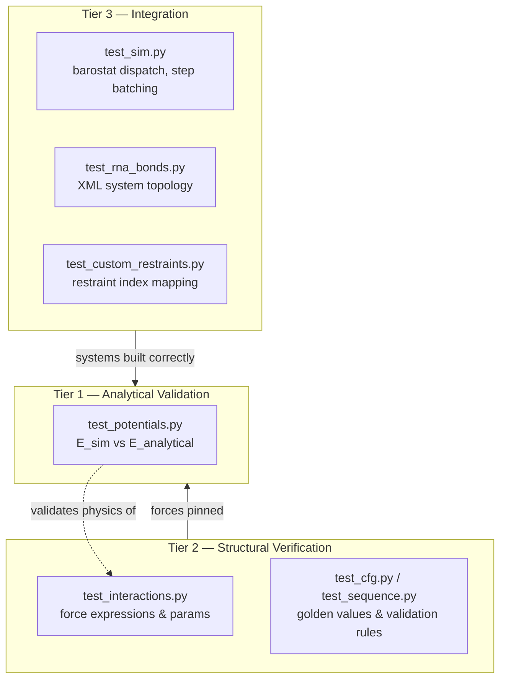
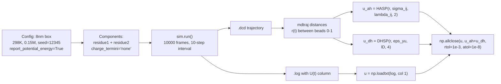

This page documents how the CALVADOS repository guarantees physical correctness of its coarse-grained force field through a three-tier test strategy: **analytical energy validation** (does the simulated potential energy match closed-form physics?), **structural force verification** (are the OpenMM force definitions exactly as intended?), and **end-to-end integration testing** (do full simulations produce structurally valid systems?). The crown jewel is `tests/test_potentials.py`, which treats simulation output as a measurable quantity and confronts it against independently written reference equations — the strongest possible guarantee that the force field implementation is free of sign, factor, and unit errors.

Sources: [pytest.ini](pytest.ini#L1-L15), [tests/test_potentials.py](tests/test_potentials.py#L1-L124)

## Test Suite Architecture & Execution Model

The test suite follows a deliberate **layered validation pyramid**, where each tier answers a different question about the codebase. Unit tests verify invariants of isolated functions (pure verification), definition tests pin the exact structure of generated OpenMM forces (regression locks), and integration tests execute real simulations through the `sim.run()` entry point and inspect the serialized artifacts. This mirrors the Diátaxis principle that a test should fail with a diagnosis, not just a symptom.

Execution is governed by `pytest.ini`, which encodes several non-obvious policies. `--doctest-modules` means every module's docstrings are collected as tests alongside the `tests/` directory, `--import-mode=importlib` avoids package import collisions, and — critically — `filterwarnings` is set to `error`, so any unexpected warning (e.g., a NumPy overflow or OpenMM deprecation) fails the suite immediately. Only `PendingDeprecationWarning`, `UserWarning`, and `DeprecationWarning` are explicitly tolerated. This "strict warnings" policy acts as a tripwire for silent numerical issues in scientific code.

| Setting | Value | Effect |
|---|---|---|
| `testpaths` | `tests` | Discovery root |
| `addopts` | `--doctest-modules --import-mode=importlib -r a -v` | Docstring tests, no path conflicts, full report |
| `filterwarnings` | `error` + 3 ignores | Warnings fail tests unless explicitly whitelisted |
| `norecursedirs` | `dist build .tox scripts` | Skip packaging artifacts |

Sources: [pytest.ini](pytest.ini#L1-L15), [calvados/sim.py](calvados/sim.py#L871-L887)

The nine test modules partition cleanly by subsystem. The inventory below maps each module to its tier and testing style — note that four modules (`test_potentials`, `test_rna_bonds`, `test_custom_restraints`, and parts of `test_sim`) run **actual OpenMM simulations** on the CPU platform, making the suite a genuine physics regression harness rather than a mock-based one.

| Module | Tier | Focus | Style |
|---|---|---|---|
| `test_potentials.py` | Analytical | AH+DH energy vs closed form | End-to-end sim + `np.allclose` |
| `test_interactions.py` | Structural | Force expressions, parameters, force groups | Exact string/param assertions |
| `test_cfg.py` | Unit | Pydantic validation, YAML round-trip | Schema contract tests |
| `test_sequence.py` | Unit | Charges, sequence statistics | Golden numeric values |
| `test_sim.py` | Unit/Integration | Step batching, barostat selection | `Sim.__new__` surgery |
| `test_components.py` | Unit | Registry dispatch, numerical stability | Registry + edge-case floats |
| `test_rna_bonds.py` | Integration | RNA bond topology in serialized system | Full sim + XML introspection |
| `test_custom_restraints.py` | Integration | Restraint index mapping, custom checkpoints | Full sim + file assertions |
| `test_analysis.py` | Unit | Contact maps, slab binning, COM trajectories | monkeypatch + real mdtraj files |

Sources: [tests/](tests), [pytest.ini](pytest.ini#L1-L15)

## Closed-Form Energy Validation: The Physics Oracle

The heart of this page is `tests/test_potentials.py`, which answers the question every force-field developer must eventually face: *does OpenMM compute the energy I think it does?* The strategy is to write the reference Ashbaugh-Hatch and Debye-Hückel potentials **from scratch as NumPy lambdas** — never importing production code — so a bug shared between implementation and test is impossible. This mirrors the reference-vs-oracle pattern from numerical libraries.

Sources: [tests/test_potentials.py](tests/test_potentials.py#L13-L21)

The reference functions encode the exact mathematical form of the two potentials (covered in depth in [Ashbaugh-Hatch Hydrophobic Interactions](6-ashbaugh-hatch-hydrophobic-interactions) and [Debye-Hückel Electrostatics](7-debye-huckel-electrostatics)), including the **shifted-force cutoff treatment**. `HASP` subtracts the potential at the cutoff distance `rc=2` nm so the energy decays continuously to zero — precisely the shift OpenMM applies in `init_ah_interactions` via `shift=(s/rc)^12-(s/rc)^6`. The Debye-Hückel reference `DHSP` performs the same constant-shift at `rc=4` nm, matching the `exp(-k*rc)/rc` offset in the Yukawa force.

| Reference function | Mathematical role | Parameterization |
|---|---|---|
| `HALR` / `HASR` | AH repulsive-attractive branches | `4ε·l·((s/r)¹²−(s/r)⁶)` / `4ε·((s/r)¹²−(s/r)⁶)+ε(1−l)` with ε=0.8368 kJ/mol |
| `HA` | Branch selection at `2^(1/6)·s` | Lagrange/interpolation-free `np.where` split |
| `HASP` | AH with constant shift at rc=2 | `HA(r) − HA(rc)` for r < rc, else 0 |
| `DH` / `DHSP` | Debye-Hückel with shift at rc=4 | `ε_yu·e^(−r/lD)/r`, shifted identically |

Sources: [tests/test_potentials.py](tests/test_potentials.py#L14-L21), [calvados/interactions.py](calvados/interactions.py#L69-L78), [calvados/interactions.py](calvados/interactions.py#L100-L104)

The test harness builds a **deliberately minimal two-bead system** for each parametrized residue pair — `(Y,W)`, `(R,W)`, `(E,D)`, `(E,W)`, `(E,R)` — chosen to span the physics space: hydrophobic-hydrophobic, charged-hydrophobic, like-charge repulsion (`E,D`), and strong charge-charge attraction (`E,R`). Because the system contains exactly two beads (`nmol=1`, one residue each from `fastalib.fasta`), the total potential energy is *exactly* the pairwise interaction, with no bond, angle, or multi-body contributions to separate out. The `charge_termini='none'` setting eliminates terminal charge patches, keeping the physics pure.

Sources: [tests/test_potentials.py](tests/test_potentials.py#L23-L32), [tests/test_potentials.py](tests/test_potentials.py#L55-L93)

The pairwise parameters are reconstructed using the **Lorentz-Berthelot mixing rules** that the production code applies to every nonbonded pair: `sigma_ij = 0.5·(σ₁+σ₂)` and `lambda_ij = 0.5·(λ₁+λ₂)`, read from the same `residues_CALVADOS2.csv` database the simulation consumes. The electrostatic prefactor chain is rebuilt independently: water permittivity from the empirical `fepsw(T)` polynomial, Bjerrum length `lB`, Yukawa amplitude `yukawa_eps = q₁·q₂·lB·RT`, and Debye length `lD = 1/√(8π·lB·ionic·N_A/10)`. This mirrors `genParamsDH` in the production module but is written with inline physical constants rather than the named constants in `interactions.py` — an intentional duplication that keeps the two derivations independent.

> [!TIP]
> The validation runs the simulation on the **CPU platform with a fixed seed** (`random_number_seed=12345`) and `platform='CPU'` — determinism is what makes the `rtol=1e-3` assertion stable across machines. If you add a new residue type to `residues.csv`, extend the `@pytest.mark.parametrize` list with a pair involving it; the harness will immediately tell you whether the new σ/λ/q entries integrate correctly into both potentials.

Sources: [tests/test_potentials.py](tests/test_potentials.py#L95-L123), [calvados/interactions.py](calvados/interactions.py#L15-L52)

The simulation produces the energy time series through the standard reporting pipeline: a `StateDataReporter` writes tab-separated values to `<sysname>.log` with `potentialEnergy=self.config.report_potential_energy`, and the test loads column 1 with `np.loadtxt(..., usecols=(1))`. The tolerance choice is physically motivated — `rtol=1e-3` (0.1%) accommodates the single-precision arithmetic OpenMM uses on most platforms, while `atol=1e-8` guards the near-zero crossover region where the shifted potentials change sign.

Sources: [calvados/sim.py](calvados/sim.py#L824-L842), [tests/test_potentials.py](tests/test_potentials.py#L100-L123)

## Force Definition Verification: Pinning the Expressions

While `test_potentials.py` validates *numbers*, `tests/test_interactions.py` validates *structure*. Its central technique is asserting the **exact OpenMM energy expression strings** returned by each force factory — any accidental edit to an energy formula in `interactions.py` breaks the test immediately, even if simulations still run. This is a regression lock on the physics specification itself, complementing the numeric oracle of the previous section.

Sources: [tests/test_interactions.py](tests/test_interactions.py#L39-L104)

The `test_nonbonded_force_definition` test is parametrized across all four nonbonded force factories, asserting five structural properties each: the energy expression verbatim, per-particle parameter names in order, the `CutoffPeriodic` nonbonded method, the cutoff distance in nanometers, and the **force group assignment**. Force groups are not cosmetic — they determine energy decomposition granularity when analysts use per-group energy reporting (relevant to the analysis workflows in [Trajectory Analysis Toolkit](15-trajectory-analysis-toolkit)).

| Force factory | Force group | Cutoff | Per-particle parameters |
|---|---|---|---|
| `init_ah_interactions` | 0 | rc_lj | `s`, `l`, `id` |
| `init_yu_interactions` | 1 | rc_yu | `q` |
| `init_cosine_interactions` | 2 | `2^(1/6)+1.5` nm | `s`, `l`, `id` |
| `init_charge_nonpolar_interactions` | 1 | rc_yu | `R3`, `alpha`, `q`, `id` |

Sources: [tests/test_interactions.py](tests/test_interactions.py#L39-L104), [calvados/interactions.py](calvados/interactions.py#L83-L115), [calvados/interactions.py](calvados/interactions.py#L316-L358)

The bonded-side counterpart `test_custom_bond_force_definition` covers the scaled restraint forces and the WCA-FENE chain bond, checking per-bond parameters *and* global parameters (e.g., `scaled_LJ` carries `eps` and `rc` globals that Go-type restraints modulate — see [Structure-Based Restraints & AlphaFold Guidance](11-structure-based-restraints-and-alphafold-guidance)). Note the `n` per-bond parameter present in both `scaled_LJ` and `scaled_YU` expressions — this is the Go-pair counting factor that reproduces each native contact `n` times.

| Bond force factory | Per-bond params | Global params | Purpose |
|---|---|---|---|
| `init_scaled_LJ` | `s`, `l`, `n` | `eps`, `rc` | Scaled AH for Go contacts |
| `init_scaled_YU` | `q`, `n` | — | Scaled electrostatics for Go contacts |
| `init_wcafene_interactions` | `s`, `kfene` | — | Chain connectivity (WCA + FENE) |

Sources: [tests/test_interactions.py](tests/test_interactions.py#L106-L150), [calvados/interactions.py](calvados/interactions.py#L178-L194), [calvados/interactions.py](calvados/interactions.py#L299-L314)

Parameter-level physics gets its own golden-value test: `test_debye_huckel_parameters` asserts `genParamsDH(temp=298, ionic=0.15)` returns `eps_yu ≈ 1.7708537147570556` and `k_yu ≈ 1.2738143970635982` with `rel=1e-14` — full double-precision pinning. This protects the constants chain (gas constant, elementary charge, vacuum permittivity, Avogadro number) declared at the top of `interactions.py`, where a single-digit typo in any physical constant would propagate silently into every simulation. The function also validates its inputs, rejecting non-positive temperature and negative ionic strength — a contract the test suite exercises through the same golden call.

Sources: [tests/test_interactions.py](tests/test_interactions.py#L32-L36), [calvados/interactions.py](calvados/interactions.py#L15-L52)

Restraint machinery is verified at both the force-definition and record-bookkeeping levels: `test_slab_restraint_definition` pins the external-force expression `k*abs(periodicdistance(x,y,z,x,y,z0))` and confirms `z0` defaults to the box z-midpoint (15.0 for a 30 nm box), while `test_add_harmonic_restraint` and `test_add_go_restraint` verify that adding a restraint returns both the mutated force *and* a one-based index record — the `[i+offset+1, j+offset+1, ...]` convention that lets downstream analysis map restraints back to human-readable residue numbering.

Sources: [tests/test_interactions.py](tests/test_interactions.py#L153-L212), [calvados/interactions.py](calvados/interactions.py#L280-L297)

## Engine & Component Unit Testing Patterns

The simulation engine tests showcase a pattern worth stealing: **surgical instantiation via `Sim.__new__`**. Instead of constructing a full `Sim` (which validates inputs, loads files, and builds systems), tests create the object shell, inject exactly the attributes the method under test reads, and call one method. `test_adds_requested_barostat` uses this to verify pressure-coupling dispatch in isolation: with only `system`, two dummy forces, and a `SimpleNamespace` config on board, the test asserts that `box_eq` yields a `MonteCarloAnisotropicBarostat` while `bilayer_eq` yields a `MonteCarloMembraneBarostat` — covering all four configuration permutations in a single parametrized table.

Sources: [tests/test_sim.py](tests/test_sim.py#L18-L66)

The step-batching invariant test applies the same discipline to `_split_steps`, the helper that divides a simulation into at most 10 checkpoint-saving batches (see [Simulation Engine & Checkpointing](14-simulation-engine-and-checkpointing) for the checkpoint semantics). Three invariants are asserted for every input size from 1 to 105: batches **sum exactly** to the requested step count, **no batch exceeds 10**, and **every batch is positive** — the properties that guarantee checkpoint intervals never silently drop or duplicate integration steps.

Sources: [tests/test_sim.py](tests/test_sim.py#L9-L15), [calvados/sim.py](calvados/sim.py#L24-L28), [calvados/sim.py](calvados/sim.py#L853-L855)

Configuration testing (`test_cfg.py`) treats the pydantic schemas as a public contract. Tests verify that defaults flow through `Config` correctly (`sysname="default_simulation"`, box cast to floats), that YAML **round-trips exactly** (`written == config.config`), and that unknown fields — like a typo'd `tempp` — raise `ValidationError` rather than being silently ignored. A parametrized table exercises six **cross-field consistency rules** from `ComponentInput`: sequences must exist when restraints are off, PDB folders and domain files must exist when restraints are on, lipids and crowders reject restraints outright, and RNA permits only harmonic restraint types. These rules are the runtime guardrails documented in [Declarative Configuration & Validation](12-declarative-configuration-and-validation).

Sources: [tests/test_cfg.py](tests/test_cfg.py#L11-L49), [tests/test_cfg.py](tests/test_cfg.py#L134-L199)

Sequence-level physics carries golden-value assertions too. `test_seqfeatures` constructs a toy 4-residue sequence with hand-computed expectations — charge hypervariable region `fcr=0.5`, net charge per residue `ncpr=0.0`, sequence charge decoration `scd=−√3/4`, and mean λ=`0.25` — verifying the sequence statistics module down to closed-form values. Charge assignment is tested for the standard CALVADOS2 scale (`KRHDEpA` → +1,+1,0,−1,−1,−1,0), custom charge tables, and **flexible histidine** pH-dependent protonation, plus multi-chain terminal patching from PDB `TER` records.

Sources: [tests/test_sequence.py](tests/test_sequence.py#L16-L42), [tests/test_sequence.py](tests/test_sequence.py#L71-L103)

Component tests cover the registry dispatch ([Component Registry & Molecule Types](9-component-registry-and-molecule-types)) and — notably — **numerical pathology resistance**: `test_rna_angle_map_clips_cosine` feeds RNA angle computation two nearly parallel vectors with components on the order of 1e128 (the kind of overflow an unconstrained initialization could produce) and asserts the resulting angle clamps to a finite 0.0 rather than NaN. This test exists because a NaN angle in an arccos-based angle map would poison an entire trajectory silently.

Sources: [tests/test_components.py](tests/test_components.py#L33-L64), [tests/test_components.py](tests/test_components.py#L67-L101)

## End-to-End Integration Tests: Inspecting Real Systems

The integration tier runs genuine simulations through `sim.run()` and then **deserializes the persisted OpenMM system XML** to assert on physical structure. `test_rna_bonds.py` builds a 12-bead RNA chain, runs 100 integration steps, deserializes `rrrrrr.xml`, and checks every bond in force index 2 against the RNA topology rule: bonds must connect an even-indexed phosphate (`i%2==0`) to its adjacent base (`j==i+1`) or next phosphate (`j==i+2`). This is a *structural* energy-adjacent validation — correct bonds guarantee the WCA-FENE connectivity term (and thus the chain's bonded energy landscape) matches the phosphate-backbone design.

Sources: [tests/test_rna_bonds.py](tests/test_rna_bonds.py#L11-L99)

`test_custom_restraints.py` performs the deepest integration check, validating the complete custom-restraint data path from a text fixture to a serialized system. The fixture `cres.txt` encodes one harmonic restraint in the pipe-delimited format (`cres_test 1 1 | cres_test 1 10 | 1.0 700.0`), and the test asserts three things end-to-end: the custom checkpoint file `custom-restart.chk` is written (while the default `restart.chk` is absent), force index 3 in the serialized system contains **exactly one bond**, and that bond connects particles `(0, 9)` — verifying the component-local → absolute bead index conversion (`start_bead + (copy−1)·nbeads + (bead−1)`) that translates the human-facing 1-based fixture into OpenMM's 0-based particle IDs. The file also unit-tests `map_custom_restraints` index arithmetic across three multi-copy components (`start_bead` sequence `[0, 6, 10]`) and exhausts the bilayer-placement retry loop to confirm a clean `ValueError`.

Sources: [tests/test_custom_restraints.py](tests/test_custom_restraints.py#L14-L56), [tests/test_custom_restraints.py](tests/test_custom_restraints.py#L80-L176), [calvados/sim.py](calvados/sim.py#L600-L644), [tests/data/cres.txt](tests/data/cres.txt#L1)

Analysis utilities get targeted tests with real I/O: `test_calc_com_traj` writes actual PDB/DCD files via mdtraj, runs `SlabAnalysis.calc_com_traj` with a step of 2, and asserts the output trajectory has exactly 3 frames from 5 inputs — verifying the frame-stride arithmetic that underpins the slab workflows in [Slab Phase-Separation Analysis](16-slab-phase-separation-analysis). Contact-map frame normalization and the final-bin z-patch histogram edge case are covered with synthetic data and `monkeypatch` isolation.

Sources: [tests/test_analysis.py](tests/test_analysis.py#L12-L83)

The shared fixture set under `tests/data/` is deliberately minimal: `fastalib.fasta` contains single-residue entries (`Y`, `E`, `W`, `D`, `R`) for the two-bead energy tests plus the 6-mer RNA and the 10-alanine `cres_test` chain; `residues_CALVADOS2.csv` and `residues_C2RNA.csv` provide the parameter databases; `cres.txt` carries the restraint record. Nothing in the fixtures is disposable — each file is referenced by name from a test, and adding fixtures without tests is treated as dead weight.

| Fixture | Consumers | Role |
|---|---|---|
| `fastalib.fasta` | potentials, rna_bonds, custom_restraints, components | Minimal sequences incl. single-residue oracles |
| `residues_CALVADOS2.csv` | potentials, custom_restraints | Protein σ/λ/q parameter database |
| `residues_C2RNA.csv` | rna_bonds, components | RNA phosphate/base parameter database |
| `cres.txt` | custom_restraints | One harmonic restraint record (beads 1→10) |

Sources: [tests/data/](tests/data), [tests/data/fastalib.fasta](tests/data/fastalib.fasta#L1-L14)

## Running the Suite & What the Tests Guarantee

Because the energy tests execute real simulations (10,000 integration steps each across five residue pairs), the full suite is CPU-bound but bounded — every integration test finishes in seconds on a laptop. Run everything from the repository root with plain `pytest` (the `pytest.ini` supplies all flags); run only the physics oracle with `pytest tests/test_potentials.py -v`, or a single residue-pair with `pytest tests/test_potentials.py -k "E and R"`.

Sources: [pytest.ini](pytest.ini#L1-L15), [tests/test_potentials.py](tests/test_potentials.py#L34-L50)

Collectively, the suite provides a precise guarantee: **the energy OpenMM accumulates is the energy the CALVADOS force field defines, to within 0.1%, for every interaction class** — hydrophobic mixing, electrostatic screening, shifted cutoffs, Go scaling, chain connectivity, and external restraints. Combined with the strict-warnings policy and the exact-expression locks, any physics-affecting change to `interactions.py`, `components.py`, or `sim.py` surfaces as a failing test with a specific diagnosis rather than as a subtly wrong production trajectory. This is the safety net that makes the extension workflows in [Extension & Custom Forces](18-extension-and-custom-forces) safe to attempt, and the performance portability in [Hardware Platforms & Performance](20-hardware-platforms-and-performance) verifiable per platform.

> [!TIP]
> When porting CALVADOS to a new platform or OpenMM version, run `test_potentials.py` first: since it asserts energy agreement at 0.1% tolerance on a fixed-seed trajectory, it is the fastest possible detector of platform-specific numerical regressions — far more sensitive than trajectory-level comparisons, which blur errors across 10,000 frames of Langevin noise.

Sources: [tests/test_potentials.py](tests/test_potentials.py#L107-L123), [calvados/sim.py](calvados/sim.py#L669-L687)

For continued reading, the natural progression is: revisit the physics these tests validate in [Ashbaugh-Hatch Hydrophobic Interactions](6-ashbaugh-hatch-hydrophobic-interactions) and [Debye-Hückel Electrostatics](7-debye-huckel-electrostatics), then see how the tested forces are orchestrated at runtime in [Simulation Engine & Checkpointing](14-simulation-engine-and-checkpointing), and finally learn how the logged energies these tests consume feed statistical error analysis in [Blocking Error Estimation](17-blocking-error-estimation).
