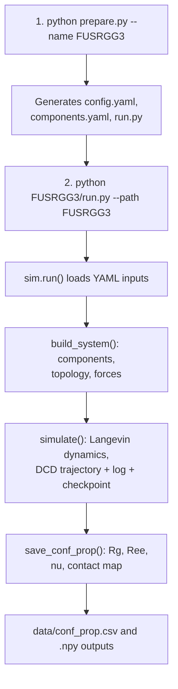

CALVADOS is a Python package for **coarse-grained, implicit-solvent simulations of biomolecules built on the OpenMM framework**. This page gets you from an empty conda environment to a finished simulation with computed conformational observables in a few minutes of setup. You will install the package, run its test suite, and execute the smallest complete workflow in the repository — a single intrinsically disordered region (IDR) in a cubic box — while learning the file conventions every CALVADOS project shares. For a conceptual explanation of what the model represents physically, start with the [Overview](1-overview).

Sources: [README.md](README.md#L9-L13)

## Prerequisites and Installation

CALVADOS requires a conda environment with **Python 3.13**, the OpenMM engine, and two trajectory libraries (MDAnalysis and MDTraj). The recommended setup is:

```bash
conda create -n calvados python=3.13
conda activate calvados
```

The only decision you must make at install time is your compute target, because it determines whether CUDA support is bundled:

| Compute target | Installation command |
|---|---|
| **GPU (CUDA)** | `conda install -c conda-forge openmm=8.2.0 cudatoolkit=11.8 mdanalysis=2.9 mdtraj=1.11` |
| **CPU / OpenCL** | `conda install -c conda-forge openmm=8.2.0 mdanalysis=2.9 mdtraj=1.11` |

Then clone the repository and install the package itself with pip:

```bash
git clone https://github.com/KULL-Centre/CALVADOS.git
cd CALVADOS
pip install .
```

Using `pip install -e .` instead installs an editable copy, which is convenient if you plan to read or modify the source while working through the tutorials.

Sources: [README.md](README.md#L26-L49)

## Verifying the Installation

Before running anything yourself, confirm that the physics and file handling are intact on your machine:

```bash
python -m pytest
```

The most important check is `test_potentials`, which simulates two free amino acids, re-computes potential energies from the saved trajectory, and compares them against the values OpenMM logged during the run — a direct validation that forces are assembled correctly on your hardware. Two further tests verify bond ordering in the RNA model and the correct application of custom restraints.

Sources: [README.md](README.md#L50-L59), [tests/test_potentials.py](tests/test_potentials.py)

## Your First Simulation: Single IDR

The `examples/single_IDR` directory is the canonical minimal project. Its README defines the entire workflow in two commands:

```bash
python prepare.py --name FUSRGG3
python FUSRGG3/run.py --path FUSRGG3
```

`FUSRGG3` is an arginine/glycine-rich IDR whose sequence ships in the example's `input/idr.fasta`. The two commands separate *declaration* (what to simulate) from *execution* (how it runs), and everything they produce lands in a per-system folder named after the system. The complete journey looks like this:



Sources: [examples/single_IDR/README.md](examples/single_IDR/README.md#L1-L9), [examples/single_IDR/input/idr.fasta](examples/single_IDR/input/idr.fasta#L1-L5)

## Step 1 — Declare the System in prepare.py

Open `prepare.py`; it is a single script that builds two declarative objects and writes them to disk. All simulation-level settings live in a `Config` object:

```python
config = Config(
  sysname = sysname,  # name of simulation system
  box = [L, L, L],    # nm
  temp = 293.15,      # K
  ionic = 0.19,       # M
  pH = 7.5,
  topol = 'center',
  wfreq = N_save,     # dcd writing interval, 1 = 10 fs
  steps = N_frames*N_save,
  platform = 'CPU',   # or CUDA
  restart = 'checkpoint',
  frestart = 'restart.chk',
)
```

The parameters that matter for a first run are summarized below:

| Parameter | Example value | Role |
|---|---|---|
| `box` | `[50, 50, 50]` (nm) | Side length of the periodic cubic box |
| `temp` / `ionic` / `pH` | 293.15 K / 0.19 M / 7.5 | Physical conditions; ionic strength feeds the Debye-Hückel electrostatics |
| `topol` | `'center'` | Single-molecule topology, molecule centered in the box |
| `wfreq` | 7000 | Save a trajectory frame every 7000 steps (1 step = 10 fs) |
| `steps` | 1010 × 7000 | Total integration steps, expressed as frames × save interval |
| `platform` | `'CPU'` or `'CUDA'` | OpenMM execution target |
| `restart` / `frestart` | `'checkpoint'` / `'restart.chk'` | Resume interrupted runs from this checkpoint file |

Molecule definitions live in a separate `Components` object. The example declares defaults (`molecule_type='protein'`, `nmol=1`, `restraint=False`, `charge_termini='both'`), points at the residue parameter table and the FASTA file, then adds the named chain that `--name` selected:

```python
components = Components(
  molecule_type = 'protein',
  nmol = 1,
  restraint = False,
  charge_termini = 'both',
  fresidues = residues_file,
  ffasta = f'{cwd}/input/idr.fasta',
)
components.add(name=args.name)
components.write(path, name='components.yaml')
```

Calling `config.write(path, ...)` then does something essential: it serializes both validated objects into the run directory as `config.yaml` and `components.yaml`, **and generates the `run.py` launcher script** next to them.

<CgxTip>`Config` validates every keyword through the Pydantic model `SimulationInput` before writing YAML, so a typo like `temp=293.15` vs `temprature=293` fails immediately at prepare time — with a clear error — rather than five minutes into a trajectory. Validation happens again inside the simulation itself (`validate_inputs` in `sim.run`), giving you a second safety net.

Sources: [examples/single_IDR/prepare.py](examples/single_IDR/prepare.py#L23-L40), [examples/single_IDR/prepare.py](examples/single_IDR/prepare.py#L52-L72), [calvados/cfg.py](calvados/cfg.py#L37-L61), [calvados/cfg.py](calvados/cfg.py#L88-L118)

## Step 2 — Build and Run with run.py

The generated `run.py` is deliberately tiny: it parses `--path`, `--config`, and `--components` arguments and calls one function:

```python
sim.run(path=path, fconfig=fconfig, fcomponents=fcomponents)
```

`sim.run()` loads the two YAML files, constructs a `Sim` driver, and executes its two phases in order. `build_system()` assembles the OpenMM `System` and MDTraj topology, instantiates each component (sequence → beads with charge and hydrophobicity from the residue table), initializes the Ashbaugh-Hatch and Debye-Hückel interaction parameters, and places molecules according to the `topol` setting. `simulate()` then attaches a DCD reporter and a state-data reporter to the OpenMM `Simulation` and integrates the trajectory, saving checkpoints along the way and writing final `checkpoint.pdb`/`checkpoint.cif` structures.

By the end of this step your run directory contains:

| File | Producer | Content |
|---|---|---|
| `config.yaml`, `components.yaml`, `run.py` | `prepare.py` | Declarative inputs + generated launcher |
| `top.pdb` | `build_system()` | Reference structure of the built system |
| `<sysname>.dcd` | `DCDReporter` | Trajectory frames, one per `wfreq` steps |
| `<sysname>.log` | `StateDataReporter` | Step, speed, elapsed time, potential energy |
| `restart.chk` | Checkpointing | Resume point for interrupted or extended runs |
| `checkpoint.pdb` / `checkpoint.cif` | Final state | Final frame in standard structure formats |

<CgxTip>Checkpointing is built into the batch loop: if a run is cut off (cluster walltime, laptop sleep), simply rerun the same `run.py` command. With `restart='checkpoint'`, the simulator detects the existing `restart.chk`, skips equilibration adjustments, and appends to the existing DCD rather than starting over.

Sources: [calvados/sim.py](calvados/sim.py#L871-L886), [calvados/sim.py](calvados/sim.py#L157-L164), [calvados/sim.py](calvados/sim.py#L824-L869), [calvados/sim.py](calvados/sim.py#L851-L857)

## Step 3 — Automatic Trajectory Analysis

Notice that `prepare.py` defined a `analyses` string containing Python code. `Config.write_runfile()` appends this string verbatim to the generated `run.py`, so after the trajectory finishes, the same process immediately runs `save_conf_prop(...)`:

```python
from calvados.analysis import save_conf_prop
save_conf_prop(path="{path}", name="{sysname}", residues_file=..., 
               output_path="data", start=10, is_idr=True, select='all')
```

This function loads `top.pdb` plus the DCD into MDAnalysis and computes single-chain conformational observables, skipping the first 10 frames (`start=10`) to exclude residual equilibration. Results land in the `data/` folder:

| Output | Description |
|---|---|
| `data/conf_prop.csv` | Summary table: mean Rg, mean end-to-end distance, and the scaling exponent ν, each with blocking-error estimates |
| `data/rgs.npy`, `data/rees.npy` | Per-frame radius of gyration and end-to-end distance arrays |
| `data/cmap.npy` | Averaged inter-residue contact map |
| `data/internal_distances.npy` | Internal distance distributions used for the ν fit (IDR mode only) |

A first successful run typically shows a compact, growing chain whose Rg is stable across the sampled frames — the blocking error estimates in `conf_prop.csv` tell you whether the trajectory is long enough for the values to be statistically meaningful.

Sources: [calvados/cfg.py](calvados/cfg.py#L63-L84), [calvados/analysis.py](calvados/analysis.py#L494-L539), [examples/single_IDR/prepare.py](examples/single_IDR/prepare.py#L44-L50)

## How the Pieces Fit Together

The quick-start experience is the user-facing surface of a four-stage pipeline. Every CALVADOS example — slab phase separation, multi-chain condensates, RNA, crowders — reuses exactly this shape, changing only the declarations:

```mermaid
flowchart LR
    A["Declarative inputs<br/>(Config + Components)"] -->|cfg.py<br/>Pydantic validation| B["YAML + generated run.py"]
    B -->|sim.run()| C["Build<br/>(build.py, components.py,<br/>interactions.py)"]
    C --> D["Simulate<br/>(sim.py + OpenMM)"]
    D --> E["Analyze<br/>(analysis.py + BLOCKING)"]
```

The separation has a practical payoff: `config.yaml` and `components.yaml` are plain, version-controllable text that fully describe a simulation, while `run.py` is disposable and regenerable. Changing a condition means editing one line in `prepare.py` and rerunning it — never hand-editing generated files.

Sources: [calvados/cfg.py](calvados/cfg.py#L13-L33), [calvados/sim.py](calvados/sim.py#L1-L39)

## Common First-Run Issues

| Symptom | Likely cause | Fix |
|---|---|---|
| `Topol 'single/center' incompatible with multiple molecules.` | `topol='center'` declared while `nmol > 1` | Use `nmol=1`, or switch to a grid/slab topology for many molecules |
| Slow simulation on GPU machine | `platform='CPU'` left as default | Set `platform='CUDA'` in `Config` after installing with cudatoolkit |
| Simulation restarts from scratch | `frestart` path missing or `restart` set to `'pdb'`/`'cif'` without the file present | Keep `restart='checkpoint'` and let `restart.chk` accumulate in the run directory |
| `FileNotFoundError` for a restart structure | `restart='pdb'`/'cif' points to a nonexistent file | Generate the structure first (any completed run writes `checkpoint.pdb`), or use checkpoint mode |

Sources: [calvados/sim.py](calvados/sim.py#L126-L130), [calvados/sim.py](calvados/sim.py#L61-L72), [calvados/sim.py](calvados/sim.py#L805-L819)

## Where to Go Next

You now possess the core skill — declaring a system in `prepare.py` and executing it via the generated `run.py`. Recommended progression:

1. **[Simulation Workflow Primer](3-simulation-workflow-primer)** — a guided walkthrough of the same prepare → build → simulate → analyze lifecycle with deeper narration of each stage.
2. **[Example Gallery](4-example-gallery)** — the full set of ready-made projects in `examples/`, from `slab_IDR` phase-separation setups to RNA and crowder systems; each follows the pattern you just ran.
3. **[Architecture Overview](5-architecture-overview)** — how `cfg`, `components`, `build`, `interactions`, `sim`, and `analysis` modules relate inside the package.
4. When you are ready to tune physics rather than workflow, **[Residue Parameter Database](8-residue-parameter-database)** explains the `residues_CALVADOS2.csv` file your `Components` object consumed.
