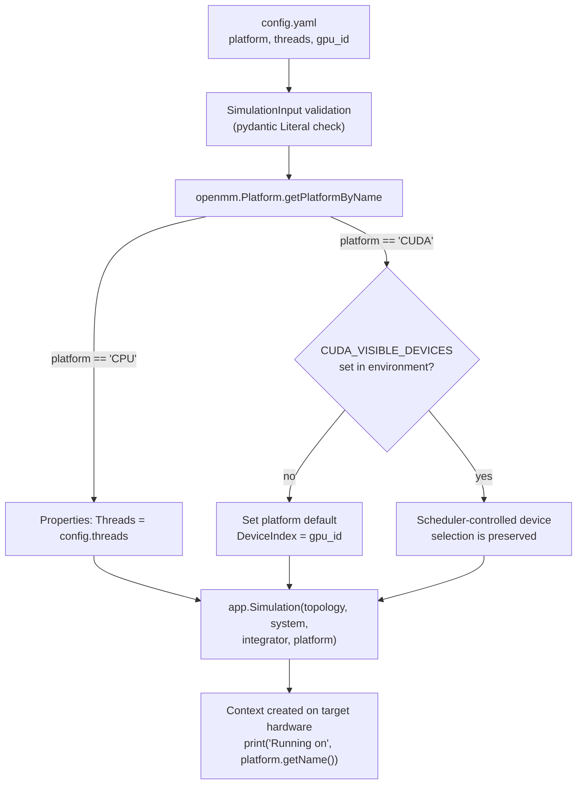
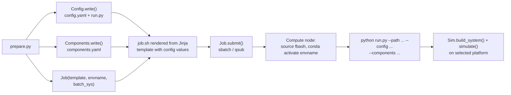

CALVADOS delegates all compute-heavy dynamics to OpenMM, so hardware behavior on this page is governed by three cooperating layers: a **validated runtime configuration** (`platform`, `threads`, `gpu_id`), a **platform-aware simulation launcher** that assembles OpenMM `Simulation` contexts, and a **cluster submission layer** that renders SLURM/PBS scripts from packaged Jinja templates. This page documents how execution hardware is selected, how throughput-relevant settings control I/O and checkpointing overhead, and how jobs are provisioned on HPC systems. It complements the engine internals covered in [Simulation Engine & Checkpointing](14-simulation-engine-and-checkpointing) and the validation rules in [Declarative Configuration & Validation](12-declarative-configuration-and-validation).

Sources: [sim.py](calvados/sim.py#L646-L688), [inputmodels.py](calvados/inputmodels.py#L146-L153), [cfg.py](calvados/cfg.py#L138-L183)

## Execution Architecture: From Config to Context

At runtime, `Sim.simulate()` never hard-codes hardware: it reads the `platform` string from the validated `SimulationInput` model, retrieves the matching OpenMM platform by name, and attaches platform-specific properties before creating the `Simulation` object. Because `SimulationInput` declares `platform` as a `Literal["CPU","CUDA"]`, any other backend name (e.g., `OpenCL` or `Reference`) fails validation at construction time rather than silently at launch — a deliberate design that keeps unsupported hardware combinations out of the execution path.

Sources: [sim.py](calvados/sim.py#L659-L687), [inputmodels.py](calvados/inputmodels.py#L148)

The decision flow is small and fully deterministic:



Sources: [sim.py](calvados/sim.py#L668-L687)

## Platform Selection: CPU vs CUDA

Both supported platforms share the same integrator setup — a `LangevinMiddleIntegrator` at the configured temperature, with friction `friction_coeff` per picosecond and a fixed 0.01 ps timestep — so switching hardware changes only where forces are evaluated, not the physics being integrated. The divergence between the two paths is confined to context properties and GPU addressing.

Sources: [sim.py](calvados/sim.py#L658-L666)

### CPU Platform & Thread Scaling

When `platform = "CPU"` (the default), CALVADOS passes `{"Threads": str(self.config.threads)}` as platform properties to the `Simulation` constructor. This maps the user-facing `threads` field (a positive integer, default 1) onto OpenMM's CPU platform thread pool, so parallelism is controlled per job rather than via environment variables. The same `Threads` property is re-applied every time the `Simulation` object is reconstructed (see equilibration hand-offs below), so thread count is consistent across the entire job lifetime.

Sources: [sim.py](calvados/sim.py#L670-L677), [sim.py](calvados/sim.py#L746-L753), [inputmodels.py](calvados/inputmodels.py#L149)

### CUDA Platform & GPU Indexing

For `platform = "CUDA"`, no properties dict is passed to the constructor. Instead, CALVADOS sets the platform's `DeviceIndex` default to `gpu_id` — but only when the `CUDA_VISIBLE_DEVICES` environment variable is unset. This ordering means cluster schedulers that expose GPUs via cgroup-masked `CUDA_VISIBLE_DEVICES` keep full control of device assignment, while `gpu_id` serves as the selection mechanism on shared workstations where multiple GPUs are visible. Exactly one device is targeted per simulation; there is no multi-GPU decomposition, so large systems scale by running independent jobs (e.g., replicas), not by partitioning one trajectory across GPUs.

> [!TIP]
> On SLURM clusters with GPU scheduling, `CUDA_VISIBLE_DEVICES` is almost always set by the scheduler — your `gpu_id` config value is then ignored by design. Reserve `gpu_id` for workstation use where several cards are visible and you want to pin a job to a specific one.

Sources: [sim.py](calvados/sim.py#L678-L686), [inputmodels.py](calvados/inputmodels.py#L173)

### Installation Prerequisites per Backend

The dependency contract differs by target hardware: GPU execution requires the CUDA-enabled OpenMM build (`openmm[cuda12]` in `pyproject.toml`, or `cudatoolkit` alongside `openmm=8.2.0` in the README's conda instructions), while CPU/OpenCL machines install OpenMM without the toolkit extra. The rest of the stack — `MDAnalysis`, `mdtraj`, `numba`, and friends — is hardware-agnostic and shared by both paths.

| Concern | CPU target | CUDA target |
|---|---|---|
| Config keys | `platform="CPU"`, `threads` | `platform="CUDA"`, `gpu_id` |
| OpenMM install (conda) | `openmm=8.2.0` (no cudatoolkit) | `openmm=8.2.0` + `cudatoolkit=11.8` |
| pip dependency spec | `openmm[cuda12]>=8.2,<8.5` | same package, CUDA runtime required |
| Device selection | `Threads` property | `DeviceIndex` unless env overrides |
| Context properties dict | passed | omitted |

Sources: [pyproject.toml](pyproject.toml#L23-L38), [README.md](README.md#L33-L40), [sim.py](calvados/sim.py#L670-L686)

## Throughput- and Overhead-Oriented Settings

Beyond platform choice, `SimulationInput` exposes a cluster of fields that determine how much wall-clock time is spent integrating versus writing data. These are the primary levers for tuning job throughput:

| Setting | Default | Effect on performance |
|---|---|---|
| `steps` / `runtime` | `steps=100_000_000` (if neither set) | Total work budget; `runtime` (hours) caps wall time instead |
| `wfreq` | 100000 | DCD frame write interval — high-frequency writes add I/O overhead |
| `logfreq` | 1000000 | `StateDataReporter` interval; logging is cheap but not free |
| `report_potential_energy` | `False` | Energy evaluation is opt-in to avoid per-frame cost |
| `friction_coeff` | 0.01 | Langevin friction (per ps); physics parameter, not a tunable "speed" knob |
| `random_number_seed` | `None` | Seeds the integrator for reproducible trajectories |
| `restart` / `frestart` | `"checkpoint"` / `"restart.chk"` | Enables resume-in-place without rebuilding the system |

Sources: [inputmodels.py](calvados/inputmodels.py#L146-L153), [inputmodels.py](calvados/inputmodels.py#L167-L177), [inputmodels.py](calvados/inputmodels.py#L181-L190)

Two design details are worth noting for throughput planning. First, the `StateDataReporter` is configured with `speed=True` and `elapsedTime=True`, so every job self-reports its ns/day-equivalent throughput and accumulated wall time into `<sysname>.log` — this is the built-in instrumentation for comparing hardware configurations. Second, the integrator's timestep is hard-coded at 0.01 ps (10 fs per step), so performance tuning is done exclusively through hardware selection, thread counts, I/O frequency, and parallel job fan-out — never through the integrator itself.

Sources: [sim.py](calvados/sim.py#L824-L842), [sim.py](calvados/sim.py#L659-L663)

## Long-Running Simulations: Runtime Budgeting and Checkpointing

CALVADOS offers two scheduling modes that map directly onto HPC wall-time policies. In **runtime mode** (`runtime` set, in hours), OpenMM's `runForClockTime` stops the job before the scheduler kills it, writing a checkpoint every 30 minutes. In **steps mode** (default), the total step count is divided by `_split_steps` into at most ten nonempty batches; after each batch, the simulation saves a checkpoint to `frestart`. The batch scheme gives intermediate safety points (useful for preemption or node failure recovery) and drives a `tqdm` progress bar without adding per-step Python overhead.

Sources: [sim.py](calvados/sim.py#L844-L857), [sim.py](calvados/sim.py#L24-L28)

Resume semantics are hardware-transparent: if `restart = "checkpoint"` and the checkpoint file exists, the existing `Context` state is loaded via `loadCheckpoint`, and the trajectory/log files are appended rather than rewritten. If no checkpoint exists, the job starts fresh: existing DCD output is backed up with a timestamp suffix, positions are loaded, and energy minimization runs before dynamics. This is what makes the batch templates' 24-hour walltime sustainable — jobs are designed to be resubmitted until the trajectory length target is met.

Sources: [sim.py](calvados/sim.py#L689-L715), [sim.py](calvados/sim.py#L707-L711)

An important architectural consequence lives in the equilibration hand-off. After slab equilibration (or pressure equilibration), CALVADOS removes the restraint/barostat forces and **reconstructs the entire `Simulation` object** — new integrator, same platform reference, re-applied `Threads` properties — because OpenMM contexts do not support force-list mutation in place. In slab equilibration, production additionally switches from `LangevinMiddleIntegrator` to `LangevinIntegrator`. The practical effect for performance is that each context rebuild pays a one-time kernel compilation cost on GPU; this is negligible for 24-hour jobs but relevant when running many short probes.

> [!TIP]
> When benchmarking hardware, note that a slab (`slab_eq`) or pressure (`box_eq`/`bilayer_eq`) job creates up to three contexts sequentially — equilibration, post-equilibration rebuild, production. Compare GPUs only between identical pipeline configurations, or the context-compilation overhead will skew short benchmarks.

Sources: [sim.py](calvados/sim.py#L717-L763), [sim.py](calvados/sim.py#L765-L821), [sim.py](calvados/sim.py#L739-L743)

## HPC Batch Submission Layer

The `Job` class in `calvados/cfg.py` bridges the local preparation workflow and cluster hardware. It validates settings through `JobInput` — which selects a packaged Jinja `template` (default `robust.jinja`), a `fbash` profile to source, a conda `envname`, and a `batch_sys` of either `SLURM` or `PBS` — then renders the template with the full `Config` dump merged in. Because the rendered script inherits every simulation key (including `platform` and `threads`), the resource request in the batch header and the runtime platform choice can never drift apart: requesting a GPU partition while running on `CPU` requires deliberate template logic, and indeed the templates branch on `platform == 'CUDA'`.

Sources: [cfg.py](calvados/cfg.py#L138-L183), [inputmodels.py](calvados/inputmodels.py#L254-L267)

`Job.write` produces `job.sh` in the system directory; `Job.submit` dispatches it via `sbatch` or `qsub` with a 0.5 s spacing between submissions, and enforces that PBS receives only single jobs (`njobs > 1` raises). The template's payload is intentionally thin: it activates the conda environment and executes the `run.py` driver that `Config.write` generated — the same script a user would run interactively — so local and cluster execution paths share identical code.

Sources: [cfg.py](calvados/cfg.py#L153-L183), [cfg.py](calvados/cfg.py#L63-L84)

The full submission pipeline:



Sources: [cfg.py](calvados/cfg.py#L146-L183), [sim.py](calvados/sim.py#L871-L886)

## Cluster Template Comparison

Three templates ship inside the package (`calvados/data/templates/`, included as package data) and encode site-specific hardware provisioning. Their resource requests differ notably in how they treat the CUDA branch:

| Aspect | `robust.jinja` | `computerome.jinja` | `deic.jinja` |
|---|---|---|---|
| Batch system | SLURM | PBS | SLURM |
| Partition / queue | `qgpu` | `thinnode` (CPU) via `nodes=1:ppn=...:thinnode` | `sbinlab_ib2` |
| CUDA branch | `--gres=gpu:1` + `--cpus-per-task=18` | `nodes=1:ppn=20:gpus=1` | none — CPU-only |
| CPU branch | `--cpus-per-task={{threads}}` | `ppn={{threads}}` | `--cpus-per-task={{threads}}` |
| Memory request | 8888 MB per CPU | 80 GB total | 10 GB per CPU |
| Walltime | 24 h | 24 h | 24 h |
| Extras | `--dependency=singleton` | mails disabled (`-m n`) | `--dependency=singleton` |

The GPU-branch CPU allocations are meaningful: a CUDA job on `robust.jinja` reserves 18 CPU cores even though OpenMM's GPU kernel does the force evaluation, reflecting the CPU work in trajectory integration glue, DCD writing, and checkpointing that accompanies every GPU run. The `--dependency=singleton` flag on the SLURM templates additionally prevents duplicate simultaneous resubmissions of the same job name — a safety companion to the checkpoint-resume logic described above.

Sources: [calvados/data/templates/robust.jinja](calvados/data/templates/robust.jinja#L1-L27), [calvados/data/templates/computerome.jinja](calvados/data/templates/computerome.jinja#L1-L22), [calvados/data/templates/deic.jinja](calvados/data/templates/deic.jinja#L1-L21), [pyproject.toml](pyproject.toml#L55-L60)

## End-to-End Performance Workflow in the Examples

The example gallery demonstrates both configuration styles. `single_IDR/prepare.py` sets `platform = 'CPU'` with an inline comment advertising `'CUDA'` as the alternative, while `slab_IDR/prepare.py` accepts `--gpu_id` on the command line and threads it into the config — the canonical pattern for replica fan-out on multi-GPU nodes, where each replica gets a distinct device index.

```python
# examples/single_IDR/prepare.py — workstation/CPU default
platform = 'CPU', # or CUDA

# examples/slab_IDR/prepare.py — per-replica GPU pinning
gpu_id = args.gpu_id,
platform = 'CPU', # 'CUDA'
```

Sources: [examples/single_IDR/prepare.py](examples/single_IDR/prepare.py#L36-L39), [examples/slab_IDR/prepare.py](examples/slab_IDR/prepare.py#L33-L36)

A practical hardware selection recipe for intermediate developers:

| Scenario | Config | Template |
|---|---|---|
| Laptop/workstation exploration | `platform="CPU"`, `threads=N` (cores) | none — run `run.py` directly |
| Single shared GPU node | `platform="CUDA"`, `gpu_id=<free card>` | `robust.jinja` (or local launch) |
| Scheduler-managed GPUs (replicas) | `platform="CUDA"`, `gpu_id` value irrelevant | `robust.jinja` + `--replica` fan-out |
| CPU-only cluster partition | `platform="CPU"`, `threads=ppn` | `computerome.jinja` or `deic.jinja` |

For testing hardware setups without committing to long trajectories, the repository's own validation harness runs two-amino-acid simulations and reconciles trajectory-derived potential energies against OpenMM's log output — a fast smoke test that any new platform/driver combination should pass before production use; see [Testing & Energy Validation](19-testing-and-energy-validation). For deeper treatment of what executes inside the context — integrators, checkpoint internals, and the equilibration state machine — continue to [Simulation Engine & Checkpointing](14-simulation-engine-and-checkpointing), and for the full validation contract behind every field on this page, see [Declarative Configuration & Validation](12-declarative-configuration-and-validation).
