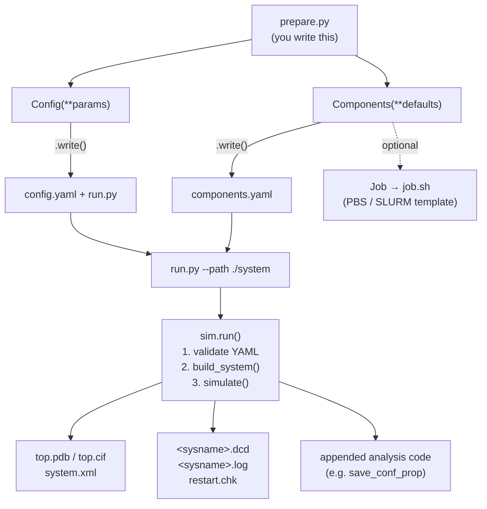
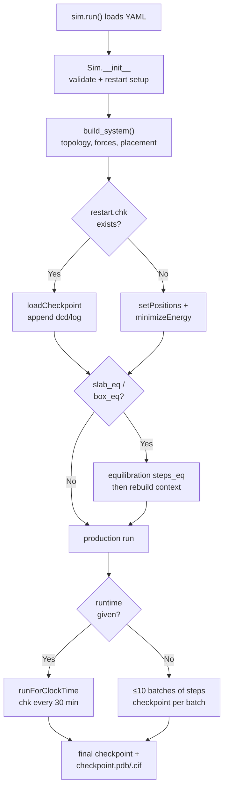

This primer walks you through the complete lifecycle of a CALVADOS simulation: from writing a small Python *preparation script*, to the generated YAML inputs, to the OpenMM engine that builds and integrates the system, and finally to the trajectory files you analyze. CALVADOS is a coarse-grained platform for biomolecular simulations (intrinsically disordered regions, condensates, membranes, RNA), and every example in the repository follows the same three-act structure — **declare, execute, analyze**. By the end of this page you will understand what each file in a simulation directory is, who creates it, and when it is used.

## The Workflow at a Glance

Every simulation directory in CALVADOS is produced by the same pipeline. You write one script (typically named `prepare.py`), which instantiates two validated configuration objects, `Config` and `Components`. Calling their `.write()` methods produces `config.yaml`, `components.yaml`, and a ready-to-run `run.py`. Launching `run.py` invokes `sim.run()`, which validates the YAML, constructs the OpenMM system, and executes the trajectory while writing checkpoints and a DCD trajectory. Analysis code is optionally appended to `run.py` itself, so post-processing happens automatically after production ends.



Sources: [prepare.py](examples/single_IDR/prepare.py#L26-L73), [cfg.py](calvados/cfg.py#L37-L84), [sim.py](calvados/sim.py#L871-L886)

This design separates **what** you simulate (declarative YAML) from **how** it runs (the engine). The preparation script never touches OpenMM directly; it only produces validated input files. This means the same `run.py` can be rerun, resumed, or submitted to a cluster without touching a single line of engine code.

Sources: [cfg.py](calvados/cfg.py#L63-L84), [inputmodels.py](calvados/inputmodels.py#L122-L131)

## Project Structure: Who Does What

The `calvados` package maps cleanly onto workflow stages. As a beginner, you only need to understand three of these modules directly — `cfg`, `sim`, and `analysis` — but knowing the full layout helps you navigate the Deep Dive pages later.

```
calvados/
├── cfg.py           ← Stage 1: Config / Components / Job (declarative inputs)
├── inputmodels.py   ← Pydantic schemas: validation + defaults
├── components.py    ← Molecule classes + COMPONENT_REGISTRY
├── sequence.py      ← FASTA parsing, charge assignment
├── build.py         ← Box grids, random placement, geometry helpers
├── interactions.py  ← Ashbaugh-Hatch, Debye-Hückel, restraints forces
├── sim.py           ← Stage 2: Sim class (build_system + simulate) + run()
├── analysis.py      ← Stage 3: trajectory measurements
├── utilities.py     ← misc helpers
└── BLOCKING/        ← blocking (statistical) error estimation
```

Sources: [sim.py](calvados/sim.py#L15-L20), [cfg.py](calvados/cfg.py#L10)

## Stage 1 — Declare the Simulation with `Config`

`Config` is a thin wrapper around the `SimulationInput` Pydantic model. You pass keyword arguments (box size, temperature, ionic strength, runtime settings); they are validated immediately — unknown or misspelled keys fail at *preparation time*, not hours into a run — and serialized into a YAML-compatible dictionary. In the canonical `single_IDR` example, the configuration specifies a 50 nm cubic box, 293.15 K, 0.19 M salt, and runtime settings such as `wfreq` (trajectory write interval) and `platform` (`CPU` or `CUDA`).

Sources: [cfg.py](calvados/cfg.py#L37-L48), [inputmodels.py](calvados/inputmodels.py#L122-L153), [prepare.py](examples/single_IDR/prepare.py#L26-L42)

The most important keys for a first simulation are summarized below. Note that a duration must be given as *either* `steps` or `runtime` (hours) — supplying both raises a validation error. One step corresponds to the 10 fs integrator timestep, so the example's `N_frames * N_save = 7,070,000` steps equals roughly 70.7 ns of simulated time.

| Key | Type / Default | Meaning |
|---|---|---|
| `box` | 3 floats (required) | Box side lengths in nm |
| `temp`, `ionic`, `pH` | floats (required) | Thermodynamic + salt conditions |
| `topol` | `center` (default) | Molecule placement scheme: `single`, `slab`, `grid`, `center`, `shift_ref_bead`, `random` |
| `steps` / `runtime` | exactly one | Simulation length in steps or wall-clock hours |
| `wfreq` | 100000 | Steps between DCD trajectory frames |
| `platform` | `CPU` | `CPU` (with `threads`) or `CUDA` (with `gpu_id`) |
| `restart` / `frestart` | `checkpoint` / `restart.chk` | Resume mode and checkpoint file |
| `eps_lj`, `cutoff_lj`, `cutoff_yu` | 0.2 / 2.0 / 4.0 nm | Nonbonded interaction settings |
| `slab_eq`, `box_eq`, `bilayer_eq` | `False` | Equilibration protocol switches |

Sources: [inputmodels.py](calvados/inputmodels.py#L133-L180), [inputmodels.py](calvados/inputmodels.py#L181-L190), [prepare.py](examples/single_IDR/prepare.py#L18-L19), [sim.py](calvados/sim.py#L659-L663)

## Stage 2 — Declare the Molecules with `Components`

`Components` collects the molecular inventory. Shared defaults are set in the constructor, then each species is registered with `.add(name, **overrides)`, where every entry is validated against `ComponentInput`. At minimum a component needs a residue-parameter file (`fresidues`, e.g. `residues_CALVADOS2.csv`) and a sequence source (`ffasta`) — unless it uses structure-based restraints, in which case a `pdb_folder` is required instead.

Sources: [cfg.py](calvados/cfg.py#L95-L124), [inputmodels.py](calvados/inputmodels.py#L39-L76), [prepare.py](examples/single_IDR/prepare.py#L58-L72)

The `molecule_type` field selects the component class from `COMPONENT_REGISTRY` during system construction, which in turn determines the bead model, bonded terms, and interactions applied. The validator also enforces physics-driven constraints — for example, RNA may only use harmonic restraints, and lipids/crowders can never be restrained.

| `molecule_type` | Used for |
|---|---|
| `protein` | Standard single-bead-per-residue IDRs/proteins |
| `rna` | Two-bead-per-nucleotide RNA (P + N beads) |
| `lipid` / `cooke_lipid` | Membrane bilayers (mutually exclusive) |
| `crowder` | Inert volume excluders |
| `cyclic`, `seastar`, `ptm_protein` | Specialized topologies / modified proteins |

Sources: [inputmodels.py](calvados/inputmodels.py#L17-L26), [sim.py](calvados/sim.py#L84-L108), [inputmodels.py](calvados/inputmodels.py#L110-L117)

## Stage 3 — Write the Artifacts

Calling `config.write(path)` does two things: dumps the validated dictionary to `config.yaml` (preserving your key order), and generates the `run.py` launcher — a small argparse script that forwards `--path`, `--config`, and `--components` to `sim.run()`. This is also where the *analysis hook* lives: any code string you pass as `analyses` is appended verbatim to `run.py`, so functions like `save_conf_prop` execute automatically after the trajectory finishes. `components.write(path)` analogously produces `components.yaml` with a `defaults` block plus a per-component `system` block containing only explicit overrides. For cluster users, the optional `Job` class renders packaged Jinja2 templates (PBS or SLURM) into a `job.sh` that embeds your config values and can be submitted with `.submit()`.

Sources: [cfg.py](calvados/cfg.py#L50-L84), [prepare.py](examples/single_IDR/prepare.py#L49-L56), [cfg.py](calvados/cfg.py#L126-L134), [cfg.py](calvados/cfg.py#L138-L183)

## Stage 4 — Execute: Inside `sim.run()`

The generated `run.py` calls a single function. `sim.run()` loads both YAML files, constructs a `Sim` object, and drives two phases in sequence: `build_system()` and `simulate()`. The `Sim.__init__` constructor already does meaningful work — it re-validates the inputs via `validate_inputs`, converts `eps_lj` from kcal to kJ/mol, and checks restart-file existence, disabling equilibration phases automatically when a checkpoint resume is detected.

Sources: [sim.py](calvados/sim.py#L871-L886), [sim.py](calvados/sim.py#L41-L72)

`build_system()` is the deterministic assembly phase. It creates an MDTraj topology and an OpenMM `System` with periodic box vectors, computes Debye-Hückel parameters from temperature and ionic strength, instantiates components from the registry (calculating charges, sigmas, and lambdas per residue), and initializes the two global nonbonded forces — Ashbaugh-Hatch (`ah`) and Debye-Hückel (`yu`). Then, molecule by molecule, it places coordinates according to the `topol` scheme (e.g. `'center'` puts the molecule at the box midpoint), registers particles into each force object, adds bonds/angles/restraints with nonbonded exclusions, and finally attaches all forces to the system — including optional barostats — and serializes the result to `<sysname>.xml`. The initial structure is saved as `top.pdb` and `top.cif`.

Sources: [sim.py](calvados/sim.py#L157-L208), [sim.py](calvados/sim.py#L265-L303), [sim.py](calvados/sim.py#L412-L414), [sim.py](calvados/sim.py#L306-L353), [sim.py](calvados/sim.py#L368-L393)

`simulate()` is the dynamics phase. It selects the restart source (checkpoint by default, or a PDB/mmCIF you provide), creates a `LangevinMiddleIntegrator` at your temperature with friction coefficient `friction_coeff` and a 0.01 ps (10 fs) timestep, and assembles the OpenMM `Simulation` on the chosen platform. If `restart.chk` exists, the state is loaded and the existing trajectory/log are appended; otherwise positions are set and energy is minimized. Optional staged equilibrations then run: slab equilibration pulls molecules toward the box plane with a harmonic external force that is *removed afterward* (requiring a fresh context), and pressure equilibration scales the box with a barostat. Production then starts with a `DCDReporter` (every `wfreq` steps) and a `StateDataReporter` log.

Sources: [sim.py](calvados/sim.py#L646-L687), [sim.py](calvados/sim.py#L689-L715), [sim.py](calvados/sim.py#L717-L763), [sim.py](calvados/sim.py#L765-L842)



Sources: [sim.py](calvados/sim.py#L646-L857)

## Stage 5 — Outputs, Checkpointing, and Resume

A completed run leaves a self-describing directory. Understanding these files is essential because *resume behavior is file-driven*: with the default `restart='checkpoint'`, re-executing `run.py` after an interruption loads `restart.chk` and appends to the existing trajectory; with `restart='pdb'` or `'cif'`, you point `frestart` at a structure to start fresh coordinates from. When starting non-checkpoint runs, any pre-existing DCD is timestamped and backed up rather than overwritten.

| File | Producer | Purpose |
|---|---|---|
| `config.yaml` / `components.yaml` | `Config`/`Components.write()` | Validated declarative inputs |
| `run.py` | `Config.write()` | Launcher + appended analysis code |
| `top.pdb` / `top.cif` | `build_system()` | Initial coarse-grained structure |
| `<sysname>.xml` | `print_system_summary()` | Full serialized OpenMM system |
| `<sysname>.dcd` | `DCDReporter` | Trajectory, one frame per `wfreq` steps |
| `<sysname>.log` | `StateDataReporter` | Step/speed/energy records |
| `restart.chk` | `simulate()` | OpenMM checkpoint for seamless resume |
| `checkpoint.pdb/.cif` | end of run | Final coordinates snapshot |

Sources: [sim.py](calvados/sim.py#L295-L304), [sim.py](calvados/sim.py#L368-L373), [sim.py](calvados/sim.py#L823-L842), [sim.py](calvados/sim.py#L689-L698), [sim.py](calvados/sim.py#L707-L712), [sim.py](calvados/sim.py#L859-L869)

> [!TIP]
> Checkpointing granularity differs by duration mode: with `steps`, progress is checkpointed after each of at most 10 batches (`_split_steps`), but with `runtime`, OpenMM writes the checkpoint every 30 wall-clock minutes via `runForClockTime` — the latter is the right choice for queue systems with wall-clock limits.

Sources: [sim.py](calvados/sim.py#L24-L28), [sim.py](calvados/sim.py#L845-L857)

## The Analysis Hook

Because analysis code is appended to `run.py`, the typical pattern is: import an analysis function at the top of the appended block, then call it with the simulation `path`, system `name`, and the residues file. In the `single_IDR` example, `save_conf_prop` is invoked with `start=10` (skip early frames) and `is_idr=True`. The analysis stack — including slab phase-separation diagnostics and blocking error estimation (`calvados/BLOCKING`) — is covered in depth on its own pages.

Sources: [prepare.py](examples/single_IDR/prepare.py#L49-L56), [analysis.py](calvados/analysis.py#L21-L23)

## Where to Go Next

You now understand the full declare → execute → analyze loop. Recommended progression from here:

- Run one yourself end-to-end: [Quick Start](2-quick-start), then browse ready-made scenarios in [Example Gallery](4-example-gallery)
- Understand what the engine builds under the hood: [Architecture Overview](5-architecture-overview)
- Go deeper into the physics you just saw registered as `ah`/`yu` forces: [Ashbaugh-Hatch Hydrophobic Interactions](6-ashbaugh-hatch-hydrophobic-interactions) and [Debye-Hückel Electrostatics](7-debye-huckel-electrostatics)
- Master the declarative layer: [Declarative Configuration & Validation](12-declarative-configuration-and-validation) and [Simulation Engine & Checkpointing](14-simulation-engine-and-checkpointing)