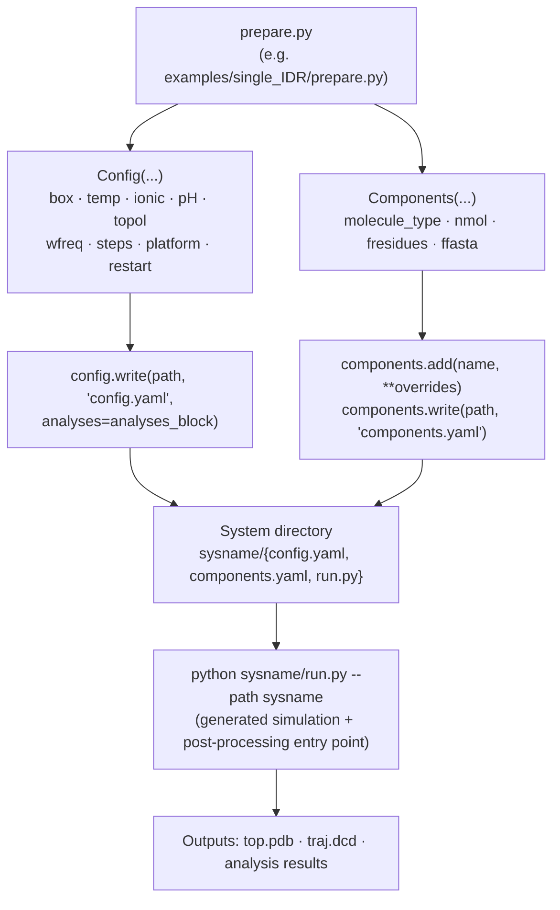
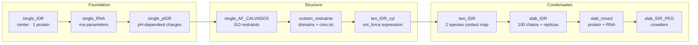

The `examples/` directory is CALVADOS' living documentation: 16 self-contained scenarios that demonstrate every supported simulation style, from a single intrinsically disordered region (IDR) in a cubic box to 200-chain protein–RNA coexistence slabs. Each example follows the same skeleton — a `prepare.py` script that emits declarative YAML, plus the model input files it references — so once you can read one example, you can read them all. This page catalogs the gallery, decodes the recurring patterns, and charts a learning path from the simplest scenario to the most advanced.

Sources: [examples/single_IDR/prepare.py](examples/single_IDR/prepare.py#L1-L73), [examples/slab_mixed/prepare.py](examples/slab_mixed/prepare.py#L1-L92)

## Gallery at a Glance

Every example directory contains a `prepare.py` that you run first, followed by a generated `run.py` inside the newly created system directory (more on this two-step pattern below). The gallery divides cleanly along two axes: **simulation geometry** (how chains are arranged in the periodic box) and **molecular composition** (what is being simulated). The table below maps all 16 examples to those axes so you can jump straight to the scenario closest to your science.

| Example | Geometry (`topol`) | Molecules | Key Technique Demonstrated |
|---|---|---|---|
| `single_IDR` | `center` | 1 protein | Canonical minimal setup |
| `single_IDR_box_eq` | `center` | 1 protein | MC barostat box equilibration |
| `single_pIDR` | `center` | 1 phospho-protein | pH-dependent phosphorylated-residue charges |
| `single_AF_CALVADOS` | `center` | 1 protein | AlphaFold structure-based GO restraints |
| `single_MDP` | `center` | 1 folded + MDP | MEGABASE folded-domain force field (CALVADOS3) |
| `custom_restraints` | `center` | 1 multi-domain protein | Custom harmonic restraints file + AF restraints |
| `single_RNA` | `center` | 1 RNA | RNA bond/angle/nonbonded parameters |
| `single_dsRNA` | `single` | 1 RNA duplex | Restrained double-stranded RNA |
| `two_IDR` | `random` | 2 proteins | Multi-component contact analysis |
| `two_IDR_MDP` | `random` | 2 folded proteins | CALVADOS3 with domain restraints |
| `ten_IDR_cyl` | `grid` | 10 proteins | Custom external force (cylinder confinement) |
| `slab_IDR` | `slab` | 100 copies, 1 protein | Direct-coexistence phase separation |
| `slab_IDR_MDP` | `slab` | 100 + 100 chains | Per-component restraint overrides |
| `slab_IDR_PEG` | `slab` | 100 proteins + PEG crowders | Crowder count from w/v fraction |
| `slab_MDP` | `slab` | 100 folded chains | Slab of structured domains (CALVADOS3) |
| `slab_mixed` | `slab` | 200 proteins + 60 RNAs | Mixed protein–RNA condensate |

Sources: [examples/slab_IDR/prepare.py](examples/slab_IDR/prepare.py#L26-L31), [examples/ten_IDR_cyl/prepare.py](examples/ten_IDR_cyl/prepare.py#L28-L30), [examples/single_RNA/prepare.py](examples/single_RNA/prepare.py#L46-L66), [examples/slab_IDR_PEG/prepare.py](examples/slab_IDR_PEG/prepare.py#L95-L96)

## Anatomy of an Example

All `prepare.py` scripts share one five-beat rhythm. The canonical example is `single_IDR`, and studying it first pays off across the entire gallery: (1) parse a system name from the command line, (2) choose box size and sampling constants, (3) build a `Config` object holding general physics and runtime settings, (4) build a `Components` object listing every molecular species and its copy number, and (5) write both to YAML inside the new system directory. An `analyses` block — a raw Python snippet stored inside `config.yaml` — is optionally attached so post-processing runs automatically after simulation.



The two-step execution contract is documented in each example's `README.md`. For a single-chain system:

```bash
python prepare.py --name <protein name>
python <protein name>/run.py --path <protein name>
```

Slab examples extend this with replica and GPU arguments — `prepare.py --name <protein> --replica <replica> --gpu_id <gpu_id>` — and the system directory name then incorporates the replica number (`f'{args.name}_{args.replica}'`), enabling statistically independent replicas for sampling-error estimation. Note that `prepare.py` itself never runs dynamics; it is purely a *configuration generator*, which keeps the gallery's scripts short, diffable, and safe to edit.

Sources: [examples/single_IDR/prepare.py](examples/single_IDR/prepare.py#L11-L73), [examples/single_IDR/README.md](examples/single_IDR/README.md#L1-L9), [examples/slab_IDR/README.md](examples/slab_IDR/README.md#L1-L9)

> [!TIP]
> The `analyses` block is written as a literal Python string into `config.yaml` and executed after the trajectory completes. This means you can freely edit post-processing (e.g., change `start=10` to skip equilibration frames) *without re-preparing or re-running the simulation* — a deliberate separation of physics from analysis.

## Geometry Configurations

The `topol` parameter in `Config` selects the chain-placement strategy and, with it, the box shape. The gallery exercises five topologies, each suited to a different physical question:

| `topol` Value | Box Shape (example) | Chains | Purpose | Reference Example |
|---|---|---|---|---|
| `center` | Cubic, e.g. 50×50×50 nm | 1 | Single-chain ensemble properties (Rg, internal contacts) | `single_IDR` |
| `random` | Cubic, e.g. 20×20×20 nm | 2+ | Inter-chain contact maps between distinct species | `two_IDR` |
| `slab` | Elongated, e.g. 15×15×150 nm | 100+ | Direct-coexistence phase separation; dense slab forms against dilute phase | `slab_IDR` |
| `grid` | Cubic, 20×20×20 nm | 10 | Regular initial lattice with optional external confinement | `ten_IDR_cyl` |
| `single` | Cubic, 100×100×100 nm | 1 (duplex) | Restrained folded assemblies (dsRNA) | `single_dsRNA` |

Two slab-specific refinements appear in the gallery. `slab_eq = True` with `steps_eq` triggers an initial equilibration phase that compresses chains into the dense slab before production sampling, as configured in `slab_IDR` with `steps_eq = 100*N_save`. For studies where the condensate itself should stay at fixed composition, `slab_IDR_PEG` adds `fixed_lambda` and `slab_outer` parameters to control the interaction scaling and slab boundary treatment around crowder molecules.

Sources: [examples/slab_IDR/prepare.py](examples/slab_IDR/prepare.py#L26-L49), [examples/two_IDR/prepare.py](examples/two_IDR/prepare.py#L29-L34), [examples/ten_IDR_cyl/prepare.py](examples/ten_IDR_cyl/prepare.py#L25-L31), [examples/single_dsRNA/prepare.py](examples/single_dsRNA/prepare.py#L28-L32), [examples/slab_IDR_PEG/prepare.py](examples/slab_IDR_PEG/prepare.py#L36-L39)

## Molecular Species and Force Field Files

Every `Components` object declares a `molecule_type` (default `'protein'`) and points to a **residues file** — a CSV defining each coarse-grained bead's mass, charge, and interaction parameters. The gallery ships five residue files, and choosing the right one is inseparable from choosing the model:

| Residues File | Species / Model | Used By |
|---|---|---|
| `residues_CALVADOS2.csv` | IDRs, CALVADOS 2 model | `single_IDR`, `two_IDR`, `slab_IDR`, `ten_IDR_cyl`, `single_IDR_box_eq` |
| `residues_CALVADOS3.csv` | Folded domains (MEGABASE-style), CALVADOS 3 | `single_MDP`, `slab_MDP`, `slab_IDR_MDP`, `two_IDR_MDP`, `custom_restraints` |
| `residues_pCALVADOS2.csv` | Phosphorylated residues (SEP, TPO) | `single_pIDR` |
| `residues_C2RNA.csv` | RNA nucleotides | `single_RNA`, `single_dsRNA`, `slab_mixed` |
| `residues_C2PEG.csv` | PEG crowder beads | `slab_IDR_PEG` |

RNA systems activate an additional parameter family directly on `Components` — bond constants (`rna_kb1`, `rna_kb2`), an angle constant (`rna_ka`), a dihedral parameter (`rna_pa`), and nonbonded scaling (`rna_nb_sigma`, `rna_nb_scale`, `rna_nb_cutoff`) — as shown in `single_RNA`. PEG crowders are declared as `molecule_type='crowder'` with `charge_termini='none'` and `ext_restraint=False`, and `slab_IDR_PEG` goes further: a helper function converts a weight/volume PEG concentration into an exact chain count using Avogadro's number and the box volume, so the experimental concentration is reproduced analytically rather than guessed.

The phosphorylation example demonstrates the most sophisticated preparation pattern in the gallery: `single_pIDR` accepts `--pH` on the command line, then *rewrites the residues file in place*, adjusting SEP and TPO charges via Henderson–Hasselbalch-type fractions using `pKa_dict = dict(SEP=6.01, TPO=6.3)`. The input pH flows into both the modified charges and the `Config`'s `pH` field, keeping protonation state and electrostatics consistent.

Sources: [examples/single_RNA/prepare.py](examples/single_RNA/prepare.py#L44-L66), [examples/slab_IDR_PEG/prepare.py](examples/slab_IDR_PEG/prepare.py#L11-L17), [examples/slab_IDR_PEG/prepare.py](examples/slab_IDR_PEG/prepare.py#L95-L96), [examples/single_pIDR/prepare.py](examples/single_pIDR/prepare.py#L10-L27)

## Restraint, Equilibration, and External-Force Techniques

Beyond plain diffusion, the gallery demonstrates four techniques for keeping folded or structured elements intact — and crucially, restraints are controlled at two levels: global defaults on `Components` and per-molecule overrides in `components.add()`. This two-level scheme is what lets `slab_IDR_MDP` simulate an IDR (no elastic network) alongside a folded MDP domain (elastic network) in one slab.

| Technique | Where Configured | Key Parameters | Reference |
|---|---|---|---|
| AlphaFold GO restraints | `Components` | `restraint=True`, `pdb_folder`, `restraint_type='go'`, `k_go=15.`, `colabfold` (0 = EBI AFDB, 1–2 = ColabFold PAE format) | `single_AF_CALVADOS` |
| Harmonic AF restraints | `Components` (+ `fdomains`) | `restraint_type='harmonic'`, `k_harmonic=700.`, `use_com=True`, `fdomains=input/domains.yaml` | `custom_restraints`, `slab_MDP` |
| Custom restraint file | `Config` | `custom_restraints=True`, `custom_restraint_type='harmonic'`, `fcustom_restraints=input/cres.txt` | `custom_restraints` |
| External confinement force | `Config` + per-component flag | `ext_force=True`, `ext_force_expr` (OpenMM expression string) | `ten_IDR_cyl` |
| Per-component overrides | `components.add(...)` | e.g. `add(name_1, restraint=False)` vs `add(name_2, ext_restraint=False)` | `slab_IDR_MDP`, `single_dsRNA` |

The external-force example is the gallery's gateway to arbitrary user forces: `ten_IDR_cyl` confines ten chains to a cylinder of radius 3 nm with a single expression — `ext_force_expr = 'step(d-3)*0.5*(d-3)^2; d=periodicdistance(x, y, z, L/2, L/2, z)'` — applied only to components added with `ext_restraint=True`. On the equilibration side, two mechanisms coexist: slab systems use `slab_eq` (chains collapse into the dense phase before production), while `single_IDR_box_eq` demonstrates the MC barostat (`box_eq=True`, `pressure=[0.1, 0, 0]`, `boxscaling_xyz=[False, False, True]`) that scales only the z box dimension toward a target pressure, useful for studying single-chain osmotic properties. Finally, `custom_restraints` shows the optional batch route via a commented-out `Job(envname='calvados-public')` block — the third configuration object in the framework, used for submitting prepared jobs rather than running them locally.

Sources: [examples/single_AF_CALVADOS/prepare.py](examples/single_AF_CALVADOS/prepare.py#L53-L63), [examples/custom_restraints/prepare.py](examples/custom_restraints/prepare.py#L37-L39), [examples/custom_restraints/prepare.py](examples/custom_restraints/prepare.py#L84-L86), [examples/ten_IDR_cyl/prepare.py](examples/ten_IDR_cyl/prepare.py#L29-L30), [examples/ten_IDR_cyl/prepare.py](examples/ten_IDR_cyl/prepare.py#L59-L65), [examples/slab_IDR_MDP/prepare.py](examples/slab_IDR_MDP/prepare.py#L95-L96), [examples/single_IDR_box_eq/prepare.py](examples/single_IDR_box_eq/prepare.py#L25-L29)

> [!TIP]
> When reading any example, compare the `Components(...)` constructor (global defaults) against each `components.add(...)` call (per-molecule overrides). This diff tells you instantly which molecules deviate from the default force-field treatment — the entire physical narrative of mixed systems like `slab_IDR_MDP` is encoded in two `add()` lines.

## Built-In Post-Processing and Analysis Notebooks

Because the `analyses` block travels inside `config.yaml`, every example ships with its post-processing recipe attached. Single-chain examples embed lightweight functions — `save_conf_prop` for conformational property distributions in `single_IDR` and `single_pIDR`, and `save_rg` for radius-of-gyration time series in `single_IDR_box_eq`. Multi-chain examples layer on `calc_com_traj` (center-of-mass distances between species, keyed by a `chainid_dict`) and `calc_contact_map` (inter-chain contact matrices).

Slab examples use the full `SlabAnalysis` object pipeline: `center()` recenters the trajectory on the dense phase (either `center_target='all'` or, in mixed systems, only on a chosen reference species like `ref_name='A1'`), then `calc_profiles()` and `calc_concentrations()` compute density profiles and phase concentrations, and `plot_density_profiles()` renders them. Multi-species slabs identify each species by chain ranges — for example `slab_mixed` assigns proteins to `ref_chains=(0, 199)` and the 60 RNA chains to `client_chain_list=[(200, 259)]` — and `slab_IDR` documents why replicas matter: the README explicitly recommends independent replicas to estimate sampling error on phase properties. Two examples (`slab_IDR`, `slab_mixed`) additionally include an `example_slab_analysis.ipynb` notebook for interactive exploration of the outputs, making them the natural bridge from batch examples to hands-on analysis.

Sources: [examples/slab_IDR/prepare.py](examples/slab_IDR/prepare.py#L53-L66), [examples/slab_IDR_MDP/prepare.py](examples/slab_IDR_MDP/prepare.py#L45-L69), [examples/slab_mixed/prepare.py](examples/slab_mixed/prepare.py#L40-L53), [examples/slab_IDR/README.md](examples/slab_IDR/README.md#L1-L9), [examples/slab_IDR/example_slab_analysis.ipynb](examples/slab_IDR/example_slab_analysis.ipynb)

## Suggested Learning Path Through the Gallery

The gallery is intentionally ordered for cumulative learning, and it pairs naturally with the documentation catalog. A beginner-friendly progression:

1. **Read `single_IDR` first** — it is the minimal template every other example extends, and pair it with the conceptual grounding in [Simulation Workflow Primer](3-simulation-workflow-primer) and the hands-on steps in [Quick Start](2-quick-start).
2. **Add chemistry variation with `single_pIDR` and `single_RNA`** — these show how residue files and molecule types parameterize the force field; the underlying parameter database is detailed in [Residue Parameter Database](8-residue-parameter-database).
3. **Add structure with `single_AF_CALVADOS` and `custom_restraints`** — restraint mechanics and AlphaFold guidance are explained in [Structure-Based Restraints & AlphaFold Guidance](11-structure-based-restraints-and-alphafold-guidance), and the `ext_force_expr` technique connects to [Extension & Custom Forces](18-extension-and-custom-forces).
4. **Scale up with `two_IDR` → `ten_IDR_cyl` → `slab_IDR`** — this sequence teaches multi-component bookkeeping (chain indices, per-species overrides) before committing to 100+ chain slab simulations.
5. **Analyze with the notebooks** — run the `example_slab_analysis.ipynb` in `slab_IDR` or `slab_mixed`, then continue to [Slab Phase-Separation Analysis](16-slab-phase-separation-analysis) for the physics behind density profiles and phase concentrations, and [Blocking Error Estimation](17-blocking-error-estimation) for quantifying sampling uncertainty.



Sources: [examples/single_IDR/README.md](examples/single_IDR/README.md#L1-L9), [examples/slab_IDR/example_slab_analysis.ipynb](examples/slab_IDR/example_slab_analysis.ipynb), [examples/slab_mixed/example_slab_analysis.ipynb](examples/slab_mixed/example_slab_analysis.ipynb)

## Where to Go Next

The gallery gives you working configurations; the Deep Dive section explains why they work. After running `single_IDR` end-to-end, trace where `Config` and `Components` values are validated and consumed in [Declarative Configuration & Validation](12-declarative-configuration-and-validation) and [Component Registry & Molecule Types](9-component-registry-and-molecule-types); then understand the physics those parameters drive in [Ashbaugh-Hatch Hydrophobic Interactions](6-ashbaugh-hatch-hydrophobic-interactions) and [Debye-Hückel Electrostatics](7-debye-huckel-electrostatics). When you are ready to write your own example, start by copying `single_IDR`, change one dimension at a time (box → species → topol → restraints), and let the gallery's per-example diffing discipline keep your configuration honest.
