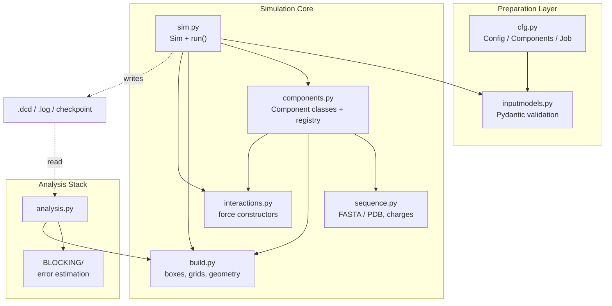

CALVADOS is a Python package for coarse-grained simulations of biomolecular phase separation — proteins, RNA, lipids, and crowders modeled as one-bead-per-residue (or per-monomer) chains driven by the OpenMM engine. This page maps the package's layered architecture: how declarative YAML inputs are validated, how molecular components are constructed from a registry, how the simulation engine assembles OpenMM forces, and how trajectories flow into the analysis stack. All claims below are verified directly against the source tree; deeper physics and component details are deferred to the dedicated Deep Dive pages.

Sources: [calvados/__init__.py](calvados/__init__.py#L1-L19), [examples/single_IDR/prepare.py](examples/single_IDR/prepare.py#L26-L42)

## Project Structure at a Glance

The package lives entirely under `calvados/` as a flat set of single-responsibility modules, with one nested subpackage (`BLOCKING/`) for statistical error estimation and one data directory (`calvados/data/`) holding residue parameters and batch-job templates. The `__init__.py` deliberately re-exports all eight modules so users can address any subsystem through a single import root, mirroring the flat module layout rather than hiding a deep internal hierarchy.

```
calvados/
├── BLOCKING/          # Block-averaging error estimation (subpackage)
├── analysis.py        # Trajectory analysis toolkit
├── build.py           # Geometry: boxes, grids, PDB/CIF coordinates
├── cfg.py             # Config / Components / Job writers
├── components.py      # Component classes + COMPONENT_REGISTRY
├── data/              # residues.csv, job templates
├── inputmodels.py     # Pydantic validation models
├── interactions.py    # Force-field force constructors
├── sequence.py        # FASTA/PDB sequence I/O, charge assignment
├── sim.py             # Sim engine class + run() entry point
└── utilities.py       # Shared helpers
```

Sources: [calvados/__init__.py](calvados/__init__.py#L1-L19), [calvados/BLOCKING/block_tools.py](calvados/BLOCKING/block_tools.py#L11-L25)

## Design Principles: Declarative Inputs, Validated Everywhere

The architecture's first principle is that **everything the user writes is declarative data, not code**. Simulation settings and molecule definitions are expressed as keyword arguments, validated by Pydantic models in `inputmodels.py`, and serialized to YAML. The `ComponentInput` model is configured with `extra="forbid"`, so a misspelled key fails immediately at preparation time rather than silently at runtime; cross-field validators enforce invariants such as "a FASTA must be supplied unless restraints are used" and "Go restraints are invalid for RNA."

Sources: [calvados/inputmodels.py](calvados/inputmodels.py#L39-L48), [calvados/inputmodels.py](calvados/inputmodels.py#L91-L119)

The three configuration writers in `cfg.py` — `Config`, `Components`, and `Job` — form the user-facing preparation API. `Config` validates against `SimulationInput` and writes both `config.yaml` and a generated `run.py` script; `Components` merges shared defaults with per-component overrides before writing `components.yaml`; `Job` renders packaged Jinja templates (`calvados/data/templates`) into PBS or SLURM submission scripts. This trio cleanly separates *what to simulate* from *how to execute it*.

| Class | Validates against | Emits | Role |
|---|---|---|---|
| `Config` | `SimulationInput` | `config.yaml` + `run.py` | Simulation settings and runner script |
| `Components` | `ComponentInput` | `components.yaml` | Defaults + per-molecule overrides |
| `Job` | `JobInput` | `job.sh` (Jinja-rendered) | PBS/SLURM batch submission |

Sources: [calvados/cfg.py](calvados/cfg.py#L37-L84), [calvados/cfg.py](calvados/cfg.py#L88-L134), [calvados/cfg.py](calvados/cfg.py#L138-L183)

> [!TIP]
> The generated `run.py` is not a static template — `Config.write()` accepts an `analyses` string that is appended verbatim to the runner, so each example bakes its post-processing calls (e.g., `save_conf_prop`) directly into the executable pipeline.

Sources: [calvados/cfg.py](calvados/cfg.py#L63-L84), [examples/single_IDR/prepare.py](examples/single_IDR/prepare.py#L49-L56)

## The Layered Architecture

The modules form a strict dependency hierarchy: a validation foundation, a preparation layer above it, and a simulation core that consumes both. Higher layers depend only on modules below them — for instance, `components.py` imports from `build`, `interactions`, `sequence`, and `inputmodels`, while `sim.py` orchestrates all of them through the registry. The analysis stack is a peer of the simulation core: it reads trajectories produced by `sim` and delegates error statistics to `BLOCKING`.



Sources: [calvados/components.py](calvados/components.py#L16-L25), [calvados/sim.py](calvados/sim.py#L15-L20), [calvados/analysis.py](calvados/analysis.py#L21-L23)

## Module Map

Each module has a sharply bounded responsibility, which makes the codebase navigable by name alone:

| Module | Responsibility | Key symbols |
|---|---|---|
| `cfg.py` | Write validated YAML configs, runner scripts, batch jobs | `Config`, `Components`, `Job` |
| `inputmodels.py` | Pydantic schemas + cross-field validation | `SimulationInput`, `ComponentInput`, `JobInput` |
| `components.py` | Coarse-grained molecule classes and registry | `Component`, `Protein`, `RNA`, `COMPONENT_REGISTRY` |
| `sequence.py` | Sequence I/O, charge assignment, MW calc | `read_fasta`, `seq_from_pdb`, `get_qs` |
| `build.py` | Geometry: box vectors, grids, PDB coordinate extraction | `build_box`, `geometry_from_pdb`, `get_ssdomains` |
| `interactions.py` | OpenMM force constructors for all potentials | `init_ah_interactions`, `init_yu_interactions`, `genParamsDH` |
| `sim.py` | Orchestration: build system, integrate, report, restart | `Sim`, `run()` |
| `analysis.py` | Trajectory processing and observables | `center_traj`, `calc_energy`, `save_conf_prop` |
| `BLOCKING/` | Block-averaging statistical error estimation | `BlockAnalysis`, `blocking`, `blocker` |

Sources: [calvados/components.py](calvados/components.py#L1005-L1014), [calvados/sim.py](calvados/sim.py#L31-L39), [calvados/interactions.py](calvados/interactions.py#L117-L137), [calvados/analysis.py](calvados/analysis.py#L32-L66)

## The Component Registry: One Base Class, Eight Molecule Types

`components.py` implements a template-method pattern. The base `Component` class owns the shared workflow — reading residue parameters from a CSV, extracting sequences from FASTA or PDB/CIF, computing per-bead properties (σ, λ, charge, bond length, MW), and generating harmonic bonds via a `bond_check` hook that subclasses override. `Protein` adds structure-derived harmonic or Go-like restraints; `PTMProtein` extends the sequence with PTM branches and redefines bonding for the branched topology; `Seastar` implements a star (multi-branch) bond topology.

| `molecule_type` key | Class | Notes |
|---|---|---|
| `protein` | `Protein` | 1 bead/residue; optional harmonic/Go restraints |
| `rna` | `RNA` | Harmonic restraints only; dedicated bond/angle parameters |
| `lipid` / `cooke_lipid` | `Lipid` | Two lipid models; mutually exclusive in one system |
| `crowder` | `Crowder` | Inert crowding particles |
| `cyclic` | `Cyclic` | Ring topology |
| `seastar` | `Seastar` | Star topology with center-to-branch bonds |
| `ptm_protein` | `PTMProtein` | Protein + post-translational modification branches |

Sources: [calvados/components.py](calvados/components.py#L28-L100), [calvados/components.py](calvados/components.py#L948-L1014)

At runtime, `sim.Sim.make_components()` looks each component up in `COMPONENT_REGISTRY` by its `molecule_type` string and instantiates the matching class — the registry, not inheritance, is the dispatch point. This is the package's principal extension seam: adding a new molecule type means writing a `Component` subclass and registering it.

> [!TIP]
> The registry keys are frozen by the `MoleculeType` Literal type alias in `inputmodels.py`, so validation and dispatch stay in lockstep — extending the registry requires updating both `components.py` and `inputmodels.py` in the same change.

Sources: [calvados/sim.py](calvados/sim.py#L84-L108), [calvados/inputmodels.py](calvados/inputmodels.py#L16-L26)

## The Simulation Engine Pipeline

`sim.py` centers on a single `Sim` class with a two-phase lifecycle, exposed to users through the one-call `run()` function that loads both YAML files, builds, and simulates. Phase one (`build_system`) constructs the MDTraj topology and OpenMM System, generates Debye-Hückel parameters from temperature and ionic strength *before* instantiating components, initializes the Ashbaugh-Hatch and Yukawa nonbonded forces, and places molecules according to the requested topology (`slab`, `grid`, bilayer, etc.) using geometry helpers from `build.py`. Phase two (`simulate`) attaches a Langevin integrator (0.01 ps timestep), DCD and StateData reporters, and either runs to a fixed step count in checkpointed batches or for wall-clock time.

```mermaid
flowchart LR
    A["run()<br/>load YAML"] --> B["validate_inputs<br/>Pydantic check"]
    B --> C["build_system()"]
    C --> C1["genParamsDH<br/>eps_yu, k_yu"]
    C1 --> C2["make_components<br/>registry dispatch"]
    C2 --> C3["init nonbonded<br/>AH + Yukawa forces"]
    C3 --> C4["place molecules<br/>slab / grid / bilayer"]
    C4 --> D["simulate()"]
    D --> D1["LangevinIntegrator<br/>0.01 ps"]
    D1 --> D2["DCD + log reporters"]
    D2 --> D3["checkpoint loop<br/>or runForClockTime"]
```



Sources: [calvados/sim.py](calvados/sim.py#L157-L208), [calvados/sim.py](calvados/sim.py#L798-L857), [calvados/sim.py](calvados/sim.py#L871-L887)

Restart handling is a first-class architectural concern: the engine supports `pdb`/`cif` structure restarts (verified to exist at init) and OpenMM checkpoint restarts, with equilibration flags (`slab_eq`, `box_eq`, `bilayer_eq`) automatically suppressed when resuming from a checkpoint. Checkpoints are saved every 30 minutes under clock-time runs and after every batch under step-count runs, so long phase-separation trajectories are always resumable.

Sources: [calvados/sim.py](calvados/sim.py#L59-L83), [calvados/sim.py](calvados/sim.py#L845-L857)

## File Artifacts: The Preparation-to-Execution Contract

The architecture communicates between preparation and execution purely through files in the job directory. This is what allows `prepare.py` to run on a laptop while `run.py` executes on an HPC node via the `Job`-rendered submission script.

| Artifact | Producer | Consumer | Contents |
|---|---|---|---|
| `config.yaml` | `Config.write()` | `sim.run()` | Validated simulation settings |
| `components.yaml` | `Components.write()` | `sim.run()` | Defaults + per-molecule definitions |
| `run.py` | `Config.write()` | Batch system | `sim.run()` call + appended analyses |
| `job.sh` | `Job.write()` | `sbatch`/`qsub` | Rendered PBS/SLURM script |
| `bonds_<name>.txt` | `Component.write_bonds()` | Inspection | 1-based bond records |
| `<sysname>.dcd` / `.log` | `simulate()` | `analysis.py` | Trajectory frames, thermodynamic log |
| `restart.chk` / `checkpoint.pdb|.cif` | `simulate()` | Restart / analysis | OpenMM checkpoint, final structures |

Sources: [calvados/cfg.py](calvados/cfg.py#L50-L61), [calvados/components.py](calvados/components.py#L172-L177), [calvados/sim.py](calvados/sim.py#L824-L869)

## Analysis Stack and Force-Field Separation

The analysis module is deliberately decoupled from simulation: it operates on trajectory files (DCD) through MDAnalysis and mdtraj rather than OpenMM objects, and includes a numba-JIT reimplementation of the Ashbaugh-Hatch and Yukawa pairwise energies (`calc_energy`) for per-frame energy decomposition. Statistical rigor is delegated to the `BLOCKING` subpackage — `analysis.py` imports `BlockAnalysis` from it, and the underlying `blocking()` function performs block averaging to estimate standard errors with their own uncertainty.

Sources: [calvados/analysis.py](calvados/analysis.py#L21-L23), [calvados/analysis.py](calvados/analysis.py#L68-L80), [calvados/BLOCKING/block_tools.py](calvados/BLOCKING/block_tools.py#L52-L79)

Within the simulation core, force-field code is isolated in `interactions.py` as pure constructors: each function returns an OpenMM force object (e.g., `init_ah_interactions` returns a `CustomNonbondedForce` in force group 0, `init_yu_interactions` a shifted Yukawa force in group 1) without touching positions or the system. Physical constants and the Debye-Hückel parameter derivation (`genParamsDH` — Bjerrum length, Yukawa prefactor, and inverse Debye length from temperature and ionic strength) live in the same module, keeping all potential mathematics in one auditable file while `sim.py` handles only assembly.

Sources: [calvados/interactions.py](calvados/interactions.py#L15-L52), [calvados/interactions.py](calvados/interactions.py#L63-L115), [calvados/sim.py](calvados/sim.py#L181-L188)

## Where to Go Next

With the architectural map in place, the Deep Dive sections follow the layering order of the package itself. For the physics inside `interactions.py`, start with [Ashbaugh-Hatch Hydrophobic Interactions](6-ashbaugh-hatch-hydrophobic-interactions) and [Debye-Hückel Electrostatics](7-debye-huckel-electrostatics), then [Residue Parameter Database](8-residue-parameter-database) for the CSV-driven bead parameters consumed by `calc_properties`. For the component layer, [Component Registry & Molecule Types](9-component-registry-and-molecule-types), [Sequence Handling & Charge Assignment](10-sequence-handling-and-charge-assignment), and [Structure-Based Restraints & AlphaFold Guidance](11-structure-based-restraints-and-alphafold-guidagement) cover `components.py` and `sequence.py` in depth; for the engine layer, [Declarative Configuration & Validation](12-declarative-configuration-and-validation), [System Building & Geometry](13-system-building-and-geometry), and [Simulation Engine & Checkpointing](14-simulation-engine-and-checkpointing) expand on `inputmodels.py`, `build.py`, and `sim.py`. The analysis side is detailed in [Trajectory Analysis Toolkit](15-trajectory-analysis-toolkit), [Slab Phase-Separation Analysis](16-slab-phase-separation-analysis), and [Blocking Error Estimation](17-blocking-error-estimation), while [Extension & Custom Forces](18-extension-and-custom-forces) shows how to grow the registry and force set following the patterns described above.
