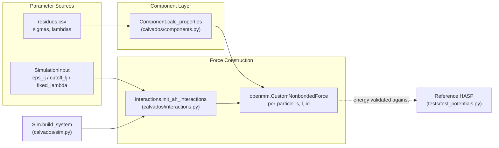

This page documents the Ashbaugh-Hatch (AH) pair potential — the short-range nonbonded interaction that governs both steric repulsion and hydrophobic attraction between coarse-grained beads in CALVADOS. We trace the potential from its OpenMM energy expression, through the residue-level parameterization pipeline (σ and λ values), into the configuration surface that controls its energy scale and cutoff, and finally through the energy-validation harness that guarantees numerical fidelity.

Sources: [interactions.py](calvados/interactions.py#L63-L93), [test_potentials.py](tests/test_potentials.py#L13-L17)

## Position in the Force Field Architecture

CALVADOS decomposes nonbonded protein physics into exactly two `CustomNonbondedForce` instances with distinct force groups: **AH** on group 0 and the Yukawa (**YU**) electrostatic force on group 1. The factory `init_nonbonded_interactions` receives `eps_lj`, `cutoff_lj`, `eps_yu`, `k_yu`, `cutoff_yu`, and `fixed_lambda`, then delegates AH construction to `init_ah_interactions` and YU construction to `init_yu_interactions`, naming the forces `'AH'` and `'YU'` for downstream identification. The simulation orchestrator `Sim.build_system` computes Debye-Hückel parameters first (`genParamsDH`), instantiates both forces, and holds them as `self.ah` and `self.yu` before any particles exist. One subtle but critical unit conversion happens upstream: `sim.py` multiplies the configured `eps_lj` by 4.184, converting the kcal/mol input convention into OpenMM's native kJ/mol.

Sources: [interactions.py](calvados/interactions.py#L117-L137), [sim.py](calvados/sim.py#L173-L188), [sim.py](calvados/sim.py#L55)



Sources: [interactions.py](calvados/interactions.py#L63-L137), [components.py](calvados/components.py#L70-L100), [sim.py](calvados/sim.py#L157-L188)

## Mathematical Formulation

The AH potential is a piecewise modification of the Lennard-Jones 12-6 form, expressed as a single OpenMM energy string in `init_ah_interactions`:

```python
energy_expression = (
    f'{eps}*select(step(r-2^(1/6)*s),'
    '4*l*((s/r)^12-(s/r)^6-shift),'
    '4*((s/r)^12-(s/r)^6-l*shift)+(1-l))'
)
```

The `select(step(...), y, z)` construct routes evaluation between two branches. For separations beyond the Lennard-Jones minimum, `r ≥ 2^(1/6)·σ`, the energy is `ε·4λ[(σ/r)^12 − (σ/r)^6 − shift]` — the attractive LJ tail **scaled by λ** and shifted by `shift = (σ/rc)^12 − (σ/rc)^6` so the potential vanishes at the cutoff. Inside the minimum, `r < 2^(1/6)·σ`, the branch becomes `ε·{4[(σ/r)^12 − (σ/r)^6 − λ·shift] + (1−λ)}` — a WCA-type repulsive wall whose `(1−λ)ε` constant term is precisely what makes the two branches continuous at the crossover point (both evaluate to `−λ(1+shift)ε` there). The physical consequence: **λ modulates well depth without altering the contact radius** — monomer excluded volume is preserved regardless of hydrophobicity.

Sources: [interactions.py](calvados/interactions.py#L69-L81), [test_potentials.py](tests/test_potentials.py#L14-L17)

| λ_ij regime | Effective form | Physical interpretation |
|---|---|---|
| λ = 0 | Pure WCA wall `4[(σ/r)^12 − (σ/r)^6] + ε` | Good solvent; no attraction, steric wall intact |
| 0 < λ < 1 | Reduced-depth LJ well + raised wall | Partial hydrophobicity; collapse tendency scales with λ |
| λ = 1 | Fully shifted Lennard-Jones | Unmodified LJ attraction with U(rc) = 0 |

Sources: [interactions.py](calvados/interactions.py#L69-L78)

The two λ limits also explain the reference implementation in the test suite: `HALR` (attractive branch, no shift), `HASR` (repulsive branch with the `+ε(1−l)` constant), `HA` (the `np.where` crossover at `2^(1/6)·s`), and `HASP` (shift subtracted at rc, zero beyond) compose the identical function in NumPy form.

Sources: [test_potentials.py](tests/test_potentials.py#L13-L17)

## Pair Mixing Rules and Residue-Level Data

The parameter expression appended to the energy function defines how per-particle values combine into pair values:

```python
parameter_expression = (
    f'; l=select(id1+id2,(id1*id2)*0.5*(l1+l2),{fixed_lambda})'
    f'; shift=(s/{rc})^12-(s/{rc})^6'
    '; s=0.5*(s1+s2)'
)
```

**σ follows the Lorentz–Berthelot arithmetic mean** `s = ½(s₁+s₂)`, and for pairs whose `id` type flags are both nonzero, **λ likewise mixes as the arithmetic mean** `½(λ₁+λ₂)` — exactly the rule the integration test assumes when reconstructing energies (`lambda_ij = 0.5*(l1+l2)` from the residue table). The `select(id1+id2, ...)` routing adds a per-particle type flag `id` as a third per-particle parameter: pairs where `id₁+id₂ = 0` fall back to the configured `fixed_lambda`, and the `id₁·id₂` factor inside the mixing branch drives mixed flagged/unflagged pairs toward λ = 0 attraction. This flag mechanism lets one force object serve chemically distinct particle classes (e.g., solutes versus generic crowd particles) without separate force instances.

Sources: [interactions.py](calvados/interactions.py#L74-L85), [test_potentials.py](tests/test_potentials.py#L104-L107)

Per-residue σ and λ originate from a CSV database indexed by one-letter code, loaded at `Component` initialization and mapped onto the sequence in `calc_properties` as NumPy arrays (`self.sigmas`, `self.lambdas`). The same λ values feed a separate derived quantity, `self.alphas = self.lambdas * self.params.alpha`, used outside the AH force. Representative values from the bundled default database illustrate the hydrophobicity ordering that drives IDP collapse behavior:

Sources: [components.py](calvados/components.py#L48-L51), [components.py](calvados/components.py#L83-L99), [residues.csv](residues.csv#L1-L21)

| Residue | λ (hydrophobicity) | σ (nm) | Character |
|---|---|---|---|
| W (Trp) | 0.9894 | 0.678 | Most hydrophobic; near-full LJ |
| Y (Tyr) | 0.9775 | 0.646 | Aromatic |
| F (Phe) | 0.8672 | 0.636 | Aromatic |
| R (Arg) | 0.7308 | 0.656 | Large σ, moderate λ |
| D (Asp) | 0.0416 | 0.558 | Charged, weakly attractive |
| E (Glu) | 0.0007 | 0.592 | Least attractive (near-WCA) |

Sources: [residues.csv](residues.csv#L1-L21)

## Energy Scale, Cutoff, and Runtime Configuration

Three `SimulationInput` fields control the AH force: `eps_lj` (default 0.2), `cutoff_lj` (default 2.0 nm), and `fixed_lambda` (default 0.0). The constructor validates cutoffs are strictly positive before force creation (`init_nonbonded_interactions` raises `ValueError` otherwise), attaches `CutoffPeriodic` nonbonded method with the cutoff in nanometers, and assigns **force group 0** so AH energies are independently reportable from YU (group 1) energies. Notably, the factory also emits a runtime diagnostic printing the well depth between reference beads of σ = 0.68 nm at the configured cutoff — a convenient cross-check that ε and rc propagated correctly.

Sources: [inputmodels.py](calvados/inputmodels.py#L141-L144), [interactions.py](calvados/interactions.py#L79-L93), [interactions.py](calvados/interactions.py#L127-L130)

| Configuration parameter | Default | Unit | Effect on AH force |
|---|---|---|---|
| `eps_lj` | 0.2 | kcal/mol | Well depth ε; converted ×4.184 to kJ/mol (→ 0.8368) |
| `cutoff_lj` | 2.0 | nm | Truncation radius; sets the LJ shift reference |
| `fixed_lambda` | 0.0 | dimensionless | λ fallback for pairs with `id₁+id₂ = 0` |

Sources: [inputmodels.py](calvados/inputmodels.py#L141-L144), [sim.py](calvados/sim.py#L55)

> [!TIP]
> The 4.184 kcal→kJ multiplication in `Sim.__init__` means your YAML `eps_lj` is always specified in kcal/mol, but the diagnostic print in `init_ah_interactions` reports kJ/mol. Grep simulation logs for the "Ashbaugh-Hatch potential between particles" line to confirm the effective well depth (≈0.8368 kJ/mol at defaults) before committing to long production runs.

## Variant: Scaled Bonded AH for Structure-Based Restraints

A second implementation of the same functional form exists as a **bonded** force: `init_scaled_LJ` builds a `CustomBondForce` replicating the piecewise AH expression, but with global parameters `eps` and `rc` instead of baked-in constants, and per-bond parameters `s`, `l`, and `n`. The extra `n` factor multiplies the entire expression, allowing per-pair attenuation by `bondscale` — a sigmoid of AlphaFold-derived PAE distances and B-factors computed during Go-restraint setup (`bondscale = expit(−bscale_width·(scale − bscale_shift))`). Pair assembly in `add_scaled_lj` applies the identical ½(s₁+s₂)/½(λ₁+λ₂) mixing rules, keeping bonded and nonbonded variants numerically consistent. Expression-level equivalence between the two variants is pinned by unit tests comparing the exact OpenMM energy strings.

Sources: [interactions.py](calvados/interactions.py#L178-L194), [interactions.py](calvados/interactions.py#L260-L275), [components.py](calvados/components.py#L216-L234), [test_interactions.py](tests/test_interactions.py#L106-L120)

| Property | `init_ah_interactions` (nonbonded) | `init_scaled_LJ` (bonded) |
|---|---|---|
| OpenMM force type | `CustomNonbondedForce` | `CustomBondForce` |
| Energy scale ε | Per-force constant | Global parameter `eps` |
| Cutoff / shift | Per-force cutoff; pair-level shift | Global parameter `rc` |
| σ source | Per-particle `s`, mixed ½(s₁+s₂) | Per-bond `s` |
| λ source | Per-particle `l` + `id`-flag mixing | Per-bond `l`, mixed ½(λ₁+λ₂) |
| Per-pair scaling | — (all non-excluded pairs) | Per-bond `n` (AlphaFold-derived) |
| Scope | All intermolecular/intramolecular pairs | Selected Go-restrained pairs only |

Sources: [interactions.py](calvados/interactions.py#L63-L93), [interactions.py](calvados/interactions.py#L178-L194)

## Exclusions and Boundary Conditions

Both AH and YU forces use `CutoffPeriodic` so pair distances respect the periodic box vectors established in `build_system`. Bonded neighbors are removed from the nonbonded calculation through the exclusion mechanism: `Component.add_bonds` returns an `exclusion_map` explicitly annotated "for ah, yu etc.", and the generic `add_exclusion` helper registers these particle pairs on any `CustomNonbondedForce`, preventing double counting where the `HarmonicBondForce` already acts.

Sources: [interactions.py](calvados/interactions.py#L87-L89), [interactions.py](calvados/interactions.py#L292-L297), [components.py](calvados/components.py#L150-L166), [sim.py](calvados/sim.py#L166-L169)

## The Energy Validation Harness

Numerical correctness of the AH force is enforced by `tests/test_potentials.py`, which runs genuine two-bead OpenMM simulations parametrized over residue pairs (`Y`/`W`, `R`/`W`, `E`/`D`, `E`/`W`, `E`/`R`) in an 8 nm cubic box, then asserts that the logged potential energy matches the NumPy reference `HASP + DHSP` with `rtol=1e-3, atol=1e-8`. The harness independently reconstructs every ingredient: σ and λ as arithmetic means from `residues_CALVADOS2.csv`, the 0.8368 kJ/mol energy scale, the 2 nm AH cutoff, and the Debye-Hückel parameters at 298 K / 0.15 M ionic strength — making this test a true end-to-end contract on the mixing rules, shift convention, and unit conversion simultaneously.

Sources: [test_potentials.py](tests/test_potentials.py#L23-L33), [test_potentials.py](tests/test_potentials.py#L95-L123)

> [!TIP]
> The parametrized pair matrix in `test_ah_dh_potentials` deliberately spans extreme λ contrasts (W↔Y near λ=1, E↔D near λ=0). Any modification to the energy expression, shift convention, or mixing rules should be validated against this full matrix — a single pair would not catch a sign error in the `(1−λ)` continuity constant, which only manifests in mixed-λ regimes.

## Summary and Related Pages

The Ashbaugh-Hatch interaction in CALVADOS is a λ-interpolated, cutoff-shifted LJ 12-6 potential whose per-residue σ and λ values flow from a CSV database through `Component.calc_properties` into per-particle parameters on a single `CustomNonbondedForce`, with arithmetic-mean pair mixing governed by an `id` type flag and a configurable `fixed_lambda` fallback. Its bonded twin (`init_scaled_LJ`) reuses the identical functional form for AlphaFold-scaled Go restraints, and the entire construction is locked to reference physics by an integration-level energy validation suite. For the companion long-range electrostatic force sharing this architecture, continue to [Debye-Hückel Electrostatics](7-debye-huckel-electrostatics); for the provenance and customization of λ/σ residue values, see [Residue Parameter Database](8-residue-parameter-database); for the restraint context of the scaled variant, see [Structure-Based Restraints & AlphaFold Guidance](11-structure-based-restraints-and-alphafold-guidance); for the validation methodology in depth, see [Testing & Energy Validation](19-testing-and-energy-validation); and for adding new nonbonded forms alongside AH, see [Extension & Custom Forces](18-extension-and-custom-forces).
