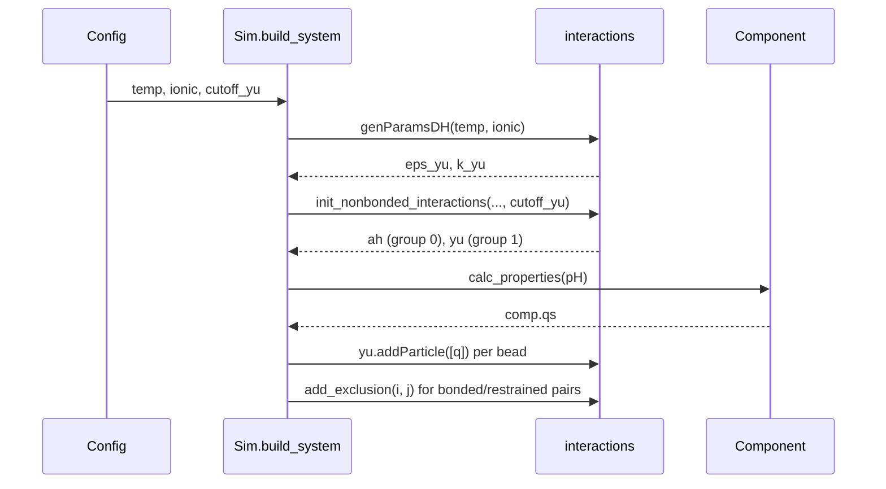

This page documents the electrostatic interaction model in CALVADOS: the shifted-truncated **Debye-Hückel (Yukawa) potential** that mediates charge effects between coarse-grained beads. It covers the physical parameterization (dielectric model, Bjerrum length, Debye length), the OpenMM force construction, the pH-dependent charge assignment pipeline that feeds the force, and the numerical validation strategy. Material scope is limited to electrostatics; the companion hydrophobic term is covered in [Ashbaugh-Hatch Hydrophobic Interactions](6-ashbaugh-hatch-hydrophobic-interactions).

## Physical Model: The Shifted Yukawa Potential

CALVADOS replaces explicit solvent ions with a **mean-field electrostatic term**: each charged bead interacts pairwise through a screened Coulomb (Yukawa) potential derived from linearizing the Poisson–Boltzmann equation. The implemented form is energy-shifted at the cutoff so the potential decays smoothly to zero:

```
U_YU(r) = ε_yu · q₁q₂ · [ e^(−κr)/r − e^(−κr_c)/r_c ]   for r < r_c
U_YU(r) = 0                                             for r ≥ r_c
```

where `ε_yu = l_B · k_B T` is the Yukawa prefactor, `κ` is the inverse Debye length, and `q₁q₂` is the product of the two bead charges in units of the elementary charge. The shift constant `e^(−κr_c)/r_c` is identical for all pairs, so the potential is **continuous but not force-continuous** at `r_c` — a standard coarse-grained compromise that avoids long-range truncation artifacts in energy reporting.

The functional form and its shifted reference are encoded directly in the test suite's analytical reference, confirming this convention is the contract the implementation must satisfy:

Sources: [interactions.py](calvados/interactions.py#L95-L115), [test_potentials.py](tests/test_potentials.py#L19-L21)

## Electrostatic Parameter Generation: `genParamsDH`

The two global parameters `ε_yu` and `κ` are derived from exactly two user inputs — temperature and ionic strength — through a deterministic physical chain:

1. **Water permittivity** `_calc_relative_permittivity(temp)` evaluates a temperature polynomial for the relative dielectric constant of water: `ε_r(T) = 5321/T + 233.76 − 0.9297·T + 0.1417·10⁻²·T² − 0.8292·10⁻⁶·T³` (T in K).
2. **Bjerrum length** `l_B = e²/(4π·ε₀·ε_r) · N_A·1000 / k_B·T` — the distance at which two unit charges interact at thermal energy, expressed in nm via the ×1000 scaling.
3. **Yukawa prefactor** `ε_yu = l_B · k_B·T`, converted to kJ/mol scale.
4. **Inverse Debye length** `κ = √(8π·l_B·I·N_A/10)` with ionic strength `I` in mol/L; the `N_A/10` factor converts molar concentration to number density in nm⁻³.

Guard clauses enforce physical validity upfront: temperature must be positive and ionic strength non-negative.

Sources: [interactions.py](calvados/interactions.py#L15-L18), [interactions.py](calvados/interactions.py#L20-L28), [interactions.py](calvados/interactions.py#L31-L52)

**Physical constants embedded in the module:**

| Constant | Value (module-level) | Role in electrostatics |
|---|---|---|
| `GAS_CONSTANT` | 8.3145 J·mol⁻¹·K⁻¹ | Thermal energy `k_B T` |
| `ELEMENTARY_CHARGE` | 1.6021766 × 10⁻¹⁹ C | Charge quantum in `l_B` |
| `VACUUM_PERMITTIVITY` | 8.854188 × 10⁻¹² F·m⁻¹ | Coulomb prefactor denominator |
| `AVOGADRO_CONSTANT` | 6.02214076 × 10²³ mol⁻¹ | Molar → number-density conversion |

Sources: [interactions.py](calvados/interactions.py#L15-L18)

> [!TIP]
> All electrostatic lengths are computed in **nanometers** and energies in **kJ/mol** by pre-scaling the SI constants (`×1000` in the Bjerrum length, `N_A/10` in the Debye length). The values are then baked into the OpenMM energy expression string as literal numbers — meaning changing temperature or ionic strength requires a **full system rebuild**, not a context parameter update, because `ε_yu` and `κ` are compile-time constants of the custom force, not global parameters.

## OpenMM Force Construction

`init_yu_interactions(eps, k, rc)` materializes the potential as an `openmm.CustomNonbondedForce` with these architectural properties:

- **Energy expression**: `q*{eps}*(exp(-{k}*r)/r-{shift})` with `q=q1*q2` — the pair charge product is a per-particle-parameter combination; `eps`, `k`, and `shift` are formatted literals.
- **Per-particle parameter**: a single dimensionless `q` per bead, set during system assembly.
- **Boundary handling**: `CutoffPeriodic` nonbonded method with cutoff `rc` — electrostatics respect the periodic box without lattice sums, consistent with mean-field screening (beyond `κ⁻¹` the interaction is negligible).
- **Force group 1**: isolates electrostatic energy reporting from the Ashbaugh-Hatch term (group 0), enabling per-component energy diagnostics in logs.

The diagnostic print statement reports `ε_yu · e^(−κr_c)/r_c` — the residual energy between unit charges at the cutoff — as a sanity check of the shift magnitude.

Sources: [interactions.py](calvados/interactions.py#L95-L115), [interactions.py](calvados/interactions.py#L117-L137)

**Related electrostatic force variants:**

| Force | OpenMM type | Energy form | Purpose | Force group |
|---|---|---|---|---|
| `YU` | `CustomNonbondedForce` | `ε_yu·q₁q₂·(e^(−κr)/r − shift)` | Inter-molecule electrostatics | 1 |
| Scaled `YU` | `CustomBondForce` | `n·q·ε_yu·(e^(−κr)/r − shift)` | Intra-molecule electrostatics for Go-restrained proteins (bond-scale factor `n`) | — |
| Charge-nonpolar | `CustomNonboundForce` variant | `−step(id₁+id₂)·ε·αq²R³/2·(1/r − 1/r_c)` | Lipid–protein attraction mixing charge with hydrophobic exposure | 1 |

Sources: [interactions.py](calvados/interactions.py#L196-L210), [interactions.py](calvados/interactions.py#L277-L290), [interactions.py](calvados/interactions.py#L341-L358)

## Charge Assignment Pipeline

The per-particle `q` values originate from sequence analysis, not from the force module. The pipeline runs during `calc_properties`, which is invoked per component with the configuration-level pH:

```mermaid
flowchart LR
    A[residues.csv<br/>column 'q'] --> C[get_qs]
    B[FASTA / PDB sequence] --> C
    D[config pH] --> C
    C -->|flexhis: q_H = 1/&#40;1+10^&#40;pH-6&#41;&#41;| E["qs array<br/>(signed charges)"]
    E --> F["Sim.add_interactions<br/>yu.addParticle&#40;&#91;q&#93;&#41;"]
```



`get_qs` consults the residue parameter table (`residues.csv`, indexed by one-letter code) for static charges, while **flexible histidine** receives a Henderson–Hasselbalch fractional charge with pKa = 6: `q = 1/(1 + 10^(pH − 6))`, making protonation state a continuous function of simulation pH. A numba-jitted fallback `get_qs_fast` hardcodes R/K = +1, E/D/p = −1 for table-free contexts.

Terminal charges are governed by the component-level `charge_termini` option (`none` / `N` / `C` / `both`, default `both`), patched onto the sequence via terminal-charge utilities before the force assembly. This coupling between pH, sequence, and electrostatics is elaborated in [Sequence Handling & Charge Assignment](10-sequence-handling-and-charge-assignment).

Sources: [components.py](calvados/components.py#L70-L100), [sequence.py](calvados/sequence.py#L95-L113), [sequence.py](calvados/sequence.py#L116-L130), [inputmodels.py](calvados/inputmodels.py#L50-L56)

## System Integration: Build Order and Exclusions

Within `Sim.build_system`, electrostatic parameters are generated **before** any component is instantiated, then consumed in a strict ordering:



Two exclusion classes keep electrostatics physically consistent:

- **Bonded neighbors** (consecutive beads along a chain) are excluded from `YU` alongside `AH`, since their separation is governed by harmonic bonds.
- **Restrained pairs** (harmonic or Go restraints, including custom restraints) are excluded from both nonbonded forces, so restraint energy is not double-counted with electrostatics.

For Go-restrained components, an additional scaled Yukawa `CustomBondForce` captures *intra*-molecular electrostatics between restraint-partner beads, modulated by a per-bond scale factor — the intermolecular force alone would otherwise leave these pairs unshielded after exclusion.

Sources: [sim.py](calvados/sim.py#L157-L188), [sim.py](calvados/sim.py#L98-L107), [sim.py](calvados/sim.py#L493-L501), [sim.py](calvados/sim.py#L503-L533)

## Configuration Surface

Electrostatics is fully controlled through the declarative configuration layer (validated by `SimulationInput`, see [Declarative Configuration & Validation](12-declarative-configuration-and-validation)):

| Parameter | Unit | Effect | Propagates to |
|---|---|---|---|
| `temp` | K | Sets water `ε_r(T)`, `l_B`, `k_B T` | `eps_yu`, `k_yu` |
| `ionic` | mol/L | Sets screening strength | `k_yu` (inverse Debye length) |
| `pH` | — | Sets histidine (and optionally termini) charge states | per-particle `q` |
| `cutoff_yu` | nm | Shift location and interaction range | shift constant, force cutoff |

Sources: [sim.py](calvados/sim.py#L172-L188), [test_potentials.py](tests/test_potentials.py#L55-L73), [inputmodels.py](calvados/inputmodels.py#L50-L56)

## Numerical Validation Strategy

`tests/test_potentials.py` validates the full electrostatic stack end-to-end: it builds two-bead dimers (e.g., `E–R`, `E–D` for attraction/repulsion, `E–W` and `R–W` for charge-neutral controls) at T = 298 K, I = 0.15 M, pH = 7, runs short simulations on the CPU platform, and reconstructs the potential energy purely from the bead–bead distance trajectory. The reference implementation independently re-derives `l_B`, `ε_yu = q₁q₂·l_B·k_BT`, and the Debye length from first constants, then asserts:

```python
assert np.allclose(u, u_calc, rtol=1e-3, atol=1e-8)
```

The test's config does not override `cutoff_yu`, and the reference shift uses `r_c = 4` nm — corroborating that 4 nm is the shipped default cutoff, distinct from the 2 nm Ashbaugh-Hatch cutoff used in the same test. Because the check compares the *logged total potential energy* against an analytical sum of AH + DH terms, it jointly validates the energy expression, the charge assignment, the parameter generation, and the shift convention. The AH reference halves of the same test are detailed in [Testing & Energy Validation](19-testing-and-energy-validation).

Sources: [test_potentials.py](tests/test_potentials.py#L34-L79), [test_potentials.py](tests/test_potentials.py#L104-L123)

> [!TIP]
> When debugging electrostatic anomalies, exploit the **force-group separation**: `yu` is group 1, `ah` group 0 — you can query `context.getState(getEnergy=True, groups={1<<1})` on a live context to isolate electrostatic energy without rerunning. The build log's `yu: N particles, M exclusions` line (sim.py) is the fastest integrity check that charge attachment and exclusion counting match your expected molecule topology.

## Suggested Reading Progression

Electrostatics is one leg of the force-field triad. Recommended continuation paths:

- **[Ashbaugh-Hatch Hydrophobic Interactions](6-ashbaugh-hatch-hydrophobic-interactions)** — the short-range reference term built by the same `init_nonbonded_interactions` call.
- **[Residue Parameter Database](8-residue-parameter-database)** — where the static per-residue `q` values in `residues.csv` are defined and curated.
- **[Sequence Handling & Charge Assignment](10-sequence-handling-and-charge-assignment)** — deeper treatment of flexible histidine, termini patching, and PTM charges.
- **[Testing & Energy Validation](19-testing-and-energy-validation)** — the full energy-decomposition test methodology that this page's validation section summarized.