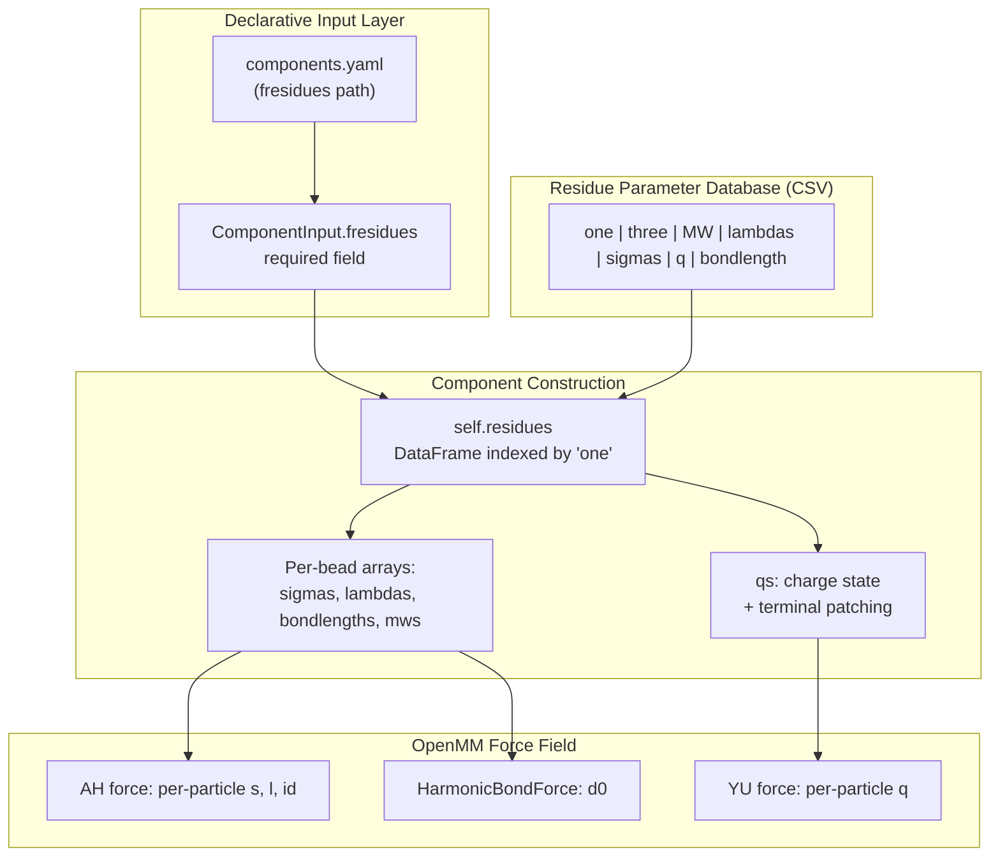
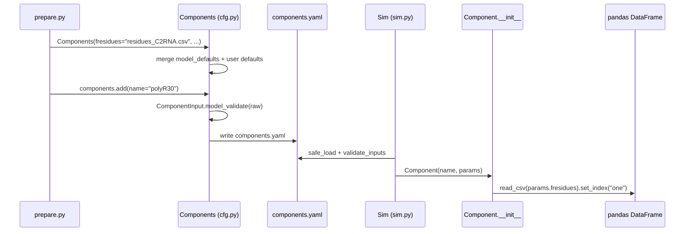

The residue parameter database is the bridge between the *alphabet* of a sequence and the *physics* of a simulation. CALVADOS models biomolecules as chains of coarse-grained beads — one bead per amino acid (or two per RNA nucleotide) — so every physical property a bead can possess must be resolvable from a single letter. This page explains the database schema, the shipped parameter variants, the runtime loading path, and exactly how each column feeds the Ashbaugh-Hatch and Debye-Hückel force fields. By the end, you will be able to read, modify, or extend a residue table with full knowledge of the consequences downstream.

## Role in the Architecture: Sequence Alphabet → Bead Physics

From first principles, a one-bead-per-residue force field needs exactly five things per bead type: a size (for excluded volume), a hydrophobicity (for attractive dispersion), a charge (for electrostatics), a mass (for dynamics), and a bond length (for chain connectivity). The residue database packages all five into a flat CSV keyed by the one-letter amino acid code, making the mapping explicit, inspectable, and — critically — *user-replaceable*. Rather than hard-coding parameters in Python, CALVADOS treats the CSV as configuration: swap the file, and you have swapped the effective force field.

The data flow is strictly one-directional: the CSV is read once at component construction time, exploded into per-bead NumPy arrays, and those arrays are then consumed by the OpenMM force objects. Nothing writes back to the database, and no force reads the CSV directly.

The database sits upstream of everything: component classes only translate rows into arrays, and force objects only consume arrays. This clean separation is what makes custom parameter sets a first-class workflow rather than a code fork.

Sources: [components.py](/calvados/components.py#L36-L51), [residues.csv](/residues.csv#L1-L21), [interactions.py](/calvados/interactions.py#L63-L115)

## Database Schema and Parameter Semantics

The canonical protein table ships at the repository root with 20 rows — one per canonical amino acid — and a seven-column header: `one, three, MW, lambdas, sigmas, q, bondlength`. Each column has a precise physical role in the simulation, summarized below.

| Column | Unit | Physical role | Range in shipped table |
|---|---|---|---|
| `one` | — | Join key; one-letter sequence code | `A`–`Y` (20 codes) |
| `three` | — | Three-letter label (documentation only, never joined on) | `ARG`…`PHE` |
| `MW` | g/mol | Bead mass | 57.05 (G) – 186.22 (W) |
| `lambdas` | dimensionless | Hydrophobicity λ for the Ashbaugh-Hatch attractive term | 0.00069 (E) – 0.989 (W) |
| `sigmas` | nm | Lennard-Jones diameter σ for excluded volume | 0.450 (G) – 0.678 (W) |
| `q` | e | Nominal charge for Debye-Hückel electrostatics | −1 (D, E), +1 (K, R), 0 (rest) |
| `bondlength` | nm | Equilibrium bond length d₀ between consecutive beads | 0.38 (uniform) |

A representative sample of rows shows how the table encodes chemistry: glycine is the smallest bead (σ = 0.45) but strongly hydrophobic (λ ≈ 0.71) in this parametrization, while glutamate carries the maximum negative charge with near-zero hydrophobicity (λ ≈ 0.0007). Tryptophan is simultaneously the largest, most massive, and most hydrophobic bead.

| `one` | `three` | `MW` | `lambdas` | `sigmas` | `q` | `bondlength` |
|---|---|---|---|---|---|---|
| `W` | TRP | 186.22 | 0.9894 | 0.678 | 0 | 0.38 |
| `G` | GLY | 57.05 | 0.7059 | 0.450 | 0 | 0.38 |
| `K` | LYS | 128.17 | 0.1790 | 0.636 | 1 | 0.38 |
| `E` | GLU | 129.11 | 0.0007 | 0.592 | −1 | 0.38 |

Note the deliberate asymmetry in the design: `three` is decorative metadata, while `one` is the sole lookup key. The charged residues (K, R, D, E) carry integer ±1 charges in the table, but the effective charge of a bead is not always its table value — pH-dependent histidine and charged termini are patched at construction time, as described below.

Sources: [residues.csv](/residues.csv#L1-L21), [components.py](/calvados/components.py#L70-L100)

## Shipped Variants: Protein, Packaged Default, and the C2 RNA Extension

Three parameter files exist in the repository, and their differences are instructive. The root `residues.csv` and the packaged `calvados/data/residues.csv` contain the same 20 protein rows but differ in column order (`one,three,…` vs `three,one,…`) and in numeric precision (root values are rounded to ~12 digits; packaged values carry full precision). Crucially, both load identically because the loader re-indexes on the `one` column by *name*, not position. The RNA variant `residues_C2RNA.csv` keeps all 20 protein rows and appends six additional bead types for the two-beads-per-nucleotide RNA model.

| File | Bead alphabet | Column order | Precision | Purpose |
|---|---|---|---|---|
| `residues.csv` (root) | 20 amino acids | `one` first | rounded | example workflows |
| `calvados/data/residues.csv` | 20 amino acids | `three` first | full | packaged default reference |
| `residues_C2RNA.csv` (tests + example) | 20 amino acids + 6 RNA beads | `three` first | full | C2 two-bead RNA model |

The RNA additions encode a two-bead nucleotide architecture: each nucleotide contributes a negatively charged backbone bead `p` (`RBC`, q = −1, σ = 0.6954 nm, bondlength 0.59 nm) and a hydrophobic base bead (`ADE/a` or `URI/u`, λ = 1.18, bondlength 0.54 nm). The table also defines two phantom-like beads `LPH/B` (MW 100, σ 0.855) and `LPT/Z` (MW 200, σ 0.9) inherited from the published C2 parametrization; they are simply unused unless their letter codes appear in an input sequence.

| Code | `three` | `MW` | `lambdas` | `sigmas` | `q` | `bondlength` | Role |
|---|---|---|---|---|---|---|---|
| `r` | RNA | 126.3 | 1.18 | 0.6238 | 0 | 0.54 | generic base bead |
| `a` | ADE | 134.1 | 1.18 | 0.6430 | 0 | 0.54 | adenine base |
| `u` | URI | 111.1 | 1.18 | 0.5958 | 0 | 0.54 | uracil base |
| `p` | RBC | 194.1 | 0.00 | 0.6954 | −1 | 0.59 | charged phosphate/backbone |
| `B` | LPH | 100.0 | 0.4625 | 0.855 | 0 | 0.38 | large phantom bead (defined, not FASTA-driven) |
| `Z` | LPT | 200.0 | 0.9775 | 0.900 | 0 | 0.38 | large phantom bead (defined, not FASTA-driven) |

The example RNA workflow makes the mechanism concrete: its FASTA file contains nothing but the letter `r` repeated 30 times, and the `Components` defaults point `fresidues` at the local `residues_C2RNA.csv`. The table, not the code, decides what a `p` or an `r` *means*.

Sources: [residues.csv](/residues.csv#L1-L21), [calvados/data/residues.csv](/calvados/data/residues.csv#L1-L21), [tests/data/residues_C2RNA.csv](/tests/data/residues_C2RNA.csv#L22-L27), [examples/single_RNA/rna.fasta](/examples/single_RNA/rna.fasta#L1-L3), [examples/single_RNA/prepare.py](/examples/single_RNA/prepare.py#L44-L65)

> [!TIP]
> The loader calls `.set_index("one")`, so the *column order* in your CSV is irrelevant — but the *column names* are contract. Renaming `sigmas` to `sigma` will not fail at load time; it will fail later, as an `AttributeError` when `calc_properties` reads `.sigmas` off the DataFrame rows.

## Runtime Loading Path: From components.yaml to a DataFrame

The database path travels through the declarative configuration layer before any file is read. `fresidues` is a **required** field on the `ComponentInput` Pydantic model — it has no default — which forces every workflow to make its parameter choice explicit. The `Components` builder merges `model_defaults(ComponentInput)` with user-supplied defaults, validates each added component, and serializes the merged dictionary into `components.yaml`. At simulation time, the `Sim` class re-validates that YAML and instantiates components, whose base-class constructor performs the only CSV read in the entire pipeline.

This design has three practical consequences. First, because validation happens in `ComponentInput` before serialization, a missing `fresidues` key fails at *prepare* time with a clear Pydantic error rather than deep inside simulation setup. Second, `fresidues` can be set as a shared default (as the RNA example does) or overridden per component — a mixed protein/RNA system simply uses two different tables in one simulation. Third, the path is resolved relative to the process working directory at *build* time, not YAML-write time, so generated `components.yaml` files embed whatever path string you provided.

Sources: [inputmodels.py](/calvados/inputmodels.py#L39-L58), [cfg.py](/calvados/cfg.py#L88-L134), [components.py](/calvados/components.py#L48-L51), [examples/single_RNA/prepare.py](/examples/single_RNA/prepare.py#L49), [sim.py](/calvados/sim.py#L41-L51)

## From Table to Beads: `calc_properties`

The base `Component.calc_properties` method is the translation layer that converts sequence letters into per-bead NumPy arrays. It iterates the sequence once per property, performing a `DataFrame.loc` lookup on the one-letter code for each position: `sigmas`, `lambdas`, `bondlengths`, and `mws` are extracted positionally, and `alphas` is derived — not stored — as `lambdas * alpha` where `alpha` is the component-level scaling parameter (default 0.0, meaning fully water-like beads unless you opt in to hydrophobic attraction). Charges are handled by `get_qs` with the component's residue table passed in.

The charge path deserves special attention because it is the one place where the table is *conditionally* consulted. `get_qs` honors `flexhis=True` by overriding the table for histidine with a pH-dependent protonation fraction q = 1/(1 + 10^(pH−6)), taken from the simulation-level `pH` setting. For every other residue, the table's `q` column is used verbatim.

| Residue context | Charge source | Applied value |
|---|---|---|
| Any residue except H | table `q` column | −1 / 0 / +1 |
| `H` with `flexhis=True` | Henderson-Hasselbalch form | 1/(1 + 10^(pH−6)) |
| N-/C-termini (`charge_termini`) | `patch_terminal_qs` / `patch_terminal_mws` | ±1 charge and MW deltas added |

The `Protein` subclass then layers terminal chemistry on top: after the base lookup, it calls `patch_terminal_qs` and `patch_terminal_mws` to add end-group charges and masses according to the component's `charge_termini` setting (`none`, `N`, `C`, or `both`). This means the table defines *interior* residue physics while terminal corrections live in code — a separation you must remember when authoring custom tables with nonstandard termini.

Sources: [components.py](/calvados/components.py#L70-L100), [sequence.py](/calvados/sequence.py#L95-L113), [components.py](/calvados/components.py#L236-L267)

> [!TIP]
> When `flexhis=True` (the standard path for proteins built through `calc_properties`), the `q` value in the HIS row of the table is never used — the pH formula always wins. The HIS table charge only takes effect through the table-driven `get_qs` branch when flexibility is disabled, or via the table-free `get_qs_fast` shortcut used in other modules.

## Force Field Integration: Which Column Feeds Which Force

Each database column maps to exactly one OpenMM force construct. The Ashbaugh-Hatch force is a `CustomNonbondedForce` declaring three per-particle parameters — `s` (σ), `l` (λ), and `id` (a regularity flag) — with arithmetic mixing rules baked into its expression: pairwise σ is the arithmetic mean `s = 0.5·(s₁+s₂)`, and pairwise λ averages as `0.5·(l₁+l₂)` for regular particles, while particles flagged `id = 0` (crowders) fall back to a fixed λ passed at force initialization. The Yukawa (Debye-Hückel) force declares a single per-particle `q` and evaluates products `q₁·q₂` scaled by the salt- and temperature-dependent prefactors computed by `genParamsDH`.

| Database column | Becomes | Consumed by | Mixing rule |
|---|---|---|---|
| `sigmas` → bead array | AH per-particle `s` | `init_ah_interactions` | arithmetic mean of pair |
| `lambdas` × `alpha` → `alphas` | AH per-particle `l` | `init_ah_interactions` | arithmetic mean (id = 1); `fixed_lambda` otherwise |
| `q` (+ HIS pH formula, termini) | YU per-particle `q` | `init_yu_interactions` | product q₁·q₂ |
| `bondlength` | equilibrium d₀ | `HarmonicBondForce` via `calc_bondlength` | d₀ = 0.5·(blᵢ + blⱼ) |
| `MW` | bead masses | system particle masses | per particle |

The RNA component demonstrates how the same table serves a *different topology* without any schema change. Its `calc_comp_seq` expands the FASTA sequence `rrr…` into a two-bead string `prprpr…`, so `nbeads = 2 × nres`, and every property lookup runs over that expanded sequence. Backbone and phosphate–base bonds take their equilibrium length directly from the per-bead `bondlength` entries, and the neighboring-base pair restraint averages the two bases' λ values — `(λᵢ + λⱼ)/2` — into the bonded Lennard-Jones-like interaction, reusing the table's hydrophobicity column for a *bonded* rather than nonbonded purpose.

Sources: [interactions.py](/calvados/interactions.py#L63-L115), [components.py](/calvados/components.py#L83-L99), [components.py](/calvados/components.py#L511-L539), [components.py](/calvados/components.py#L541-L552), [components.py](/calvados/components.py#L660-L676)

## Extending the Database: Custom Residues and PTMs

Because the table is the single source of truth, adding new chemistry is a data problem, not a code problem. The contract is minimal: every one-letter code that can appear in a component's sequence — or in the expanded RNA two-bead string — must exist as a row keyed on `one`, otherwise the `DataFrame.loc` lookup fails at build time. The post-translational modification workflow shows the intended pattern: `PTMProtein.calc_comp_seq` appends the PTM's FASTA record letters onto the protein sequence at each configured `ptm_location`, so the PTM beads are just ordinary rows in your residue table.

A minimal extension recipe:

1. Copy an existing table (start from `calvados/data/residues.csv` for full precision).
2. Append one row per new bead: a fresh one-letter code, a mass, a λ, a σ, a charge, and a bond length.
3. In your FASTA file, place the new codes where the modification belongs (for `PTMProtein`, list the PTM sequence as a separate record named by `ptm_name`).
4. Point `fresidues` at your table via `Components` defaults.

Reasonable invariants to preserve, based on how the columns are consumed: keep `q` within {−1, 0, +1} unless you specifically intend fractional charges (the only fractional charge in the shipped system is the pH-dependent histidine); keep `bondlength` uniform (0.38 nm) for one-bead proteins, since the mixed d₀ = 0.5·(blᵢ + blⱼ) rule assumes homogeneous chains; and be aware that a new residue's *terminal* behavior is governed by the code patches, not the table — `patch_terminal_qs`/`patch_terminal_mws` apply fixed terminal deltas regardless of what the table says.

Sources: [components.py](/calvados/components.py#L959-L1003), [inputmodels.py](/calvados/inputmodels.py#L88-L89), [sequence.py](/calvados/sequence.py#L137-L140), [cfg.py](/calvados/cfg.py#L107-L124)

## Key Takeaways and Reading Progression

The residue parameter database embodies CALVADOS's central design decision: *parameters are data*. One flat CSV, keyed by sequence letter, determines bead sizes, hydrophobicities, charges, masses, and bond lengths for proteins, RNA, lipids, crowders, and PTM-tagged chains alike. The `fresidues` field makes that choice explicit and validated at the configuration layer, and the `set_index("one")` loader makes table authoring forgiving of column order but strict about names and codes. Understanding this table is understanding the effective force field: to predict how a mutation changes your simulation, you look up its row.

To continue exploring:

- How λ and σ enter the dispersion term: [Ashbaugh-Hatch Hydrophobic Interactions](6-ashbaugh-hatch-hydrophobic-interactions)
- How `q` and the DH prefactors produce electrostatics: [Debye-Hückel Electrostatics](7-debye-huckel-electrostatics)
- How components map to molecule types and the registry: [Component Registry & Molecule Types](9-component-registry-and-molecule-types)
- How sequences are read and charges finalized: [Sequence Handling & Charge Assignment](10-sequence-handling-and-charge-assignment)
- How `fresidues` fits the YAML validation pipeline: [Declarative Configuration & Validation](12-declarative-configuration-and-validation)
- How parameter changes are caught in tests: [Testing & Energy Validation](19-testing-and-energy-validation)
