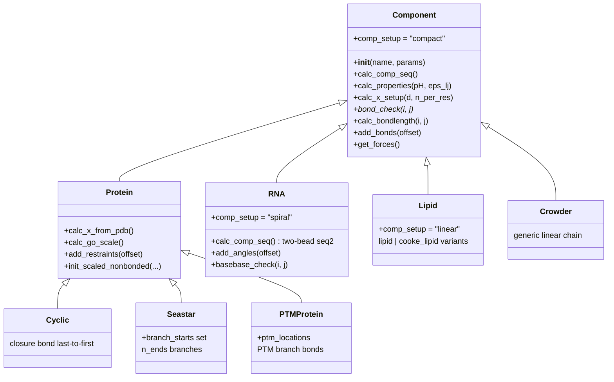
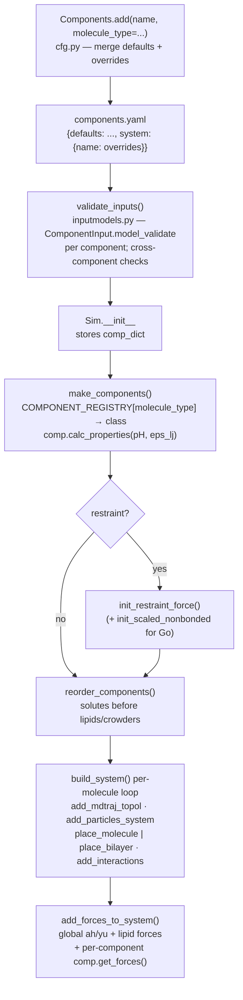

CALVADOS simulates heterogeneous coarse-grained systems — IDRs, folded proteins, RNA, lipids, crowders — inside a single OpenMM `System`. The mechanism that makes this possible is a deliberately small piece of architecture: a **type-keyed registry** (`COMPONENT_REGISTRY`) that maps declarative `molecule_type` strings from `components.yaml` to concrete Python classes in `calvados/components.py`. Each class encapsulates one molecular model: its bead granularity, its bonded topology, its restraint semantics, and its initial-coordinate strategy. This page documents that registry, the class hierarchy behind it, and the lifecycle that turns a YAML stanza into particles and forces. For the broader context of where these objects sit in the runtime, see [Architecture Overview](5-architecture-overview); for the physics they parameterize, see [Residue Parameter Database](8-residue-parameter-database).

## The Registry: One Dict, Two Sources of Truth

The registry is a module-level dictionary at the very end of `components.py`, typed as `dict[str, type[Component]]`:

```python
COMPONENT_REGISTRY: dict[str, type[Component]] = {
    "protein": Protein,
    "lipid": Lipid,
    "cooke_lipid": Lipid,
    "crowder": Crowder,
    "rna": RNA,
    "cyclic": Cyclic,
    "seastar": Seastar,
    "ptm_protein": PTMProtein,
}
```

Eight molecule types resolve to seven classes, because `"lipid"` and `"cooke_lipid"` deliberately share a single `Lipid` implementation that branches internally on `params.molecule_type` to select its force model. The registry's keys are mirrored by a Pydantic `Literal` type alias, `MoleculeType`, declared in `inputmodels.py` — this is the validation gate that rejects unknown molecule types *before* any class lookup happens:

```python
MoleculeType: TypeAlias = Literal[
    "protein", "rna", "lipid", "cooke_lipid",
    "crowder", "cyclic", "seastar", "ptm_protein",
]
```

The design has a notable property: **the class registry and the validation schema are decoupled but must stay synchronized**. A new entry in `COMPONENT_REGISTRY` without a matching `MoleculeType` literal will pass class lookup conceptually but fail Pydantic validation; the reverse fails at `COMPONENT_REGISTRY[...]` with a `KeyError`. There is no third source of truth — this coupling is intentional to keep the mapping auditable in two readable locations.

Sources: [components.py](calvados/components.py#L1005-L1014), [inputmodels.py](calvados/inputmodels.py#L17-L26)

## Class Hierarchy: Template Method Over Subclass Polymorphism

The hierarchy follows a classic **template method** pattern. The `Component` base class fixes the processing pipeline (sequence → per-bead properties → coordinates → bonds → forces), while subclasses override narrow predicates — most importantly `bond_check(i, j)` — to express topology differences. This is why a cyclic peptide and a linear protein differ by eight lines of code rather than a parallel implementation.



Every subclass also inherits the residue-parameter lookup from the base constructor, which loads a residues CSV (`read_csv(self.params.fresidues).set_index("one")`) keyed by one-letter code. `RNA` reuses this table for its `p`-prefixed two-bead sequence (`pA`, `pG`, …), which is why the RNA residue CSV must contain those composite keys — a direct consequence of the inheritance design.

Sources: [components.py](calvados/components.py#L28-L52), [components.py](calvados/components.py#L898-L910), [components.py](calvados/components.py#L536-L539)

## Anatomy of the Base Class Pipeline

`Component` defines the lifecycle that `Sim.make_components()` drives. The pipeline stages, all verifiable in the base class:

1. **Sequence resolution** — `calc_comp_seq()` branches on `params.restraint`: if restraints are enabled, the sequence (and multi-chain termini indices) is extracted from a PDB/CIF structure; otherwise it comes from a FASTA record keyed by the component name, with single N- and C-termini at positions `0` and `len(seq)-1`.
2. **Per-bead property vectorization** — `calc_properties()` maps every residue through the loaded CSV to build parallel NumPy arrays: `sigmas`, `lambdas`, `bondlengths`, `mws`, charges `qs` (via `get_qs` with `flexhis=True` and the simulation `pH`), and hydrophobicity scales `alphas = lambdas * alpha`.
3. **Coordinate synthesis** — `calc_x_setup()` dispatches on the class attribute `comp_setup`: `"spiral"` → `build.build_spiral`, `"compact"` → `build.build_compact`, anything else → `build.build_linear`. The attribute defaults to `"compact"` in the base class, is `"spiral"` for RNA (two beads per residue need the arc layout), and `"linear"` for lipids.
4. **Bonded topology** — `bond_check(i, j)` is the base extension point returning `False` (no bonds); `add_bonds(offset)` iterates all pairs, calls the predicate, and registers harmonic bonds into an OpenMM `HarmonicBondForce` at `d0 = 0.5*(bondlengths[i] + bondlengths[j])` with stiffness `params.kb`, accumulating 1-based `bond_pairlist` records for later serialization.
5. **Force export** — `get_forces()` returns the component's force objects, which `Sim` adds to the global system.

Sources: [components.py](calvados/components.py#L53-L68), [components.py](calvados/components.py#L70-L100), [components.py](calvados/components.py#L113-L137), [components.py](calvados/components.py#L149-L170)

> [!TIP]
> The bond/property computation is deliberately offset-transparent: `add_bonds(offset)` receives the global particle index offset from `Sim`, so each component class is written as if it owns particles `0..nbeads-1`. Any custom subclass must preserve this local-indexing contract — all `i + offset` arithmetic lives inside these methods.

## The Eight Molecule Types Compared

| `molecule_type` | Class | Bead model | `comp_setup` | Bonded topology | Restraints supported | Defining feature |
|---|---|---|---|---|---|---|
| `protein` | `Protein` | 1 bead/residue | `compact` | chain `j = i+1`, skipping charged termini | harmonic & Go | structure-derived restraints, terminal charge patching |
| `rna` | `RNA` | 2 beads/residue (P + base) | `spiral` | P–P (`j = i+2`), P–base (`j = i+1`), angles `i,i+2,i+4` | harmonic only | `seq2 = "p"+res` composite keys, neighboring-base LJ |
| `lipid` | `Lipid` | 3 beads | `linear` | bonds + harmonic angles (k=1700) | forbidden | bilayer placement via `place_bilayer` |
| `cooke_lipid` | `Lipid` | 3 beads | `linear` | WCA-FENE bonds + FENE-kink bends | forbidden | Cooke force field, mutually exclusive with `lipid` |
| `crowder` | `Crowder` | 1 bead/residue | `compact` | consecutive beads only | forbidden | inert excluded-volume filler |
| `cyclic` | `Cyclic` | 1 bead/residue | inherited | chain + closure bond `(0, nbeads-1)` | harmonic & Go (inherited) | ring closure in `bond_check` |
| `seastar` | `Seastar` | 1 bead/residue | inherited | star: center bead 0 to `branch_starts` | harmonic & Go (inherited) | branch partition via `divmod(n-1, n_ends)` |
| `ptm_protein` | `PTMProtein` | 1 bead/residue + PTM branches | inherited | chain + residue↔PTM branch bonds | harmonic & Go (inherited) | PTM sequences appended at `ptm_locations` |

Sources: [components.py](calvados/components.py#L298-L303), [components.py](calvados/components.py#L597-L623), [components.py](calvados/components.py#L793-L797), [components.py](calvados/components.py#L904-L910), [components.py](calvados/components.py#L948-L956), [components.py](calvados/components.py#L985-L1003)

### Protein: the restraint-capable archetype

`Protein` overrides `calc_properties()` to call the base implementation, then patches terminal charges and masses according to `charge_termini` (`none`/`N`/`C`/`both`) via `patch_terminal_qs` and `patch_terminal_mws`. The significant addition is the dual-path geometry: with `restraint=True`, coordinates come from `build.geometry_from_pdb` (PDB or CIF, auto-detected), an intracomponent distance map `dmap` is computed (periodic-aware via `self_distances`), and either `calc_ssdomains()` (harmonic, from a domain file) or `calc_go_scale()` (Go-like, from B-factors × PAE sigmoid products via `expit`) is prepared. Its `calc_bondlength(i, j)` override is the most intricate in the codebase: for Go restraints it blends the default bond length with the structural distance using the `bondscale` sigmoid, with special-casing at `min_scale=0.05` and `cutoff_mix_in_LJYU=0.15`. That last constant drives a *mixed* regime where weakly-restrained pairs additionally receive scaled Lennard-Jones and Yukawa terms (`init_scaled_nonbonded`, `add_scaled_lj`, `add_scaled_yu`) so that contacts are neither ignored nor fully locked — the restraint language itself is documented in [Structure-Based Restraints & AlphaFold Guidance](11-structure-based-restraints-and-alphafold-guidance).

Sources: [components.py](calvados/components.py#L236-L267), [components.py](calvados/components.py#L269-L296), [components.py](calvados/components.py#L328-L387), [components.py](calvados/components.py#L216-L234)

### RNA: two beads per residue, done by string manipulation

`RNA` inherits nothing restraint-specific from `Protein` — it reimplements the property pipeline because its bead count differs from its residue count. The mechanism is compact: `self.seq2 = "".join(f"p{s}" for s in self.seq)`, giving `nbeads = 2 × nres`; even indices are phosphates, odd indices are bases. Three topology predicates encode the polymer physics: `bond_check` (P–P backbone and P–base bonds with distinct stiffnesses `rna_kb1`/`rna_kb2`), `angle_check` (backbone angles over beads `i, i+2, i+4`, equilibrium `rna_pa`, stiffness `rna_ka`), and `basebase_check` (stacking-like LJ between neighboring bases, sigma adjustable by restraint-derived distances). Notably, `RNA.add_bonds()` does double duty — it also registers the neighboring-base `scLJ_rna` bonds — and `RNA.add_angles()` returns exclusions, so both nonbonded exclusion bookkeeping and bonded records flow through the same pair loops. When restraints are enabled, structured domains are mapped from residue space to bead space by doubling (`2*s` and `2*s+1`), and RNA *only* accepts harmonic restraints — the Go path raises immediately.

Sources: [components.py](calvados/components.py#L416-L510), [components.py](calvados/components.py#L536-L539), [components.py](calvados/components.py#L597-L623), [components.py](calvados/components.py#L639-L704), [components.py](calvados/components.py#L442-L453)

### Lipid: one class, two force-field variants

`Lipid` is the registry's only *parameterized* class: the same object behaves differently depending on `params.molecule_type`. In `"lipid"` mode it builds harmonic bonds (k = 1700 kJ/mol/nm²) plus harmonic angles with a special kinked first angle (`2/3·π`, k = 3.5); in `"cooke_lipid"` mode it uses a WCA-FENE bond (`kfene = 30·3·eps/d²`) plus FENE-anchored bends at `4d` equilibrium (`kbend = 30·eps/d²`). The mutual exclusivity of the two variants is enforced twice — once during input validation (see below) and once in `build_system` — because both share the same lipid pair-interaction force slots (`init_lipid_interactions` with different factors: 1.9 vs 3.0).

Sources: [components.py](calvados/components.py#L777-L875), [sim.py](calvados/sim.py#L189-L200)

### Cyclic, Seastar, PTMProtein: topology variants by predicate override

The three `Protein` subclasses demonstrate how little code a topology change costs when the template pipeline is well-factored. `Cyclic` adds one clause to `bond_check`: `(j == nbeads-1) and i == 0` closes the ring. `Seastar` overrides `calc_comp_seq` to compute `branch_starts` — a set of bead indices where branches leave the center bead — by distributing `nbeads-1` branch beads across `n_ends` branches with `divmod` (larger branches absorb the remainder first); its `bond_check` then bonds center→branch-start and within-branch, suppressing chain-continuation across branch boundaries. With `n_ends ≤ 2` it degenerates gracefully to linear `Protein` behavior. `PTMProtein` overrides `calc_comp_seq` to concatenate `len(ptm_locations)` copies of the `ptm_name` FASTA record onto the protein sequence, and its `bond_check` implements three bond kinds — protein chain, protein-residue→PTM-branch attachment (index arithmetic via `nbeads_protein + idx * len(ptm_seq)`), and intra-PTM chain. All three inherit the full restraint machinery unchanged.

Sources: [components.py](calvados/components.py#L898-L910), [components.py](calvados/components.py#L913-L956), [components.py](calvados/components.py#L959-L1003)

## From YAML Stanza to OpenMM Forces

The registry is consumed in exactly one place, `Sim.make_components()`, but the component objects then participate in four distinct system-assembly stages. The full data flow:



Two structural decisions in this flow deserve attention. First, **reordering**: `reorder_components()` partitions components into `solute_types = ["protein", "rna", "cyclic", "seastar", "ptm_protein"]` and everything else, placing solutes first so that slab/bilayer grids can reserve interior coordinates for solutes and assign lipids/crowders to outer regions — the dispatch between `place_molecule` and `place_bilayer` is again keyed on the raw `molecule_type` string, not on the class. Second, **force aggregation**: each component owns its bonded/restraint `Force` objects (created inside its own `init_*_force` methods), and `add_forces_to_system()` simply concatenates `comp.get_forces()` into the shared `openmm.System` — global nonbonded forces (Ashbaugh-Hatch, Yukawa) are created once by `Sim` and never owned by components. Charge assignment details behind the `qs` arrays are covered in [Sequence Handling & Charge Assignment](10-sequence-handling-and-charge-assignment); how placement geometry works is [System Building & Geometry](13-system-building-and-geometry).

Sources: [sim.py](calvados/sim.py#L84-L108), [sim.py](calvados/sim.py#L137-L155), [sim.py](calvados/sim.py#L265-L293), [sim.py](calvados/sim.py#L306-L336), [cfg.py](calvados/cfg.py#L88-L134)

## Validation Guards Around the Registry

`ComponentInput` is a strict Pydantic model (`extra="forbid"` — misspelled keys fail immediately) whose `model_validator` encodes the semantic contracts between molecule types and their required inputs:

| Rule | Condition | Consequence |
|---|---|---|
| FASTA required | `restraint=False` and `ffasta is None` | validation error — unrestrained sequences must come from FASTA |
| PTM needs FASTA | `molecule_type="ptm_protein"` without `ffasta` | validation error |
| Structure for restraints | `restraint=True` without `pdb_folder` | validation error |
| Domains for harmonic | `restraint=True`, `restraint_type="harmonic"`, no `fdomains` | validation error |
| No restraints for passive species | restraint requested for `lipid`/`cooke_lipid`/`crowder` | validation error |
| RNA harmonic-only | `molecule_type="rna"` with `restraint_type="go"` | validation error |
| Lipid variant exclusivity | `{"lipid", "cooke_lipid"}` ⊆ system molecule types | rejected in `validate_inputs` |
| Slab crowder placement | slab topology + crowders without `slab_outer` | rejected in `validate_inputs` |

The defaults themselves are worth knowing: `kb = 8033.0` kJ/mol/nm², `charge_termini = "both"`, `alpha = 0.0` (so `alphas = lambdas × 0` unless overridden — hydrophobic scaling is opt-in per component), `k_harmonic = 700.0`, `k_go = 15.0`, and a full `rna_*` parameter family (`rna_kb1`, `rna_kb2`, `rna_ka`, `rna_pa`, `rna_nb_sigma`, `rna_nb_scale`, `rna_nb_cutoff`). The user-facing writer API (`Components` in `cfg.py`) merges `model_defaults(ComponentInput)` with user defaults, validates each `add()` call eagerly, and serializes only *overridden* keys per component — so `components.yaml` stays minimal while remaining fully reproducible. The configuration layer overall is [Declarative Configuration & Validation](12-declarative-configuration-and-validation).

Sources: [inputmodels.py](calvados/inputmodels.py#L39-L119), [inputmodels.py](calvados/inputmodels.py#L270-L327), [cfg.py](calvados/cfg.py#L95-L134)

> [!TIP]
> The registry lookup in `make_components()` uses `COMPONENT_REGISTRY[comp_params.molecule_type]` — a bare subscript with no error message of its own. If you register a custom class but forget to extend the `MoleculeType` literal, Pydantic intercepts it first with a clear Literal-validation error; if you extend the literal but forget the registry, you get an opaque `KeyError` at system-build time. Extend the literal first, then the registry.

## Extending the Registry: A Four-Point Contract

Adding a new molecule type touches exactly four locations, in order:

1. **Schema** — extend `MoleculeType` in `inputmodels.py` and add any new fields to `ComponentInput` (this is how `n_ends` for `Seastar` and the `ptm_*` family for `PTMProtein` were added), plus any validator rules the type requires.
2. **Class** — subclass the most specific existing class (`Protein` if restraint machinery is needed, `Component` otherwise) and override only the predicates: `bond_check` for topology, `calc_comp_seq`/`calc_properties` if bead granularity differs, `calc_x_setup` if `comp_setup` doesn't fit.
3. **Registry** — add the mapping to `COMPONENT_REGISTRY`.
4. **Sim dispatch lists** — audit the string-keyed lists in `sim.py`: `solute_types` in `reorder_components()` and the `place_molecule` vs `place_bilayer` branch in `build_system()`. A solute-like type must be appended to `solute_types` or it will be grid-placed as a passive species.

The pattern's trade-offs are visible in this contract. The template-method design makes new chain topologies nearly free (a predicate override), at the cost of several string-keyed dispatch points in `sim.py` that the registry itself does not own — a known coupling surface. Conversely, keeping `lipid`/`cooke_lipid` as one parameterized class rather than two subclasses was a pragmatic choice that avoids duplicated coordinate/bond logic but requires the double exclusivity guard. Both choices are consistent with the codebase's philosophy: validation at the boundary, dispatch by string, physics in the class.

Sources: [inputmodels.py](calvados/inputmodels.py#L17-L89), [sim.py](calvados/sim.py#L137-L143), [sim.py](calvados/sim.py#L274-L285), [components.py](calvados/components.py#L1005-L1014)

## Where to Go Next

The registry you've just explored is the spine connecting the surrounding chapters. To understand how the residue CSV values consumed in `calc_properties()` were derived, continue to [Residue Parameter Database](8-residue-parameter-database). For the sequence-to-charge machinery (`get_qs`, `seq_from_pdb`, termini patching) that the base pipeline calls, see [Sequence Handling & Charge Assignment](10-sequence-handling-and-charge-assignment). To go deeper into the Go/harmonic restraint semantics that `Protein` and `RNA` orchestrate, read [Structure-Based Restraints & AlphaFold Guidance](11-structure-based-restraints-and-alphafold-guidance). Finally, for how `Sim` assembles the OpenMM `System` after the registry resolves — particles, nonbonded forces, integrator, checkpointing — proceed to [System Building & Geometry](13-system-building-and-geometry) and [Simulation Engine & Checkpointing](14-simulation-engine-and-checkpointing).