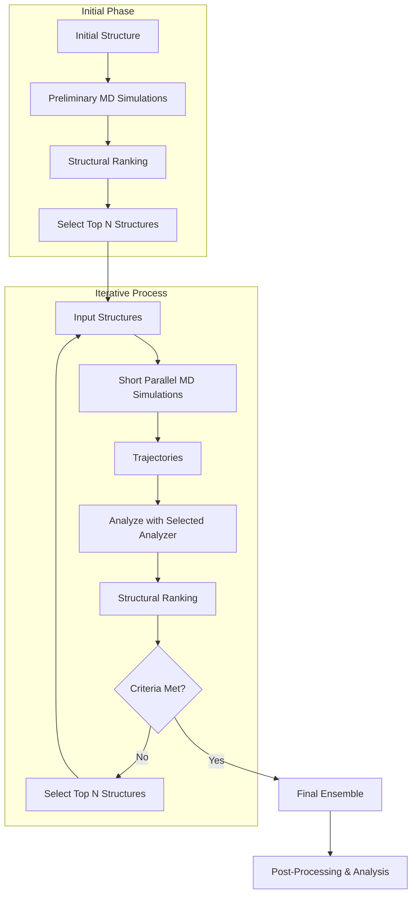
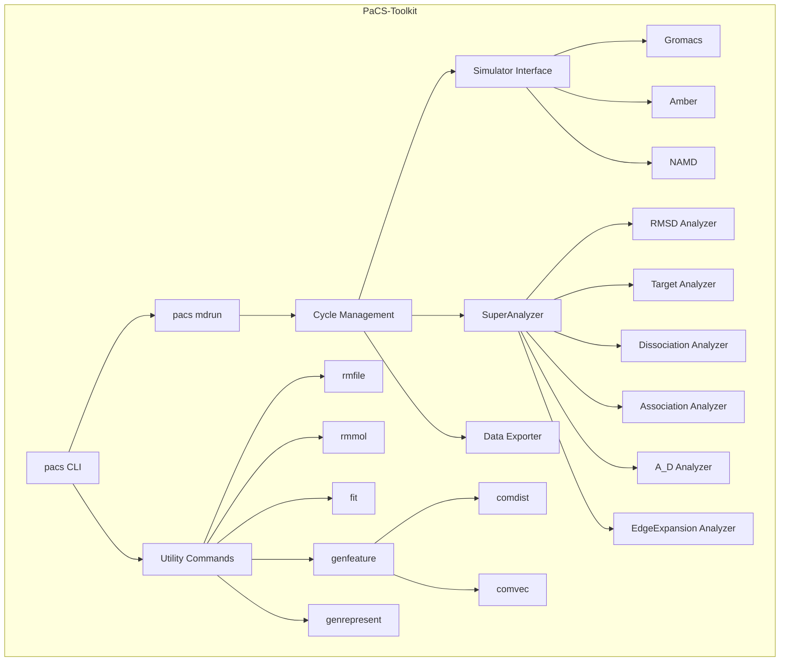
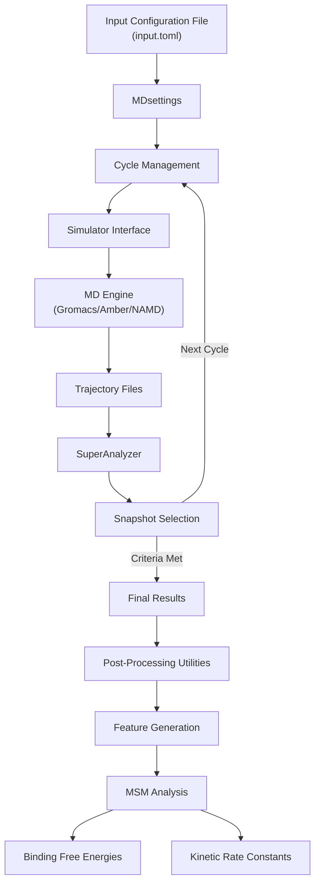

# Overview

<details>
<summary>Relevant source files</summary>

The following files were used as context for generating this wiki page:

- [README.md](README.md)
- [docs/src/README.md](docs/src/README.md)
- [docs/src/SUMMARY.md](docs/src/SUMMARY.md)
- [docs/src/mdrun/reference.md](docs/src/mdrun/reference.md)
- [pacs/_version.py](pacs/_version.py)

</details>


## Purpose and Scope

PaCS-Toolkit is a software package that enables the execution and analysis of Parallel Cascade Selection Molecular Dynamics (PaCS-MD) simulations. PaCS-MD is a non-bias-enhanced sampling method designed to efficiently explore conformational spaces in molecular systems. This toolkit provides a comprehensive framework for running PaCS-MD simulations with various molecular dynamics engines, analyzing the results, and performing post-simulation processing.

This overview introduces the fundamental concepts, architecture, and capabilities of PaCS-Toolkit. For installation instructions, see [Installation](#2), and for a hands-on introduction, see the [Quick Start Guide](#3).

Sources: [README.md:1-6](), [docs/src/README.md:1-2]()

## What is PaCS-MD?

PaCS-MD is an enhanced sampling method that explores the conformational space of molecular systems through an iterative process of short parallel simulations and structure selection. The method operates by:

1. Running multiple short MD simulations in parallel
2. Ranking structures based on specific criteria (e.g., RMSD, distance)
3. Selecting top-ranked structures as starting points for the next simulation cycle
4. Repeating until predefined criteria are met

This approach allows efficient exploration of conformational transitions without introducing artificial biases to the system.

### PaCS-MD Workflow



Sources: [docs/src/README.md:10-49]()

## Key Features

PaCS-Toolkit offers several unique capabilities that make it a versatile tool for molecular dynamics research:

1. **Multiple Analyzer Types** for different research objectives:
   - RMSD-based selection (structural deviation)
   - Target-directed sampling (conformational transitions)
   - Dissociation studies (unbinding events)
   - Association studies (binding events)
   - Combined association/dissociation 
   - Edge expansion (broad conformational exploration)

2. **Multiple MD Engine Support**:
   - Gromacs
   - Amber
   - NAMD

3. **Comprehensive Analysis Tools**:
   - File management utilities
   - Trajectory processing
   - Feature extraction
   - Markov State Model (MSM) analysis

4. **Extensible Framework** that allows for custom analyzer implementation

Sources: [README.md:3-4](), [README.md:54-71]()

## System Architecture

PaCS-Toolkit follows a modular design that separates different functional components:



The architecture centers around the `Cycle` class, which orchestrates the execution of simulation cycles. Each cycle involves running simulations through a `Simulator` interface, analyzing trajectories via the `SuperAnalyzer` framework, and exporting data for the next cycle or final analysis.

Sources: [docs/src/SUMMARY.md:1-39]()

## Data Flow

The following diagram illustrates how data flows through the PaCS-Toolkit during a simulation:



The process begins with an input configuration file that defines simulation parameters. The `MDsettings` class parses this configuration and initializes the simulation cycle. Each cycle runs simulations, analyzes results, and selects structures for the next cycle until specified criteria are met. The final trajectories can be processed with various utility tools for deeper analysis.

Sources: [README.md:8-52]()

## Installation Options

PaCS-Toolkit can be installed with different feature sets to accommodate various use cases:

| Installation Option | Features | Command |
|---------------------|----------|---------|
| Core | Basic CLI and utilities | `pip install "pacs @ git+https://github.com/Kitaolab/PaCS-Toolkit.git"` |
| With MDTraj | Enhanced trajectory analysis | `pip install "pacs[mdtraj] @ git+https://github.com/Kitaolab/PaCS-Toolkit.git"` |
| With MSM | Markov State Model analysis | `pip install "pacs[msm] @ git+https://github.com/Kitaolab/PaCS-Toolkit.git"` |
| All Features | Complete functionality | `pip install "pacs[all] @ git+https://github.com/Kitaolab/PaCS-Toolkit.git"` |

Sources: [README.md:19-45]()

## Usage Example

A basic PaCS-MD simulation can be started with:

```bash
pacs mdrun -t 1 -f input.toml
```

Where `-t` specifies the number of threads and `-f` points to the input configuration file. For more detailed usage instructions, see the [Quick Start Guide](#3).

Sources: [README.md:48-52]()

## Versions and Development

The current version of PaCS-Toolkit is 1.2.0 as indicated in the version file.

Sources: [pacs/_version.py:1-2]()

## References and Citations

PaCS-Toolkit builds upon extensive research in the field of enhanced sampling for molecular dynamics. The methodology has been applied to various molecular systems, including protein-ligand binding/unbinding, protein domain motions, and conformational transitions.

Key publications:
- Ikizawa et al. (2024): PaCS-Toolkit software
- Harada & Kitao (2013): Original PaCS-MD method
- Tran et al. (2018, 2019): Dissociation PaCS-MD
- Takaba et al. (2020): Edge expansion PaCS-MD

For a complete list of references, see the [Reference section](#4.2) of the documentation.

Sources: [README.md:54-76](), [docs/src/mdrun/reference.md:1-33]()

---