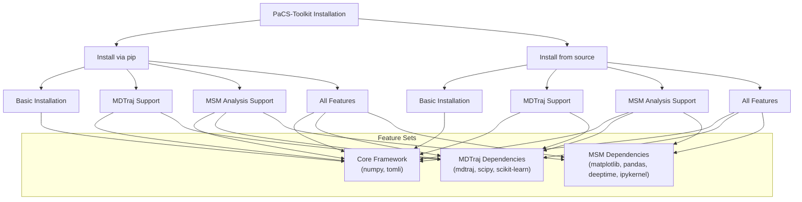
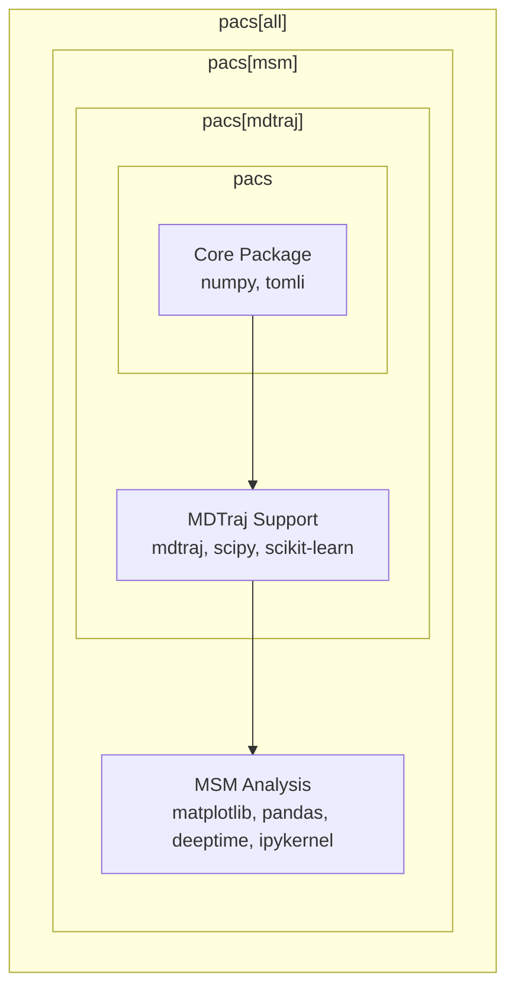

# Installation

<details>
<summary>Relevant source files</summary>

The following files were used as context for generating this wiki page:

- [.gitignore](.gitignore)
- [docs/src/install.md](docs/src/install.md)
- [requirements.txt](requirements.txt)
- [setup.py](setup.py)

</details>


This page details the process of installing PaCS-Toolkit, a framework for Parallel Cascade Selection Molecular Dynamics (PaCS-MD) simulations. PaCS-Toolkit offers several installation options depending on your specific requirements and intended usage. For quick usage instructions after installation, see [Quick Start Guide](#3).

## System Requirements

Before installing PaCS-Toolkit, ensure your system meets the following requirements:

- **Python**: Version 3.7 or newer (Python 3.8+ is recommended, especially for MSM analysis)
- **Molecular Dynamics Engine**: At least one of the following simulators:
  - [Gromacs](https://www.gromacs.org/) (version 2022.2 or newer tested)
  - [Amber](https://ambermd.org/) (version 2023 or newer tested)
  - [NAMD](https://www.ks.uiuc.edu/Research/namd/) (version 2021-02-20 or newer tested)

Sources: [docs/src/install.md:13-18]()

## Installation Methods

PaCS-Toolkit can be installed either through pip directly from the GitHub repository or by cloning/downloading the source code.

### Installation Architecture

Below is a diagram showing the installation options and how they relate to different feature sets:



Sources: [docs/src/install.md:20-145](), [setup.py:32-62]()

### Installation via pip

The easiest way to install PaCS-Toolkit is directly from the GitHub repository using pip:

#### Using pip with conda (Recommended)

1. Create and activate a conda environment (recommended for better package management):

```bash
conda create -n pacsmd "python>=3.8" -y
conda activate pacsmd
```

2. Install PaCS-Toolkit with your desired configuration:

| Configuration | Command | Use Case |
|---------------|---------|----------|
| Basic | `pip install "pacs @ git+https://github.com/Kitaolab/PaCS-Toolkit.git"` | Using `pacs mdrun` with Gromacs analyzer |
| MDTraj Support | `pip install "pacs[mdtraj] @ git+https://github.com/Kitaolab/PaCS-Toolkit.git"` | Using `pacs mdrun` with MDTraj analyzers |
| MSM Support | `pip install "pacs[msm] @ git+https://github.com/Kitaolab/PaCS-Toolkit.git"` | Performing Markov State Model analysis |
| All Features | `pip install "pacs[all] @ git+https://github.com/Kitaolab/PaCS-Toolkit.git"` | Using all PaCS-Toolkit functionality |

#### Using pip directly

You can also install PaCS-Toolkit without conda, using the same pip commands as above.

Sources: [docs/src/install.md:20-68]()

### Installation from Source

For development or to access specific versions, you can install from source:

1. Clone the repository or download a specific version:

```bash
# Clone the latest version
git clone https://github.com/Kitaolab/PaCS-Toolkit.git
cd PaCS-Toolkit

# Or download a specific release
version="x.x.x"  # Replace with actual version number
wget https://github.com/Kitaolab/PaCS-Toolkit/archive/refs/tags/${version}.tar.gz
tar -xvzf ${version}.tar.gz
cd PaCS-Toolkit-${version}
```

2. Create a conda environment (optional but recommended):

```bash
conda create -n pacsmd "python>=3.8" -y
conda activate pacsmd
```

3. Install with your desired configuration:

| Configuration | Command | Use Case |
|---------------|---------|----------|
| Basic | `pip install -e .` | Using `pacs mdrun` with Gromacs/CPPtraj analyzers |
| MDTraj Support | `pip install -e ".[mdtraj]"` | Using `pacs mdrun` with MDTraj analyzers |
| MSM Support | `pip install -e ".[msm]"` | Performing Markov State Model analysis |
| All Features | `pip install -e ".[all]"` | Using all PaCS-Toolkit functionality |

Sources: [docs/src/install.md:71-145]()

## Feature Sets and Dependencies

PaCS-Toolkit has a modular design with different feature sets and dependencies:



### Dependency Details

The table below shows the dependencies for each feature set:

| Feature Set | Dependencies | Functionality |
|-------------|--------------|--------------|
| Core (`pacs`) | numpy, tomli | Basic PaCS-MD simulation with Gromacs analyzers |
| MDTraj (`pacs[mdtraj]`) | mdtraj, scipy, scikit-learn | MDTraj-based structural analysis |
| MSM (`pacs[msm]`) | matplotlib, pandas, deeptime, ipykernel | Markov State Model analysis |
| All (`pacs[all]`) | All of the above | Complete toolkit functionality |

Note: Python 3.8 or newer is strongly recommended for MSM analysis due to `deeptime` requirements.

Sources: [setup.py:32-62](), [requirements.txt:1-10]()

## Verifying Installation

After installation, verify that PaCS-Toolkit is correctly installed by running:

```bash
pacs --version
```

This command should display the version of PaCS-Toolkit that has been installed.

To test basic functionality, you can run:

```bash
pacs --help
```

This should display the available commands in the PaCS-Toolkit CLI.

## Usage After Installation

Once installed, PaCS-Toolkit can be used through its command-line interface (CLI) by invoking the `pacs` command. The main entry point for running PaCS-MD simulations is `pacs mdrun`, which uses the configuration provided in your input files.

For detailed usage instructions, see the [Quick Start Guide](#3) and [Core Framework](#4) documentation.

Sources: [setup.py:64-68]()

---