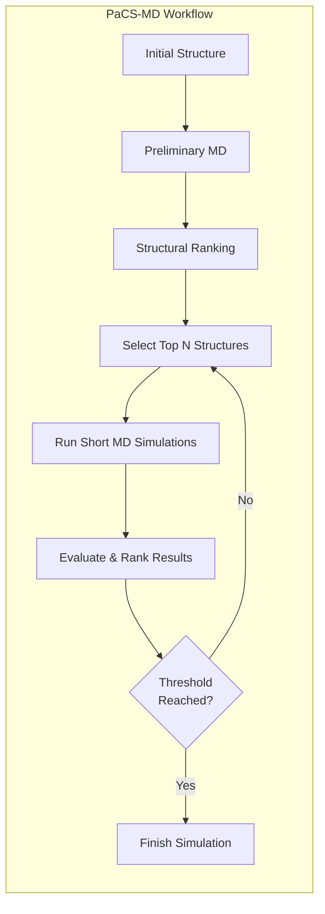
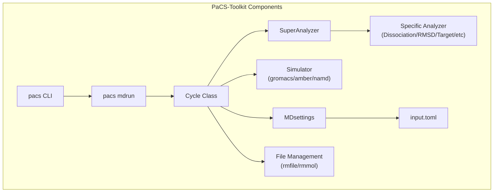
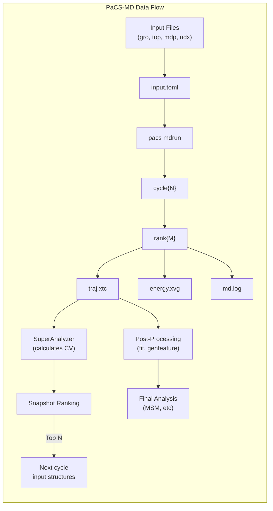

# Quick Start Guide

<details>
<summary>Relevant source files</summary>

The following files were used as context for generating this wiki page:

- [README.md](README.md)
- [docs/src/README.md](docs/src/README.md)
- [docs/src/SUMMARY.md](docs/src/SUMMARY.md)
- [docs/src/mdrun/reference.md](docs/src/mdrun/reference.md)
- [docs/src/quickstart.md](docs/src/quickstart.md)
- [pacs/_version.py](pacs/_version.py)

</details>


This guide provides a step-by-step tutorial for running PaCS-MD (Parallel Cascade Selection Molecular Dynamics) simulations using the PaCS-Toolkit. It focuses on the essential steps to get you started with a basic dissociation PaCS-MD simulation using GROMACS. For detailed information about specific analyzers, input file configuration options, or advanced features, please refer to the corresponding documentation sections.

## What is PaCS-MD?

PaCS-MD is an enhanced sampling method that efficiently explores conformational space through multiple short MD simulations cascaded together. Each cycle selects starting structures for the next round based on specific evaluation criteria, allowing the system to explore large conformational changes without applying biasing forces.



Sources: [docs/src/README.md:10-49]()

## Installation

PaCS-Toolkit can be installed using pip or conda. Choose the installation method that best suits your environment.

### Option 1: Install with pip

```bash
# Install all features of PaCS-Toolkit
pip install "pacs[all] @ git+https://github.com/Kitaolab/PaCS-Toolkit.git"
```

### Option 2: Install with conda and pip

```bash
conda create -n pacs "python>=3.8" -y
conda activate pacs

# Install all features of PaCS-Toolkit
pip install "pacs[all] @ git+https://github.com/Kitaolab/PaCS-Toolkit.git"
```

You can also install only specific features:

```bash
# Install only MDTraj functionality
pip install "pacs[mdtraj] @ git+https://github.com/Kitaolab/PaCS-Toolkit.git"
```

Sources: [README.md:19-45](), [docs/src/quickstart.md:17-35]()

## PaCS-MD Simulation Workflow

Before we begin, let's understand how PaCS-Toolkit components interact during a simulation:



Sources: [docs/src/quickstart.md:37-40]()

## Preparing Initial Files

For a GROMACS-based simulation, you need the following files:

1. Structure file (`.gro`)
2. Topology file (`.top`)
3. Parameter file (`.mdp`)
4. Index file (`.ndx`, optional)

These files define your molecular system and simulation parameters.

Sources: [docs/src/quickstart.md:37-41]()

## Creating the Configuration File

PaCS-MD requires a TOML format configuration file (commonly named `input.toml`). This file contains all the settings for your simulation:

```toml
# Input file for PaCS-MD
## basic
max_cycle = 2                           # Maximum number of cycles to run
n_replica = 3                           # Number of replica
n_parallel = 3                          # Number of replica calculated at a time
skip_frame = 1                          # Frequency of frames used for ranking
centering = true                        # Whether to move the molecule to the center
centering_selection = "protein"         # Name of molecule to move in the center
working_dir = "./."                     # Directory where pacsmd will run

## simulator
simulator = "gromacs"                   # Software used inside PaCS-MD
cmd_mpi = "mpirun -np 4"                # Commands for MPI such as mpirun
cmd_serial = "gmx_mpi mdrun -ntomp 6"   # Commands to run the simulator serially
cmd_parllel = "gmx_mpi mdrun -ntomp 6"  # Commands to run the simulator parallelly
structure = "input.gro"                 # Structural file such as gro, pdb, rst7
topology = "topol.top"                  # Topology file such as top, parm7, psf
mdconf = "parameter.mdp"                # Parameter file such as mdp, mdin, namd
index_file = ".index.ndx"               # Gromacs index file
trajectory_extension = ".xtc"           # Trajectory file extension

## analyzer
type = "dissociation"                   # Evaluation type
threshold = 100                         # CV threshold for terminating a trial
skip_frame = 1                          # How many frames to skip when ranking CVs
analyzer = "mdtraj"                     # Trajectory tool used to calculate the evaluation
selection1 = "resid 1 to 5"             # Selection string for first group in trajectories
selection2 = "resid 6 to 10"            # Selection string for second group in trajectories

## postprocess
genrepresent = true                     # Whether genrepresent is executed after trial
rmmol = true                            # Whether rmmol is executed after each cycle
keep_selection = "not water"            # Molecules to keep when running rmmol
rmfile = true                           # Whether rmfile is executed after trial
```

The configuration is divided into several sections:
- **Basic**: General PaCS-MD settings
- **Simulator**: MD engine configuration
- **Analyzer**: Evaluation criteria settings
- **Postprocess**: Output processing options

For more detailed information about configuration options, see the Input File documentation [Section 4.2](#4.2).

Sources: [docs/src/quickstart.md:44-92]()

## Running PaCS-MD

Once your configuration file is ready, you can run a PaCS-MD simulation using the `pacs mdrun` command:

```bash
pacs mdrun -t 1 -f input.toml
```

Parameters:
- `-t 1`: Specifies the trial ID (for running multiple independent simulations)
- `-f input.toml`: Path to the configuration file

This will create a directory structure for your simulation results:

```
trial001/
├── cycle001/
│   ├── rank001/
│   ├── rank002/
│   └── ...
├── cycle002/
│   └── ...
└── ...
```

Sources: [README.md:48-52](), [docs/src/quickstart.md:95-102]()

### Running Multiple Trials

For better sampling, it's recommended to run multiple independent trials:

```bash
pacs mdrun -t 2 -f input.toml
```

This will create a separate `trial002/` directory with its own set of results.

Sources: [docs/src/quickstart.md:117-128]()

## Post-Processing

After completing your PaCS-MD simulations, several post-processing steps are typically performed:

### 1. Fitting Trajectories

To prepare trajectories for analysis, use the `pacs fit` command:

```bash
pacs fit trial mdtraj -t 1 -tf prd_rmmol.xtc -top rmmol_top.pdb -r ref.gro -ts protein -rs protein
```

This aligns all frames to a reference structure, making analysis more consistent.

Sources: [docs/src/quickstart.md:130-135]()

### 2. Extracting Collective Variables

Extract relevant collective variables (CVs) for further analysis:

```bash
pacs genfeature comdist mdtraj -t 1 -tf prd.xtc -top inputs/example_gromacs/input.gro -s1 "residue 1" -s2 "residue 9"
```

The `genfeature` command supports several CV types:
- `comdist`: Center of mass distance
- `comvec`: Center of mass vector
- `rmsd`: Root mean square deviation

This creates a directory containing the extracted data:

```
comdist-CV/
```

Sources: [docs/src/quickstart.md:137-146]()

### 3. MSM Analysis

For advanced analysis, PaCS-Toolkit supports Markov State Model (MSM) analysis of the trajectories. This can provide insights into binding free energies and kinetic rates. For detailed information on MSM analysis, see the MSM Analysis documentation [Section 7](#7).

Sources: [docs/src/quickstart.md:149-151]()

## Data Flow in a PaCS-MD Simulation

The following diagram illustrates the data flow during a PaCS-MD simulation:



Sources: [docs/src/quickstart.md:1-151]()

## Next Steps

After completing this quick start guide, you might want to explore:

1. Different analyzer types for other PaCS-MD variants [Section 5](#5)
2. Advanced configuration options [Section 4.2](#4.2)
3. MSM analysis for binding free energy calculations [Section 7](#7)
4. Job submission scripts for HPC environments [Section 8.1](#8.1)

## Troubleshooting

If you encounter issues during installation or execution:

1. Check your environment variables and paths
2. Ensure all dependencies are correctly installed
3. Verify your input files are correctly formatted
4. Check the PaCS-Toolkit version compatibility

The current version of PaCS-Toolkit is v1.2.0.

Sources: [pacs/_version.py:1-2]()

---