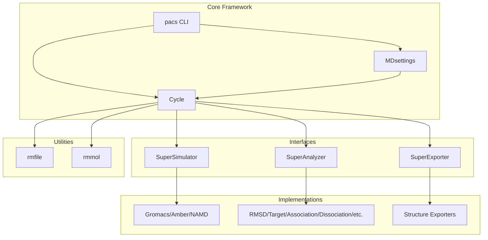
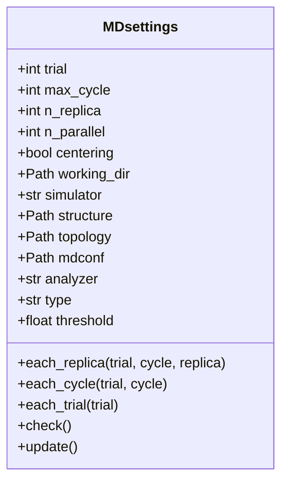
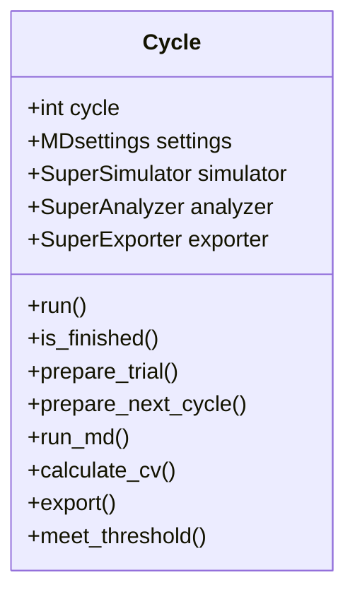
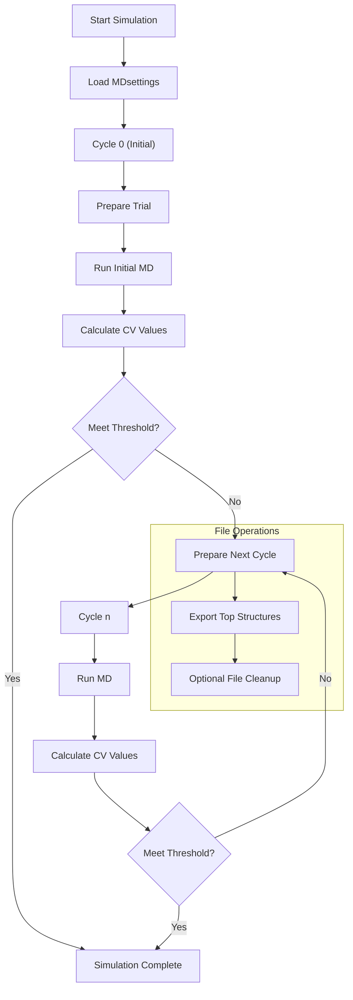
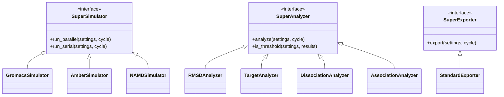
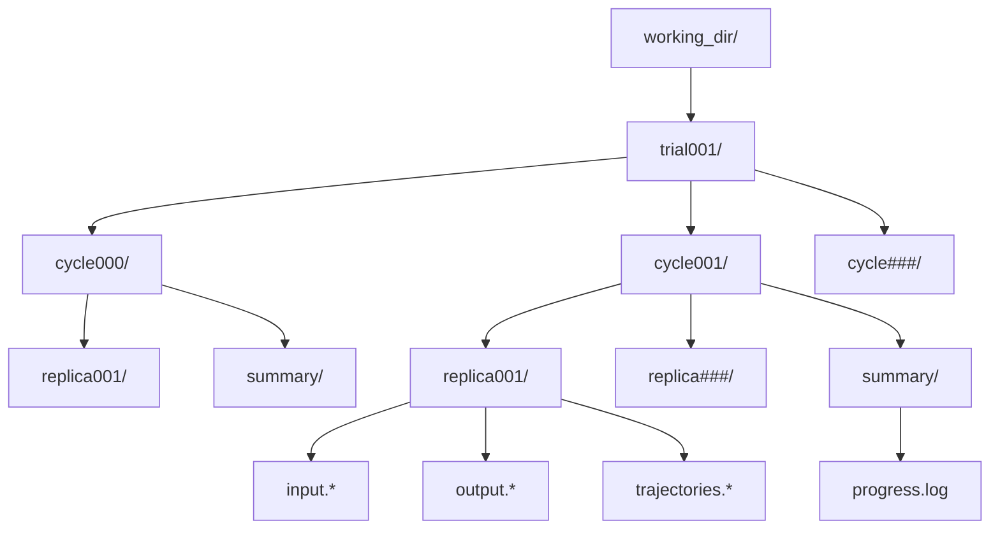

# Core Framework

Relevant source files

The following files were used as context for generating this wiki page:

- [pacs/mdrun/Cycle.py](pacs/mdrun/Cycle.py)
- [pacs/models/settings.py](pacs/models/settings.py)

The Core Framework forms the architectural foundation of the PaCS-Toolkit, providing the essential infrastructure for running Parallel Cascade Selection Molecular Dynamics (PaCS-MD) simulations. This page documents the fundamental components and their relationships within the framework that enable efficient enhanced sampling simulations. For details about specific simulation cycles, see [Simulation Cycle](#4.1), and for configuration options, see [Input File Configuration](#4.2).

## Architecture Overview

The Core Framework consists of several key components that work together to execute and manage PaCS-MD simulations. These components follow a modular design pattern, allowing for extensibility and customization.

**Core Framework Components Diagram**

Sources: [pacs/mdrun/Cycle.py:16-174](), [pacs/models/settings.py:10-384]()

## Key Components

### MDsettings

The `MDsettings` class is a central configuration container that holds all parameters needed to run PaCS-MD simulations. It defines the behavior of simulations and provides methods for validation and directory path access.

**MDsettings Class Diagram**

Sources: [pacs/models/settings.py:10-384]()

The `MDsettings` class includes several categories of settings:

| Category | Purpose | Example Settings |
|----------|---------|-----------------|
| Basic | Core configuration | trial, max_cycle, n_replica, working_dir |
| Simulator | MD engine settings | simulator, structure, topology, mdconf |
| Analyzer | Analysis configuration | analyzer, type, threshold, selection1 |
| Utilities | File management | rmfile, rmmol |

The class provides validation through its `check()` method, which ensures all required parameters are properly set before running a simulation. It also includes helper methods for accessing directories (`each_replica()`, `each_cycle()`, `each_trial()`) which establish the directory structure for simulation results.

Sources: [pacs/models/settings.py:10-384]()

### Cycle

The `Cycle` class is the central execution unit that manages a single iteration of a PaCS-MD simulation. It coordinates the simulation, analysis, and preparation for the next cycle.

**Cycle Class Diagram**

Sources: [pacs/mdrun/Cycle.py:17-174]()

The `Cycle` class implements the core workflow of a PaCS-MD cycle:

1. **Initialization**: Sets up the cycle with references to the settings, simulator, analyzer, and exporter.
2. **Execution**: Runs the MD simulation using the configured simulator.
3. **Analysis**: Analyzes the simulation results to calculate collective variables.
4. **Selection**: Based on the analysis results, prepares structures for the next cycle.
5. **Cleanup**: Optionally reduces molecule data and removes temporary files.

Sources: [pacs/mdrun/Cycle.py:17-174]()

## Simulation Workflow

The PaCS-MD simulation workflow is an iterative process that executes multiple cycles until a termination condition is met. The Core Framework manages this process through the interaction of its components.

**PaCS-MD Simulation Workflow Diagram**

Sources: [pacs/mdrun/Cycle.py:40-66](), [pacs/mdrun/Cycle.py:170-173]()

The workflow begins with loading settings and initializing the first cycle (Cycle 0). After the initial MD simulation, the framework analyzes the results to calculate collective variables (CVs). If the threshold is met or the maximum cycle count is reached, the simulation completes. Otherwise, the framework prepares for the next cycle by exporting the top-ranked structures and optionally cleaning up files. This process repeats until a termination condition is met.

## Core Interfaces

The Core Framework provides several key interfaces that facilitate extensibility and allow support for different simulation engines, analysis methods, and data export mechanisms.

**Core Framework Interfaces Diagram**

Sources: [pacs/mdrun/Cycle.py:8-10]()

These interfaces define the contract that specific implementations must follow:

1. **SuperSimulator**: Provides methods for running molecular dynamics simulations, supporting both parallel and serial execution.
2. **SuperAnalyzer**: Defines methods for analyzing simulation results and determining if termination criteria are met.
3. **SuperExporter**: Manages the export of structures for the next simulation cycle.

This interface-based design allows the Core Framework to be extended with support for additional simulation engines, analysis methods, and export mechanisms without modifying the core simulation logic.

## Directory Structure

The Core Framework establishes a standardized directory structure for organizing simulation data. This structure helps manage the potentially large amounts of data generated during PaCS-MD simulations.

**PaCS-MD Directory Structure Diagram**

Sources: [pacs/models/settings.py:94-120](), [pacs/mdrun/Cycle.py:105-125]()

The directory structure is organized hierarchically:

1. **Working Directory**: The root directory containing all simulation data.
2. **Trial**: Each trial is a complete PaCS-MD simulation (numbered from 001).
3. **Cycle**: Each cycle represents one iteration of the PaCS-MD algorithm (numbered from 000).
4. **Replica**: Within each cycle, multiple replicas are simulated (numbered from 001).
5. **Summary**: Contains summary information for each cycle, including progress logs.

This structure enables efficient management of simulation data and facilitates analysis of results across cycles and replicas.

## Summary

The Core Framework provides the foundation for running PaCS-MD simulations by coordinating the interaction between simulation engines, analyzers, and data management components. Its modular design allows for customization and extension to support various simulation scenarios and analysis techniques.

Key components like `MDsettings` and `Cycle` implement the core functionality, while interfaces like `SuperSimulator`, `SuperAnalyzer`, and `SuperExporter` enable extensibility. The framework also establishes a standardized directory structure for organizing simulation data, making it easier to manage and analyze results.

---