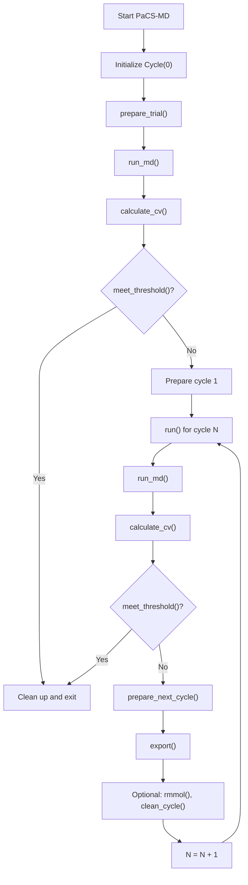
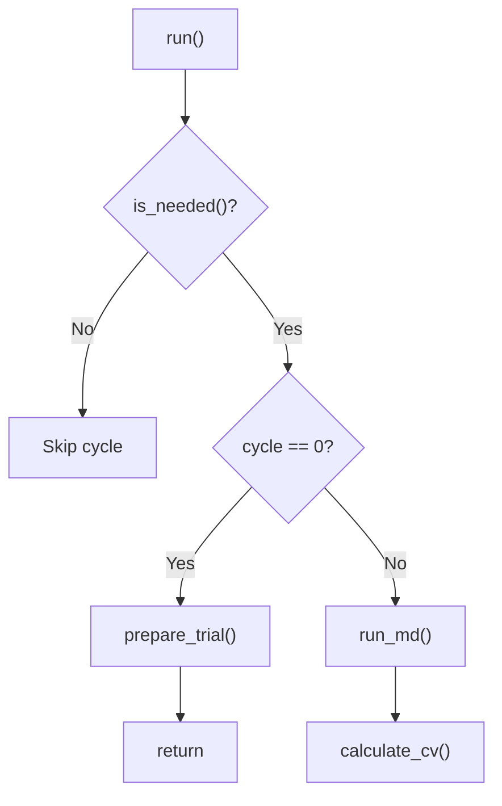
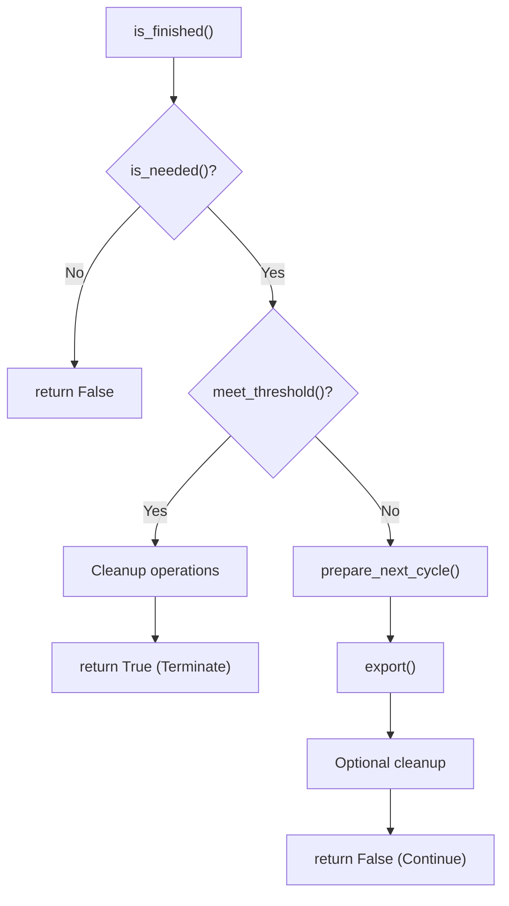
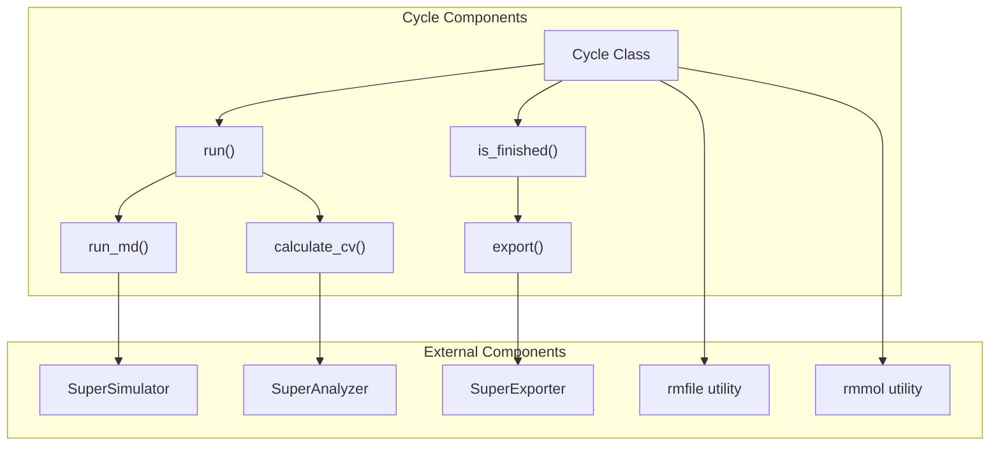
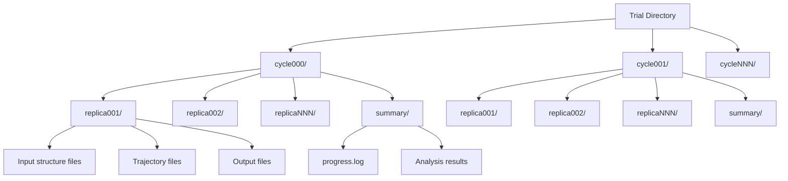

# Simulation Cycle

<details>
<summary>Relevant source files</summary>

The following files were used as context for generating this wiki page:

- [pacs/mdrun/Cycle.py](pacs/mdrun/Cycle.py)

</details>


## Purpose and Scope

This document details the simulation cycle process in PaCS-Toolkit, which is the core mechanism for executing Parallel Cascade Selection Molecular Dynamics (PaCS-MD) simulations. The simulation cycle manages the iterative process of running MD simulations, analyzing their output, and preparing subsequent cycles until termination criteria are met. For information about configuration settings used by the simulation cycle, see [Input File Configuration](#4.2) and [MDsettings](#4.3).

## Cycle Class Overview

The `Cycle` class serves as the primary controller for executing PaCS-MD simulation cycles. It coordinates interactions between simulators, analyzers, and exporters to facilitate the enhanced sampling process.

```mermaid
classDiagram
    class "Cycle" {
        +int cycle
        +MDsettings settings
        +SuperSimulator simulator
        +SuperAnalyzer analyzer
        +SuperExporter exporter
        +run()
        +is_finished()
        +prepare_trial()
        +prepare_next_cycle()
        +run_md()
        +calculate_cv()
        +export()
        +meet_threshold()
    }
    
    "Cycle" --> "MDsettings" : uses
    "Cycle" --> "SuperSimulator" : delegates MD tasks
    "Cycle" --> "SuperAnalyzer" : delegates analysis
    "Cycle" --> "SuperExporter" : delegates exports
```

Sources: [pacs/mdrun/Cycle.py:17-173]()

## Simulation Cycle Workflow

A PaCS-MD simulation consists of multiple cycles, starting from an initial structure (cycle 0) and proceeding until either the maximum cycle count is reached or a threshold criterion is met.



Sources: [pacs/mdrun/Cycle.py:40-66](), [pacs/mdrun/Cycle.py:170-173]()

## Detailed Cycle Execution Process

### Initialization and Starting a Cycle

The simulation cycle begins when the `run()` method is called. This method determines whether to prepare the initial trial (cycle 0) or execute a regular cycle.



Sources: [pacs/mdrun/Cycle.py:40-49](), [pacs/mdrun/Cycle.py:147-165]()

### Initial Trial Preparation (Cycle 0)

For the first cycle (cycle 0), special preparation is needed to set up the simulation:

1. Create directory structure for cycle 0
2. Copy the input structure to the cycle 0 directory
3. Run the initial MD simulation
4. Calculate collective variables
5. Optionally create a topology file with only essential atoms if `rmmol` is enabled

Sources: [pacs/mdrun/Cycle.py:68-104]()

### Regular Cycle Execution

For cycles after cycle 0, the process follows these steps:

1. Run parallel MD simulations using the simulator
2. Analyze the resulting trajectories using the analyzer
3. Check if the termination criteria are met
4. If not finished, prepare for the next cycle:
   - Create directory structure
   - Export selected structures to the next cycle
   - Optionally reduce molecule size and remove temporary files

Sources: [pacs/mdrun/Cycle.py:127-146]()

### Cycle Termination Check

After executing a cycle, the `is_finished()` method determines whether the simulation should continue or terminate:



Sources: [pacs/mdrun/Cycle.py:50-66](), [pacs/mdrun/Cycle.py:170-173]()

## Key Component Interactions

The `Cycle` class interacts with multiple components of the PaCS-Toolkit:



Sources: [pacs/mdrun/Cycle.py:127-146](), [pacs/mdrun/Cycle.py:1-12]()

## Data Flow in a Simulation Cycle

The following table illustrates the data flow between components during a simulation cycle:

| Step | Function | Input | Output | Component |
|------|----------|-------|--------|-----------|
| 1 | `run_md()` | Structure files from previous cycle | Trajectory files | SuperSimulator |
| 2 | `calculate_cv()` | Trajectory files | Collective variable values | SuperAnalyzer |
| 3 | `is_finished()` | CV values, settings | Boolean (continue/terminate) | Cycle |
| 4 | `prepare_next_cycle()` | Settings | Directory structure | Cycle |
| 5 | `export()` | Selected structures, settings | Input files for next cycle | SuperExporter |
| 6 | `rmmol()` (optional) | Trajectory files | Reduced trajectory files | rmmol utility |
| 7 | `clean_cycle()` (optional) | Cycle directory | Cleaned directory | rmfile utility |

Sources: [pacs/mdrun/Cycle.py:40-173]()

## Directory Structure Management

The `Cycle` class is responsible for creating and managing the directory structure required for PaCS-MD simulations:



Sources: [pacs/mdrun/Cycle.py:105-125]()

## Skip Logic and Resuming Simulations

The `Cycle` class includes logic to check if a cycle needs to be executed or can be skipped, facilitating the resumption of interrupted simulations:

1. The `is_needed()` method checks if the progress log exists
2. If the log exists, it checks for specific indicators:
   - "export to" - indicates if export was completed
   - "reduced" - indicates if molecule reduction was completed
   - "rmfile" - indicates if file cleanup was completed
3. Returns True if any of these operations need to be performed

This allows the simulation to efficiently resume from where it left off without redoing completed work.

Sources: [pacs/mdrun/Cycle.py:147-165]()

---