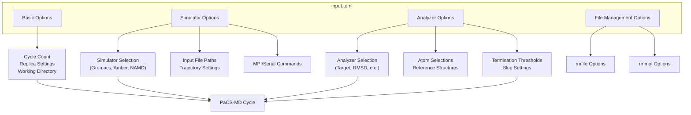
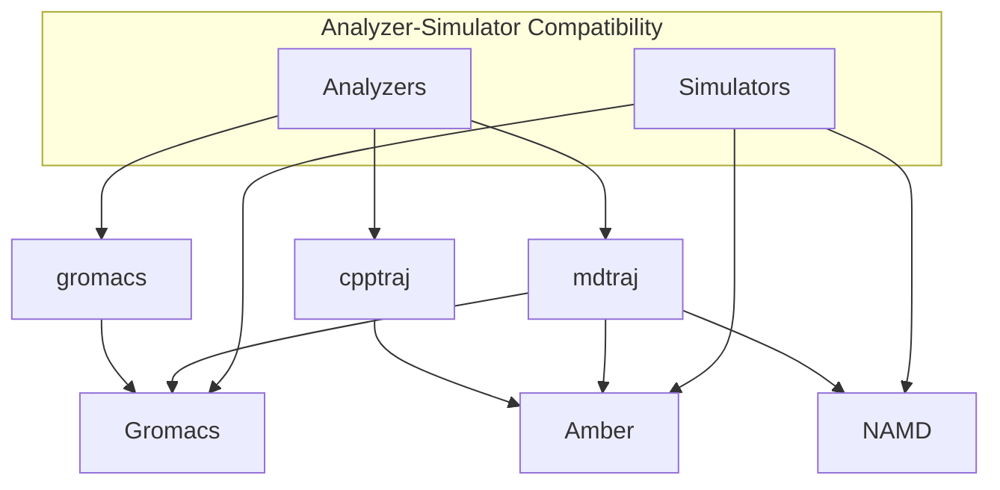
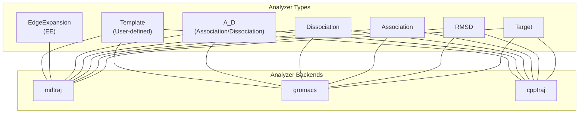

# Input File Configuration

<details>
<summary>Relevant source files</summary>

The following files were used as context for generating this wiki page:

- [docs/src/mdrun/inputfile.md](docs/src/mdrun/inputfile.md)
- [jobscripts/local/input.toml](jobscripts/local/input.toml)
- [jobscripts/tsubame3/input.toml](jobscripts/tsubame3/input.toml)

</details>


## Purpose and Scope

This document details the structure and options available in the `input.toml` configuration file, which is required to run PaCS-MD simulations using the PaCS-Toolkit. The input file defines all simulation parameters, including basic simulation settings, simulator configuration, analyzer settings, and file management options. For information about how these settings are handled internally, see [MDsettings](#4.3).

Sources: [docs/src/mdrun/inputfile.md:1-5]()

## File Format and Structure

The input configuration file must be written in [TOML](https://toml.io/en/) format, which is a simple and readable configuration file format. The file is organized into several logical sections:

1. Basic options - Simulation cycle settings, replica count, etc.
2. Simulator options - Configuration for molecular dynamics engines (Gromacs, Amber, NAMD)
3. Analyzer options - Settings for the method used to evaluate and rank simulation frames
4. File management options - Controls for trajectory file cleanup and processing

### Input File Structure



Sources: [docs/src/mdrun/inputfile.md:3-22](), [jobscripts/local/input.toml:1-45]()

## Basic Options

These options control the fundamental parameters of the PaCS-MD simulation.

| Option | Type | Default | Description |
|--------|------|---------|-------------|
| `max_cycle` | int | 1 | Maximum number of PaCS-MD cycles to run |
| `n_replica` | int | 1 | Number of replicas (parallel simulations) to run in each cycle |
| `n_parallel` | int | 1 | Number of replicas calculated simultaneously |
| `centering` | bool | true | Whether to center molecules when creating initial structures for the next cycle |
| `centering_selection` | string | varies by analyzer | Molecules to be centered (follows selection syntax of the chosen analyzer) |
| `working_dir` | string | "./." | Directory where PaCS-MD will run |

The `centering_selection` default value depends on the selected analyzer:
- `mdtraj`: "protein"
- `gromacs`: "Protein"
- `cpptraj`: "@CA,C,O,N,H"

Example configuration:

```toml
max_cycle = 200                    # Maximum number of cycles to run
n_replica = 10                     # Number of replicas
n_parallel = 1                     # Number of replicas calculated at a time
centering = true                   # Move molecules to center
centering_selection = "protein"    # Center protein molecules
working_dir = "./."                # Run in current directory
```

Sources: [docs/src/mdrun/inputfile.md:28-53](), [docs/src/mdrun/inputfile.md:56-66](), [jobscripts/local/input.toml:10-16]()

## Simulator Options

These options configure the molecular dynamics simulator used for PaCS-MD. The toolkit supports three simulators: Gromacs, Amber, and NAMD.

### Simulator Compatibility



Sources: [docs/src/mdrun/inputfile.md:69-76]()

### Common Simulator Options

| Option | Type | Default | Description |
|--------|------|---------|-------------|
| `simulator` | string | required | Name of simulator to use ("gromacs", "amber", or "namd") |
| `cmd_mpi` | string | "" | MPI commands (e.g., "mpirun -np 4") |
| `cmd_serial` | string | required | Command to run simulator serially |
| `cmd_parallel` | string | cmd_serial | Command to run simulator in parallel |
| `structure` | string | required | Path to structure file (gro, pdb, rst7, etc.) |
| `topology` | string | required | Path to topology file (top, parm7, psf, etc.) |
| `mdconf` | string | required | Path to MD parameter file (mdp, mdin, namd, etc.) |
| `trajectory_extension` | string | required | Trajectory file extension including dot (e.g., ".xtc") |

Sources: [docs/src/mdrun/inputfile.md:77-107](), [docs/src/mdrun/inputfile.md:111-121](), [docs/src/mdrun/inputfile.md:125-155](), [docs/src/mdrun/inputfile.md:159-191]()

### Gromacs-specific Options

| Option | Type | Default | Description |
|--------|------|---------|-------------|
| `index_file` | string | required | Path to Gromacs index file (ndx) |
| `nojump` | bool | false | Whether to perform PBC nojump treatment for analysis |

The `nojump` option is only valid when using Gromacs as both simulator and analyzer. When `true`, molecules can move outside the simulation box, which helps prevent errors in MSM analysis caused by molecules jumping across periodic boundaries.

Example Gromacs configuration:

```toml
simulator = "gromacs"                    # Use Gromacs
cmd_mpi = "mpirun -np 4"                 # MPI command
cmd_serial = "gmx_mpi mdrun -ntomp 6"    # Serial command
cmd_parallel = "gmx_mpi mdrun -ntomp 6"  # Parallel command
structure = "/work/input.gro"            # Structure file
topology = "/work/topol.top"             # Topology file
mdconf = "/work/parameter.mdp"           # MD parameter file
index_file = "/work/index.ndx"           # Index file
trajectory_extension = ".xtc"            # Trajectory extension
nojump = true                            # Enable nojump treatment
```

Sources: [docs/src/mdrun/inputfile.md:94-107](), [docs/src/mdrun/inputfile.md:111-121](), [jobscripts/local/input.toml:18-26]()

## Analyzer Options

The analyzer determines how simulation trajectories are evaluated to select structures for the next PaCS-MD cycle. Different analyzers implement different collective variables (CVs) for ranking simulation snapshots.

### Analyzer Types and Compatibility



Sources: [docs/src/mdrun/inputfile.md:192-201]()

### Common Analyzer Options

| Option | Type | Default | Description |
|--------|------|---------|-------------|
| `type` | string | required | Analyzer type ("target", "rmsd", "association", "dissociation", "ee", "a_d", or "template") |
| `threshold` | float | required | Threshold for simulation termination (units depend on analyzer type) |
| `skip_frame` | int | 1 | Number of frames to skip when ranking CVs |
| `analyzer` | string | "mdtraj" | Trajectory analysis tool ("mdtraj", "gromacs", or "cpptraj") |

Sources: [docs/src/mdrun/inputfile.md:202-241](), [docs/src/mdrun/inputfile.md:242-327](), [docs/src/mdrun/inputfile.md:328-375](), [docs/src/mdrun/inputfile.md:376-423](), [docs/src/mdrun/inputfile.md:424-468](), [docs/src/mdrun/inputfile.md:469-514](), [docs/src/mdrun/inputfile.md:515-538]()

### Target and RMSD Analyzers

The Target and RMSD analyzers share similar options, as both involve calculating RMSD to a reference structure:

| Option | Type | Default | Description |
|--------|------|---------|-------------|
| `reference` | string | required | Path to reference structure file |
| `selection1` | string | required | Selection for least-squares fit in trajectories |
| `selection2` | string | required | Selection for RMSD calculation in trajectories |
| `selection3` | string | selection1 | Selection for least-squares fit in reference |
| `selection4` | string | selection2 | Selection for RMSD calculation in reference |

For Target analyzer, a lower threshold means closer to the target structure, so the simulation terminates when CV falls below the threshold. For RMSD analyzer, the simulation terminates when CV exceeds the threshold.

Selection syntax depends on the chosen analyzer backend:
- `mdtraj`: Uses MDTraj atom selection syntax (e.g., "resid 5 to 100 and name CA")
- `gromacs`: Uses Gromacs index group names from the index file
- `cpptraj`: Uses CPPTraj mask syntax (e.g., "@CA,N,O,C")

Example Target analyzer configuration:

```toml
type = "target"                  # Target-directed simulation
threshold = 0.01                 # Terminate when RMSD < 0.01 nm
skip_frame = 1                   # Use all frames
analyzer = "mdtraj"              # Use MDTraj for analysis
reference = "/work/ref.pdb"      # Reference structure
selection1 = "backbone"          # Fit using backbone atoms
selection2 = "backbone"          # Calculate RMSD of backbone atoms
```

Sources: [docs/src/mdrun/inputfile.md:202-241](), [docs/src/mdrun/inputfile.md:242-327](), [jobscripts/local/input.toml:28-37]()

### Association and Dissociation Analyzers

The Association and Dissociation analyzers calculate the distance between two groups of atoms:

| Option | Type | Default | Description |
|--------|------|---------|-------------|
| `selection1` | string | required | First group of atoms for distance calculation |
| `selection2` | string | required | Second group of atoms for distance calculation |

For Association analyzer, the simulation terminates when the distance falls below the threshold (indicating binding). For Dissociation analyzer, the simulation terminates when the distance exceeds the threshold (indicating unbinding).

Example Association analyzer configuration:

```toml
type = "association"            # Association simulation
threshold = 0.3                 # Terminate when distance < 0.3 nm
skip_frame = 1                  # Use all frames
analyzer = "mdtraj"             # Use MDTraj for analysis
selection1 = "resid 1 to 5"     # First molecule (residues 1-5)
selection2 = "resid 6 to 10"    # Second molecule (residues 6-10)
```

Sources: [docs/src/mdrun/inputfile.md:328-375](), [docs/src/mdrun/inputfile.md:376-423]()

### A_D Analyzer

The A_D analyzer switches between association and dissociation modes to simulate repeated binding and unbinding events:

| Option | Type | Default | Description |
|--------|------|---------|-------------|
| `selection1` | string | required | First group of atoms for distance calculation |
| `selection2` | string | required | Second group of atoms for distance calculation |
| `d_threshold` | float | required | Threshold to switch from dissociation to association |
| `frame_sel` | int | required | Frame threshold for judging convergence |
| `bound_threshold` | int | required | Threshold for bound cycles before switching from association to dissociation |

Example A_D analyzer configuration:

```toml
type = "a_d"                    # Association-dissociation simulation
skip_frame = 1                  # Use all frames
analyzer = "mdtraj"             # Use MDTraj for analysis
selection1 = "resid 1"          # First molecule
selection2 = "resid 9"          # Second molecule
d_threshold = 3.0               # Switch when distance > 3.0 nm
frame_sel = 5                   # Convergence frame threshold
bound_threshold = 3             # Switch after 3 bound cycles
```

Sources: [docs/src/mdrun/inputfile.md:469-514]()

### EdgeExpansion Analyzer

The EdgeExpansion (ee) analyzer uses Principal Component Analysis (PCA) to explore the conformational space:

| Option | Type | Default | Description |
|--------|------|---------|-------------|
| `reference` | string | optional | Trajectory for computing PCA covariance matrix |
| `selection1` | string | required | Selection for least-squares fit |
| `selection2` | string | required | Selection for PCA calculation |
| `selection3` | string | selection1 | Selection for least-squares fit in reference |
| `selection4` | string | selection2 | Selection for PCA calculation in reference |

If `reference` is not set, the covariance matrix is computed based on the cycle 0 trajectory.

Example EdgeExpansion analyzer configuration:

```toml
type = "ee"                     # Edge expansion simulation
skip_frame = 1                  # Use all frames
analyzer = "mdtraj"             # Use MDTraj for analysis
selection1 = "backbone"         # Fit using backbone atoms
selection2 = "backbone"         # PCA of backbone atoms
```

Sources: [docs/src/mdrun/inputfile.md:424-468]()

### Template Analyzer

The Template analyzer allows users to define custom evaluation metrics:

| Option | Type | Default | Description |
|--------|------|---------|-------------|
| `threshold` | float | required | Threshold for simulation termination |
| `user-defined-*` | various | N/A | User-defined variables for custom evaluation |

Users can include additional variables specific to their custom template.

Example Template analyzer configuration:

```toml
type = "template"               # Custom template analyzer
threshold = 0.5                 # Custom threshold
user-defined-variable1 = 123    # Custom variable
user-defined-variable2 = "hoge" # Custom variable
```

Sources: [docs/src/mdrun/inputfile.md:515-538]()

## File Management Options

These options control how trajectory files are managed during and after the simulation.

| Option | Type | Default | Description |
|--------|------|---------|-------------|
| `rmmol` | bool | false | Whether to execute rmmol after each cycle |
| `keep_selection` | string | required if rmmol=true | Molecules to keep when running rmmol |
| `rmfile` | bool | false | Whether to execute rmfile after trial |

The `rmmol` utility removes unnecessary molecules from trajectories to reduce file size. The `keep_selection` option specifies which molecules to retain (follows selection syntax of the chosen analyzer).

The `rmfile` utility removes intermediate files after a trial is complete.

Example file management configuration:

```toml
rmmol = true                    # Remove unnecessary molecules
keep_selection = "not water"    # Keep all molecules except water
rmfile = true                   # Remove intermediate files
```

Sources: [docs/src/mdrun/inputfile.md:47-53](), [docs/src/mdrun/inputfile.md:56-66](), [jobscripts/local/input.toml:39-45](), [jobscripts/tsubame3/input.toml:42-48]()

## Hidden Options

The following options are set automatically and generally don't need to be specified in the input file:

| Option | Type | Description |
|--------|------|-------------|
| `cmd_gmx` | string | Gromacs command (extracted from cmd_serial) |
| `top_mdtraj` | string | Topology file for MDTraj (from input.toml) |
| `structure_extension` | string | Structure file extension (from structure) |

Sources: [docs/src/mdrun/inputfile.md:540-553]()

## Complete Example Input File

Here's a complete example input file for a Gromacs simulation with Target analyzer:

```toml
# Basic options
max_cycle = 200                                    # Maximum number of cycles
n_replica = 10                                     # Number of replicas
n_parallel = 1                                     # Number of simultaneous replicas
centering = true                                   # Center molecules
centering_selection = "protein"                    # Center protein molecules
working_dir = "./."                                # Run in current directory

# Simulator options
simulator = "gromacs"                              # Use Gromacs
cmd_mpi = ""                                       # No MPI commands
cmd_serial = "gmx_mpi mdrun"                       # Serial command
structure = "./inputs/input.gro"                   # Structure file
topology = "./inputs/topol.top"                    # Topology file
mdconf = "./inputs/parameter.mdp"                  # MD parameter file
index_file = "./inputs/index.ndx"                  # Index file
trajectory_extension = ".xtc"                      # Trajectory extension

# Analyzer options
type = "target"                                    # Target-directed simulation
threshold = 0.01                                   # Terminate when RMSD < 0.01 nm
skip_frame = 1                                     # Use all frames
analyzer = "mdtraj"                                # Use MDTraj for analysis
reference = "./inputs/ref.pdb"                     # Reference structure
selection1 = "backbone"                            # Fit using backbone atoms
selection2 = "backbone"                            # Calculate RMSD of backbone atoms
selection3 = "backbone"                            # Fit reference using backbone atoms
selection4 = "backbone"                            # Calculate reference RMSD of backbone atoms

# File management options
rmmol = true                                       # Remove unnecessary molecules
keep_selection = "not resname OPC"                 # Keep all molecules except water
rmfile = true                                      # Remove intermediate files
```

Sources: [jobscripts/local/input.toml:1-45]()

---