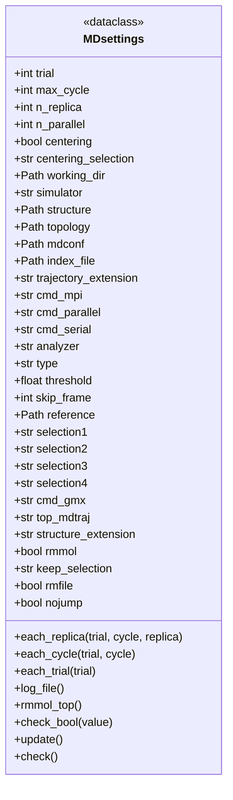
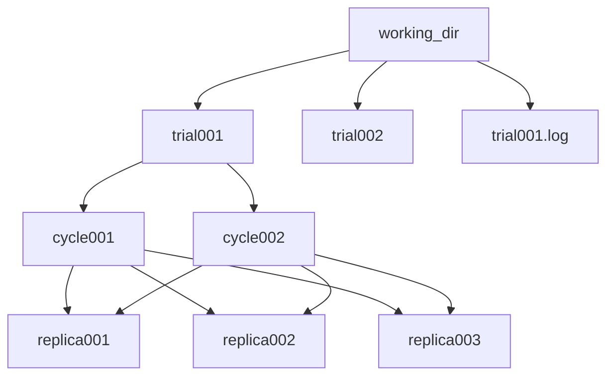
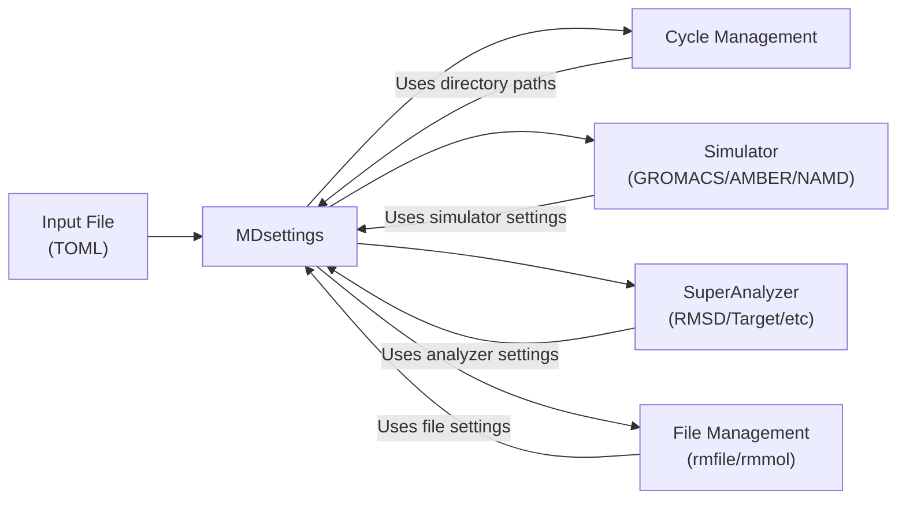
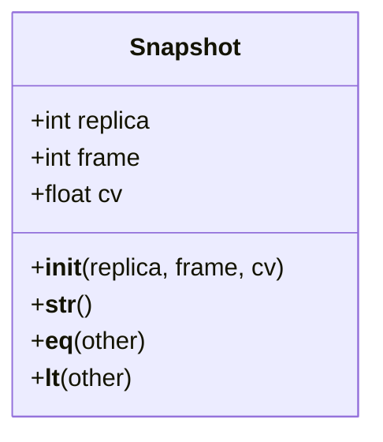

# MDsettings

<details>
<summary>Relevant source files</summary>

The following files were used as context for generating this wiki page:

- [pacs/models/settings.py](pacs/models/settings.py)

</details>


## Purpose and Scope

The `MDsettings` class is a core component of the PaCS-Toolkit that manages all configuration parameters required for molecular dynamics (MD) simulations. This page documents the structure, attributes, and methods of the `MDsettings` class, which serves as the central configuration manager throughout the PaCS-MD simulation cycle. For information about the input file configuration used to populate these settings, see [Input File Configuration](#4.2).

Sources: [pacs/models/settings.py:10-384]()

## Class Overview

The `MDsettings` class is implemented as a Python dataclass that stores and validates configuration parameters for PaCS-MD simulations. It handles everything from basic simulation parameters to specific simulator and analyzer settings.



Sources: [pacs/models/settings.py:10-384]()

## Directory Structure

The `MDsettings` class generates a hierarchical directory structure for organizing simulation data:



Sources: [pacs/models/settings.py:94-120]()

## Attribute Categories

The `MDsettings` class organizes its attributes into several logical categories:

### Basic Settings

These attributes define the fundamental parameters of the simulation:

| Attribute | Type | Default | Description |
|-----------|------|---------|-------------|
| trial | int | 1 | ID of the simulation trial |
| max_cycle | int | 1 | Maximum number of simulation cycles |
| n_replica | int | 1 | Number of replica simulations per cycle |
| n_parallel | int | 1 | Number of replicas to calculate simultaneously |
| centering | bool | True | Whether to center structures during export |
| centering_selection | str | None | Selection for centering (defaults based on analyzer) |
| working_dir | Path | "./" | Working directory for simulation output |

Sources: [pacs/models/settings.py:45-52]()

### Simulator Settings

These attributes configure the molecular dynamics simulator:

| Attribute | Type | Default | Description |
|-----------|------|---------|-------------|
| simulator | str | None | Simulator to use (gromacs, namd, amber) |
| structure | Path | None | Structure file path |
| topology | Path | None | Topology file path |
| mdconf | Path | None | Parameter file path |
| index_file | Path | None | Index file path (required for GROMACS) |
| trajectory_extension | str | None | File extension for trajectory files |
| cmd_mpi | str | "" | Command for MPI execution |
| cmd_parallel | str | None | Command for parallel simulations |
| cmd_serial | str | None | Command for serial simulations |
| cmd_gmx | str | None | GROMACS specific command (auto-detected if not set) |

Sources: [pacs/models/settings.py:54-64](), [pacs/models/settings.py:77-78]()

### Analyzer Settings

These attributes configure the trajectory analysis:

| Attribute | Type | Default | Description |
|-----------|------|---------|-------------|
| analyzer | str | "mdtraj" | Tool for analysis (mdtraj, gromacs, cpptraj) |
| type | str | None | Evaluation type (target, association, dissociation, rmsd, ee, a_d) |
| threshold | float | None | Threshold for evaluation criteria |
| skip_frame | int | 1 | Number of frames to skip during analysis |
| reference | Path | None | Reference structure file (required for target and rmsd) |
| selection1 | str | None | First selection for analysis |
| selection2 | str | None | Second selection for analysis |
| selection3 | str | None | Third selection (defaults to selection1 if not set) |
| selection4 | str | None | Fourth selection (defaults to selection2 if not set) |
| top_mdtraj | str | None | Topology file for MDTraj (auto-detected if not set) |
| structure_extension | str | None | File extension of structure file (auto-detected) |

Sources: [pacs/models/settings.py:65-74](), [pacs/models/settings.py:79-80]()

### File Management Settings

These attributes control file cleanup and processing options:

| Attribute | Type | Default | Description |
|-----------|------|---------|-------------|
| rmmol | bool | False | Whether to remove molecules from trajectories |
| keep_selection | str | None | Selection of atoms to keep when using rmmol |
| rmfile | bool | False | Whether to clean up temporary files |
| nojump | bool | False | Whether to enable nojump treatment (GROMACS only) |

Sources: [pacs/models/settings.py:84-92]()

## Key Methods

The `MDsettings` class provides several utility methods for working with simulation paths and validating settings:

### Path Generation Methods

These methods generate file paths for different levels of the simulation hierarchy:

```python
def each_replica(self, _trial=None, _cycle=None, _replica=None) -> str:
    # Returns path to a specific replica directory
    
def each_cycle(self, _trial=None, _cycle=None) -> str:
    # Returns path to a specific cycle directory
    
def each_trial(self, _trial=None) -> str:
    # Returns path to a specific trial directory
    
def log_file(self) -> str:
    # Returns path to the log file for the current trial
```

Sources: [pacs/models/settings.py:94-120]()

### Validation and Update Methods

These methods ensure the settings are valid and consistent:

```python
def check_bool(self, value: str) -> bool:
    # Converts string representations of boolean values to actual booleans
    
def update(self):
    # Updates settings to ensure consistency
    
def check(self) -> None:
    # Validates all settings and converts types as needed
```

Sources: [pacs/models/settings.py:126-384]()

## Validation Process

The `check()` method performs extensive validation to ensure all settings are correct and consistent:

1. **Type Conversion**: Converts string values to appropriate types (int, float, bool)
2. **Value Range Checks**: Verifies numeric values are within valid ranges
3. **Required Field Checks**: Ensures all required fields are provided
4. **Compatibility Checks**: Verifies combinations of settings are compatible
5. **Path Conversion**: Converts file paths to Path objects
6. **Auto-Detection**: Automatically detects certain settings when possible

Sources: [pacs/models/settings.py:152-384]()

## Integration with PaCS-MD Framework

The `MDsettings` class serves as the central configuration hub for the PaCS-MD simulation workflow:



Sources: [pacs/models/settings.py:10-384]()

## Related Classes

The settings module also includes the `Snapshot` class, which is used to store information about trajectory snapshots:



The `Snapshot` class is used for ranking and selecting frames during the PaCS-MD cycle based on their collective variable values.

Sources: [pacs/models/settings.py:386-409]()

## Common Error Cases

The `MDsettings` class includes comprehensive error checking that will terminate execution with informative error messages in the following cases:

1. Invalid trial, cycle, or replica numbers (must be between 1-999)
2. Missing required fields (simulator, type, cmd_serial, etc.)
3. Unsupported simulator or analyzer types
4. Missing threshold for types that require it
5. Incompatible simulator and analyzer combinations
6. Missing index file for GROMACS simulations
7. Missing reference for target or RMSD analysis types
8. Missing selection parameters for certain analysis types
9. Missing keep_selection when rmmol is enabled

Sources: [pacs/models/settings.py:152-384]()

## Summary

The `MDsettings` class is a critical component of the PaCS-Toolkit that provides a centralized configuration management system for all aspects of PaCS-MD simulations. It organizes simulation parameters into logical categories, validates their correctness, generates appropriate directory structures, and provides utility methods for working with simulation paths. Understanding this class is essential for configuring and customizing PaCS-MD simulations.

---