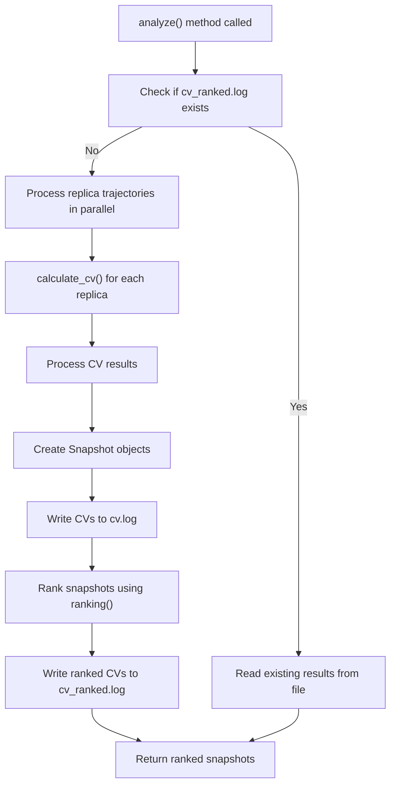
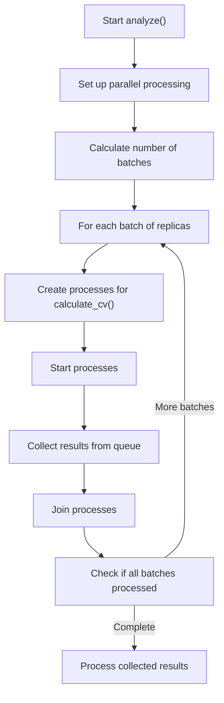
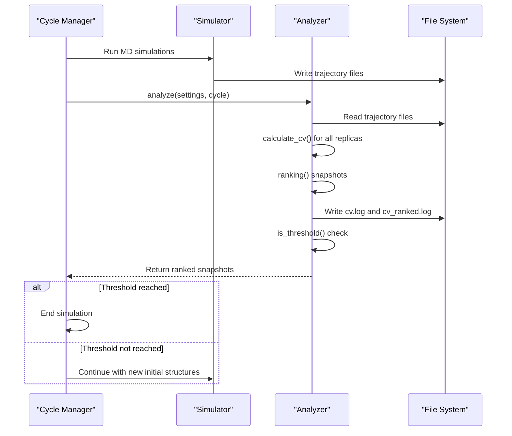

# Analyzers

<details>
<summary>Relevant source files</summary>

The following files were used as context for generating this wiki page:

- [pacs/mdrun/analyzer/superAnalyzer.py](pacs/mdrun/analyzer/superAnalyzer.py)

</details>


Analyzers are a critical component of the PaCS-Toolkit that evaluate simulation results during each cycle of a PaCS-MD simulation. They calculate collective variables (CVs), rank simulation snapshots, and determine whether simulation thresholds have been reached, effectively guiding the progress of the simulation. This page provides a technical overview of the Analyzer framework, including its architecture, functionality, and available analyzer types.

For specific details about each analyzer implementation, please see the dedicated pages:
- [RMSD Analyzer](#5.2)
- [Target Analyzer](#5.3)
- [Dissociation Analyzer](#5.4)
- [Association Analyzer](#5.5)
- [A_D Analyzer](#5.6)
- [EdgeExpansion Analyzer](#5.7)

For information about the overall SuperAnalyzer framework, see [SuperAnalyzer Framework](#5.1).

## Analyzer Framework Architecture

The PaCS-Toolkit employs a modular analyzer architecture centered around the abstract `SuperAnalyzer` class, which defines the interface that all concrete analyzer implementations must follow.

```mermaid
classDiagram
    class "SuperAnalyzer" {
        <<abstract>>
        +CVs: List[float]
        +calculate_cv(settings, cycle): List[float]
        +ranking(settings, CVs): List[Snapshot]
        +is_threshold(settings, CVs): bool
        +write_cv_to_file(output_file, cv_arr, settings, cycle): None
        +analyze(settings, cycle): List[Snapshot]
    }
    
    class "RMSDAnalyzer" {
        +calculate_cv(settings, cycle): List[float]
        +ranking(settings, CVs): List[Snapshot]
        +is_threshold(settings, CVs): bool
    }
    
    class "TargetAnalyzer" {
        +calculate_cv(settings, cycle): List[float]
        +ranking(settings, CVs): List[Snapshot]
        +is_threshold(settings, CVs): bool
    }
    
    class "DissociationAnalyzer" {
        +calculate_cv(settings, cycle): List[float]
        +ranking(settings, CVs): List[Snapshot]
        +is_threshold(settings, CVs): bool
    }
    
    class "AssociationAnalyzer" {
        +calculate_cv(settings, cycle): List[float]
        +ranking(settings, CVs): List[Snapshot]
        +is_threshold(settings, CVs): bool
    }
    
    class "A_DAnalyzer" {
        +calculate_cv(settings, cycle): List[float]
        +ranking(settings, CVs): List[Snapshot]
        +is_threshold(settings, CVs): bool
    }
    
    class "EdgeExpansionAnalyzer" {
        +calculate_cv(settings, cycle): List[float]
        +ranking(settings, CVs): List[Snapshot]
        +is_threshold(settings, CVs): bool
    }
    
    SuperAnalyzer <|-- RMSDAnalyzer
    SuperAnalyzer <|-- TargetAnalyzer
    SuperAnalyzer <|-- DissociationAnalyzer
    SuperAnalyzer <|-- AssociationAnalyzer
    SuperAnalyzer <|-- A_DAnalyzer
    SuperAnalyzer <|-- EdgeExpansionAnalyzer
```

Sources: [pacs/mdrun/analyzer/superAnalyzer.py:16-131]()

## Core Analyzer Interface

The `SuperAnalyzer` class defines the following abstract methods that all analyzer implementations must provide:

| Method | Purpose | Parameters | Return Value |
|--------|---------|------------|--------------|
| `calculate_cv` | Calculates collective variables for simulation results | `settings`: MDsettings, `cycle`: int | List[float] |
| `ranking` | Ranks snapshots based on their CV values | `settings`: MDsettings, `CVs`: List[Snapshot] | List[Snapshot] |
| `is_threshold` | Determines if the simulation has reached its target threshold | `settings`: MDsettings, `CVs`: List[Snapshot] | bool |

Sources: [pacs/mdrun/analyzer/superAnalyzer.py:20-30]()

## Analysis Workflow

The analysis process within a simulation cycle follows a specific workflow managed by the `analyze` method in the `SuperAnalyzer` class.



Sources: [pacs/mdrun/analyzer/superAnalyzer.py:40-131]()

## Key Features of the Analyzer Framework

### Parallel Processing

The analyzer framework leverages Python's multiprocessing capabilities to analyze multiple replica trajectories concurrently, improving performance for larger simulations. Parallelization is handled within the `analyze` method:



Sources: [pacs/mdrun/analyzer/superAnalyzer.py:67-104]()

### CV Data Management

Analyzers manage collective variable (CV) data through the following process:

1. Calculation of CV values for each simulation frame
2. Organization of results into `Snapshot` objects
3. Writing data to output files in the cycle's summary directory
4. Ranking snapshots based on CV values
5. Selection of snapshots for the next simulation cycle

Sources: [pacs/mdrun/analyzer/superAnalyzer.py:32-38](), [pacs/mdrun/analyzer/superAnalyzer.py:113-129]()

## Available Analyzers

The PaCS-Toolkit provides several specialized analyzers for different types of simulations:

| Analyzer | Purpose | Primary Use Case |
|----------|---------|------------------|
| RMSD Analyzer | Calculates root-mean-square deviation between structures | Conformational exploration |
| Target Analyzer | Drives simulations toward a target structure | Pathway discovery, transition analysis |
| Dissociation Analyzer | Monitors unbinding events using distance metrics | Protein-ligand unbinding studies |
| Association Analyzer | Monitors binding events using distance metrics | Protein-ligand binding studies |
| A_D Analyzer | Handles both association and dissociation processes | Complete binding/unbinding cycle analysis |
| EdgeExpansion Analyzer | Explores conformational space by favoring diverse structures | Enhanced sampling of edge states |

## Integration with the Simulation Cycle

The following diagram illustrates how analyzers integrate with the overall PaCS-MD simulation cycle:



## Implementation Details

The `SuperAnalyzer` class implements several concrete methods that handle common functionality:

1. **write_cv_to_file**: Writes CV data to a log file in the cycle's summary directory.
2. **analyze**: The main entry point that orchestrates the analysis process, including:
   - Checking for existing results
   - Parallel processing of replica trajectories
   - Organizing and formatting results
   - Ranking snapshots
   - Writing output files

The parallelization strategy divides replicas into batches based on the `n_parallel` setting to avoid overwhelming the system with too many simultaneous processes.

Sources: [pacs/mdrun/analyzer/superAnalyzer.py:32-131]()

## Snapshot Representation

Analyzers work with `Snapshot` objects, which represent individual frames from simulation trajectories along with their associated CV values:

```mermaid
classDiagram
    class "Snapshot" {
        +replica: int
        +frame: int
        +cv_values: float or List[float]
        +__str__(): String
    }
```

The format of CV values can vary by analyzer type - some use a single float value, while others use a list of float values representing multiple collective variables.

## Conclusion

The Analyzer system is a cornerstone of the PaCS-Toolkit, providing the evaluation mechanism that guides parallel cascade selection. By implementing different analyzer types, the toolkit can be applied to a variety of molecular dynamics problems, from protein folding to ligand binding and unbinding studies.

For detailed documentation on specific analyzer implementations, please refer to the individual analyzer pages listed at the beginning of this document.

---