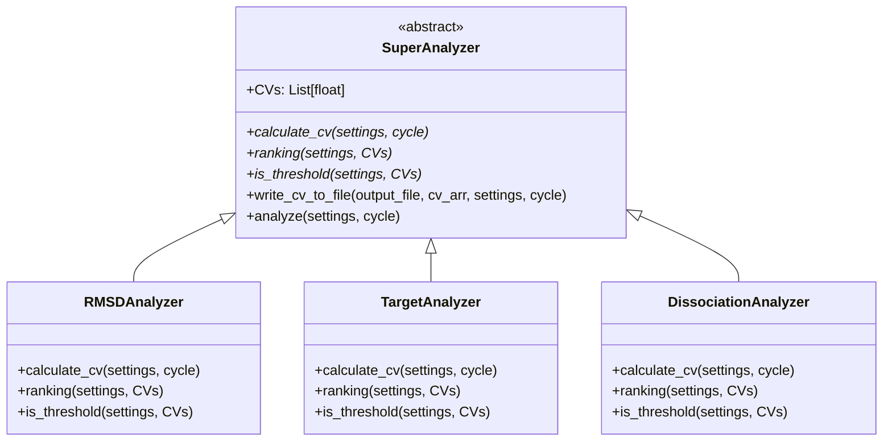
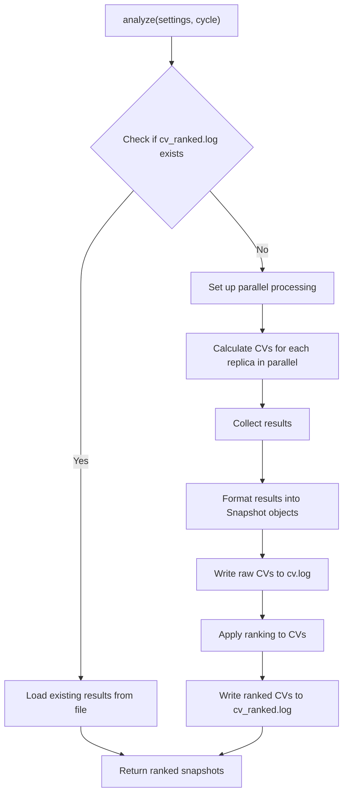
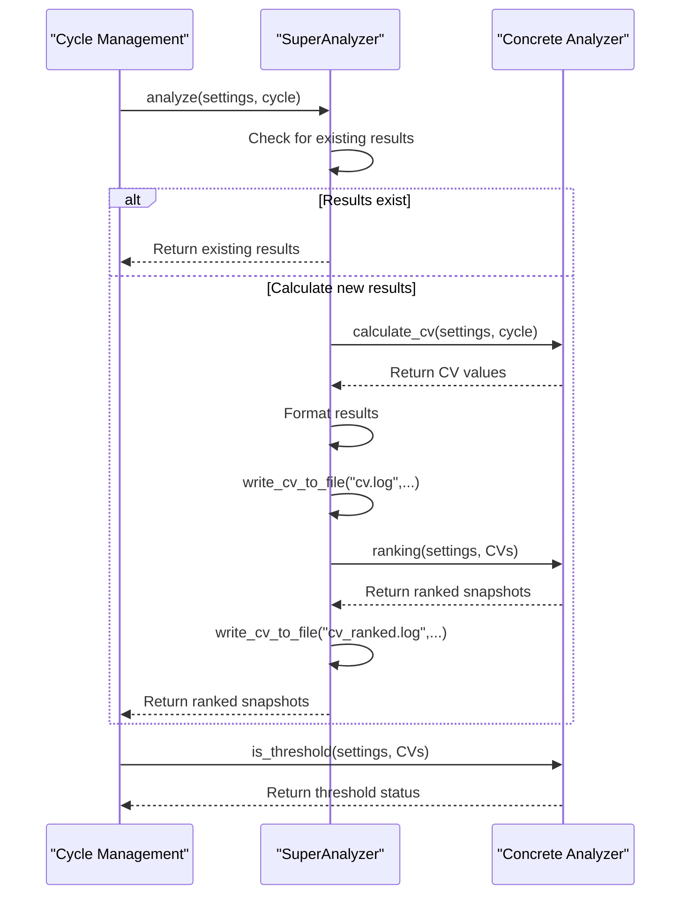
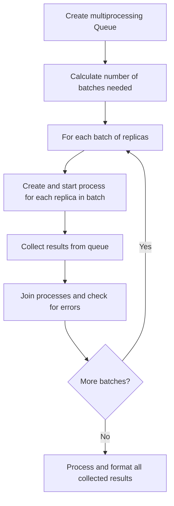
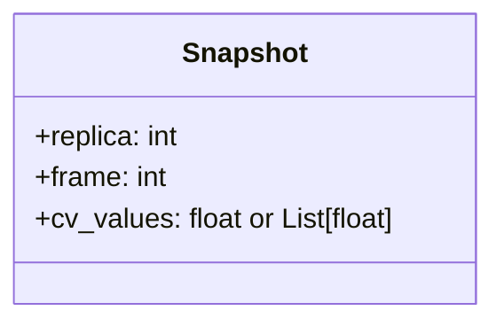

# SuperAnalyzer Framework

<details>
<summary>Relevant source files</summary>

The following files were used as context for generating this wiki page:

- [pacs/mdrun/analyzer/superAnalyzer.py](pacs/mdrun/analyzer/superAnalyzer.py)

</details>


## Purpose and Scope

The SuperAnalyzer Framework provides the foundational architecture for all analyzers in the PaCS-Toolkit. It defines a common interface and functionality for analyzing molecular dynamics simulation results, calculating collective variables (CVs), ranking snapshots, and determining when thresholds have been reached. This document explains the architecture, components, and workflow of the SuperAnalyzer framework, which serves as the base class for all specific analyzers. For information about individual analyzers that extend this framework, see [RMSD Analyzer](#5.2), [Target Analyzer](#5.3), and other analyzer pages.

Sources: [pacs/mdrun/analyzer/superAnalyzer.py:16-31]()

## Architecture Overview

The SuperAnalyzer framework follows an abstract base class pattern, requiring specific analyzer implementations to define their own analysis methods while providing common functionality for data handling, parallel processing, and output generation.



Sources: [pacs/mdrun/analyzer/superAnalyzer.py:16-31]()

## Core Components and Interface

The SuperAnalyzer class serves as an abstract base class (using Python's ABCMeta) that defines the interface all analyzers must implement. It is implemented as a dataclass with the following components:

### Attributes
- `CVs`: Stores the calculated collective variables as a list of floating-point values

### Abstract Methods
These methods must be implemented by any concrete analyzer:

1. **calculate_cv**: Calculates collective variables for a given simulation cycle
   ```python
   @abstractmethod
   def calculate_cv(self, settings: MDsettings, cycle: int) -> List[float]:
       pass
   ```

2. **ranking**: Ranks snapshots based on their collective variables
   ```python
   @abstractmethod
   def ranking(self, settings: MDsettings, CVs: List[Snapshot]) -> List[Snapshot]:
       pass
   ```

3. **is_threshold**: Determines if a predefined threshold has been reached
   ```python
   @abstractmethod
   def is_threshold(self, settings: MDsettings, CVs: List[Snapshot] = None) -> bool:
       pass
   ```

### Concrete Methods
These methods are implemented in the SuperAnalyzer and shared by all subclasses:

1. **write_cv_to_file**: Writes collective variables to a log file
2. **analyze**: Main method that manages the parallel execution of CV calculation and ranking

Sources: [pacs/mdrun/analyzer/superAnalyzer.py:16-31](), [pacs/mdrun/analyzer/superAnalyzer.py:32-131]()

## Workflow

The SuperAnalyzer orchestrates the analysis workflow for a simulation cycle through its `analyze` method. Here's how the workflow functions:



The workflow involves:

1. **Checking for existing results**: If `cv_ranked.log` exists, the method loads previous results instead of recalculating
2. **Parallel processing**: Uses Python's multiprocessing to calculate CVs for multiple replicas simultaneously
3. **Data collection and formatting**: Collects results and formats them into Snapshot objects
4. **Output generation**: Writes both raw and ranked CVs to log files
5. **Result reporting**: Returns the ranked snapshots for further processing by the PaCS-MD cycle

Sources: [pacs/mdrun/analyzer/superAnalyzer.py:40-131]()

## Integration with Cycle Management

The SuperAnalyzer framework integrates with the broader PaCS-MD cycle management system. Here's how it fits into the execution flow:



Sources: [pacs/mdrun/analyzer/superAnalyzer.py:40-131]()

## Parallel Processing

The SuperAnalyzer implements parallel processing to efficiently analyze multiple replicas simultaneously. The implementation uses Python's multiprocessing module with a queue-based approach:



Key aspects of the parallel implementation:
- Replicas are processed in batches of size `settings.n_parallel`
- Each replica's analysis runs in a separate process
- Results are collected through a multiprocessing Queue
- Error handling ensures all processes complete successfully

Sources: [pacs/mdrun/analyzer/superAnalyzer.py:67-104]()

## Data Structure: Snapshot

The SuperAnalyzer works with `Snapshot` objects which encapsulate the simulation data for analysis. A Snapshot contains:

1. Replica number
2. Frame number
3. Collective variable value(s)



Snapshots are used for:
- Representing individual frames from simulation trajectories
- Tracking which replica and frame a particular CV belongs to
- Ranking and sorting simulation results
- Writing formatted output to log files

Sources: [pacs/mdrun/analyzer/superAnalyzer.py:113-123]()

## Creating Custom Analyzers

To create a custom analyzer in the PaCS-Toolkit, you must extend the SuperAnalyzer class and implement its three abstract methods:

| Method | Purpose | Expected Implementation |
|--------|---------|-------------------------|
| `calculate_cv` | Calculate collective variables for simulation snapshots | Extract relevant data from simulation trajectories and compute problem-specific metrics |
| `ranking` | Determine the order of snapshots based on CVs | Sort snapshots according to specific criteria (e.g., ascending/descending CV values) |
| `is_threshold` | Check if termination criteria have been met | Evaluate whether simulation goals have been achieved based on CV values |

The SuperAnalyzer provides the infrastructure for parallel execution, data collection, and output generation, while custom analyzers focus on the specific analysis algorithms.

Sources: [pacs/mdrun/analyzer/superAnalyzer.py:16-31]()

## Summary

The SuperAnalyzer framework provides a robust foundation for implementing various analysis methods in PaCS-MD simulations. By defining a common interface and handling the complexities of parallel processing and data management, it allows analyzer implementations to focus on their specific algorithms. This design promotes code reuse, maintainability, and extensibility within the PaCS-Toolkit.

Sources: [pacs/mdrun/analyzer/superAnalyzer.py:16-131]()

---