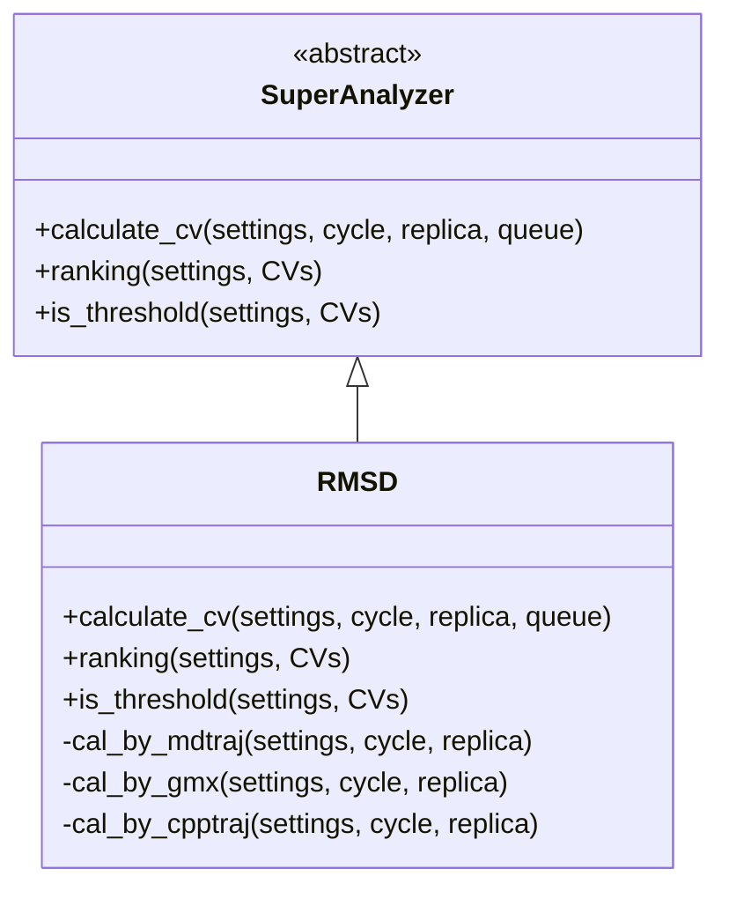
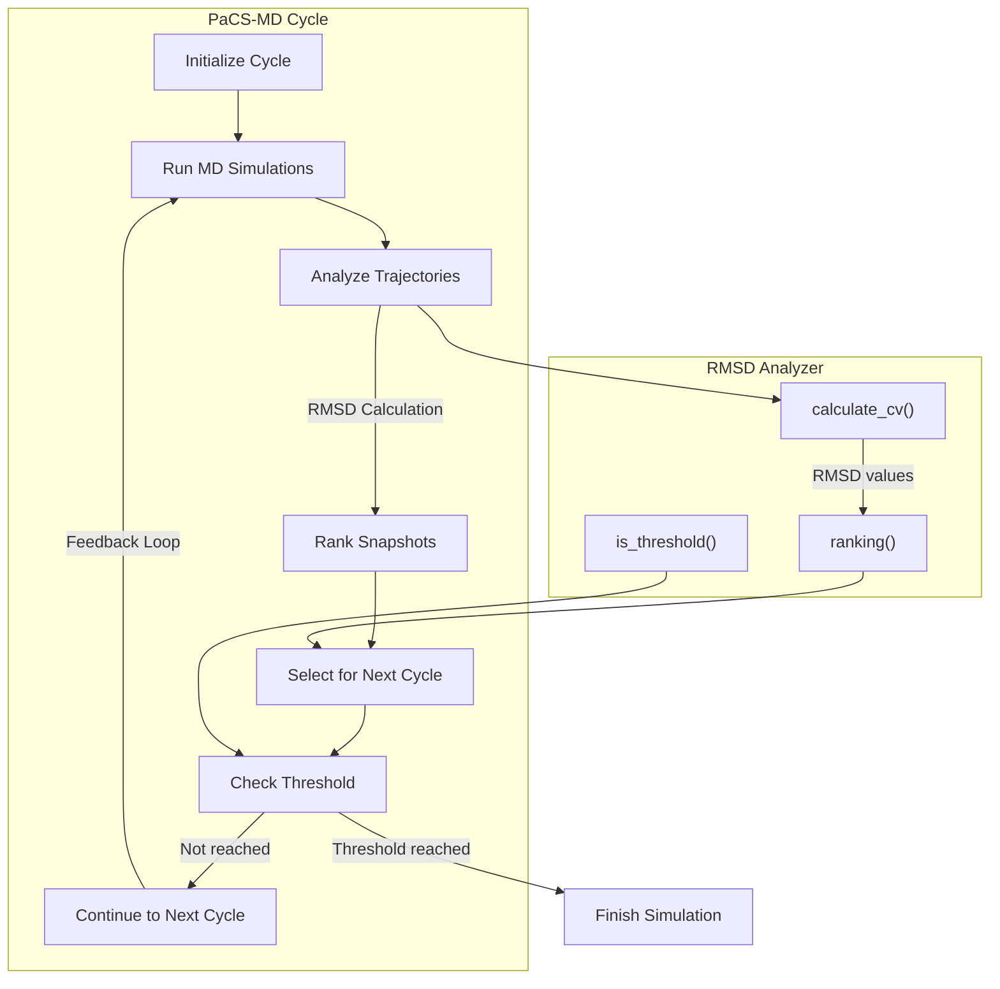
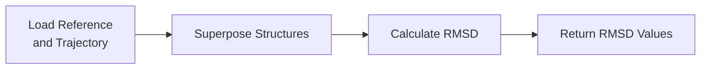
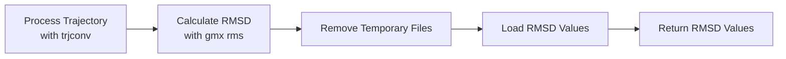
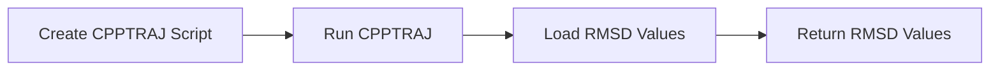
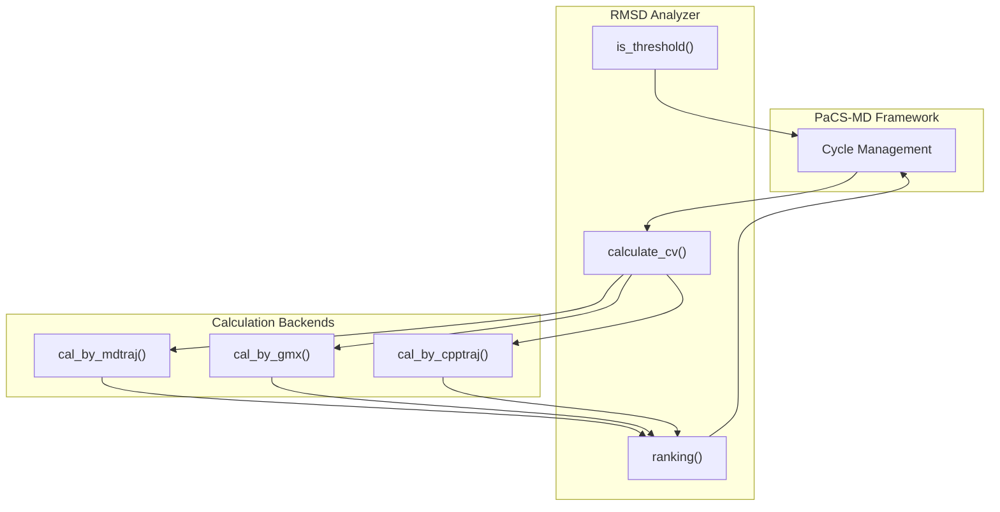

# RMSD Analyzer

<details>
<summary>Relevant source files</summary>

The following files were used as context for generating this wiki page:

- [pacs/mdrun/analyzer/rmsd.py](pacs/mdrun/analyzer/rmsd.py)

</details>


## Purpose and Overview

The RMSD (Root Mean Square Deviation) Analyzer is a component in the PaCS-Toolkit that measures structural similarity between molecular conformations during simulations. It calculates the RMSD between structures in a trajectory and a reference structure, which is used for ranking and selection in the PaCS-MD workflow. This analyzer is particularly useful for studying conformational changes, protein folding, or other scenarios where measuring structural deviation is important.

For information about other analyzers in the toolkit, see [Analyzers](#5) and [SuperAnalyzer Framework](#5.1).

Sources: [pacs/mdrun/analyzer/rmsd.py:1-6]()

## Architecture and Integration

The RMSD Analyzer is implemented as a concrete class that inherits from the SuperAnalyzer abstract base class, providing specific implementations for calculating collective variables (CVs), ranking snapshots, and checking thresholds.



The RMSD Analyzer operates within the PaCS-MD cycle workflow:



Sources: [pacs/mdrun/analyzer/rmsd.py:20-42]()

## Core Functionality

The RMSD Analyzer provides three key methods that fulfill the SuperAnalyzer interface:

1. **calculate_cv**: Calculates RMSD values for each frame in a trajectory
2. **ranking**: Sorts snapshots based on RMSD values (higher values first)
3. **is_threshold**: Determines if the simulation has reached the defined threshold

### CV Calculation

The `calculate_cv` method serves as a dispatcher that selects the appropriate calculation method based on the configured analyzer backend:

```python
def calculate_cv(self, settings: MDsettings, cycle: int, replica: int, queue: mp.Queue) -> List[float]:
    if settings.analyzer == "mdtraj":
        ret = self.cal_by_mdtraj(settings, cycle, replica)
    elif settings.analyzer == "gromacs":
        ret = self.cal_by_gmx(settings, cycle, replica)
    elif settings.analyzer == "cpptraj":
        ret = self.cal_by_cpptraj(settings, cycle, replica)
    else:
        raise NotImplementedError
    queue.put(ret)
    return ret
```

Sources: [pacs/mdrun/analyzer/rmsd.py:21-33]()

### Ranking and Threshold Checking

The RMSD Analyzer ranks snapshots in descending order of RMSD values (higher RMSD first), which means structures that deviate more from the reference are prioritized:

```python
def ranking(self, settings: MDsettings, CVs: List[Snapshot]) -> List[Snapshot]:
    sorted_cv = sorted(CVs, key=lambda x: x.cv, reverse=True)
    return sorted_cv
```

The threshold check determines if the simulation has reached its target by comparing the highest RMSD value against the configured threshold:

```python
def is_threshold(self, settings: MDsettings, CVs: List[Snapshot] = None) -> bool:
    if CVs is None:
        CVs = self.CVs
    return CVs[0].cv > settings.threshold
```

Sources: [pacs/mdrun/analyzer/rmsd.py:35-42]()

## Calculation Backends

The RMSD Analyzer supports three different backends for RMSD calculation, each with its own implementation details:

### MDTraj Backend



The MDTraj backend uses the Python MDTraj library to:
1. Load the reference structure and simulation trajectory
2. Superpose (align) the structures based on selection1 atoms
3. Calculate RMSD between selection2 atoms and their reference counterparts

Key features:
- Uses atom selections for both superposition and RMSD calculation
- Performs the calculation entirely in Python
- Requires the MDTraj package to be installed

Sources: [pacs/mdrun/analyzer/rmsd.py:44-70]()

### Gromacs Backend



The Gromacs backend uses Gromacs commands to:
1. Process the trajectory for periodic boundary conditions using `gmx trjconv`
2. Calculate RMSD using `gmx rms` 
3. Parse the resulting output file

Key features:
- Uses external Gromacs commands (`trjconv` and `rms`)
- Requires Gromacs to be installed
- Supports PBC handling through the `nojump` option

Sources: [pacs/mdrun/analyzer/rmsd.py:72-121]()

### CPPTRAJ Backend



The CPPTRAJ backend uses AmberTools' CPPTRAJ to:
1. Generate a CPPTRAJ script with appropriate commands for trajectory processing and RMSD calculation
2. Execute the script using the `cpptraj` command
3. Parse the resulting output file

Key features:
- Uses CPPTRAJ for both trajectory processing and RMSD calculation
- Requires AmberTools/CPPTRAJ to be installed
- Supports centering and image operations before RMSD calculation

Sources: [pacs/mdrun/analyzer/rmsd.py:122-166]()

## Configuration Options

The RMSD Analyzer is configured through several parameters in the MDsettings object:

| Parameter | Description | Used By |
|-----------|-------------|---------|
| `analyzer` | Backend to use (`mdtraj`, `gromacs`, or `cpptraj`) | All methods |
| `reference` | Path to reference structure file | All backends |
| `selection1` | Atom selection for superposition | All backends |
| `selection2` | Atom selection for RMSD calculation | All backends |
| `selection3` | Reference atom selection for superposition (MDTraj) | MDTraj |
| `selection4` | Reference atom selection for RMSD calculation (MDTraj) | MDTraj |
| `top_mdtraj` | Topology file for MDTraj | MDTraj |
| `cmd_gmx` | Command to invoke Gromacs | Gromacs |
| `index_file` | Index file for Gromacs selections | Gromacs |
| `nojump` | PBC handling option | Gromacs |
| `topology` | Topology file for CPPTRAJ | CPPTRAJ |
| `centering_selection` | Atoms for centering in CPPTRAJ | CPPTRAJ |
| `threshold` | RMSD threshold for terminating simulation | `is_threshold` |

Sources: [pacs/mdrun/analyzer/rmsd.py:44-166]()

## Practical Example

To use the RMSD Analyzer in a PaCS-MD simulation, you would configure it in your input.toml file:

```toml
[analyzer]
type = "rmsd"
backend = "gromacs"  # Can be "mdtraj", "gromacs", or "cpptraj"
reference = "reference.pdb"
selection1 = "Backbone"  # For superposition
selection2 = "Backbone"  # For RMSD calculation
threshold = 0.6  # Simulation stops when RMSD exceeds this value
```

The analyzer will calculate RMSD values for each frame in each replica trajectory and rank them according to their deviation from the reference structure. In the PaCS-MD approach, this ranking drives the exploration of conformational space by selecting structures that deviate more from the reference for the next simulation cycle.

Sources: [pacs/mdrun/analyzer/rmsd.py:20-42]()

## Integration with PaCS-MD Workflow



The RMSD Analyzer interacts with the PaCS-MD framework as follows:

1. During each cycle, the Cycle Management component invokes the analyzer's `calculate_cv` method for each replica
2. The method calculates RMSD values using the configured backend
3. The `ranking` method sorts snapshots based on their RMSD values
4. The Cycle Management uses this ranking to select starting structures for the next cycle
5. The `is_threshold` method determines if the simulation should continue or terminate

Sources: [pacs/mdrun/analyzer/rmsd.py:20-42]()

## Summary

The RMSD Analyzer is a versatile component that calculates structural deviations between simulated conformations and a reference structure. By supporting multiple calculation backends (MDTraj, Gromacs, and CPPTRAJ), it provides flexibility to work with different molecular dynamics engines and analysis libraries. In the context of PaCS-MD simulations, the RMSD Analyzer enables the exploration of conformational space by prioritizing structures that deviate more from the reference, driving the simulation toward novel conformations.

Sources: [pacs/mdrun/analyzer/rmsd.py:1-166]()

---