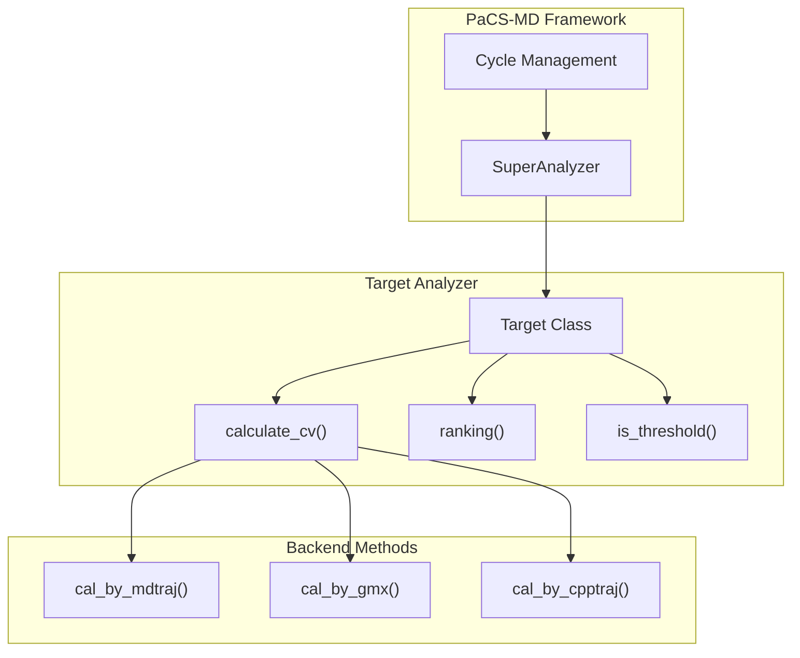
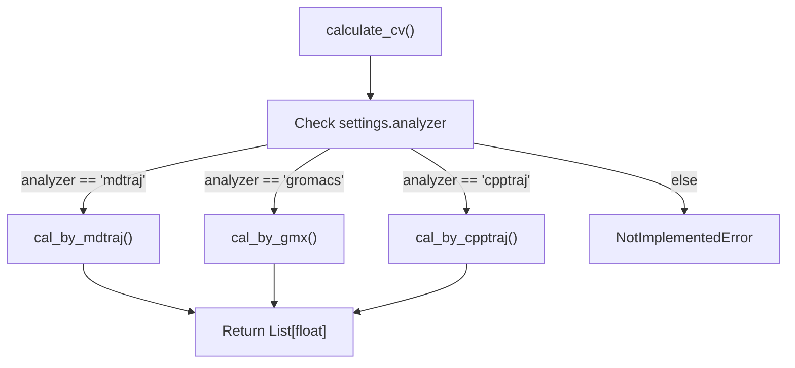
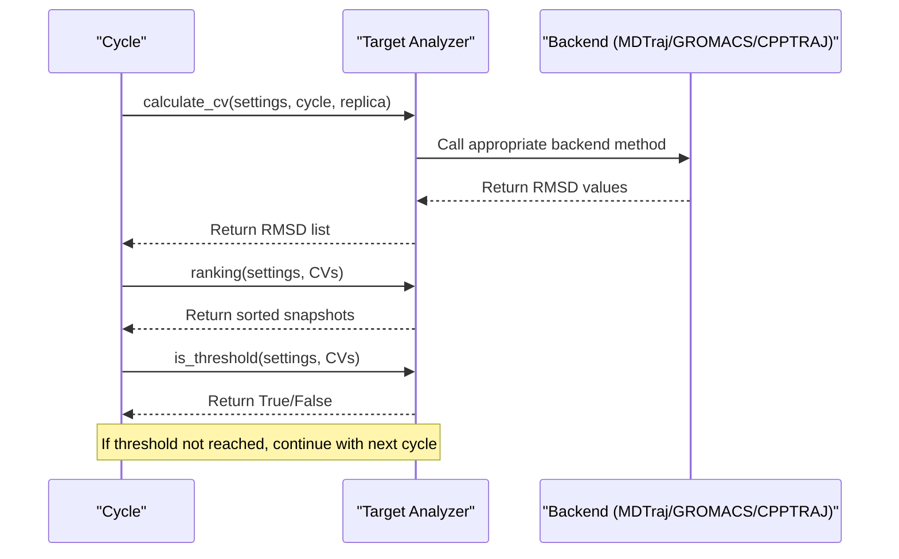

# Target Analyzer

<details>
<summary>Relevant source files</summary>

The following files were used as context for generating this wiki page:

- [pacs/mdrun/analyzer/target.py](pacs/mdrun/analyzer/target.py)

</details>


## Purpose and Scope

The Target Analyzer is a specialized component of the PaCS-Toolkit designed to drive molecular dynamics simulations toward a specific target structure. It works by measuring the Root Mean Square Deviation (RMSD) between the current structures in a simulation and a reference target structure, then ranking and selecting structures that are progressively closer to the target. This analyzer implements the fundamental mechanism described in the original Parallel Cascade Selection Molecular Dynamics (PaCS-MD) methodology.

For information about other analyzers in the PaCS-Toolkit, such as for dissociation or association processes, see [Analyzers](#5).

## Overview

The Target Analyzer evaluates molecular conformations based on their structural similarity to a reference structure. It selects snapshots with the lowest RMSD values to use as starting points in subsequent simulation cycles, effectively guiding the simulation toward the target conformation.



Sources: [pacs/mdrun/analyzer/target.py:19-39](). [pacs/mdrun/analyzer/target.py:1-5]()

## Implementation Details

The Target Analyzer is implemented in the `Target` class, which inherits from the `SuperAnalyzer` base class. It provides the core functionality needed for PaCS-MD simulations targeting a specific structure.

### Key Methods

#### calculate_cv

The `calculate_cv` method computes the collective variable (CV) values for a given replica in a specific cycle. In the case of the Target Analyzer, the CV is the RMSD between the current structure and the reference structure. The method supports multiple backends:



Sources: [pacs/mdrun/analyzer/target.py:20-32]()

#### ranking

The `ranking` method sorts snapshots based on their CV values (RMSD to target) in ascending order. Structures with lower RMSD values (more similar to the target) are ranked higher.

Sources: [pacs/mdrun/analyzer/target.py:34-36]()

#### is_threshold

The `is_threshold` method checks if the simulation has reached the target structure by comparing the lowest CV value against a defined threshold. If the best RMSD is below the threshold, the method returns `True`, indicating the simulation goal has been achieved.

Sources: [pacs/mdrun/analyzer/target.py:38-39]()

### Backend Calculation Methods

The Target Analyzer supports three different backends for RMSD calculation:

#### MDTraj Backend

When using the MDTraj backend, the analyzer:
1. Loads the reference structure and current trajectory
2. Aligns structures using the atoms defined in `selection1` (in current structure) and `selection3` (in reference)
3. Calculates RMSD between atoms in `selection2` (current structure) and `selection4` (reference)

Sources: [pacs/mdrun/analyzer/target.py:41-67]()

#### GROMACS Backend

When using the GROMACS backend, the analyzer:
1. Applies periodic boundary condition (PBC) treatment to the trajectory
2. Uses the GROMACS `rms` tool to calculate RMSD
3. Aligns using `selection1` atoms and calculates RMSD on `selection2` atoms

Sources: [pacs/mdrun/analyzer/target.py:69-119]()

#### CPPTRAJ Backend

When using the CPPTRAJ backend, the analyzer:
1. Creates a CPPTRAJ script to process the trajectory
2. Centers and images the system
3. Aligns using `selection1` atoms and calculates RMSD on `selection2` atoms

Sources: [pacs/mdrun/analyzer/target.py:120-168]()

## Configuration Parameters

To use the Target Analyzer, you need to specify the following parameters in your input configuration file:

| Parameter | Description | Example |
|-----------|-------------|---------|
| `analyzer` | Analysis backend to use (`mdtraj`, `gromacs`, or `cpptraj`) | `"mdtraj"` |
| `selection1` | Atom selection for alignment in current structure | `"protein and name CA"` |
| `selection2` | Atom selection for RMSD calculation in current structure | `"protein and name CA"` |
| `selection3` | Atom selection for alignment in reference structure (MDTraj only) | `"protein and name CA"` |
| `selection4` | Atom selection for RMSD calculation in reference structure (MDTraj only) | `"protein and name CA"` |
| `reference` | Path to the reference target structure | `"reference.pdb"` |
| `threshold` | RMSD threshold for simulation completion | `0.1` |

Sources: [pacs/mdrun/analyzer/target.py:41-67](), [pacs/mdrun/analyzer/target.py:69-119](), [pacs/mdrun/analyzer/target.py:120-168]()

## Usage Workflow

The Target Analyzer is used within the PaCS-MD cycle to progressively guide simulations toward a target structure:



Sources: [pacs/mdrun/analyzer/target.py:19-39]()

## How Target Analysis Works

The Target Analyzer implements the core mechanism of the PaCS-MD method by:

1. Starting from an initial structure
2. Running multiple short parallel simulations (replicas)
3. Calculating RMSD to the target structure for each frame of each replica
4. Ranking structures based on RMSD values
5. Selecting the top N structures with lowest RMSD
6. Using these structures as starting points for the next cycle
7. Repeating until a structure sufficiently close to the target is found

This approach efficiently samples the conformational pathway between the initial and target structures by iteratively selecting and promoting the most promising candidates.

```mermaid
flowchart TD
    Start["Initial Structure"] --> Cycle1["Run Cycle 1 Replicas"]
    Cycle1 --> Analyze1["Target Analysis: Calculate RMSD to Target"]
    Analyze1 --> Rank1["Rank Structures by RMSD"]
    Rank1 --> Check1["Check Threshold"]
    
    Check1 -->|"Not Reached"| Select1["Select Top Structures"]
    Select1 --> Cycle2["Run Cycle 2 Replicas"]
    Cycle2 --> Analyze2["Target Analysis: Calculate RMSD to Target"]
    Analyze2 --> Rank2["Rank Structures by RMSD"]
    Rank2 --> Check2["Check Threshold"]
    
    Check2 -->|"Not Reached"| Select2["Select Top Structures"]
    Select2 --> Cycle3["Run Cycle 3 Replicas"]
    Cycle3 --> "..."
    
    Check1 -->|"Reached"| End["Simulation Complete"]
    Check2 -->|"Reached"| End
```

Sources: [pacs/mdrun/analyzer/target.py:34-39]()

## Implementation Notes

### Reference Structure Alignment

The Target Analyzer performs a structural alignment before calculating RMSD to ensure proper comparison. The alignment is performed using the atoms specified in `selection1` (current structure) and `selection3` (reference structure, MDTraj only). The RMSD calculation is then performed on a potentially different set of atoms specified by `selection2` and `selection4`.

### Backend-Specific Considerations

- **MDTraj**: Provides the most flexible selection syntax but requires MDTraj installation.
- **GROMACS**: Requires an index file (`ndx`) with the appropriate atom groups defined.
- **CPPTRAJ**: Useful with Amber simulations and provides additional trajectory processing options.

The choice of backend depends on the molecular dynamics engine being used and the specific requirements of the analysis.

Sources: [pacs/mdrun/analyzer/target.py:41-67](), [pacs/mdrun/analyzer/target.py:69-119](), [pacs/mdrun/analyzer/target.py:120-168]()

## Related Components

The Target Analyzer is one of several analyzers in the PaCS-Toolkit. Other analyzers include:

- [RMSD Analyzer](#5.2) - For measuring structural deviations from a starting point
- [Dissociation Analyzer](#5.4) - For studying unbinding events
- [Association Analyzer](#5.5) - For studying binding events
- [A_D Analyzer](#5.6) - For studying both association and dissociation events
- [EdgeExpansion Analyzer](#5.7) - For exploring conformational space

For more information about the analyzer framework, see [SuperAnalyzer Framework](#5.1).

---