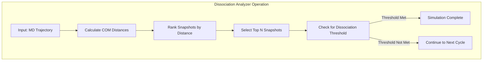
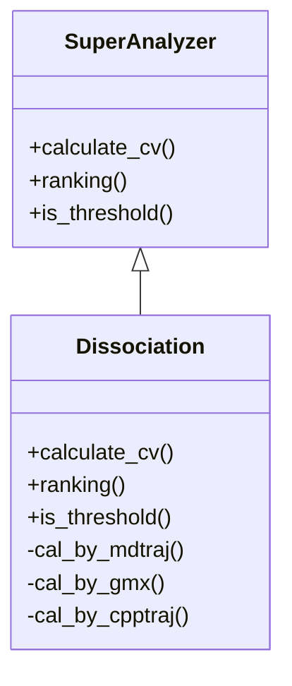
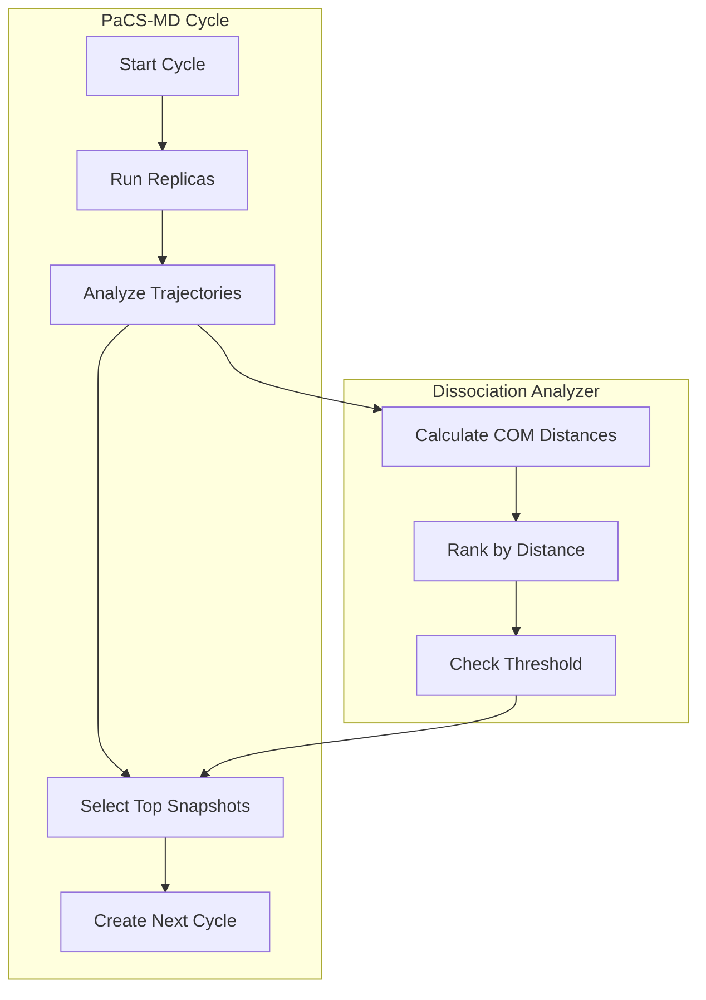

# Dissociation Analyzer

<details>
<summary>Relevant source files</summary>

The following files were used as context for generating this wiki page:

- [pacs/mdrun/analyzer/dissociation.py](pacs/mdrun/analyzer/dissociation.py)

</details>


## Overview

The Dissociation Analyzer is a specialized component of the PaCS-Toolkit designed to facilitate protein-ligand dissociation simulations using Parallel Cascade Selection Molecular Dynamics (PaCS-MD). It monitors and ranks simulation snapshots based on the distance between two groups of atoms, typically a protein and a ligand, to accelerate the sampling of unbinding events.

For binding events analysis, see the [Association Analyzer](#5.5), and for combined association-dissociation analysis, see the [A_D Analyzer](#5.6).

Sources: [pacs/mdrun/analyzer/dissociation.py:1-5]()

## Working Principle

The Dissociation Analyzer calculates collective variables (CVs) by measuring the center-of-mass (COM) distance between two specified molecular selections across all frames in a simulation trajectory. It ranks snapshots by these distances in descending order, prioritizing structures where the ligand has moved further from the protein.



Sources: [pacs/mdrun/analyzer/dissociation.py:40-47]()

## Implementation

The `Dissociation` class inherits from `SuperAnalyzer` and implements three core methods required for PaCS-MD:

1. **CV Calculation** - Computes distances between selected groups
2. **Ranking** - Sorts snapshots by distance values
3. **Threshold Checking** - Determines if dissociation criteria have been met

The analyzer supports three different backend tools for calculating distances, providing flexibility for different simulation environments.



Sources: [pacs/mdrun/analyzer/dissociation.py:19-47]()

### Core Methods

#### calculate_cv

This method calculates the collective variable (COM distance) using the specified backend analyzer:

- **Input**: Settings, cycle number, replica number
- **Output**: List of distances for each frame in the trajectory
- **Operation**: Delegates to the appropriate backend calculation method based on the `settings.analyzer` parameter

#### ranking

Ranks snapshots by their CV values in descending order:

- Higher values (greater distances) are ranked first
- Used to select starting structures for the next cycle

#### is_threshold

Checks if the dissociation criterion has been met:

- Returns `True` if the maximum distance exceeds the configured threshold
- When this condition is met, the simulation can be terminated

Sources: [pacs/mdrun/analyzer/dissociation.py:20-47]()

## Backend Calculation Methods

The Dissociation Analyzer implements three different methods for calculating inter-molecule distances:

| Backend | Method | Description |
|---------|--------|-------------|
| MDTraj | `cal_by_mdtraj` | Uses the Python-based MDTraj library |
| GROMACS | `cal_by_gmx` | Uses GROMACS command-line tools |
| CPPTraj | `cal_by_cpptraj` | Uses the AmberTools CPPTraj program |

### MDTraj Backend

The MDTraj backend:
1. Loads the trajectory using MDTraj
2. Computes the center of mass for each selection
3. Calculates the Euclidean distance between centers of mass for each frame

This backend requires MDTraj to be installed with the toolkit.

Sources: [pacs/mdrun/analyzer/dissociation.py:49-70]()

### GROMACS Backend

The GROMACS backend:
1. Processes the trajectory to handle periodic boundary conditions
2. Uses `gmx trjconv` to prepare the trajectory
3. Uses `gmx distance` to calculate inter-COM distances
4. Post-processes the output to extract distance values

This backend supports a `nojump` option for alternative PBC handling.

Sources: [pacs/mdrun/analyzer/dissociation.py:72-125]()

### CPPTraj Backend

The CPPTraj backend:
1. Generates a CPPTraj input script
2. Processes the trajectory with centering and imaging
3. Calculates distances between the specified selections
4. Extracts distance values from the output file

This backend is particularly useful for Amber simulations.

Sources: [pacs/mdrun/analyzer/dissociation.py:127-157]()

## Configuration

When using the Dissociation Analyzer, several parameters must be configured in the input.toml file:

```
[md]
analyzer = "Dissociation"  # Specifies this analyzer
analyzer_backend = "gromacs"  # or "mdtraj" or "cpptraj"
selection1 = "Protein"  # First selection group (typically protein)
selection2 = "Ligand"   # Second selection group (typically ligand)
threshold = 2.0  # Distance threshold in nm for completion
```

Additional parameters may be required depending on the chosen backend:

- **MDTraj**: Requires `top_mdtraj` parameter pointing to a topology file
- **GROMACS**: Requires `index_file` and optionally `nojump` parameter
- **CPPTraj**: Requires `topology` and `centering_selection` parameters

Sources: [pacs/mdrun/analyzer/dissociation.py:28-36](), [pacs/mdrun/analyzer/dissociation.py:49-157]()

## Integration with PaCS-MD Framework

The Dissociation Analyzer is integrated into the PaCS-MD cycle management system, where it evaluates simulation snapshots after each cycle:



During each cycle, the analyzer:
1. Processes each replica's trajectory
2. Calculates the COM distance for all frames
3. Ranks the snapshots based on these distances
4. Selects the top-ranked snapshots for the next cycle
5. Checks if the dissociation threshold has been reached

When used properly, this accelerates the sampling of dissociation pathways compared to conventional MD simulations.

Sources: [pacs/mdrun/analyzer/dissociation.py:20-47]()

## Example Use Case

The Dissociation Analyzer is particularly useful for:

- Studying drug unbinding mechanisms
- Calculating protein-ligand dissociation rates
- Exploring unbinding pathways for structure-based drug design
- Determining residence times of bound complexes

When combined with the toolkit's MSM analysis capabilities (see [MSM Analysis](#7)), it can be used to estimate kinetic off-rates (koff) and binding free energies.

## Performance Considerations

The choice of backend can significantly impact performance:

- **MDTraj** is generally fastest for small to medium systems when Python overhead is not a concern
- **GROMACS** may be more efficient for large systems when GROMACS is already being used as the simulator
- **CPPTraj** offers good performance for Amber simulations

For production runs with many replicas, using multiprocessing is recommended to parallelize the analysis of different replicas.

Sources: [pacs/mdrun/analyzer/dissociation.py:7-14]()

---