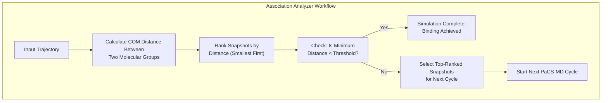
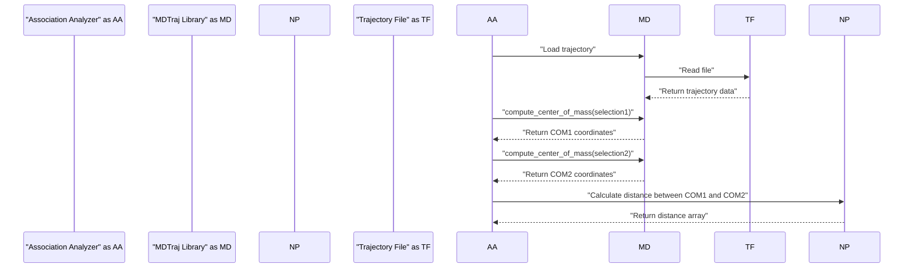
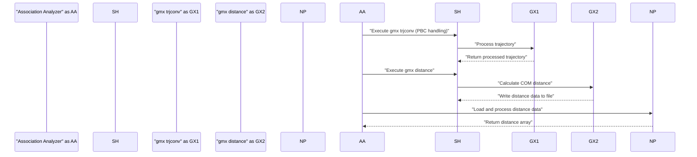
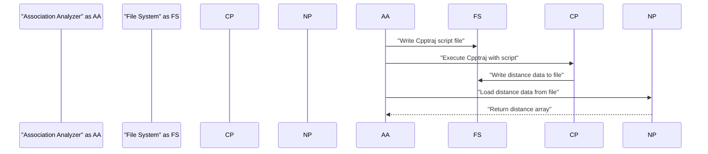
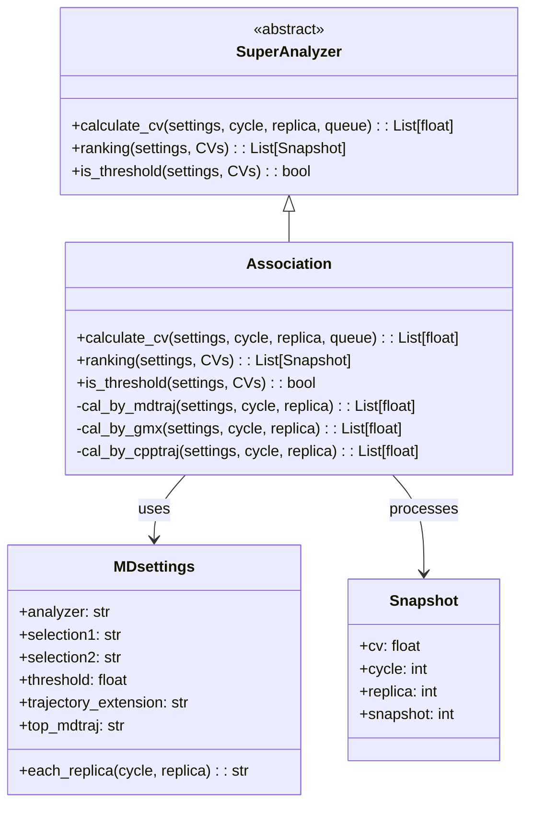
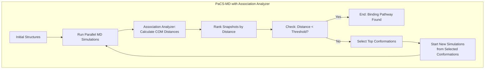

# Association Analyzer

<details>
<summary>Relevant source files</summary>

The following files were used as context for generating this wiki page:

- [pacs/mdrun/analyzer/association.py](pacs/mdrun/analyzer/association.py)

</details>


## Introduction

The Association Analyzer is a specialized component of the PaCS-Toolkit that focuses on studying binding events in molecular dynamics simulations. This analyzer calculates the center-of-mass (COM) distance between two molecular groups and ranks simulation snapshots based on this distance, prioritizing conformations where the groups are closest to each other. It is particularly useful for investigating protein-ligand, protein-protein, or other biomolecular association processes.

For studying unbinding events, see the [Dissociation Analyzer](#5.4), and for combined association-dissociation studies, refer to the [A_D Analyzer](#5.6).

Sources: [pacs/mdrun/analyzer/association.py:16-39]()

## Core Functionality

The Association Analyzer calculates the distance between the centers of mass of two user-defined molecular selections for each frame in a trajectory. It then ranks these frames from smallest distance to largest, selecting those with the smallest distances for the next PaCS-MD cycle. The simulation is considered complete when the minimum distance falls below a user-defined threshold, indicating a successful binding event.



Sources: [pacs/mdrun/analyzer/association.py:32-37]()

## Implementation Details

The Association class extends the SuperAnalyzer framework and implements three main methods required by all analyzers in the PaCS-Toolkit:

1. `calculate_cv`: Computes the collective variable (COM distance) for each frame
2. `ranking`: Sorts snapshots based on distance values (ascending order)
3. `is_threshold`: Checks if the minimum distance is below the threshold

The analyzer supports three different calculation backends:

| Backend | Description | Dependency |
|---------|-------------|------------|
| MDTraj | Python-based trajectory analysis library | MDTraj package |
| Gromacs | Uses gmx distance tool | Gromacs installation |
| Cpptraj | Uses Cpptraj for distance calculation | AmberTools installation |

Sources: [pacs/mdrun/analyzer/association.py:17-37]()

## Calculation Implementations

### MDTraj Implementation

The MDTraj implementation loads the trajectory directly into Python and uses the MDTraj library to:
1. Calculate the center of mass of each selection
2. Compute the Euclidean distance between these centers for each frame



Sources: [pacs/mdrun/analyzer/association.py:39-57]()

### Gromacs Implementation

The Gromacs implementation uses the `gmx trjconv` and `gmx distance` tools in a pipeline:
1. First, the trajectory is processed to handle periodic boundary conditions
2. Then, the distance between centers of mass is calculated
3. Results are parsed from the output file



Sources: [pacs/mdrun/analyzer/association.py:59-107]()

### Cpptraj Implementation

The Cpptraj implementation writes a script file with commands to:
1. Load the topology and trajectory
2. Apply centering and image operations for PBC handling
3. Calculate the distance between selections
4. Write results to an output file



Sources: [pacs/mdrun/analyzer/association.py:109-139]()

## Class Diagram



Sources: [pacs/mdrun/analyzer/association.py:17-37]()

## Configuration 

To use the Association Analyzer in a PaCS-MD simulation, you need to specify it in your input configuration file (input.toml). Here's an example of the relevant configuration section:

```toml
[analyzer]
type = "association"         # Selects the Association analyzer
analyzer = "mdtraj"          # Backend: "mdtraj", "gromacs", or "cpptraj"
selection1 = "protein"       # First group for COM calculation
selection2 = "resname LIG"   # Second group for COM calculation
threshold = 0.5              # Distance threshold in nm
```

Key configuration parameters include:

| Parameter | Description |
|-----------|-------------|
| type | Must be "association" to use this analyzer |
| analyzer | The backend to use: "mdtraj", "gromacs", or "cpptraj" |
| selection1 | Selection string for the first group (format depends on backend) |
| selection2 | Selection string for the second group (format depends on backend) |
| threshold | Distance threshold (in nm) below which binding is considered successful |

Sources: [pacs/mdrun/analyzer/association.py:17-37]()

## Practical Considerations

- **Selection Strings**: The format of selection strings differs between backends:
  - MDTraj: Uses MDTraj's selection syntax (e.g., "protein", "resname LIG")
  - Gromacs: Requires group names defined in an index file
  - Cpptraj: Uses Cpptraj's mask syntax (e.g., ":1-10", ":LIG")

- **Performance**: The choice of backend affects performance:
  - MDTraj is convenient for Python users but may be slower for large systems
  - Gromacs and Cpptraj are typically faster but require external software

- **Common Use Cases**:
  - Protein-ligand binding
  - Protein-protein association
  - Conformational changes involving domain association

Sources: [pacs/mdrun/analyzer/association.py:39-139]()

## Integration with PaCS-MD

The Association Analyzer is a key component in PaCS-MD simulations targeting binding processes. In each cycle, it:

1. Analyzes trajectories from parallel simulations
2. Identifies conformations where the target molecules are closest
3. Provides these conformations as starting points for the next cycle

This approach accelerates the sampling of binding pathways compared to conventional MD.



Sources: [pacs/mdrun/analyzer/association.py:17-37]()

## Related Components

The Association Analyzer is part of the broader analyzer system in PaCS-Toolkit. It shares common patterns with other analyzers, but focuses specifically on binding processes. For more information about the overall analyzer framework, see the [SuperAnalyzer Framework](#5.1).

Sources: [pacs/mdrun/analyzer/association.py:10-11]()

---