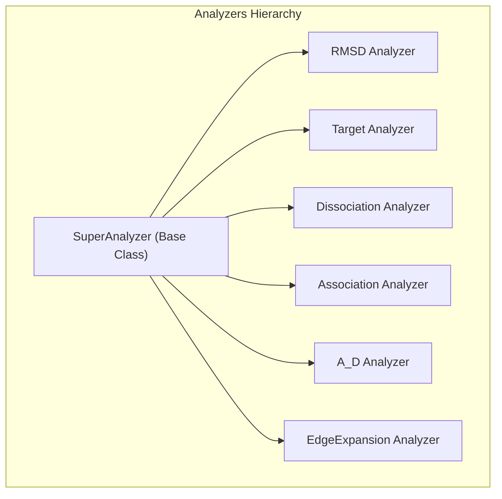
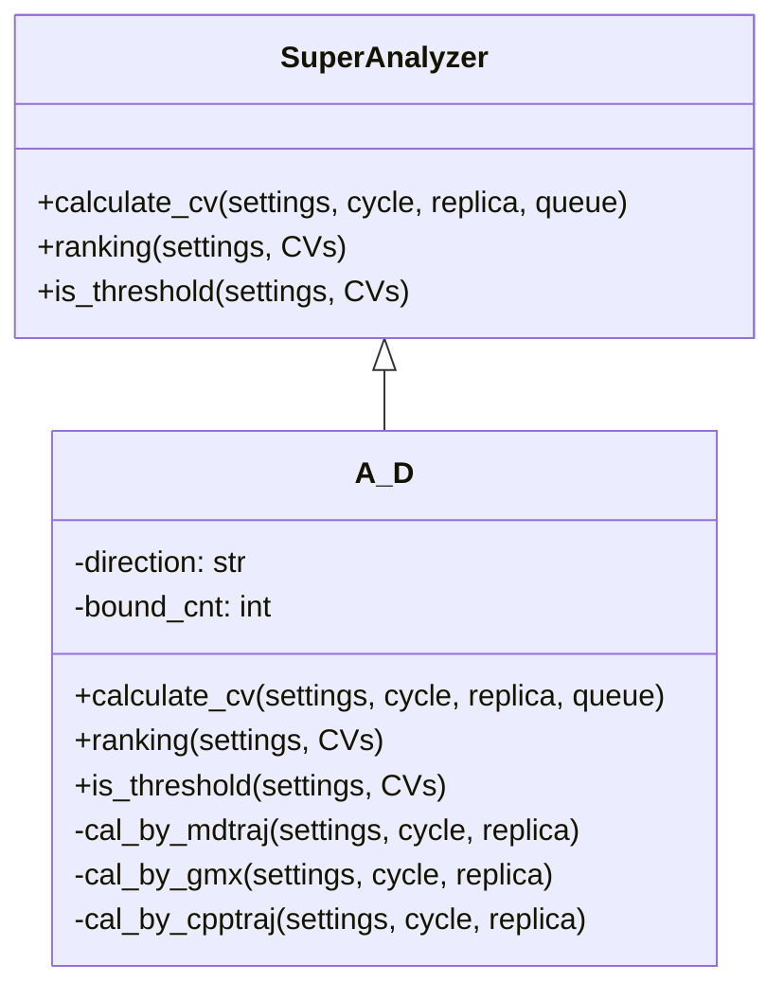
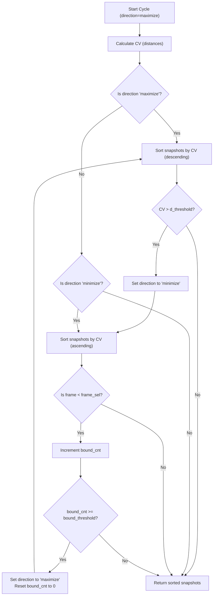
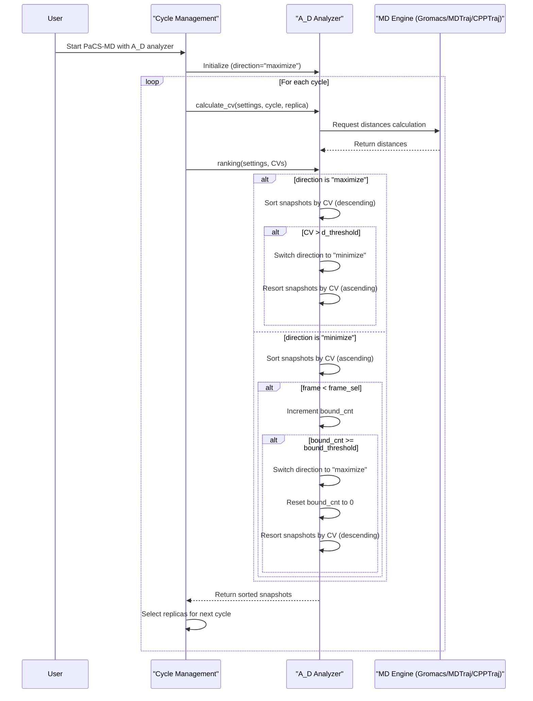

# A_D Analyzer

<details>
<summary>Relevant source files</summary>

The following files were used as context for generating this wiki page:

- [pacs/mdrun/analyzer/a_d.py](pacs/mdrun/analyzer/a_d.py)

</details>


## Purpose and Overview

The A_D Analyzer is a specialized component within the PaCS-Toolkit that enables the study of both association and dissociation events in molecular systems. Unlike analyzers that focus exclusively on either association ([Association Analyzer](#5.5)) or dissociation ([Dissociation Analyzer](#5.4)), the A_D Analyzer can dynamically switch between these modes during a simulation. This capability makes it particularly useful for studying complete binding-unbinding processes or systems with complex interaction dynamics.



Sources: [pacs/mdrun/analyzer/a_d.py:10-17](), [pacs/mdrun/analyzer/superAnalyzer.py]()

## Key Features

- Dynamically switches between association and dissociation modes based on distance thresholds
- Supports multiple backend analyzers (MDTraj, Gromacs, CPPTraj)
- Calculates center of mass distances between selected groups
- Provides automatic reversal of selection criteria when specific thresholds are reached

## Implementation Details

The A_D Analyzer is implemented as the `A_D` class that inherits from `SuperAnalyzer`. It maintains an internal state via the `direction` attribute to determine whether distances should be maximized (dissociation) or minimized (association).



Sources: [pacs/mdrun/analyzer/a_d.py:17-161]()

### Direction Switching Logic

The A_D Analyzer employs a sophisticated algorithm to switch between association (minimize) and dissociation (maximize) modes:



Sources: [pacs/mdrun/analyzer/a_d.py:36-55]()

## Calculation Methods

The A_D Analyzer supports three methods to calculate center-of-mass distances between molecule selections:

### MDTraj-based Calculation

Uses the MDTraj library to:
1. Load the trajectory file
2. Select atoms based on user-defined selections
3. Compute centers of mass for each selection
4. Calculate Euclidean distances between centers of mass for each frame

Sources: [pacs/mdrun/analyzer/a_d.py:60-78]()

### Gromacs-based Calculation

Uses Gromacs commands to:
1. Perform trajectory image processing with proper PBC handling
2. Calculate distances between centers of mass using the `gmx distance` command
3. Parse the output to extract distance values

Sources: [pacs/mdrun/analyzer/a_d.py:80-128]()

### CPPTraj-based Calculation

Uses CPPTraj to:
1. Process the trajectory with proper center and image operations
2. Calculate distances between specified selections
3. Extract distance values from the output file

Sources: [pacs/mdrun/analyzer/a_d.py:130-160]()

## Configuration Parameters

The A_D Analyzer requires several parameters in the `input.toml` configuration file:

| Parameter | Description | Example |
|-----------|-------------|---------|
| `analyzer` | Backend analysis tool to use | `"mdtraj"`, `"gromacs"`, or `"cpptraj"` |
| `selection1` | First atom selection | `"protein"` |
| `selection2` | Second atom selection | `"ligand"` |
| `d_threshold` | Distance threshold for switching to minimization | `2.0` (nm) |
| `frame_sel` | Frame selection threshold for bound state | `10` |
| `bound_threshold` | Counter threshold to switch back to maximization | `3` |
| `nojump` | PBC handling option (Gromacs only) | `true` or `false` |
| `top_mdtraj` | Topology file path for MDTraj | `"topol.gro"` |
| `index_file` | Index file for Gromacs selection | `"index.ndx"` |

Sources: [pacs/mdrun/analyzer/a_d.py:22-34](), [pacs/mdrun/analyzer/a_d.py:36-55](), [pacs/mdrun/analyzer/a_d.py:60-128]()

## Algorithm Workflow



Sources: [pacs/mdrun/analyzer/a_d.py:17-161]()

## Usage Example

To use the A_D Analyzer in your PaCS-MD simulation, you need to specify it in your input.toml configuration file:

```toml
[mdrun]
analyzer = "A_D"

[analyzer]
backend = "gromacs"      # or "mdtraj" or "cpptraj"
selection1 = "protein"
selection2 = "ligand"
d_threshold = 2.0        # nm
frame_sel = 10
bound_threshold = 3
```

## Practical Applications

The A_D Analyzer is particularly useful for:

1. Studying complete binding-unbinding processes in a single simulation
2. Investigating systems with multiple metastable states
3. Exploring energy landscapes with complex topography
4. Enhancing sampling of rare events by dynamically adapting the search direction

## Implementation Notes

- The A_D Analyzer never terminates a simulation based on reaching a threshold, as its `is_threshold` method always returns `False` ([pacs/mdrun/analyzer/a_d.py:57-58]())
- The direction switching mechanism is key to its ability to explore both association and dissociation processes
- Performance of CV calculations depends on the selected backend (MDTraj, Gromacs, or CPPTraj)

## Related Components

- [SuperAnalyzer Framework](#5.1) - Base class for all analyzers
- [Association Analyzer](#5.5) - Specialized for studying only binding events
- [Dissociation Analyzer](#5.4) - Specialized for studying only unbinding events

---