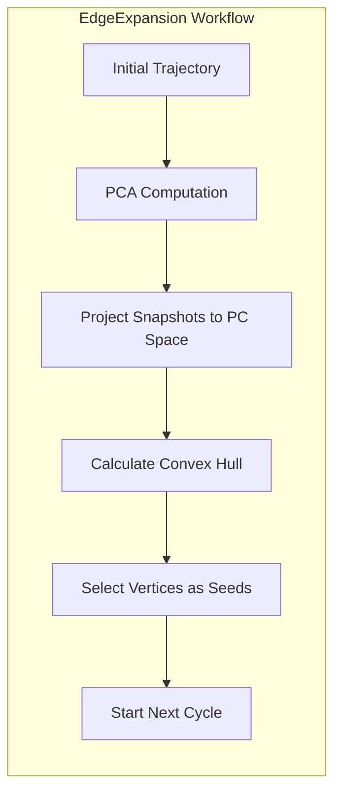
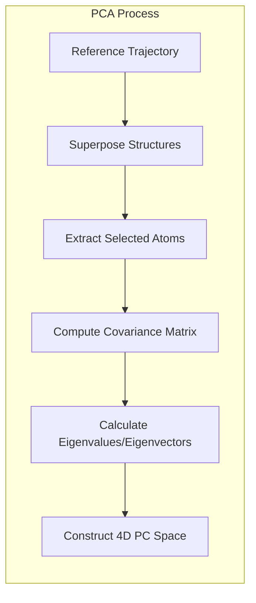
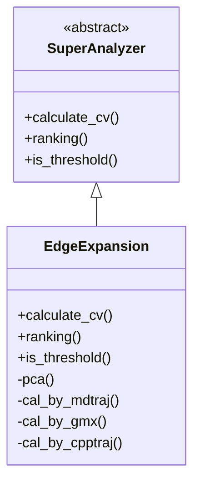
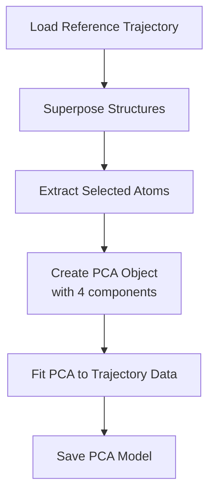
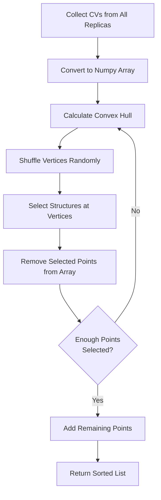

# EdgeExpansion Analyzer

<details>
<summary>Relevant source files</summary>

The following files were used as context for generating this wiki page:

- [docs/src/mdrun/analyzer/ee.md](docs/src/mdrun/analyzer/ee.md)
- [docs/src/mdrun/overview.md](docs/src/mdrun/overview.md)
- [pacs/mdrun/analyzer/ee.py](pacs/mdrun/analyzer/ee.py)

</details>


## Purpose and Overview

The EdgeExpansion Analyzer is a specialized component in the PaCS-Toolkit that enables efficient exploration of protein conformational space without requiring a predefined target structure. Unlike other analyzers that guide simulations towards or away from specific conformational states (like [Target Analyzer](#5.3) or [Dissociation Analyzer](#5.4)), EdgeExpansion focuses on maximizing the diversity of conformational sampling by leveraging principal component analysis and computational geometry concepts.

This analyzer implements the Edge Expansion Parallel Cascade Selection algorithm described in the paper "Edge expansion parallel cascade selection molecular dynamics simulation for investigating large-amplitude collective motions of proteins" (https://doi.org/10.1063/5.0004654).

Sources: [pacs/mdrun/analyzer/ee.py:1-6](), [docs/src/mdrun/analyzer/ee.md:36-40]()

## Key Concepts and Methodology

The EdgeExpansion Analyzer operates on the following key principles:



Sources: [pacs/mdrun/analyzer/ee.py:20-66](), [docs/src/mdrun/analyzer/ee.md:1-4]()

### Principal Component Analysis (PCA)

The EdgeExpansion analyzer first performs Principal Component Analysis on a reference trajectory to identify the principal components that capture the largest variance in the protein's motion. This creates a lower-dimensional subspace (specifically 4-dimensional) that still captures the essential dynamics of the system.



Sources: [pacs/mdrun/analyzer/ee.py:72-92]()

### Convex Hull Selection

The key innovation of the EdgeExpansion analyzer is how it selects structures for the next cycle:

1. Project all snapshots from the current cycle onto the 4D PC space
2. Calculate the convex hull of these points
3. Randomly shuffle the vertices of the convex hull
4. Select structures corresponding to these vertices as seeds for the next cycle

This approach ensures maximum exploration of the conformational space by prioritizing structures that are at the "edges" of the currently explored space.

Sources: [pacs/mdrun/analyzer/ee.py:42-66]()

## Implementation Details

### Class Structure



Sources: [pacs/mdrun/analyzer/ee.py:21-128]()

### Key Methods

The EdgeExpansion class implements three essential methods inherited from SuperAnalyzer:

1. **calculate_cv** - Calculates the projection of trajectory snapshots onto the principal component space
2. **ranking** - Uses the convex hull algorithm to rank snapshots based on their position at the edges of conformational space
3. **is_threshold** - Always returns False, as EdgeExpansion terminates only when max_cycle is reached

Additionally, it has helper methods:

- **pca** - Performs principal component analysis on the reference trajectory
- **cal_by_mdtraj** - Calculates PCs using MDTraj
- **cal_by_gmx**, **cal_by_cpptraj** - Placeholders for alternative implementations (not currently implemented)

Sources: [pacs/mdrun/analyzer/ee.py:22-128]()

## Configuration Parameters

The EdgeExpansion analyzer requires several configuration parameters in the input.toml file:

| Parameter | Type | Default | Description |
|-----------|------|---------|-------------|
| type | str | required | Must be "ee" for EdgeExpansion |
| skip_frame | int | 1 | Number of frames to skip when ranking CVs |
| analyzer | str | "mdtraj" | Trajectory tool for calculations (only "mdtraj" supported) |
| reference | str | required | Trajectory file used for PCA calculation |
| selection1 | str | required | Atom selection for least-squares fitting |
| selection2 | str | required | Atom selection for PCA calculation |
| selection3 | str | selection1 | Selection in reference for fitting (if different topology) |
| selection4 | str | selection2 | Selection in reference for PCA (if different topology) |

Sources: [docs/src/mdrun/analyzer/ee.md:8-34]()

## Algorithm Details

### PCA Calculation

The PCA is performed once at the beginning of the simulation (if cycle = 0):



Once the PCA model is created, it's saved to disk for use in subsequent cycles.

Sources: [pacs/mdrun/analyzer/ee.py:72-92]()

### CV Calculation

For each replica in each cycle, the EdgeExpansion analyzer:

1. Loads the trajectory
2. Superposes it to the reference
3. Extracts the atoms of interest
4. Projects the coordinates onto the pre-calculated PC space
5. Returns these projections as the collective variables

Sources: [pacs/mdrun/analyzer/ee.py:94-120]()

### Ranking Algorithm

The ranking algorithm is what makes EdgeExpansion unique:



Instead of selecting structures based on a simple metric like RMSD, EdgeExpansion identifies structures at the boundaries of the currently explored conformational space. This ensures maximum expansion of the explored area with each new cycle.

Sources: [pacs/mdrun/analyzer/ee.py:42-66]()

## Integration with PaCS-MD Framework

The EdgeExpansion analyzer integrates with the overall PaCS-MD framework as shown below:


Sources: [docs/src/mdrun/overview.md:44-70]()

## Usage Examples

EdgeExpansion is particularly useful when:

1. You need to explore a protein's conformational space without a priori knowledge of relevant states
2. You want to identify possible conformational states for further investigation
3. You're studying large-scale collective motions of proteins

A typical input file section for the EdgeExpansion analyzer might look like:

```toml
[analyzer]
type = "ee"
skip_frame = 1
analyzer = "mdtraj"
reference = "reference.xtc"
selection1 = "name CA"
selection2 = "protein"
```

Sources: [docs/src/mdrun/analyzer/ee.md:4-6]()

## Limitations and Considerations

1. **Analyzer Support**: Currently, only MDTraj is supported for calculations. Gromacs and CPPTRAJ implementations are not available.
2. **Dimensionality**: The analyzer uses a fixed 4-dimensional PC space, which may not be optimal for all systems.
3. **Reference Structure**: The quality of the PCA depends heavily on the reference trajectory used.
4. **Computational Cost**: Calculating convex hulls in higher dimensions can be computationally expensive.

Sources: [pacs/mdrun/analyzer/ee.py:32-38](), [pacs/mdrun/analyzer/ee.py:122-128]()

## Technical Implementation Notes

The EdgeExpansion analyzer leverages several libraries:
- **numpy** for numerical operations
- **scipy.spatial.ConvexHull** for convex hull calculations
- **mdtraj** for trajectory analysis
- **sklearn.decomposition.PCA** for principal component analysis

The algorithm will continue until the maximum number of cycles is reached, as the `is_threshold` method always returns False.

Sources: [pacs/mdrun/analyzer/ee.py:9-16](), [pacs/mdrun/analyzer/ee.py:68-70](), [pacs/mdrun/analyzer/ee.py:43-44]()

---