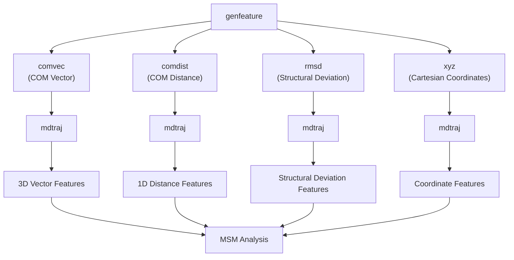
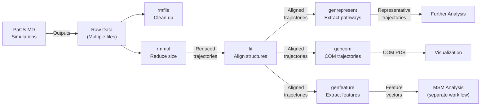

# Utilities

<details>
<summary>Relevant source files</summary>

The following files were used as context for generating this wiki page:

- [README.md](README.md)
- [docs/src/README.md](docs/src/README.md)
- [docs/src/SUMMARY.md](docs/src/SUMMARY.md)
- [docs/src/mdrun/reference.md](docs/src/mdrun/reference.md)
- [pacs/_version.py](pacs/_version.py)
- [pacs/utils/genrepresent.py](pacs/utils/genrepresent.py)
- [pacs/utils/parser.py](pacs/utils/parser.py)

</details>


The PaCS-Toolkit provides a suite of specialized utility commands that support pre-processing, post-processing, and analysis of Parallel Cascade Selection Molecular Dynamics (PaCS-MD) simulations. These utilities are designed to handle common tasks in the molecular dynamics workflow, such as file management, trajectory processing, and feature extraction for subsequent analysis.

## Overview of Utilities

The PaCS-Toolkit includes the following key utility commands:

| Utility | Purpose |
|---------|---------|
| `rmfile` | Removes unnecessary files generated during PaCS-MD simulations |
| `rmmol` | Reduces trajectory file size by selecting only necessary molecules |
| `fit` | Regenerates trajectories by best-fitting selected regions or molecules |
| `genrepresent` | Generates representative pathways from PaCS-MD simulation cycles |
| `gencom` | Creates center of mass (COM) trajectory files for visualization |
| `genfeature` | Calculates various features from trajectories for Markov State Model (MSM) analysis |

These utilities are accessed through the main `pacs` command-line interface and are designed to work seamlessly with the output of PaCS-MD simulations.

Sources: [pacs/utils/parser.py:25-1047](pacs/utils/parser.py:25-1047)

## Utility Command Architecture

```mermaid
graph TD
    CLI["pacs CLI"] --> MDRun["mdrun"]
    CLI --> Utils["Utilities"]
    
    Utils --> FileManagement["File Management"]
    Utils --> TrajectoryProcessing["Trajectory Processing"]
    Utils --> FeatureExtraction["Feature Extraction"]
    
    FileManagement --> RMFile["rmfile"]
    FileManagement --> RMMol["rmmol"]
    
    TrajectoryProcessing --> Fit["fit"]
    TrajectoryProcessing --> GenRepresent["genrepresent"]
    TrajectoryProcessing --> GenCom["gencom"]
    
    FeatureExtraction --> GenFeature["genfeature"]
    
    GenFeature --> ComDist["comdist"]
    GenFeature --> ComVec["comvec"]
    GenFeature --> RMSD["rmsd"]
    GenFeature --> XYZ["xyz"]
    
    RMFile -.-> "Remove unnecessary files"
    RMMol -.-> "Reduce trajectory size"
    Fit -.-> "Align structures"
    GenRepresent -.-> "Extract pathways"
    GenCom -.-> "Generate COM trajectories"
    GenFeature -.-> "Extract features for MSM"
```

Sources: [pacs/utils/parser.py:25-1047](pacs/utils/parser.py:25-1047)

## File Management Utilities

### rmfile

The `rmfile` utility command removes unnecessary files generated during PaCS-MD simulations to save disk space. It targets files that are no longer needed after successful completion of the simulation or after extracting essential data.

**Usage:**
```
pacs rmfile -t TRIAL -s SIMULATOR
```

**Parameters:**
- `-t, --trial`: Trial number (required)
- `-s, --simulator`: Name of simulator used (gromacs, namd, or amber) (required)

**Example:**
```
pacs rmfile -t 1 -s gromacs
```

The command removes unnecessary files from the specified trial directory based on the simulator type.

Sources: [pacs/utils/parser.py:251-262](pacs/utils/parser.py:251-262)

### rmmol

The `rmmol` utility reduces the size of MD trajectory files by selecting only necessary molecules (e.g., proteins and ligands) and removing solvent molecules that often constitute the bulk of the file size. This utility supports different MD packages through subcommands: `mdtraj`, `gmx` (Gromacs), and `cpptraj` (Amber).

**Usage for mdtraj:**
```
pacs rmmol mdtraj -t TRIAL -k SELECTION -m TOPOLOGY [-e EXTENSION]
```

**Usage for gmx (Gromacs):**
```
pacs rmmol gmx -t TRIAL -k SELECTION -n INDEX -g GMX_COMMAND [-e EXTENSION] [--nojump]
```

**Usage for cpptraj (Amber):**
```
pacs rmmol cpptraj -t TRIAL -k SELECTION [-e EXTENSION] [-p TOPOLOGY]
```

**Common Parameters:**
- `-t, --trial`: Trial number (required)
- `-k, --keep_selection`: Selection specification for molecules to retain
- `-e, --trajectory_extension`: File extension of trajectory files

**Example:**
```
pacs rmmol mdtraj -t 1 -k "not water" -m protein.pdb
```

Sources: [pacs/utils/parser.py:143-248](pacs/utils/parser.py:143-248)

## Trajectory Processing Utilities

### fit

The `fit` utility regenerates MD trajectories by aligning structures to a reference through best-fitting of selected regions or molecules. This is particularly useful for analyzing conformational changes by removing overall translations and rotations.

The utility has two main modes:
1. `traj`: Apply fitting to a single trajectory file
2. `trial`: Apply fitting to all trajectories from a PaCS-MD trial

**Usage for single trajectory (mdtraj):**
```
pacs fit traj mdtraj -tf TRAJ_FILE -top TOPOLOGY -r REF_STRUCTURE -ts TRJ_SELECTION -rs REF_SELECTION [-p N_PARALLEL] [-o OUTPUT]
```

**Usage for trial (mdtraj):**
```
pacs fit trial mdtraj -t TRIAL -tf TRAJ_FILE -top TOPOLOGY -r REF_STRUCTURE -ts TRJ_SELECTION -rs REF_SELECTION [-p N_PARALLEL] [-o OUTPUT]
```

**Parameters:**
- `-tf, --trj-file`: Trajectory file path
- `-top, --topology`: Topology file path
- `-r, --ref-structure`: Reference structure file path
- `-ts, --trj-selection`: Selection for fitting in trajectory
- `-rs, --ref-selection`: Selection for fitting in reference
- `-p, --n_parallel`: Number of parallel processes (default: 1)
- `-o, --out`: Output file name (default: {traj}_fit{ext})

**Example:**
```
pacs fit traj mdtraj -tf trajectory.xtc -top topology.pdb -r reference.pdb -ts "protein" -rs "protein"
```

Sources: [pacs/utils/parser.py:272-397](pacs/utils/parser.py:272-397)

### genrepresent

The `genrepresent` utility generates representative pathways along the PaCS-MD cycles. It extracts and concatenates trajectories from selected replicas in each cycle to create a continuous pathway from the initial to the final state.

Like other utilities, it supports different analysis backends:
- `mdtraj`
- `gmx` (Gromacs)
- `cpptraj` (Amber)

**Usage for mdtraj:**
```
pacs genrepresent mdtraj -t TRIAL -trj TRAJECTORY -top TOPOLOGY
```

**Usage for gmx (Gromacs):**
```
pacs genrepresent gmx -t TRIAL -trj TRAJECTORY -top TOPOLOGY -g GMX_COMMAND
```

**Usage for cpptraj (Amber):**
```
pacs genrepresent cpptraj -t TRIAL -trj TRAJECTORY -top TOPOLOGY
```

**Parameters:**
- `-t, --trial`: Trial number (required)
- `-trj, --trajectory`: Trajectory file name (required)
- `-top, --topology`: Topology file path (required)
- `-g, --cmd_gmx`: Gromacs command prefix (for gmx only)

**Example:**
```
pacs genrepresent mdtraj -t 1 -trj prd_rmmol.xtc -top protein.pdb
```

The utility creates a `genrepresent` directory with a concatenated trajectory file.

Sources: [pacs/utils/parser.py:52-116](pacs/utils/parser.py:52-116), [pacs/utils/genrepresent.py:12-251](pacs/utils/genrepresent.py:12-251)

### gencom

The `gencom` utility generates center of mass (COM) trajectories for selected molecules in PDB format. This is particularly useful for visualizing and analyzing the movement of molecules in a simplified manner.

The utility has two modes:
1. `traj`: Apply to a single trajectory file
2. `trial`: Apply to all trajectories from a PaCS-MD trial

**Usage for single trajectory (mdtraj):**
```
pacs gencom traj mdtraj -trj TRJ_FILE -top TOPOLOGY -s SELECTION [-r RESID] [-o OUTPUT]
```

**Usage for trial (mdtraj):**
```
pacs gencom trial mdtraj -t TRIAL -trj TRAJFILE_NAME -top TOPOLOGY -s SELECTION [-r RESID] [-o OUTPUT] [-sf STRIDE]
```

**Parameters:**
- `-trj, --trj-file`: Trajectory file path
- `-top, --topology`: Topology file path
- `-s, --selection`: Selection string to identify the group for COM calculation
- `-r, --resid`: Residue ID for virtual site of COM (default: 1)
- `-o, --out-pdb`: Output PDB file path
- `-sf, --stride-frame`: Frame stride for trial mode (default: 10)

**Example:**
```
pacs gencom traj mdtraj -trj trajectory.xtc -top topology.pdb -s "resname LIG" -o ligand_com.pdb
```

Sources: [pacs/utils/parser.py:441-552](pacs/utils/parser.py:441-552)

## Feature Generation Utilities

### genfeature

The `genfeature` utility calculates various features from trajectories for subsequent Markov State Model (MSM) analysis. It provides multiple feature types through subcommands:

1. `comvec`: Center of mass vector (3D) based features
2. `comdist`: Center of mass distance (1D) based features
3. `rmsd`: RMSD based features
4. `xyz`: Cartesian coordinate based features



Each feature type currently supports the `mdtraj` backend and generates feature data in `.npy` format, which can be used for MSM analysis (see [MSM Analysis](#7)).

#### comvec

Calculates 3D vectors between centers of mass of two molecular selections.

**Usage:**
```
pacs genfeature comvec mdtraj -t TRIAL -tf TRJ_FILE -top TOPOLOGY -ref REFERENCE -ft FIT_TRJ -fr FIT_REF -s1 SELECTION1 -s2 SELECTION2 [-od OUTDIR] [-p N_PARALLEL]
```

**Key Parameters:**
- `-s1, --selection1`: First selection for calculating COM vector
- `-s2, --selection2`: Second selection for calculating COM vector

#### comdist

Calculates 1D distances between centers of mass of two molecular selections.

**Usage:**
```
pacs genfeature comdist mdtraj -t TRIAL -tf TRJ_FILE -top TOPOLOGY -s1 SELECTION1 -s2 SELECTION2 [-od OUTDIR] [-p N_PARALLEL]
```

#### rmsd

Calculates root-mean-square deviation (RMSD) between frames and a reference structure.

**Usage:**
```
pacs genfeature rmsd mdtraj -t TRIAL -tf TRJ_FILE -top TOPOLOGY -ref REFERENCE -ft FIT_TRJ -fr FIT_REF -ct CAL_TRJ -cr CAL_REF [-od OUTDIR] [-p N_PARALLEL]
```

**Key Parameters:**
- `-ct, --cal-trj`: Selection for RMSD calculation in trajectory
- `-cr, --cal-ref`: Selection for RMSD calculation in reference

#### xyz

Extracts Cartesian coordinates for selected atoms.

**Usage:**
```
pacs genfeature xyz mdtraj -t TRIAL -tf TRJ_FILE -top TOPOLOGY -s SELECTION [-od OUTDIR] [-p N_PARALLEL]
```

**Example:**
```
pacs genfeature comdist mdtraj -t 1 -tf prd_rmmol.xtc -top topology.pdb -s1 "protein" -s2 "resname LIG"
```

These utilities generate feature files that can be used in the MSM analysis workflow for calculating binding free energies and kinetic rates.

Sources: [pacs/utils/parser.py:554-817](pacs/utils/parser.py:554-817)

## Data Flow in Utility Commands



The utility commands in PaCS-Toolkit form a cohesive workflow that processes the raw simulation data through several stages:

1. **Data Cleanup**: Using `rmfile` to remove unnecessary files and `rmmol` to reduce trajectory size
2. **Structure Alignment**: Using `fit` to align structures for accurate analysis
3. **Pathway Extraction**: Using `genrepresent` to extract representative pathways
4. **Feature Calculation**: Using `genfeature` to extract features for MSM analysis
5. **Visualization Preparation**: Using `gencom` to generate COM trajectories for visualization

This workflow transforms the raw output from PaCS-MD simulations into processed data ready for detailed analysis, particularly through the Markov State Model approach.

Sources: [pacs/utils/parser.py:25-1047](pacs/utils/parser.py:25-1047)

## Command-Line Interface Integration

All utility commands are integrated into the main `pacs` command-line interface, which provides a consistent interface for all PaCS-Toolkit functionality. The CLI is implemented in the [pacs/utils/parser.py](pacs/utils/parser.py) file using Python's `argparse` module.

Common patterns in the command-line interface include:
- Trial number specification (`-t`, `--trial`)
- File path parameters for trajectories and topologies
- Selection strings for specifying molecular groups
- Backend selection (mdtraj, gmx, cpptraj)
- Output directory or file name specification

For comprehensive documentation on each utility's available parameters and subcommands, you can use the built-in help system:

```
pacs --help
pacs UTILITY --help
pacs UTILITY SUBCOMMAND --help
```

For example:
```
pacs genfeature --help
pacs genfeature comdist --help
pacs genfeature comdist mdtraj --help
```

Sources: [pacs/utils/parser.py:25-1047](pacs/utils/parser.py:25-1047)

## Related Components

- For information about running PaCS-MD simulations, see [Core Framework](#4)
- For details on the analysis systems, see [Analyzers](#5)
- For information about MSM analysis using the generated features, see [MSM Analysis](#7)

Sources: [pacs/utils/parser.py:25-1047](pacs/utils/parser.py:25-1047)

---