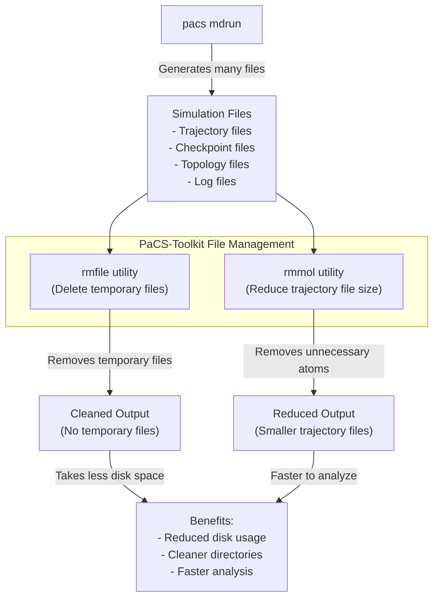
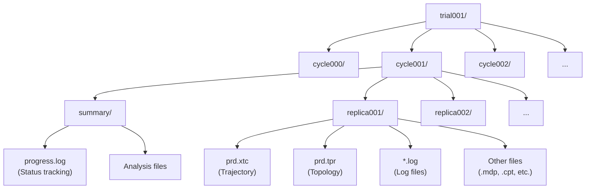
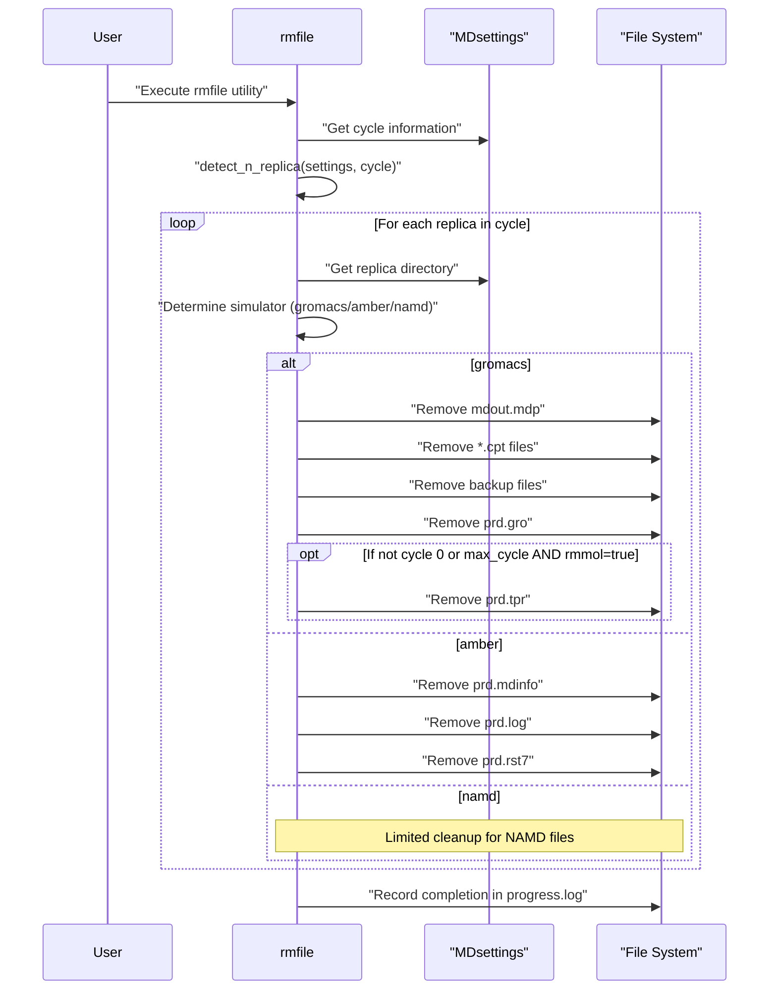
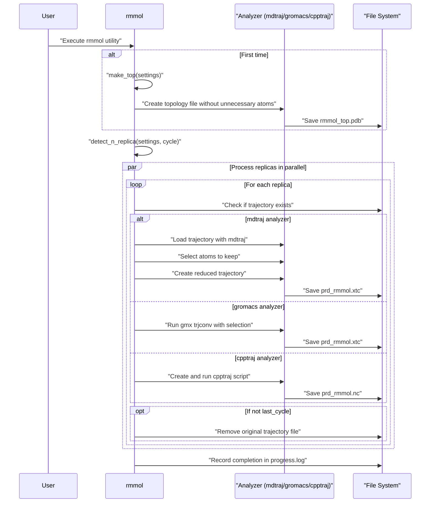
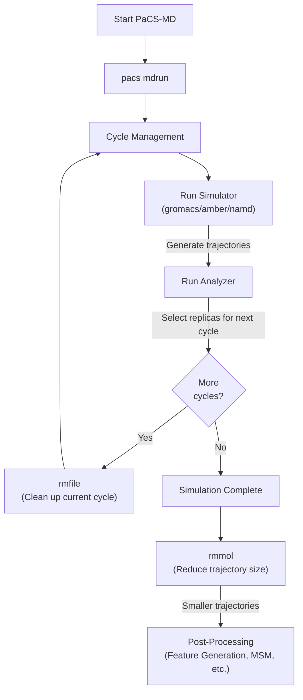
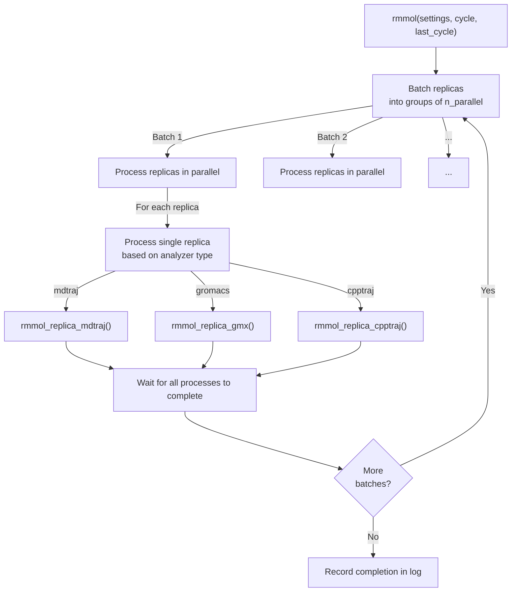

# File Management

<details>
<summary>Relevant source files</summary>

The following files were used as context for generating this wiki page:

- [docs/src/rmmol.md](docs/src/rmmol.md)
- [pacs/utils/rmfile.py](pacs/utils/rmfile.py)
- [pacs/utils/rmmol.py](pacs/utils/rmmol.py)

</details>


## Purpose and Scope

The PaCS-Toolkit provides two essential file management utilities that help manage disk space and improve performance during and after PaCS-MD simulations. This page documents the `rmfile` and `rmmol` utilities, which handle cleanup of temporary files and reduction of trajectory file sizes, respectively. For information about feature generation and trajectory analysis, see [Feature Generation](#6.2) and [Trajectory Fitting](#6.3).

## Overview of File Management Utilities

PaCS-MD simulations generate numerous files during execution, many of which are temporary or contain redundant information. The toolkit provides two key utilities to manage these files:

1. **rmfile**: Removes temporary and unnecessary files generated during simulation
2. **rmmol**: Reduces trajectory file sizes by removing unnecessary atoms (e.g., solvent molecules)



Sources: [pacs/utils/rmfile.py:1-117](), [pacs/utils/rmmol.py:1-316]()

## File Structure in PaCS-MD Simulations

Before discussing the file management utilities, it's helpful to understand how files are organized in a PaCS-MD simulation:



Sources: [pacs/utils/rmfile.py:10-31](), [pacs/utils/rmmol.py:11-33]()

## The rmfile Utility

The `rmfile` utility cleans up temporary files that are no longer needed after a simulation cycle has completed. It operates on a per-cycle basis and handles different files based on the molecular dynamics simulator used.

### How rmfile Works



Sources: [pacs/utils/rmfile.py:42-109]()

### Files Removed by Simulator Type

The `rmfile` utility removes different files depending on the simulator being used:

| Simulator | Files Removed |
|-----------|---------------|
| GROMACS   | `.mdp` files (mdout.mdp), `.cpt` files, backup files (`#*`), output structure files (prd.gro), and optionally `.tpr` files |
| AMBER     | `.mdinfo` files, empty log files, output structure files (prd.rst7) |
| NAMD      | Limited cleanup (most NAMD files are preserved) |

Sources: [pacs/utils/rmfile.py:46-99]()

## The rmmol Utility

The `rmmol` utility reduces the size of trajectory files by removing unnecessary atoms, typically solvent molecules like water. This makes trajectory files smaller and faster to analyze.

### How rmmol Works



Sources: [pacs/utils/rmmol.py:134-280]()

### Analyzer-Specific Behavior

The `rmmol` utility works differently depending on the analyzer specified:

| Analyzer | Method |
|----------|--------|
| mdtraj   | Uses MDTraj to load the trajectory, select atoms to keep, and save a reduced trajectory |
| gromacs  | Uses GROMACS's `trjconv` tool to select atoms and convert the trajectory |
| cpptraj  | Uses a CPPTraj script to process the trajectory and remove unnecessary atoms |

Sources: [pacs/utils/rmmol.py:47-131](), [pacs/utils/rmmol.py:177-280]()

## Command-Line Usage

The PaCS-Toolkit provides command-line interfaces for both file management utilities.

### rmfile Command

The `rmfile` command is typically run automatically during PaCS-MD simulations but can also be run manually:

```
pacs rmfile -t TRIAL_NUMBER
```

This will clean up all unnecessary files for all cycles in the specified trial.

### rmmol Command

The `rmmol` command must be run manually after a simulation is complete. It has different options depending on the analyzer used:

#### For MDTraj:
```
pacs rmmol mdtraj -t TRIAL_NUMBER -k "not water" -e .xtc -m TOPOLOGY_FILE
```

#### For GROMACS:
```
pacs rmmol gmx -t TRIAL_NUMBER -k "not_water" -e .xtc -n index.ndx -g gmx --nojump
```

#### For CPPTraj:
```
pacs rmmol cpptraj -t TRIAL_NUMBER -k "not water" -e .nc -p TOPOLOGY_FILE
```

Sources: [docs/src/rmmol.md:1-76]()

## File Management Workflow in PaCS-MD

The following diagram shows how file management fits into the overall PaCS-MD workflow:



Sources: [pacs/utils/rmfile.py:42-116](), [pacs/utils/rmmol.py:134-315]()

## Implementation Details

### File Detection Functions

Both utilities use similar functions to detect the number of replicas and cycles:

```python
def detect_n_replica(settings: MDsettings, cycle: int) -> int:
    # Detect number of replicas in a cycle
    for replica in range(1, 1000):
        replica_dir = Path(settings.each_replica(_cycle=cycle, _replica=replica))
        if not replica_dir.exists():
            n_replica = replica - 1
            break
    return n_replica

def detect_n_cycle(settings: MDsettings) -> int:
    # Detect maximum cycle number
    for cycle in range(1000):
        cycle_dir = Path(settings.each_cycle(_cycle=cycle))
        if not cycle_dir.exists():
            max_cycle = cycle - 1
            break
    return max_cycle
```

Sources: [pacs/utils/rmfile.py:10-31](), [pacs/utils/rmmol.py:11-33]()

### Parallel Processing in rmmol

The `rmmol` utility processes multiple replicas in parallel to improve performance:



Sources: [pacs/utils/rmmol.py:134-174]()

## Best Practices and Considerations

1. **Run rmfile during simulations**: The `rmfile` utility is automatically run during PaCS-MD simulations to keep disk usage manageable.

2. **Run rmmol after simulation completion**: The `rmmol` utility should be run after a simulation is complete to reduce the size of trajectory files for analysis.

3. **Keep original files for the last cycle**: By default, `rmmol` keeps the original trajectory files for the last cycle as a precaution.

4. **Consider PBC handling**: When using `rmmol` with GROMACS, consider using the `--nojump` option if your trajectories were generated with PBC handling.

5. **Selection syntax**: Be careful with the atom selection syntax, which differs between analyzers:
   - MDTraj: `"not water"`
   - GROMACS: `"not_water"` (group name in index file)
   - CPPTraj: `"not water"` or `":!WAT"`

Sources: [pacs/utils/rmmol.py:218-222](), [docs/src/rmmol.md:6-9]()

## Summary

The file management utilities in PaCS-Toolkit provide essential functionality for managing the files generated during PaCS-MD simulations. The `rmfile` utility removes temporary and unnecessary files, while the `rmmol` utility reduces the size of trajectory files by removing unnecessary atoms. These utilities help keep disk usage manageable and improve performance during analysis.

---