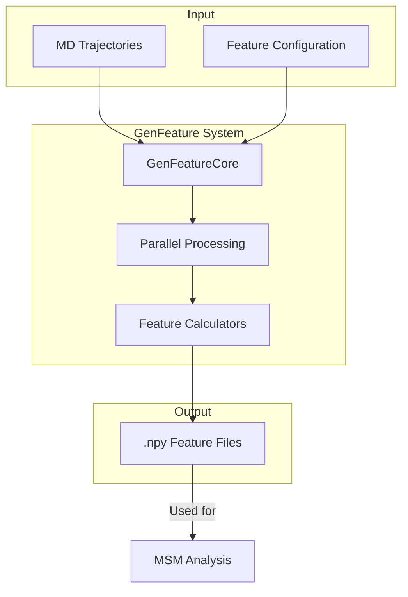
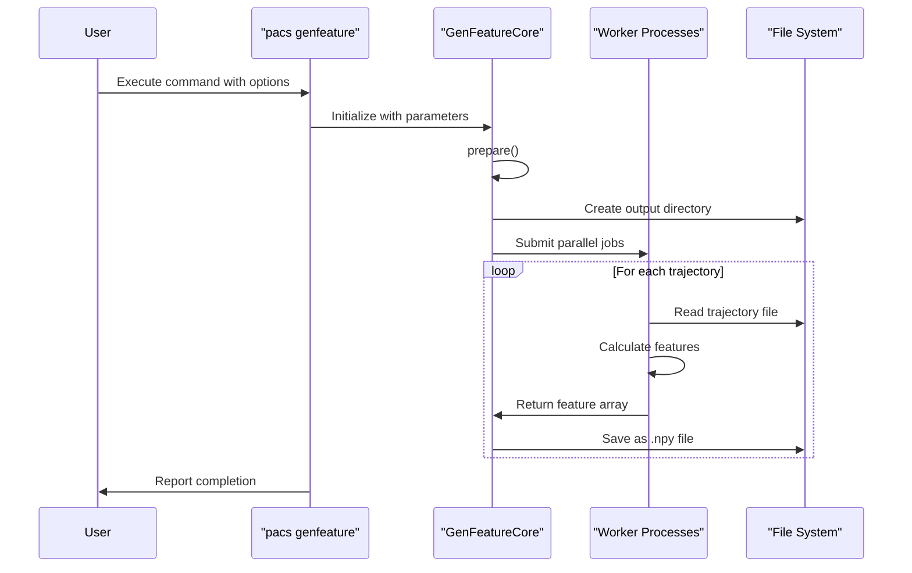
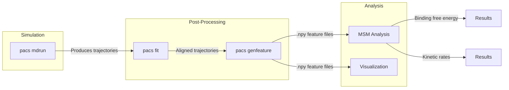

# Feature Generation

<details>
<summary>Relevant source files</summary>

The following files were used as context for generating this wiki page:

- [docs/src/genfeature.md](docs/src/genfeature.md)
- [pacs/utils/fit.py](pacs/utils/fit.py)
- [pacs/utils/genfeature/genfeat.py](pacs/utils/genfeature/genfeat.py)

</details>


The Feature Generation module in PaCS-Toolkit provides utilities for extracting meaningful features from molecular dynamics (MD) trajectories. These features serve as input for advanced analyses, particularly Markov State Model (MSM) analysis. The utilities convert complex trajectory data into numerical representations that capture essential properties of molecular systems.

For trajectory fitting options prior to feature generation, see [Trajectory Fitting](#6.3).
For details on MSM analysis with the generated features, see [MSM Analysis](#7).

## Overview

The Feature Generation system processes trajectory files from PaCS-MD simulations and converts them into numerical features saved as NumPy array files (`.npy`). These features provide a reduced-dimensional representation of the molecular system's behavior, focusing on properties relevant to specific analyses.



Sources: [pacs/utils/genfeature/genfeat.py:12-58](), [docs/src/genfeature.md:1-17]()

## Core Components

The feature generation system is built around the `GenFeatureCore` class, which manages the process of extracting features from trajectory files and saving them in a standardized format.

```mermaid
classDiagram
    class GenFeatureCore {
        +int trial
        +str trj_filename
        +str output_directory
        +int n_parallel
        +save(cycle, replica, features)
        +prepare()
        +cal_parallel(calc_feature, *args, **kwargs)
    }
    
    GenFeatureCore --> "concurrent.futures" : uses
    GenFeatureCore --> "numpy" : saves arrays
```

### Key Components:
- **GenFeatureCore**: The central class that manages feature extraction and saving
- **Parallel Processing**: Uses `concurrent.futures` to process multiple trajectories simultaneously
- **Feature Calculators**: Specialized functions for extracting different types of features

Sources: [pacs/utils/genfeature/genfeat.py:12-58]()

## Supported Feature Types

PaCS-Toolkit supports several types of features that capture different aspects of molecular behavior:

| Feature Type | Description | Output Shape | MDTraj Support |
|-------------|-------------|--------------|----------------|
| `comdist` | Center of mass distance between selection groups | (n_frames,) | Yes |
| `comvec` | Center of mass vector between selection groups | (n_frames, 3) | Yes |
| `rmsd` | Root Mean Square Deviation from reference | (n_frames,) | Yes |
| `xyz` | Atomic coordinates | (n_frames, n_atoms, 3) | Yes |

Each feature type serves a different analytical purpose:
- **comdist**: Useful for monitoring binding/unbinding events and distances between molecular components
- **comvec**: Captures directional information between molecular groups
- **rmsd**: Measures structural deviation from a reference conformation
- **xyz**: Provides raw coordinate data for custom analyses

Sources: [docs/src/genfeature.md:9-17]()

## Feature Generation Process

The feature generation workflow involves processing trajectory files from PaCS-MD simulations and calculating specified features in parallel.



The workflow involves the following steps:

1. User invokes the `pacs genfeature` command with appropriate options
2. The system initializes a `GenFeatureCore` instance with configuration parameters
3. Output directory is prepared for storing results
4. Trajectory files are processed in parallel using worker processes
5. Each worker calculates features for a specific trajectory
6. Results are saved as NumPy array files with standardized naming conventions

Sources: [pacs/utils/genfeature/genfeat.py:32-58]()

## File Naming Convention

Feature files are saved using a standardized naming convention that encodes the trial, cycle, and replica information:

```
t{trial:03}c{cycle:03}r{replica:03}.npy
```

For example, `t001c002r003.npy` contains features from trial 1, cycle 2, replica 3.

Sources: [pacs/utils/genfeature/genfeat.py:19-26]()

## Integration with PaCS-Toolkit Workflow

Feature generation is a critical step that bridges simulation and analysis in the PaCS-Toolkit workflow:



Feature generation is typically executed after trajectory fitting (to ensure proper alignment) and before MSM analysis or other data visualization steps.

Sources: [docs/src/genfeature.md:1-7](), [pacs/utils/fit.py:9-73]()

## Usage Example

To generate features from PaCS-MD trajectories, use the `pacs genfeature` command:

```bash
# Generate center of mass distance features
pacs genfeature comdist -t 1 -tf traj.xtc -od features_comdist -np 4

# Generate center of mass vector features
pacs genfeature comvec -t 1 -tf traj.xtc -od features_comvec -np 4
```

Command-line arguments:
- `-t`: Trial number
- `-tf`: Trajectory filename
- `-od`: Output directory
- `-np`: Number of parallel processes

Additional parameters may be required depending on the specific feature type.

Sources: [docs/src/genfeature.md:1-7]()

## Implementation Details

### Parallel Processing

The `cal_parallel` method in `GenFeatureCore` manages parallel processing of trajectory files:

1. It locates trajectory files matching the pattern `./trial{trial}/cycle*/replica*/{trj_filename}`
2. Submits calculation jobs to a process pool executor
3. Collects results and saves them to the output directory

The parallel processing approach significantly accelerates feature generation for large datasets.

Sources: [pacs/utils/genfeature/genfeat.py:32-58]()

### Save Method

The `save` method in `GenFeatureCore` handles saving the calculated features:

1. Formats the output filename according to the standardized naming convention
2. Saves the NumPy array to the specified output directory
3. Logs the save operation

This ensures consistent output formatting and organization.

Sources: [pacs/utils/genfeature/genfeat.py:19-26]()

## Feature Type Details

### Center of Mass Distance (comdist)

The `comdist` feature calculates the scalar distance between centers of mass of two selection groups. This is particularly useful for:
- Monitoring binding/unbinding events
- Tracking distances between domains or molecules
- Identifying potential binding poses

Output: 1D array of shape (n_frames,) containing distances for each frame

### Center of Mass Vector (comvec)

The `comvec` feature calculates the 3D vector between centers of mass of two selection groups. This provides directional information useful for:
- Understanding approach/departure directions
- Analyzing the orientation of binding partners
- Characterizing transition pathways

Output: 2D array of shape (n_frames, 3) containing x, y, z vector components for each frame

### RMSD (rmsd)

The `rmsd` feature calculates the Root Mean Square Deviation from a reference structure. This is useful for:
- Measuring conformational changes
- Identifying stable states
- Tracking structural transitions

Output: 1D array of shape (n_frames,) containing RMSD values for each frame

### Coordinates (xyz)

The `xyz` feature extracts raw atomic coordinates. This provides maximum flexibility for:
- Custom feature development
- Complex geometric calculations
- Advanced structural analysis

Output: 3D array of shape (n_frames, n_atoms, 3) containing x, y, z coordinates for each atom in each frame

Sources: [docs/src/genfeature.md:9-17]()

## Summary

The Feature Generation system in PaCS-Toolkit provides essential utilities for extracting meaningful features from molecular dynamics trajectories. These features serve as input for advanced analyses, particularly Markov State Model (MSM) analysis. The system supports parallel processing for efficient handling of large trajectory datasets and provides multiple feature types to capture different aspects of molecular behavior.

---