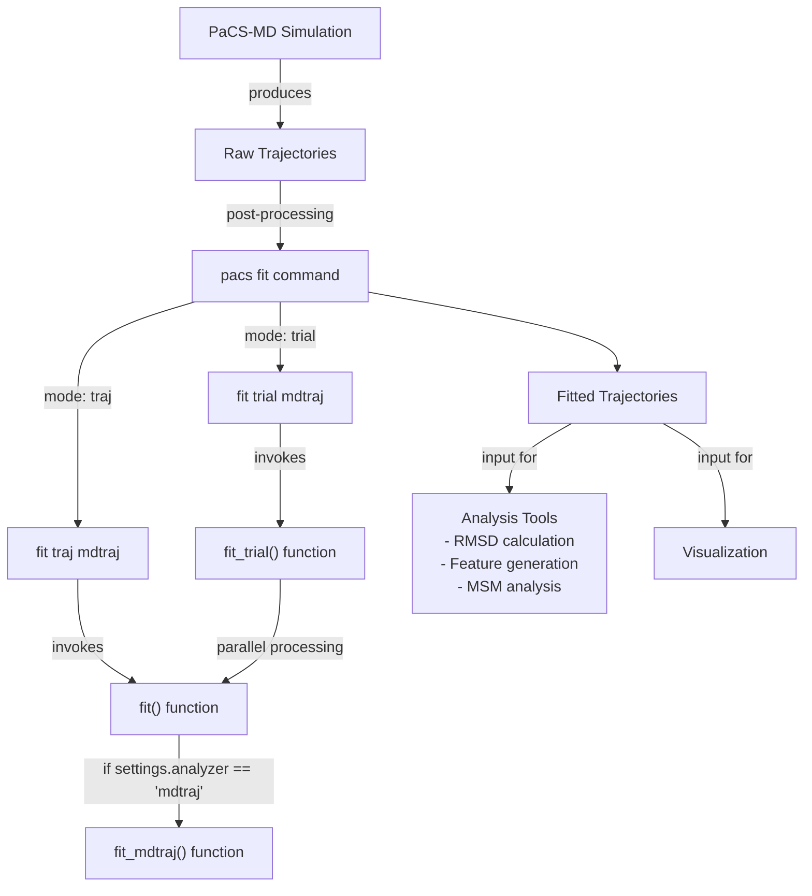
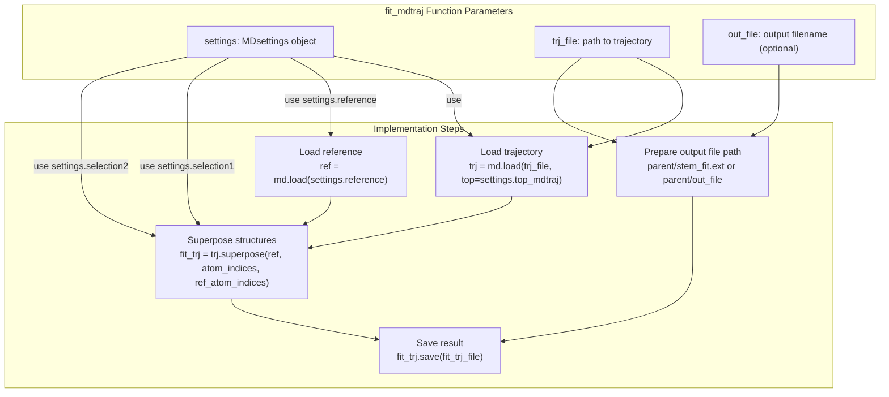

# Trajectory Fitting

<details>
<summary>Relevant source files</summary>

The following files were used as context for generating this wiki page:

- [docs/src/fit.md](docs/src/fit.md)
- [pacs/utils/fit.py](pacs/utils/fit.py)
- [pacs/utils/genfeature/genfeat.py](pacs/utils/genfeature/genfeat.py)

</details>


## Overview

Trajectory Fitting is a post-processing utility in PaCS-Toolkit used to align molecular dynamics (MD) trajectories to a reference structure. This alignment removes translational and rotational movements, making it easier to analyze conformational changes, calculate meaningful RMSDs, and visualize structural transitions. The `pacs fit` command provides functionality to process either a single trajectory or all trajectories in a trial in parallel.

For feature generation utilities, see [Feature Generation](#6.2).

## Position in PaCS-Toolkit Workflow

The Trajectory Fitting utility typically fits into the PaCS-Toolkit workflow after MD simulations have been performed but before detailed analysis.



Sources: [pacs/utils/fit.py:10-14](), [pacs/utils/fit.py:17-48](), [pacs/utils/fit.py:50-73]()

## Implementation Details

The trajectory fitting functionality is implemented in the `fit.py` module and currently supports fitting through the MDTraj library. The implementation consists of three main functions:

1. `fit(settings, trj_file, out_file)`: Main entry point that delegates to the appropriate fitting implementation based on the analyzer type
2. `fit_trial(settings, trj_file, out_file)`: Processes all trajectories in a trial in parallel
3. `fit_mdtraj(settings, trj_file, out_file)`: Performs the actual fitting using MDTraj

### fit_mdtraj Implementation

The `fit_mdtraj` function performs the trajectory fitting through the following steps:



Sources: [pacs/utils/fit.py:50-73]()

### Parallel Processing in fit_trial

When fitting all trajectories in a trial, the `fit_trial` function implements parallel processing to improve performance:

```mermaid
graph TD
    Start["fit_trial(settings, trj_file, out_file)"] --> ScanDirectories["Scan trial directories\n./trial{settings.trial:03}/cycle*/replica*"]
    
    ScanDirectories --> |"for each directory"| CheckFile["Check if trajectory exists\nPath(f\"{path}/{trj_file}\").exists()"]
    
    CheckFile --> |"if exists"| CreateProcess["Create process\nmp.Process(target=fit, args=(settings, path/trj_file, out_file))"]
    CheckFile --> |"if not exists"| LogError["Log error and exit"]
    
    CreateProcess --> AddToJobList["Add to job_list"]
    
    AddToJobList --> CheckJobList["Check if job_list length == settings.n_parallel"]
    
    CheckJobList --> |"if full"| ExecuteJobs["Execute jobs and wait for completion"]
    CheckJobList --> |"if not full"| ContinueLoop["Continue loop"]
    
    ExecuteJobs --> CheckResults["Check job results"]
    CheckResults --> |"if error"| ExitWithError["Exit with error"]
    CheckResults --> |"if success"| ClearJobList["Clear job_list"]
    
    ClearJobList --> ContinueLoop
    ContinueLoop --> |"if more directories"| CheckFile
    ContinueLoop --> |"if finished"| FinalCheck["Check remaining jobs"]
```

Sources: [pacs/utils/fit.py:17-48]()

## Usage

The `pacs fit` command can be used in two modes:

### Single Trajectory Mode

```bash
pacs fit traj mdtraj -tf ./trial001/cycle001/replica001/prd.xtc -top ./inputs/input.gro -r ./inputs/input.gro -ts "backbone" -rs "backbone"
```

### Trial Mode (Parallel Processing)

```bash
pacs fit trial mdtraj -t 1 -top ./trial001/cycle001/replica001/prd.pdb -r ./trial001/cycle001/replica001/prd.pdb -ts "protein" -rs "protein" -tf prd.xtc -p 10
```

### Command Arguments

| Argument | Description | Example |
|----------|-------------|---------|
| `-tf, --trj_file` | Trajectory file to be fitted | `-tf prd.xtc` |
| `-top, --topology` | Topology file for loading trajectory | `-top input.gro` |
| `-r, --ref_structure` | Reference structure for fitting | `-r input.gro` |
| `-ts, --trj_selection` | Atom selection for trajectory | `-ts "backbone"` |
| `-rs, --ref_selection` | Atom selection for reference | `-rs "backbone"` |
| `-p, --parallel` | Number of parallel processes | `-p 10` |
| `-o, --out` | Output filename (default: `{trj_file}_fit.{ext}`) | `-o prd_fit.xtc` |
| `-t, --trial` | Trial number (for trial mode) | `-t 1` |

Sources: [docs/src/fit.md:10-68]()

## Common Workflow Example

A typical workflow using trajectory fitting might look like:

1. Run PaCS-MD simulations using `pacs mdrun`
2. Fit trajectories to a reference structure using `pacs fit trial mdtraj`
3. Analyze the fitted trajectories (e.g., calculate RMSD, generate features)
4. Visualize the fitted trajectories in a molecular visualization program

## Performance Considerations

Fitting trajectories can be computationally intensive, especially for large systems or numerous trajectories. The documentation notes that fitting an entire trial may take around an hour. To mitigate this:

- Use the `-p` option to specify the number of parallel processes based on your system's capabilities
- Consider fitting only the trajectories needed for your specific analysis
- For large systems, use more specific atom selections (e.g., backbone atoms instead of all protein atoms)

Sources: [docs/src/fit.md:6-8]()

## Limitations

- Currently, only the MDTraj library is supported for trajectory fitting
- The output trajectories will be in the same format as the input trajectories
- Fitted trajectories are saved in the same directory as the original trajectories with "_fit" appended to the filename (unless an output name is specified)

---