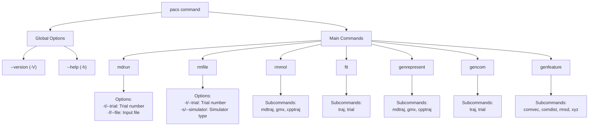
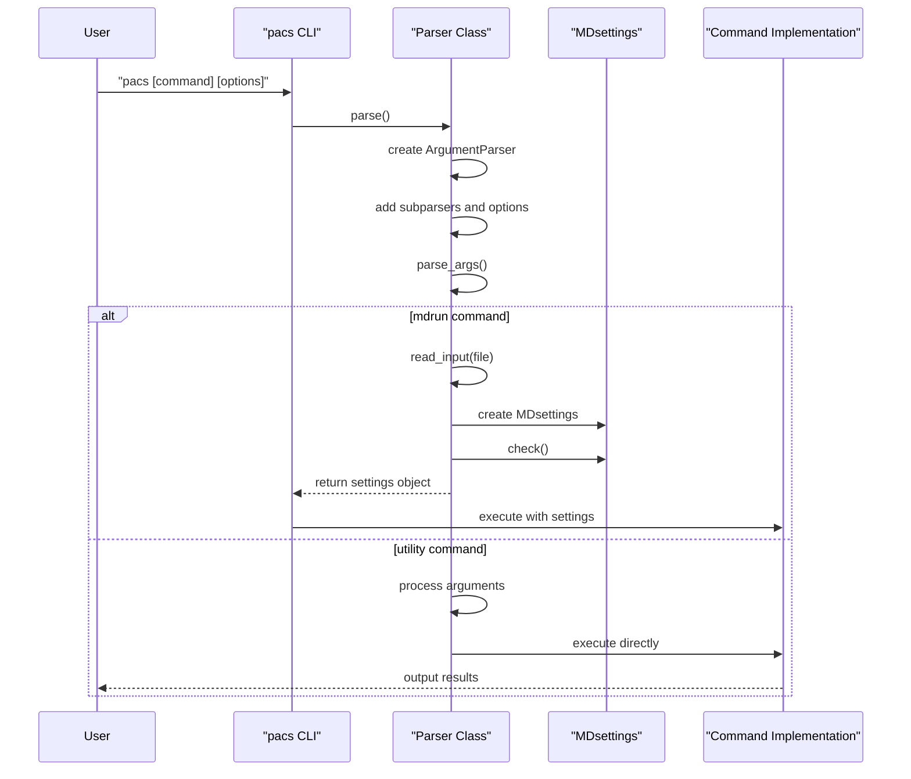
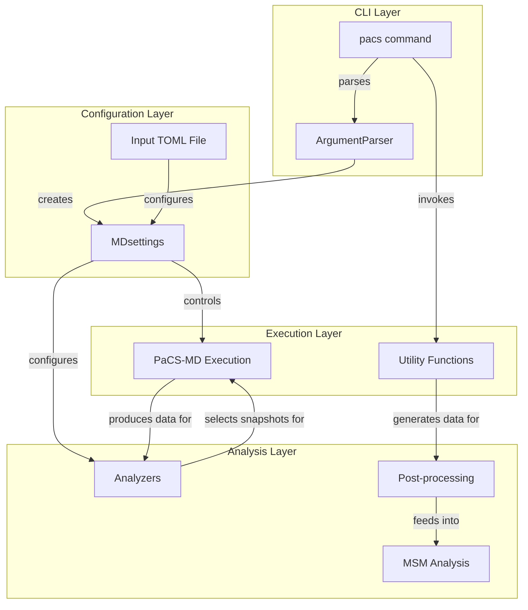

# Command Line Interface

<details>
<summary>Relevant source files</summary>

The following files were used as context for generating this wiki page:

- [README.md](README.md)
- [docs/src/README.md](docs/src/README.md)
- [docs/src/SUMMARY.md](docs/src/SUMMARY.md)
- [docs/src/mdrun/reference.md](docs/src/mdrun/reference.md)
- [pacs/_version.py](pacs/_version.py)
- [pacs/utils/genrepresent.py](pacs/utils/genrepresent.py)
- [pacs/utils/parser.py](pacs/utils/parser.py)

</details>


The PaCS-Toolkit provides a comprehensive command-line interface (CLI) through the `pacs` command that serves as the primary entry point to access all toolkit functionality. This page documents the command structure, available subcommands, and their options to enable users to effectively utilize PaCS-Toolkit from the command line.

For information about specific configuration options used in input files, see [Input File Configuration](#4.2).

## Command Structure Overview

The `pacs` command follows a hierarchical structure with subcommands and options:

```
pacs [options] command [subcommand] [arguments]
```

The CLI is organized into main commands that handle different aspects of the PaCS-MD workflow, from running simulations to analyzing results and managing files.



Sources: [pacs/utils/parser.py:21-91](), [README.md:48-52]()

## Global Options

The `pacs` command supports the following global options:

| Option | Description |
|--------|-------------|
| `-h`, `--help` | Display help message and exit |
| `-V`, `--version` | Display version information and exit |

Sources: [pacs/utils/parser.py:31-32](), [pacs/_version.py:1-2]()

## Main Commands

### mdrun

The `mdrun` command is used to run PaCS-MD simulations. It is the primary command for executing simulations.

```
pacs mdrun -t TRIAL -f INPUT_FILE
```

| Option | Required | Description |
|--------|----------|-------------|
| `-t`, `--trial` | Yes | Trial number for the simulation |
| `-f`, `--file` | Yes | Input configuration file (TOML format) |

Example:
```
pacs mdrun -t 1 -f input.toml
```

Sources: [pacs/utils/parser.py:34-49](), [README.md:48-52]()

### rmfile

The `rmfile` command removes unnecessary files generated during PaCS-MD simulations to save disk space.

```
pacs rmfile -t TRIAL -s SIMULATOR
```

| Option | Required | Description |
|--------|----------|-------------|
| `-t`, `--trial` | Yes | Trial number of the simulation |
| `-s`, `--simulator` | Yes | Simulator used (gromacs, namd, amber) |

Sources: [pacs/utils/parser.py:251-269]()

### rmmol

The `rmmol` command reduces the size of MD trajectories by selecting only necessary molecules. This is particularly useful for post-processing large trajectories.

```
pacs rmmol {mdtraj|gmx|cpptraj} [OPTIONS]
```

Available subcommands:
- `mdtraj`: Use MDTraj for molecule reduction
- `gmx`: Use Gromacs for molecule reduction
- `cpptraj`: Use CPPTRAJ for molecule reduction

Common options:
- `-t`, `--trial`: Trial number
- `-k`, `--keep_selection`: Selection of molecules to retain

Each subcommand has specific options relevant to the respective tool.

Sources: [pacs/utils/parser.py:143-248]()

### fit

The `fit` command regenerates MD trajectories by best-fitting selected regions or molecules, which is useful for analysis and visualization.

```
pacs fit {traj|trial} {mdtraj} [OPTIONS]
```

Subcommands:
- `traj`: Apply to a single trajectory file
- `trial`: Apply to a complete PaCS-MD trial

Both subcommands support the `mdtraj` analysis tool with various options for fitting references and selections.

Sources: [pacs/utils/parser.py:272-397]()

### genrepresent

The `genrepresent` command generates representative pathways along the PaCS-MD cycles, extracting the most relevant conformational changes.

```
pacs genrepresent {mdtraj|gmx|cpptraj} [OPTIONS]
```

Subcommands:
- `mdtraj`: Use MDTraj for generating representative pathways
- `gmx`: Use Gromacs for generating representative pathways
- `cpptraj`: Use CPPTRAJ for generating representative pathways

Common options:
- `-t`, `--trial`: Trial number
- `-trj`, `--trajectory`: Trajectory file name
- `-top`, `--topology`: Topology file path

Sources: [pacs/utils/parser.py:52-116](), [pacs/utils/genrepresent.py:12-251]()

### gencom

The `gencom` command generates center of mass (COM) trajectories of molecules in PDB format, which is useful for visualization and analysis.

```
pacs gencom {traj|trial} {mdtraj} [OPTIONS]
```

Subcommands:
- `traj`: Apply to a single trajectory file
- `trial`: Apply to a complete PaCS-MD trial

Both subcommands support the `mdtraj` tool for generating COM trajectories.

Sources: [pacs/utils/parser.py:441-552]()

### genfeature

The `genfeature` command calculates features for Markov State Model (MSM) analysis, exporting them as numpy arrays.

```
pacs genfeature {comvec|comdist|rmsd|xyz} {mdtraj} [OPTIONS]
```

Subcommands:
- `comvec`: Calculate COM vector (3D) based features
- `comdist`: Calculate COM distance (1D) based features
- `rmsd`: Calculate RMSD based features
- `xyz`: Calculate XYZ based features

All subcommands support the `mdtraj` tool for feature calculation.

Sources: [pacs/utils/parser.py:554-817]()

## Command Execution Flow

The following diagram illustrates how commands are processed within the PaCS-Toolkit CLI:



Sources: [pacs/utils/parser.py:26-105](), [pacs/utils/parser.py:832-1096]()

## Integration with PaCS-MD Framework

The CLI integrates with the broader PaCS-MD framework as shown in the following diagram:



Sources: [pacs/utils/parser.py:26-105](), [pacs/utils/parser.py:832-1096]()

## Error Handling

The CLI implements error handling to provide informative messages when errors occur:

1. If no command is provided, it shows a help message
2. For configuration errors, it validates input and provides specific error messages
3. When version mismatches occur between the toolkit and existing trials, it prevents potential incompatibility issues

Sources: [pacs/utils/parser.py:822-831](), [pacs/utils/parser.py:1082-1096]()

## Example Usage

Here are some common usage examples for the PaCS-Toolkit CLI:

### Running a PaCS-MD Simulation

```bash
pacs mdrun -t 1 -f input.toml
```

### Removing Unnecessary Files

```bash
pacs rmfile -t 1 -s gromacs
```

### Reducing Trajectory Size

```bash
pacs rmmol mdtraj -t 1 -k "not water" -m topology.pdb -e .xtc
```

### Generating Representative Pathways

```bash
pacs genrepresent mdtraj -t 1 -trj prd.xtc -top topology.pdb
```

### Generating Features for MSM Analysis

```bash
pacs genfeature comvec mdtraj -t 1 -tf prd_rmmol.xtc -top topology.pdb -ref reference.pdb -ft "protein" -fr "protein" -s1 "protein" -s2 "resname LIG" -p 4
```

Sources: [README.md:48-52](), [pacs/utils/parser.py:118-1080]()

## Version Information

The CLI provides version information through the `-V` or `--version` flag:

```bash
pacs --version
```

This displays the current version of PaCS-Toolkit. The toolkit also checks version compatibility when working with existing trials to ensure consistency.

Sources: [pacs/_version.py:1-2](), [pacs/utils/parser.py:827-829](), [pacs/utils/parser.py:1082-1096]()

---