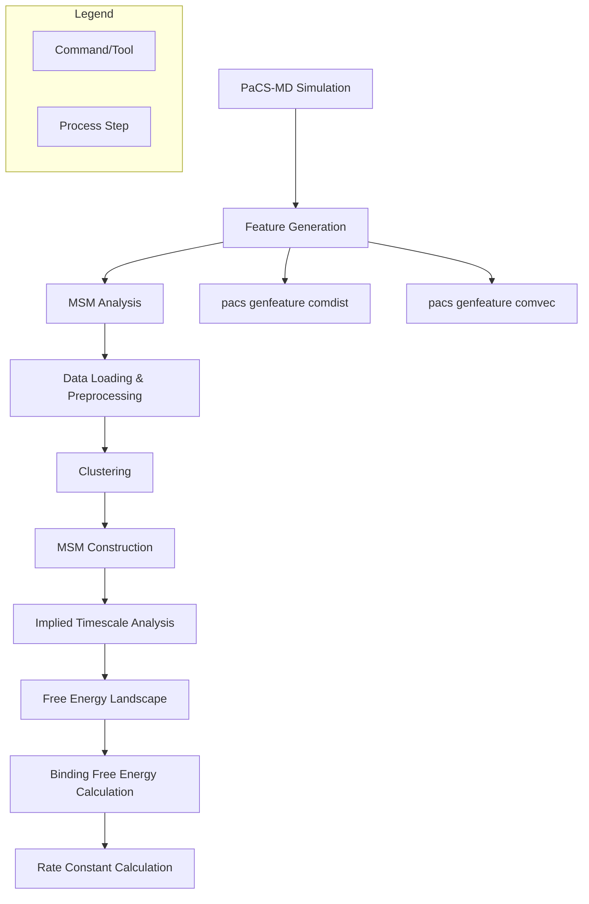
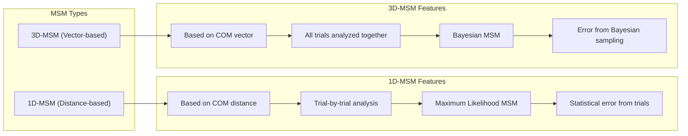
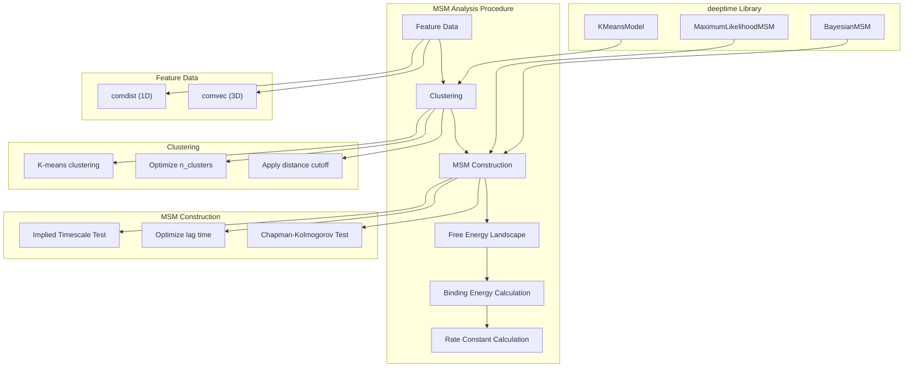
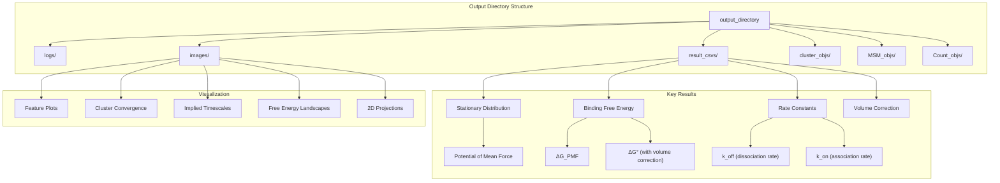

# MSM Analysis

<details>
<summary>Relevant source files</summary>

The following files were used as context for generating this wiki page:

- [MSM/README.md](MSM/README.md)

</details>


## Purpose and Overview

This document provides a comprehensive guide to Markov State Model (MSM) analysis within the PaCS-Toolkit. MSM analysis is a powerful post-processing technique used to extract thermodynamic and kinetic properties from molecular dynamics simulations, particularly binding/unbinding events. Using MSM analysis, you can calculate:

- Standard binding free energies (ΔG°)
- Dissociation rate constants (koff)
- Association rate constants (kon)

MSM analysis is typically performed after completing PaCS-MD simulations (particularly association or dissociation simulations) and generating appropriate feature data. For information on running the simulations themselves, see [Core Framework](#4) and [Analyzers](#5).

Sources: [MSM/README.md:1-4]()

## MSM Analysis Workflow

The MSM analysis in PaCS-Toolkit is implemented through the `distance_deeptime.ipynb` notebook (or equivalent Python scripts). Below is the general workflow for performing MSM analysis:



Sources: [MSM/README.md:8-11](), [MSM/README.md:25-60]()

## Prerequisites and Inputs

Before running MSM analysis, you need to prepare the following:

1. **Completed PaCS-MD simulations** - Typically association or dissociation simulations
2. **Feature data for MSM** - Generated using the `pacs genfeature` command

The feature data should follow specific formats:

| Feature Type | Command | Directory | Filename Pattern | Data Shape |
|--------------|---------|-----------|------------------|------------|
| Inter-COM distance (1D) | `pacs genfeature comdist` | User-specified | `t{trial:03}*.npy` | (frames,) |
| Inter-COM vector (3D) | `pacs genfeature comvec` | User-specified | `*.npy` | (frames, 3) |

Sources: [MSM/README.md:8-23]()

## Types of MSM Analysis

PaCS-Toolkit implements two complementary MSM approaches:



### 1D-MSM
- **Feature**: Center-of-mass distance (1D) between molecules
- **Method**: Applied trial-by-trial using maximum likelihood MSM
- **Error Estimation**: Statistical measures derived from each trial's MSM
- **Advantage**: Better for distinguishing direction of dissociation

### 3D-MSM
- **Feature**: Center-of-mass vector (3D) between molecules
- **Method**: Applied across all trials simultaneously using Bayesian MSM
- **Error Estimation**: Derived from Bayesian sampling
- **Advantage**: Differentiates dissociation in multiple directions

Sources: [MSM/README.md:25-40]()

## Analysis Procedure

The MSM analysis follows a systematic procedure:

1. **Feature Data Visualization**
   - Plot the feature values over simulation cycles
   
2. **Clustering**
   - Group similar conformations based on feature values
   - Optimize the number of clusters
   
3. **State Definition**
   - Define bound and unbound states based on distance thresholds
   
4. **MSM Construction**
   - Build Markov models at different lag times
   - Analyze implied timescales for convergence
   
5. **Free Energy Landscape**
   - Calculate the potential of mean force (PMF) along reaction coordinates
   
6. **Thermodynamic and Kinetic Properties**
   - Calculate binding free energy with volume correction
   - Estimate association and dissociation rate constants



Sources: [MSM/README.md:42-60](), [MSM/README.md:25-40]()

## Key Parameters

To run MSM analysis, you need to specify several parameters in the `distance_deeptime.ipynb` notebook:

| Parameter | Type | Description |
|-----------|------|-------------|
| `n_trial_for_calc` | List[int] | List of trial indices to analyze |
| `trial_root_directory` | str | Directory containing trial data |
| `feature_1d_directory` | str | Directory containing 1D distance features |
| `feature_3d_directory` | str | Directory containing 3D vector features |
| `output_directory` | str | Output directory for results |
| `T` | float | Temperature in Kelvin |
| `dt` | int | Time interval (ps) of saved trajectory |
| `n_clusters_for_try_1d` | List[int] | Cluster numbers to try for 1D MSM |
| `lags_for_try_1d` | List[int] | Lag times to try for 1D MSM |
| `n_clusters_for_try_3d` | List[int] | Cluster numbers to try for 3D MSM |
| `lags_for_try_3d` | List[int] | Lag times to try for 3D MSM |
| `cutoff` | float | Distance cutoff (nm) for MSM construction |
| `do_volume_correction` | bool | Whether to apply volume correction |
| `num_of_ligands` | int | Number of ligands in the system |
| `box_size` | float | Simulation box size (nm³) |

Additionally, you'll need to define bound and unbound state thresholds:

```
# Definition for bound-state
lower_bound = 0  # 0 is recommended
upper_bound = <value>  # System-dependent

# Definition for unbound-state
lower_unbound = <value>  # System-dependent
upper_unbound = cutoff  # cutoff is recommended
```

Sources: [MSM/README.md:62-118]()

## Outputs and Result Interpretation

The MSM analysis generates extensive outputs organized in several directories:



### Key Result Files

The most important results are found in `result_csvs/`:

1. **MSM Stationary Distribution**
   - 1D: `1d_trial{trial}_n_clusters{n}_lag{lag}_cut{cutoff}.csv`
   - 3D: `3d_n_clusters{n}_lag{lag}_cut{cutoff}.csv`

2. **Binding Free Energy**
   - 1D: `1d_binding_energy_summary.csv`
   - 3D: `3d_binding_energy_summary.csv`

3. **Rate Constants**
   - 3D: `3d_rate_constant_summary.csv`

4. **Volume Correction**
   - 1D: `1d_VC.csv`
   - 3D: `3d_VC.csv`

### Visualizations

The `images/` directory contains various plots:

1. **Feature plots**: `cycle_feature.png`
2. **Clustering convergence**: `clustering_converge_*.png`
3. **Histograms**: `hist_*.png`
4. **Inertia plots**: `inertia_*.png`
5. **Implied timescale plots**: `its_*.png`
6. **Free energy landscapes**: `fel_*.png`

Sources: [MSM/README.md:121-276]()

## Performance Tips

MSM analysis, particularly the clustering and MSM building steps, can be computationally intensive. Here are some tips for efficient analysis:

1. **Run Intensive Parts Separately**:
   - Convert the notebook to a Python script: `jupyter nbconvert distance_deeptime.ipynb --to script`
   - Create separate scripts for 1D-MSM and 3D-MSM
   - Run these scripts in parallel or in the background

2. **Parameter Selection**:
   - Start with a small number of trials as a test run
   - Begin with a reasonable range of clusters (50-200) and lag times
   - Verify results with implied timescale tests before production runs

3. **Visualization Optimization**:
   - Set `show_picture=False` when running the script to avoid rendering plots during computation
   - Generate and review plots after the expensive calculations are complete

4. **Reproducibility**:
   - Save all parameters used in your analysis
   - Store intermediate results (clustering, MSM objects)

Sources: [MSM/README.md:278-289]()

## Next Steps

After performing MSM analysis, you may want to:

1. Compare the results from 1D-MSM and 3D-MSM approaches
2. Validate binding free energies against experimental data
3. Use the rate constants for kinetic modeling
4. Explore different clustering or feature generation methods

For detailed interpretation of binding free energies and rate constants, see [Binding Free Energy Calculation](#7.3).

---