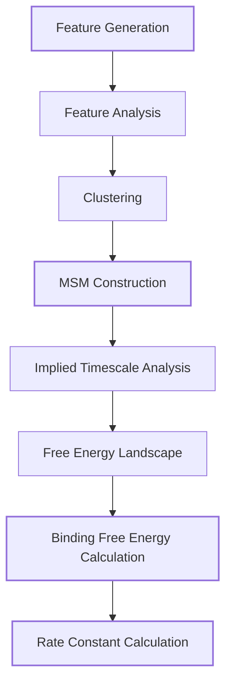
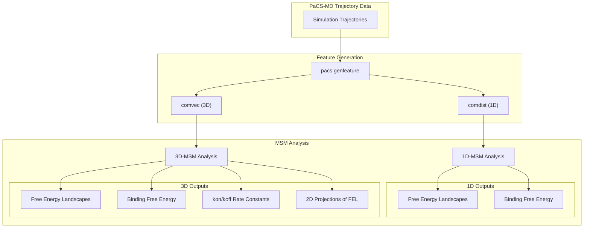
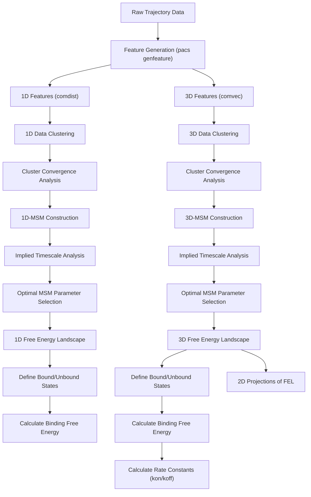
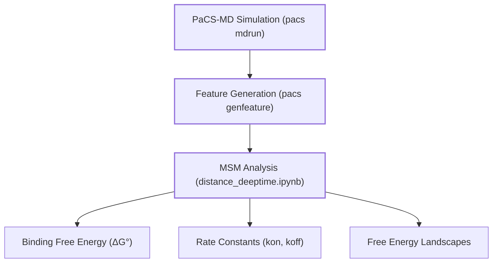

# MSM Analysis Workflow

<details>
<summary>Relevant source files</summary>

The following files were used as context for generating this wiki page:

- [MSM/README.md](MSM/README.md)

</details>


This document describes the complete workflow for performing Markov State Model (MSM) analysis on trajectory data generated from PaCS-MD simulations. The MSM analysis workflow allows you to calculate standard binding free energies (ΔG°) and rate constants (kon, koff) from simulation data. For information about using the specific notebook implementation, see [Using the MSM Notebook](#7.2).

## Overview of MSM Analysis in PaCS-Toolkit

Markov State Model (MSM) analysis is a powerful statistical technique for analyzing molecular dynamics trajectories and extracting thermodynamic and kinetic properties. In the PaCS-Toolkit, MSM analysis is typically performed after completing dissociation or association simulations and generating appropriate feature data.

The MSM analysis workflow consists of several key stages:



Sources: [MSM/README.md:25-41]()

## Prerequisites

Before starting the MSM analysis workflow, you need to have:

1. Completed PaCS-MD simulations (typically dissociation or association)
2. Generated feature data using the feature generation utilities:
   - `pacs genfeature comdist` for 1D analysis (center-of-mass distance)
   - `pacs genfeature comvec` for 3D analysis (center-of-mass vector)

The feature data should follow specific formats:
- **Inter-COM distance (comdist)**:
  - Filename pattern: `t{trial:03}*.npy`
  - Shape: (frames,)
- **Inter-COM vector (comvec)**:
  - Filename pattern: `*.npy`
  - Shape: (frames, 3)

Sources: [MSM/README.md:8-23]()

## MSM Analysis Approaches

The PaCS-Toolkit implements two complementary MSM approaches for analyzing the same simulation data:



### 1D-MSM Analysis

- **Feature**: Center-of-mass distance (1D) between molecules
- **Implementation**: Trial-by-trial analysis using Maximum Likelihood MSM
- **Error Estimation**: Statistical measures from individual trial MSMs
- **Advantages**: Well-suited for distinguishing the direction of dissociation

### 3D-MSM Analysis

- **Feature**: Center-of-mass vector (3D) between molecules
- **Implementation**: Analysis across all trials using Bayesian MSM
- **Error Estimation**: Derived from Bayesian sampling
- **Advantages**: Differentiates dissociation in multiple directions
- **Additional Outputs**: Calculates kon and koff rate constants

Sources: [MSM/README.md:25-41]()

## Detailed Workflow

The MSM analysis workflow involves several key steps that transform raw trajectory data into meaningful thermodynamic and kinetic information:



Sources: [MSM/README.md:42-60]()

### 1. Feature Generation

The first step is to extract relevant features from your simulation trajectories using the `pacs genfeature` command with either `comdist` or `comvec` options:

```
pacs genfeature comdist  # For 1D analysis
pacs genfeature comvec   # For 3D analysis
```

These commands generate `.npy` files containing the feature data needed for MSM analysis.

### 2. Data Clustering

Both 1D and 3D features are clustered to discretize the continuous feature space. This is typically done using K-means clustering via the deeptime library:

- Multiple values of `n_clusters` are tested to identify the optimal number of clusters
- Clustering convergence is assessed through inertia plots
- Histograms of inter-COM distances are generated to visualize the distribution

### 3. MSM Construction

Markov State Models are built using the clustered data:

- For 1D analysis: Maximum Likelihood MSM is applied on each trial separately
- For 3D analysis: Bayesian MSM is applied across all trials simultaneously
- Multiple lag times are tested to identify the optimal model

### 4. Implied Timescale Analysis

The quality of the MSMs is assessed by examining implied timescales:

- Plots of implied timescales versus lag time help identify when the model becomes Markovian
- Optimal lag time and number of clusters are selected based on these plots

### 5. Free Energy Landscape Calculation

Free energy landscapes are calculated from the stationary distribution of the MSM:

- 1D: Free energy vs. inter-COM distance
- 3D: Free energy projected onto different dimensions
- 2D: Free energy projected onto selected planes

### 6. Binding Free Energy Calculation

The binding free energy is calculated by:

1. Defining bound and unbound states based on the free energy landscape
2. Calculating the PMF difference between states
3. Applying volume correction for standard state

### 7. Rate Constant Calculation

For 3D-MSM analysis, kinetic properties are calculated:

- koff: Unbinding rate constant (s⁻¹)
- kon: Binding rate constant (M⁻¹s⁻¹)

Sources: [MSM/README.md:42-60](), [MSM/README.md:120-236]()

## Key Parameters

The MSM analysis requires several important parameters to be specified:

| Parameter | Description | Type | Notes |
|-----------|-------------|------|-------|
| `n_trial_for_calc` | List of trial indices to analyze | List[int] | Required |
| `trial_root_directory` | Directory containing trial data | str | Required |
| `feature_1d_directory` | Directory containing comdist data | str | Required |
| `feature_3d_directory` | Directory containing comvec data | str | Required |
| `output_directory` | Where to save analysis outputs | str | Required |
| `T` | Temperature in Kelvin | float | Required |
| `dt` | Time interval of trajectory frames (ps) | int | Required |
| `n_clusters_for_try_1d` | Number of clusters to test for 1D analysis | List[int] | Should be >10 |
| `lags_for_try_1d` | Lag times to test for 1D analysis | List[int] | In trajectory frames |
| `n_clusters_for_try_3d` | Number of clusters to test for 3D analysis | List[int] | Should be >10 |
| `lags_for_try_3d` | Lag times to test for 3D analysis | List[int] | In trajectory frames |
| `cutoff` | Distance cutoff for MSM analysis (nm) | float | Required |
| `nbins` | Number of bins for plotting | int | Required |
| `do_volume_correction` | Whether to apply volume correction | bool | Required |
| `num_of_ligands` | Number of ligands in system | int | Required |
| `box_size` | Simulation box size (nm³) | float | Required |

Additionally, bound and unbound state definitions must be specified:

| Parameter | Description | Default | Notes |
|-----------|-------------|---------|-------|
| `lower_bound` | Lower bound of bound state (nm) | 0 | Recommended value is 0 |
| `upper_bound` | Upper bound of bound state (nm) | - | Must be set based on FEL |
| `lower_unbound` | Lower bound of unbound state (nm) | - | Must be set based on FEL |
| `upper_unbound` | Upper bound of unbound state (nm) | - | Recommended to use cutoff value |

Sources: [MSM/README.md:62-118]()

## Output Files

The MSM analysis generates numerous output files organized in a structured directory:

```mermaid
graph TD
    Output["output_directory"]
    Output --> Logs["logs/"]
    Output --> Images["images/"]
    Output --> ResultCSVs["result_csvs/"]
    Output --> ClusterObjs["cluster_objs/"]
    Output --> MSMObjs["MSM_objs/"]
    Output --> CountObjs["Count_objs/"]
    
    Logs --> LogFile["distance_deeptime.log"]
    
    Images --> CycleFeature["cycle_feature.png"]
    Images --> ClusterConverge["clustering_converge_*.png"]
    Images --> Histogram["hist_*.png"]
    Images --> Inertia["inertia_*.png"]
    Images --> ITS["its_*.png"]
    Images --> FEL["fel_*.png"]
    
    ResultCSVs --> MSMDistribution["*_n_clusters*_lag*_cut*.csv"]
    ResultCSVs --> BindingEnergy["*_binding_energy_summary.csv"]
    ResultCSVs --> VolumeCorrection["*_VC.csv"]
    ResultCSVs --> RateConstant["3d_rate_constant_summary.csv"]
    
    ClusterObjs --> ClusterPKL["*_n_clusters*_cut*.pkl"]
    MSMObjs --> MSMPKL["*_n_clusters*_cut*.pkl"]
    CountObjs --> CountPKL["*_n_clusters*_cut*.pkl"]
```



Key outputs include:

1. **Results CSVs**: 
   - Binding free energy values
   - Rate constants (kon, koff) from 3D analysis
   - Volume correction terms
   - MSM stationary distributions

2. **Images**:
   - Free energy landscapes (1D, 2D, 3D)
   - Implied timescale plots
   - Clustering convergence plots
   - Histograms of distances

3. **Serialized Objects**:
   - Clustering models
   - MSM objects
   - Count models

Sources: [MSM/README.md:121-276]()

## Performance Considerations

The most computationally intensive parts of the MSM analysis workflow are:

1. **Clustering**: Particularly for large datasets with many clusters
2. **MSM Building**: Especially for Bayesian MSM with 3D data

For efficient analysis, it's recommended to:

1. Split computationally intensive parts (clustering, MSM building) into separate Python scripts
2. Run these scripts in the background or on computing clusters
3. Return to the main notebook for visualization and final calculations

Sources: [MSM/README.md:278-289]()

## Integration with PaCS-MD Workflow

The MSM analysis workflow integrates with the broader PaCS-MD framework as follows:



The MSM analysis represents the final stage in extracting meaningful thermodynamic and kinetic parameters from PaCS-MD simulations, providing insights into molecular binding/unbinding processes.

Sources: [MSM/README.md:1-7]()

---