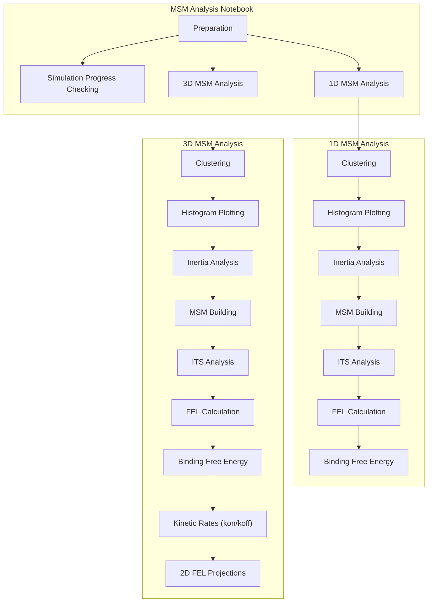
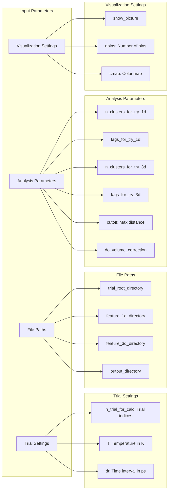
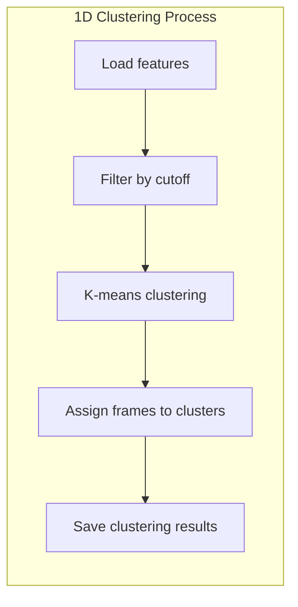
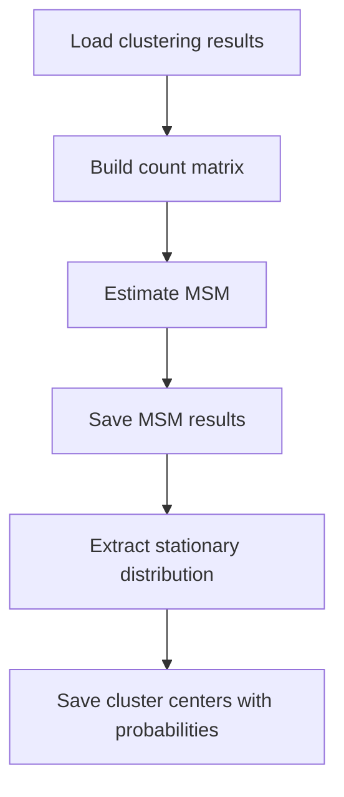
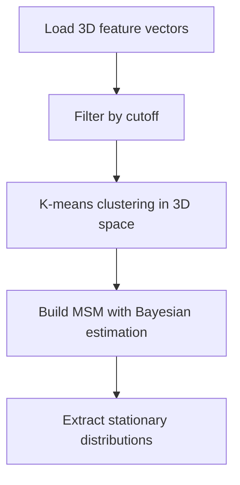
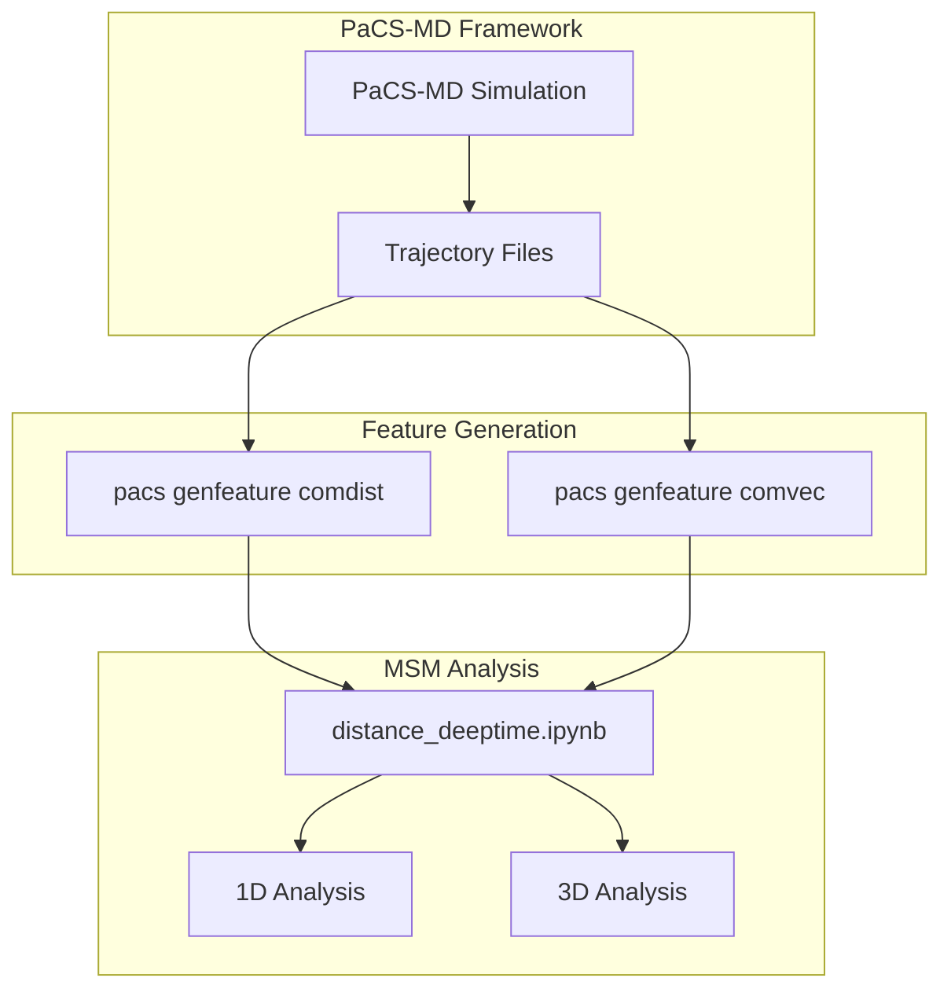

# Using the MSM Notebook

<details>
<summary>Relevant source files</summary>

The following files were used as context for generating this wiki page:

- [MSM/distance_deeptime.ipynb](MSM/distance_deeptime.ipynb)

</details>


The MSM Notebook (`distance_deeptime.ipynb`) is a powerful tool in PaCS-Toolkit for performing Markov State Model (MSM) analysis on PaCS-MD simulation results. This notebook enables researchers to analyze protein-ligand binding/unbinding processes by constructing MSMs from simulation trajectories, calculating binding free energies, and determining kinetic rate constants (kon and koff).

For general information about MSM analysis workflows, see [MSM Analysis Workflow](#7.1). For specific details on calculating binding free energies, see [Binding Free Energy Calculation](#7.3).

## Prerequisites

Before using the MSM notebook, you need:

1. Completed PaCS-MD simulations
2. Generated feature files using the following commands:
   - For 1D analysis: `pacs genfeature comdist` 
   - For 3D analysis: `pacs genfeature comvec`

Sources: [MSM/distance_deeptime.ipynb:78-102]()

## Notebook Overview

The MSM notebook is organized into several key sections:



Sources: [MSM/distance_deeptime.ipynb:3-40]()

## Setting Up Parameters

The notebook requires several input parameters that control the analysis:



These parameters control the behavior of the MSM analysis, including which trials to analyze, clustering parameters, and visualization settings.

Sources: [MSM/distance_deeptime.ipynb:77-102](), [MSM/distance_deeptime.ipynb:254-315]()

## Checking Simulation Progress

The notebook allows monitoring PaCS-MD progress by plotting feature values (inter-COM distance) across simulation cycles:

```python
plot_feature(params=params, threshold=4)
```

This function visualizes how the inter-COM distance evolves over simulation cycles for each trial, helping you determine if your simulations have achieved sufficient sampling.

Sources: [MSM/distance_deeptime.ipynb:321-396]()

## 1D MSM Analysis Workflow

### 1. Clustering Trajectory Data

The 1D analysis begins with k-means clustering of the inter-COM distance trajectories:



The clustering process groups similar conformations based on inter-COM distance, providing a discretized state space for MSM construction.

Sources: [MSM/distance_deeptime.ipynb:406-496]()

### 2. Visualizing Distributions and Selecting Optimal Parameters

After clustering, the notebook provides functions to:

1. Plot histograms of inter-COM distances with cluster centers
2. Analyze clustering quality through inertia plots
3. Plot implied timescales (ITS) from MSMs with different lag times

These visualizations help select optimal parameters (number of clusters and lag time) for MSM construction.

Sources: [MSM/distance_deeptime.ipynb:515-607](), [MSM/distance_deeptime.ipynb:628-694](), [MSM/distance_deeptime.ipynb:834-895]()

### 3. Building the MSM

The 1D MSM is constructed using the following process:



The MSM captures the dynamics between different states defined by inter-COM distance values.

Sources: [MSM/distance_deeptime.ipynb:703-817]()

### 4. Free Energy Landscape Analysis

The notebook calculates free energy landscapes (FEL) along the inter-COM distance:


The FEL provides insights into the energetic barriers and stable states in the binding/unbinding process.

Sources: [MSM/distance_deeptime.ipynb:1007-1286]()

### 5. Binding Free Energy Calculation

Finally, the notebook calculates binding free energies by:

1. Defining bound and unbound states based on distance ranges
2. Computing probability ratios between states
3. Applying volume correction (optional)

This analysis provides the standard binding free energy (ΔG°) from simulation data.

Sources: [MSM/distance_deeptime.ipynb:1300-1580]()

## 3D MSM Analysis Workflow

The 3D MSM analysis follows a similar workflow to the 1D analysis but uses 3D vectors instead of scalar distances, providing more detailed information about binding/unbinding pathways.

### 1. 3D Clustering and MSM Construction

The 3D clustering process:



Bayesian MSM estimation provides uncertainty quantification in the results.

Sources: [MSM/distance_deeptime.ipynb:1645-1726](), [MSM/distance_deeptime.ipynb:1918-2040]()

### 2. Free Energy Landscape Analysis in 3D

The 3D analysis enables calculation of:
- FEL along the inter-COM distance with statistical uncertainty
- 2D projections of the FEL onto coordinate planes (x-y, x-z, y-z)

These visualizations help identify binding pathways and stable intermediate states.

Sources: [MSM/distance_deeptime.ipynb:2206-2277](), [MSM/distance_deeptime.ipynb:2763-2867]()

### 3. Kinetic Rate Calculation

A unique feature of the 3D analysis is the calculation of kinetic rate constants:


The notebook calculates:
- koff: Unbinding rate constant (s^-1)
- kon: Binding rate constant (M^-1 s^-1)

Sources: [MSM/distance_deeptime.ipynb:2591-2717]()

## Parameter Selection Guidelines

For reliable MSM analysis, consider the following guidelines when selecting parameters:

| Parameter | Recommendation | Notes |
|-----------|---------------|-------|
| n_clusters_for_try_1d | [20, 30, 40, 50, 60, 70, 80] | Use inertia plots to select optimal value |
| lags_for_try_1d | Range from 1 to 50 | Choose based on ITS convergence |
| n_clusters_for_try_3d | [100, 200, 300, 400, 500] | More clusters needed for 3D space |
| cutoff | System-dependent | Maximum distance to consider |
| lower_bound | Usually 0 | Lower bound of bound state |
| upper_bound | System-dependent | Upper bound of bound state |
| lower_unbound | System-dependent | Should be > upper_bound |
| upper_unbound | Usually = cutoff | Upper bound of unbound state |

Choosing appropriate parameters is crucial for meaningful MSM analysis results.

Sources: [MSM/distance_deeptime.ipynb:94-102](), [MSM/distance_deeptime.ipynb:1300-1316](), [MSM/distance_deeptime.ipynb:2313-2321]()

## Relationship with Other PaCS-Toolkit Components

The MSM notebook is part of the broader MSM analysis toolset in PaCS-Toolkit:



The notebook requires output from PaCS-MD simulations processed by feature generation tools.

Sources: [MSM/distance_deeptime.ipynb:78-102]()

## Theoretical Foundation

The MSM analysis in the notebook is based on the following theoretical framework:

1. **Free Energy Calculation**:
   - ΔG° = ΔGPMF + ΔGv
   - ΔGPMF: Free energy difference between bound and unbound states
   - ΔGv: Volume correction term

2. **Kinetic Rate Calculation**:
   - koff = 1/MFPToff
   - kon = 1/(MFPTon × Cligand)
   - MFPT: Mean first passage time
   - Cligand: Ligand concentration

These calculations provide thermodynamic and kinetic information about protein-ligand binding processes.

Sources: [MSM/distance_deeptime.ipynb:1322-1363](), [MSM/distance_deeptime.ipynb:2580-2588]()

## Output Files

The notebook generates several output files organized in the following directories:

| Directory | Content |
|-----------|---------|
| images/ | Plots of histograms, FELs, ITS, etc. |
| cluster_objs/ | Pickled clustering results |
| MSM_objs/ | Pickled MSM objects |
| Count_objs/ | Transition count matrices |
| result_csvs/ | CSV files with binding energies and rates |
| logs/ | Log files from the analysis |

These outputs provide comprehensive data for further analysis and publication.

Sources: [MSM/distance_deeptime.ipynb:303-310]()

## References

The MSM analysis methodology is based on several key publications in the field, which are listed at the end of the notebook for further reading. These references provide the theoretical foundation for the MSM analysis approaches implemented in the notebook.

Sources: [MSM/distance_deeptime.ipynb:2886-2896]()

---