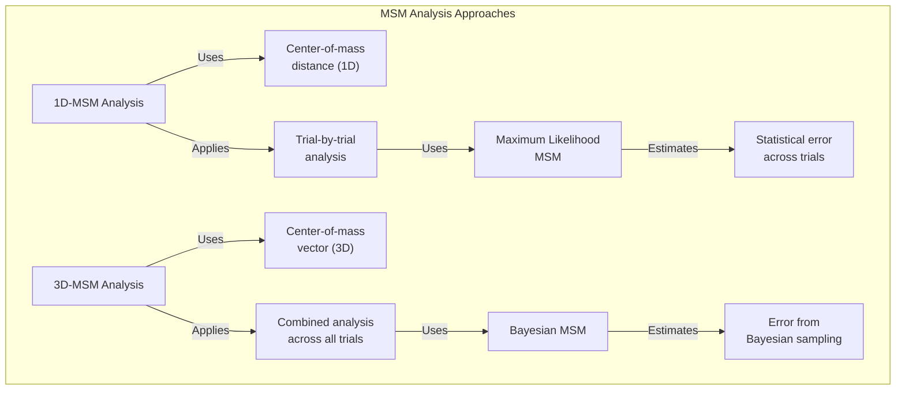
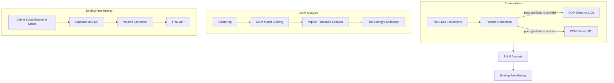
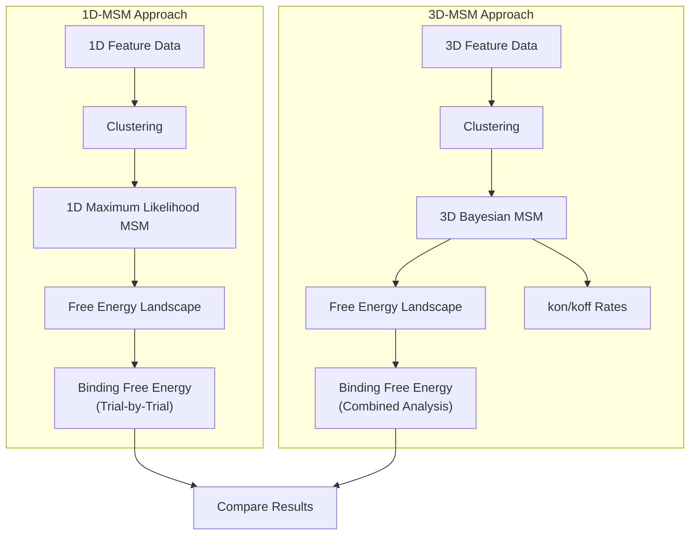
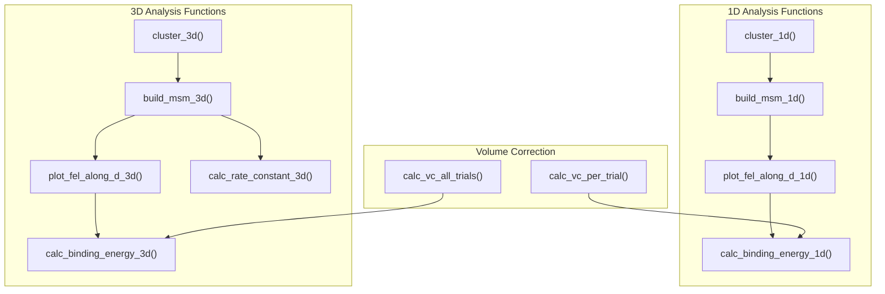
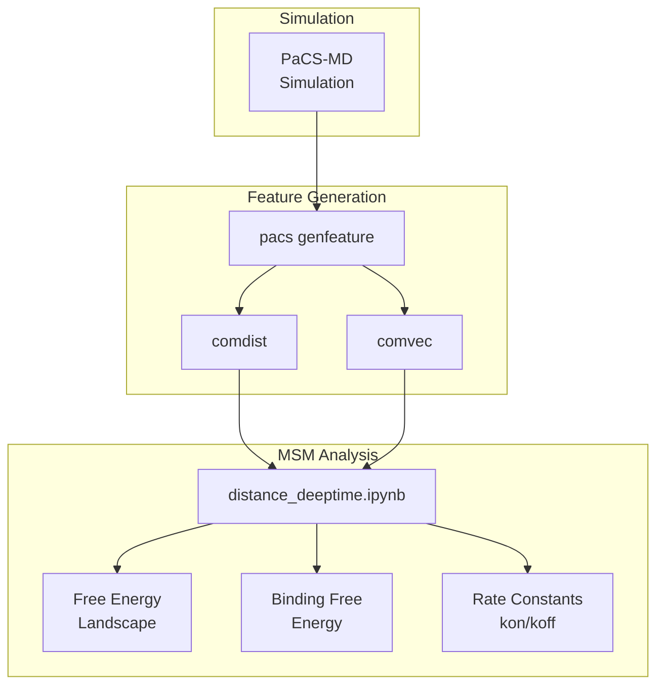

# Binding Free Energy Calculation

<details>
<summary>Relevant source files</summary>

The following files were used as context for generating this wiki page:

- [MSM/README.md](MSM/README.md)
- [MSM/distance_deeptime.ipynb](MSM/distance_deeptime.ipynb)

</details>


## Overview

This document explains how to calculate standard binding free energies (ΔG°) from molecular dynamics simulations using Markov State Model (MSM) analysis in PaCS-Toolkit. The procedure builds upon completed dissociation or association simulations and feature generation to provide quantitative binding affinity measurements for protein-ligand complexes. For information on generating necessary features, see [Feature Generation](#6.2).

Sources: [MSM/README.md:1-58](), [MSM/distance_deeptime.ipynb:1-48]()

## Theoretical Foundation

The standard binding free energy (ΔG°) is calculated using the following equation:

```
ΔG° = ΔGPMF + ΔGv
```

Where:
- ΔGPMF is the potential of mean force term (binding free energy difference between bound and unbound states)
- ΔGv is the volume correction term (necessary to standardize the binding free energy)

The PaCS-Toolkit implements two complementary MSM approaches:



Sources: [MSM/README.md:25-41]()

## Workflow

The binding free energy calculation workflow consists of three main phases:



Sources: [MSM/README.md:25-48](), [MSM/distance_deeptime.ipynb:7-37]()

## Input Requirements

### Feature Data

Before calculating binding free energies, you must prepare feature data from MD trajectories:

| Feature Type | Format | Description |
|--------------|--------|-------------|
| Inter-COM distance (comdist) | `t{trial:03}*.npy` files | 1D array of distances (shape: frames,) |
| Inter-COM vector (comvec) | `*.npy` files | 3D array of vectors (shape: frames, 3) |

### Required Parameters

The following parameters must be specified for the binding free energy calculation:

```python
# Essential parameters
n_trial_for_calc      # List of trial indices
T                     # Temperature in Kelvin
dt                    # Time interval (ps) between saved trajectory frames
cutoff                # Distance cutoff (nm) for considering states in MSM
box_size              # Simulation box size (nm^3)

# State definitions
lower_bound           # Lower bound of bound state (nm)
upper_bound           # Upper bound of bound state (nm)
lower_unbound         # Lower bound of unbound state (nm)
upper_unbound         # Upper bound of unbound state (nm)
```

Sources: [MSM/README.md:8-23](), [MSM/README.md:62-103](), [MSM/distance_deeptime.ipynb:78-103]()

## Analytical Procedure

The binding free energy calculation follows these analytical steps:



### 1D-MSM Analysis

1. **Clustering**: Perform k-means clustering on the center-of-mass distance data
2. **MSM Building**: Construct maximum likelihood MSMs for each trial separately
3. **Free Energy Calculation**: Calculate ΔGPMF using:
   ```
   ΔGPMF = -RT ln(Σb πi / Σu πi)
   ```
   Where πi represents the stationary distribution of state i, and the sums are taken over bound (b) and unbound (u) states

### 3D-MSM Analysis

1. **Clustering**: Perform k-means clustering on the center-of-mass vector data
2. **MSM Building**: Construct a Bayesian MSM using data from all trials
3. **Free Energy Calculation**: Calculate ΔGPMF as in the 1D approach
4. **Rate Constants**: Calculate kon/koff using mean first passage times (MFPT):
   ```
   koff = 1/MFPToff
   kon = 1/(MFPTon * Cligand)
   ```

### Volume Correction

For both approaches, the volume correction term is calculated as:
```
ΔGv = -RT ln(Vu/V0)
```
Where:
- Vu is the sampled volume of the unbound state (approximated by the convex volume in 3D inter-COM space)
- V0 is the standard volume (1661 ų)

Sources: [MSM/README.md:25-41](), [MSM/distance_deeptime.ipynb:1320-1363](), [MSM/distance_deeptime.ipynb:2328-2330]()

## Implementation Details

The binding free energy calculation is implemented in the `distance_deeptime.ipynb` notebook, with key functions for each step:



### Key Functions:

- `calc_binding_energy_1d()`: Calculates binding free energy for 1D-MSM
- `calc_binding_energy_3d()`: Calculates binding free energy for 3D-MSM
- `calc_rate_constant_3d()`: Calculates kon/koff rates from 3D-MSM
- `calc_vc_per_trial()` and `calc_vc_all_trials()`: Calculate volume correction

Sources: [MSM/distance_deeptime.ipynb:1370-1579](), [MSM/distance_deeptime.ipynb:2338-2514](), [MSM/distance_deeptime.ipynb:2597-2691]()

## Output Files

The binding free energy calculation generates several output files:

| File | Description |
|------|-------------|
| `1d_binding_energy_summary.csv` | 1D binding free energy results per trial |
| `3d_binding_energy_summary.csv` | 3D binding free energy results |
| `1d_VC.csv` | Volume correction results for 1D analysis |
| `3d_VC.csv` | Volume correction results for 3D analysis |
| `3d_rate_constant_summary.csv` | kon/koff rate constants |

### 1D Binding Energy CSV Format:

```
trial,n_clusters,lag,lower_bound,upper_bound,lower_unbound,upper_unbound,dG_PMF,VC
```

### 3D Binding Energy CSV Format:

```
n_clusters,lag,lower_bound,upper_bound,lower_unbound,upper_unbound,dG_PMF,dG_ste,VC
```

### Rate Constant CSV Format:

```
n_clusters,lag,lower_bound,upper_bound,lower_unbound,upper_unbound,koff_mean,koff_ste,kon_mean,kon_ste
```

Where:
- `dG_PMF`: Binding free energy term (kcal/mol)
- `VC`: Volume correction term (kcal/mol)
- `koff`: Rate constant for dissociation (s⁻¹)
- `kon`: Rate constant for association (M⁻¹s⁻¹)

Sources: [MSM/README.md:165-235]()

## Practical Workflow

### Step 1: Generate Feature Data

After running PaCS-MD simulations:
```bash
# Generate 1D features (distances)
pacs genfeature comdist

# Generate 3D features (vectors)
pacs genfeature comvec
```

### Step 2: Define Parameters in Notebook

Set parameters in the `distance_deeptime.ipynb` notebook:
```python
# Essential parameters
n_trial_for_calc = [1, 2, 3, 4, 5]  # List of trial indices 
T = 303.15                          # Temperature in Kelvin
dt = 1                              # Time interval in ps
```

### Step 3: Define Bound/Unbound States

After analyzing free energy landscapes, define state boundaries:
```python
# Define bound state
lower_bound = 0      # Usually set to 0
upper_bound = 0.5    # Adjust based on FEL

# Define unbound state
lower_unbound = 1.0  # Adjust based on FEL
upper_unbound = 5.0  # Usually set to cutoff value
```

### Step 4: Calculate Binding Free Energy

Run the calculation cells in the notebook to obtain:
- ΔGPMF (kcal/mol): Free energy difference between bound and unbound states
- ΔGv (kcal/mol): Volume correction term
- ΔG° = ΔGPMF + ΔGv: Standard binding free energy

Sources: [MSM/README.md:8-16](), [MSM/README.md:104-118](), [MSM/distance_deeptime.ipynb:1307-1316]()

## Connection with Other Components



The binding free energy calculation integrates with other components of the PaCS-Toolkit:

1. **Input**: Takes features generated by `pacs genfeature`
2. **Analysis**: Performed within the `distance_deeptime.ipynb` notebook
3. **Output**: Provides binding free energies and kinetic rates for further analysis

For more details on the overall MSM analysis workflow, see [MSM Analysis Workflow](#7.1).

Sources: [MSM/README.md:1-16](), [MSM/README.md:41-58]()

## Tips for Effective Use

1. **Parameter Selection**: Choose n_clusters and lag time values where implied timescales show convergence
2. **State Definition**: Carefully define bound/unbound states based on free energy landscapes
3. **Resource Management**: For large datasets, run clustering and MSM building separately in Python scripts
4. **Error Estimation**: 
   - For 1D-MSM: Use statistics across multiple trials 
   - For 3D-MSM: Use Bayesian sampling error estimates
5. **Validation**: Compare results from 1D and 3D approaches for consistency

Sources: [MSM/README.md:278-287](), [MSM/distance_deeptime.ipynb:917-918]()

---