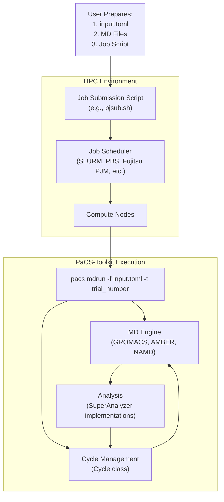
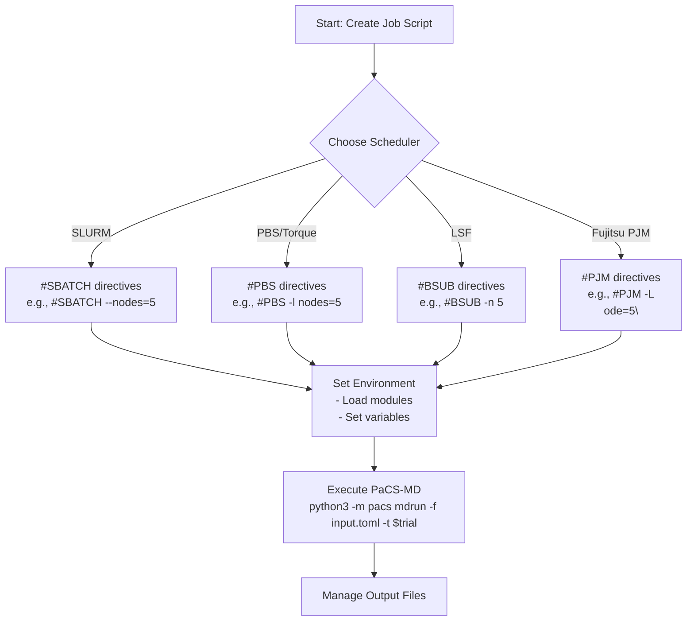
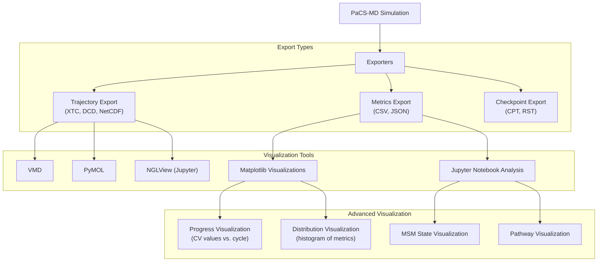
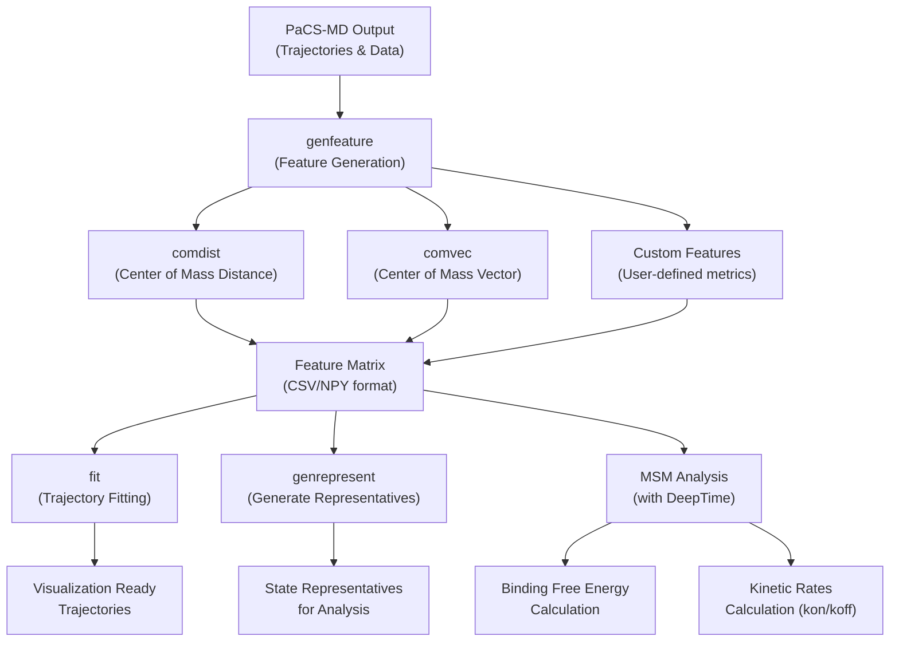
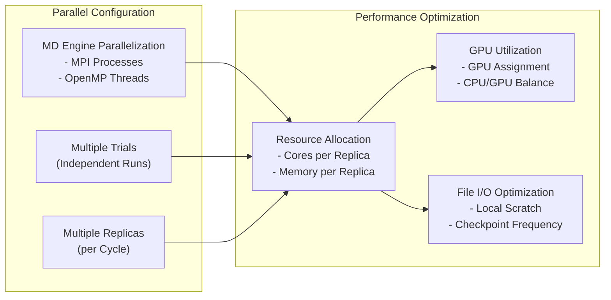

# Advanced Usage

<details>
<summary>Relevant source files</summary>

The following files were used as context for generating this wiki page:

- [jobscripts/README.md](jobscripts/README.md)
- [jobscripts/fugaku/pjsub.sh](jobscripts/fugaku/pjsub.sh)

</details>


This page documents advanced usage scenarios and configurations for the PaCS-Toolkit. It covers running simulations on high-performance computing (HPC) systems, exporting and visualizing simulation results, and utilizing post-processing scripts for in-depth analysis. For basic setup and execution of PaCS-MD simulations, see [Quick Start Guide](#3). For detailed information on the core framework, see [Core Framework](#4).

## Job Submission Scripts for HPC Systems

Running PaCS-MD simulations on HPC systems often requires submission scripts tailored to the specific scheduling system and architecture of the supercomputer. The PaCS-Toolkit includes sample job scripts for various supercomputing environments in the `jobscripts` directory.

### Job Script Architecture



Sources: [jobscripts/fugaku/pjsub.sh](), [jobscripts/README.md]()

### Example: Fugaku Supercomputer Script

The PaCS-Toolkit provides an example script for the Fugaku supercomputer, which uses the Fujitsu PJM scheduler:

```
#PJM -L "node=5"                    # Request 5 nodes
#PJM -L "rscgrp=small"              # Use the small resource group
#PJM -L "elapse=00:30:00"           # Request 30 minutes of runtime
#PJM --mpi "max-proc-per-node=4"    # Limit to 4 MPI processes per node
#PJM -g <groupname>                 # Specify your group
```

The script loads necessary modules, sets environment variables, and executes PaCS-MD:

```
export OMP_NUM_THREADS=12           # Set OpenMP thread count
path_to_pacstk="/path/to/pacstk"    # Path to PaCS-Toolkit

for trial in {1..1};                # Loop for multiple trial runs
do
    python3 -m pacs mdrun -f input.toml -t $trial
done
```

Sources: [jobscripts/fugaku/pjsub.sh:1-25]()

### Adapting for Other HPC Systems



Sources: [jobscripts/README.md](), [jobscripts/fugaku/pjsub.sh]()

When adapting job scripts for your HPC system, consider the following:

1. **Resource allocation**: Adjust node count, cores, memory based on your simulation size
2. **Scheduler directives**: Use appropriate directives for your system (SLURM, PBS, LSF, etc.)
3. **Module loading**: Ensure necessary modules are loaded (MD engine, Python, etc.)
4. **Environment variables**: Set appropriate thread counts and paths
5. **File management**: Link or copy necessary input files to working directory

## Exporting and Visualization

PaCS-Toolkit provides multiple options for exporting and visualizing simulation results through its exporters system.

### Export Pipeline Architecture



### Visualization Best Practices

| Data Type | Recommended Tools | Key Capabilities |
|-----------|-------------------|------------------|
| Trajectories | VMD, PyMOL | 3D visualization, movie creation, hydrogen bond analysis |
| CV Progress | matplotlib, seaborn | Line plots, heatmaps of CV values across cycles |
| Free Energy Landscapes | matplotlib, plotly | 2D/3D surface plots from MSM analysis |
| Transition Pathways | PyEMMA, DeepTime | TPT visualization, flux analysis |
| State Populations | matplotlib, networkx | State population plots, network graphs |

## Post-Processing Scripts

Advanced analyses often require post-processing of the simulation data. PaCS-Toolkit includes several post-processing utilities to facilitate these analyses.

### Post-Processing Workflow



### Feature Generation

The `genfeature` command is a powerful utility for extracting features from trajectory data:

```
pacs genfeature -f feature_config.toml -t <trajectory_file> -p <topology_file>
```

Common feature types include:

1. **Distance-based features**: Inter-atomic distances, center of mass distances
2. **Angle-based features**: Dihedral angles, improper angles
3. **Contact-based features**: Native contacts, hydrogen bonds
4. **Structural features**: RMSD, radius of gyration

### MSM Analysis Integration

Post-processed features can be analyzed using Markov State Models (MSMs):

1. Extract features with `genfeature`
2. Cluster the feature space to define states
3. Estimate transition probabilities using DeepTime or PyEMMA
4. Calculate thermodynamic and kinetic properties
5. Visualize results with the provided notebooks

For in-depth MSM analysis, see [MSM Analysis](#7).

## Advanced Configuration Options

### Parallel Execution Configuration



### input.toml Advanced Options

The `input.toml` configuration file supports several advanced options for specialized use cases:

| Category | Option | Description |
|----------|--------|-------------|
| Engine | `engine_replica` | MD engine options for each replica |
| | `mpi_command` | Custom MPI command for execution |
| Analysis | `custom_analyzer` | Path to custom analyzer implementation |
| | `analyzer_args` | Custom arguments for analyzers |
| Parallel | `n_parallel` | Number of replicas to run in parallel |
| | `omp_num_threads` | OpenMP thread count per replica |
| File Management | `keep_files` | Control which files to retain after simulation |
| | `backup_interval` | Interval for backup creation |

For complete configuration options, refer to [Input File Configuration](#4.2).

### Custom Analysis Implementation

For specialized analyses beyond the built-in analyzers, you can create custom analyzer classes by extending the `SuperAnalyzer` base class. These classes should implement the required methods such as `calc_cv()` and can be specified in the input.toml file.

For detailed information on creating custom analyzers, see [SuperAnalyzer Framework](#5.1).

---