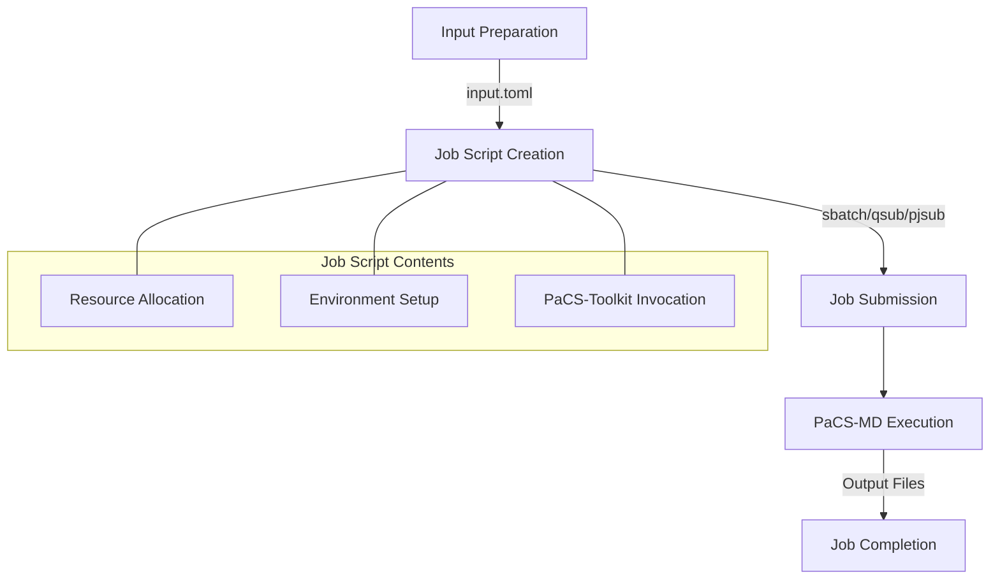
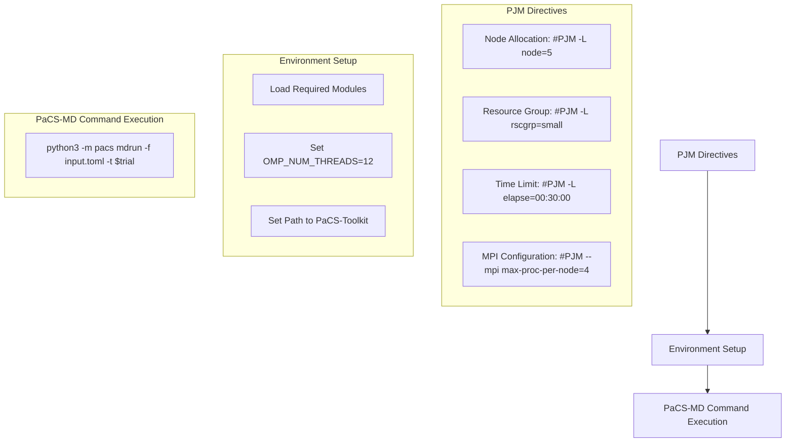
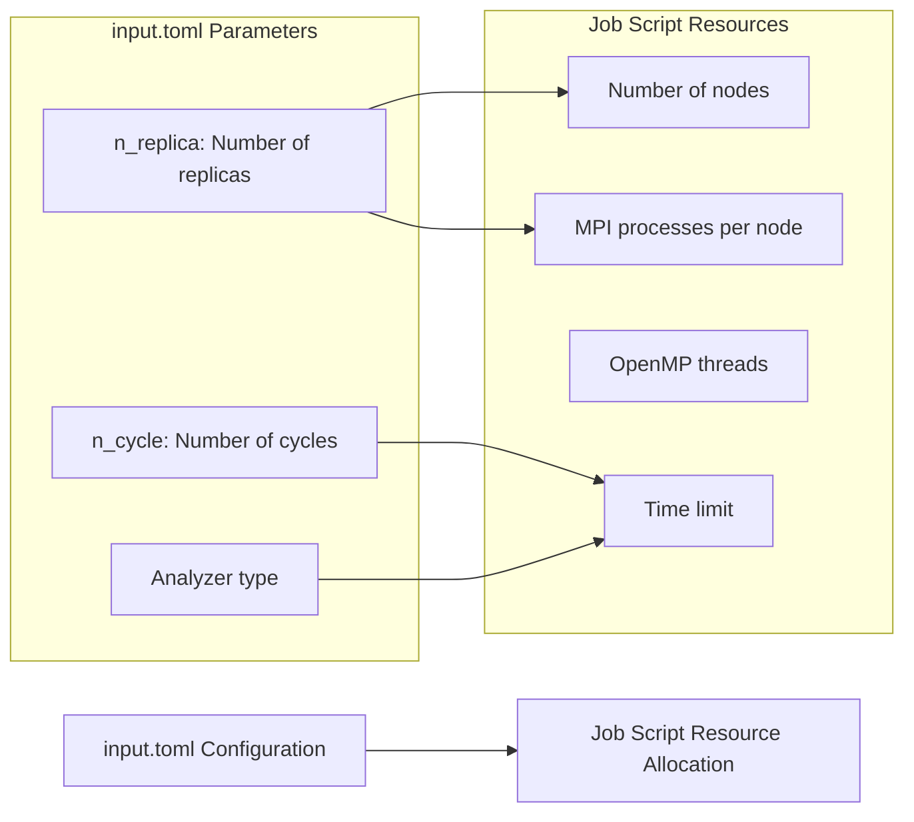
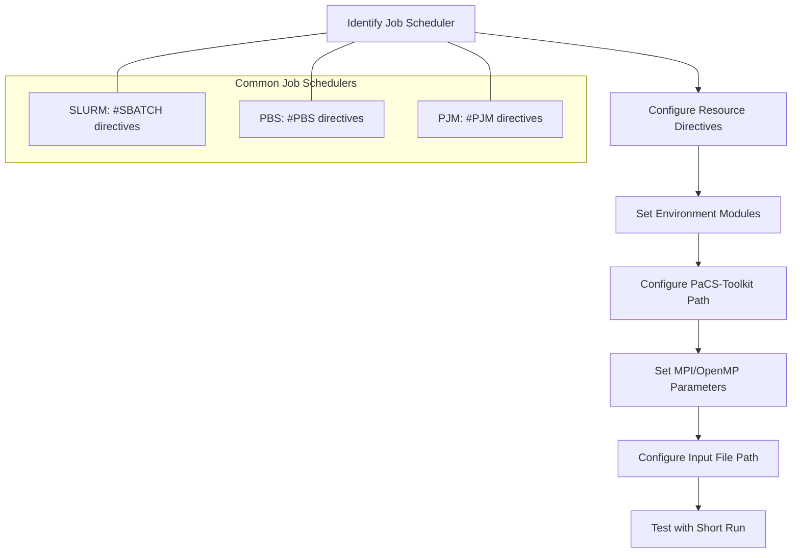

# Job Submission Scripts

<details>
<summary>Relevant source files</summary>

The following files were used as context for generating this wiki page:

- [jobscripts/README.md](jobscripts/README.md)
- [jobscripts/fugaku/pjsub.sh](jobscripts/fugaku/pjsub.sh)

</details>


This page explains how to run PaCS-MD simulations on High-Performance Computing (HPC) systems using job submission scripts. It covers the structure of job scripts, resource allocation considerations, and provides examples for specific supercomputers. For information about post-processing analysis after job completion, see [Post-Processing Scripts](#8.3).

## Overview of Job Submission for PaCS-Toolkit

Running PaCS-MD simulations on HPC systems typically involves creating a job script that configures the computing resources and launches the simulation. The PaCS-Toolkit is designed to work seamlessly with various job scheduling systems such as SLURM, PBS, and PJM.



Sources: [jobscripts/fugaku/pjsub.sh](), [jobscripts/README.md]()

## Job Script Structure

A typical job script for PaCS-MD simulations includes the following components:

1. **Job scheduler directives**: Commands specific to the scheduler (SLURM, PBS, PJM) that specify resource requirements
2. **Environment setup**: Loading required modules and setting environment variables
3. **PaCS-Toolkit invocation**: Running the simulation with appropriate parameters

### Common Job Scheduler Directives

Different HPC systems use different job schedulers. Here are the common directive formats:

| Scheduler | Example Directive | Purpose |
|-----------|-------------------|---------|
| SLURM     | `#SBATCH --nodes=2` | Request 2 compute nodes |
| PBS       | `#PBS -l nodes=2:ppn=40` | Request 2 nodes with 40 processes per node |
| PJM       | `#PJM -L "node=5"` | Request 5 compute nodes |

The specific directives needed depend on your simulation requirements and HPC system policies.

Sources: [jobscripts/fugaku/pjsub.sh:1-8]()

## Example Job Script: Fugaku Supercomputer

The PaCS-Toolkit repository includes a sample job script for the Fugaku supercomputer, which uses the PJM scheduler:



Here's a breakdown of the key components in the Fugaku job script:

1. **Resource allocation**:
   - 5 nodes requested
   - Small resource group
   - 30-minute time limit
   - 4 MPI processes per node

2. **Environment setup**:
   - Loading Gromacs and other required modules
   - Setting OpenMP thread count to 12
   - Linking to the PaCS-Toolkit installation

3. **Simulation execution**:
   - Running a PaCS-MD simulation using the `pacs mdrun` command
   - Using the specified input file (`input.toml`)
   - Setting the trial number

Sources: [jobscripts/fugaku/pjsub.sh]()

## Resource Allocation Considerations

When configuring job scripts for PaCS-MD simulations, you should consider these key resource aspects:

### Node and CPU Allocation

PaCS-MD performance depends on:
- Number of replicas in your simulation (set in `input.toml`)
- Computational demands of the molecular system
- MD engine performance characteristics



### Time Allocation

The time needed for a PaCS-MD simulation depends on:
- Number of cycles
- Simulation length per cycle
- System size
- Analyzer complexity
- HPC system performance

It's recommended to start with a conservative time estimate and adjust based on actual performance.

Sources: [jobscripts/fugaku/pjsub.sh:2-5]()

## Multi-Trial Simulations

PaCS-MD simulations often benefit from running multiple trials with different initial conditions. The sample job script demonstrates how to run multiple trials in a single job submission:

```bash
for trial in {1..1};
do
    python3 -m pacs mdrun -f input.toml -t $trial
done
```

The `-t` flag specifies the trial number, which creates separate output directories for each trial.

For large production runs, consider these approaches:
1. **Sequential trials**: Run multiple trials within a single job (as shown above)
2. **Parallel trials**: Submit separate jobs for each trial
3. **Array jobs**: Use scheduler-specific array job features (e.g., `#SBATCH --array=1-10`)

Sources: [jobscripts/fugaku/pjsub.sh:19-22]()

## Customizing Scripts for Different HPC Systems

The job script needs to be adapted for your specific HPC system. Key considerations include:

1. **Scheduler directives**: Replace the PJM directives with those appropriate for your system (SLURM, PBS, etc.)
2. **Module loading**: Update the module loading commands for your system's configuration
3. **Path to PaCS-Toolkit**: Set the correct path to your PaCS-Toolkit installation
4. **MPI and OpenMP settings**: Configure according to your system's architecture and your simulation needs



Sources: [jobscripts/README.md](), [jobscripts/fugaku/pjsub.sh]()

## Example SLURM Job Script Template

Below is a template for a SLURM-based job script, which you can adapt for your specific HPC system:

```bash
#!/bin/bash
#SBATCH --job-name=pacsmd
#SBATCH --nodes=2
#SBATCH --ntasks-per-node=4
#SBATCH --cpus-per-task=12
#SBATCH --time=12:00:00
#SBATCH --partition=compute
#SBATCH --account=your_account

# Load necessary modules
module purge
module load gromacs/2023.2
module load python/3.9

# Set environment variables
export OMP_NUM_THREADS=${SLURM_CPUS_PER_TASK}
export PATH_TO_PACSTK="/path/to/your/pacstk/installation"

# Create symbolic link to PaCS-Toolkit
ln -s ${PATH_TO_PACSTK} ./.

# Run multiple trials
for trial in {1..3}; do
    python3 -m pacs mdrun -f input.toml -t ${trial}
done

echo "PaCS-MD simulation completed"
```

Sources: [jobscripts/fugaku/pjsub.sh]()

## Integrating with input.toml Configuration

The job script works in conjunction with your `input.toml` configuration file. Ensure that:

1. The number of MPI processes is compatible with your `n_replica` setting
2. The time limit is sufficient for your `n_cycle` and per-cycle simulation time
3. The correct path to the MD engine executable is specified in your `input.toml`

Resource efficiency is achieved when:
- Number of MPI processes = Number of replicas
- CPU allocation matches the optimal settings for your MD engine

## Best Practices

1. **Test with short runs first**: Start with a small number of cycles to verify your setup
2. **Monitor resource usage**: Check efficiency and adjust resource allocation as needed
3. **Checkpoint regularly**: Configure your simulation to write checkpoint files
4. **Use appropriate file paths**: Avoid overly deep directory structures that can cause issues
5. **Clean up unnecessary files**: Use PaCS-Toolkit's file management utilities to manage disk usage

Sources: [jobscripts/README.md]()

## References to Additional Resources

For more detailed examples of different PaCS-MD configurations, refer to the [example input repository](https://github.com/Kitaolab/PaCS-Toolkit-example) mentioned in the jobscripts README.

For information on analyzing the results after job completion, see the [Post-Processing Scripts](#8.3) documentation.

Sources: [jobscripts/README.md:5]()

---