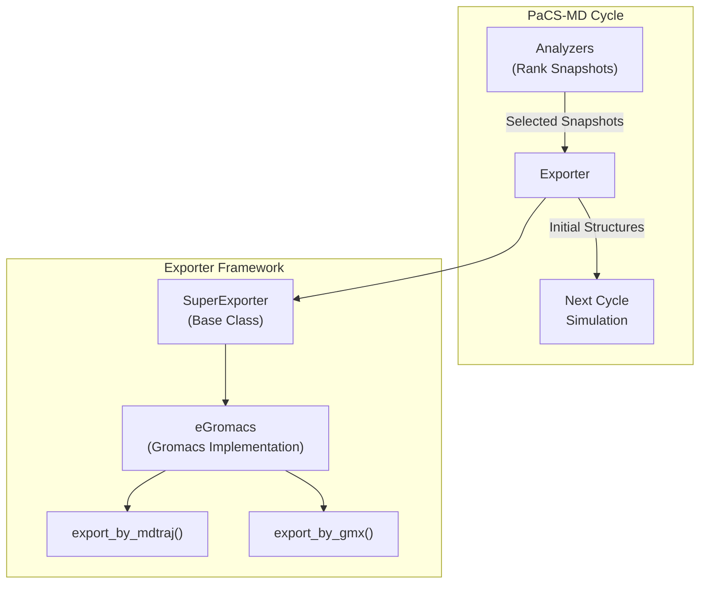
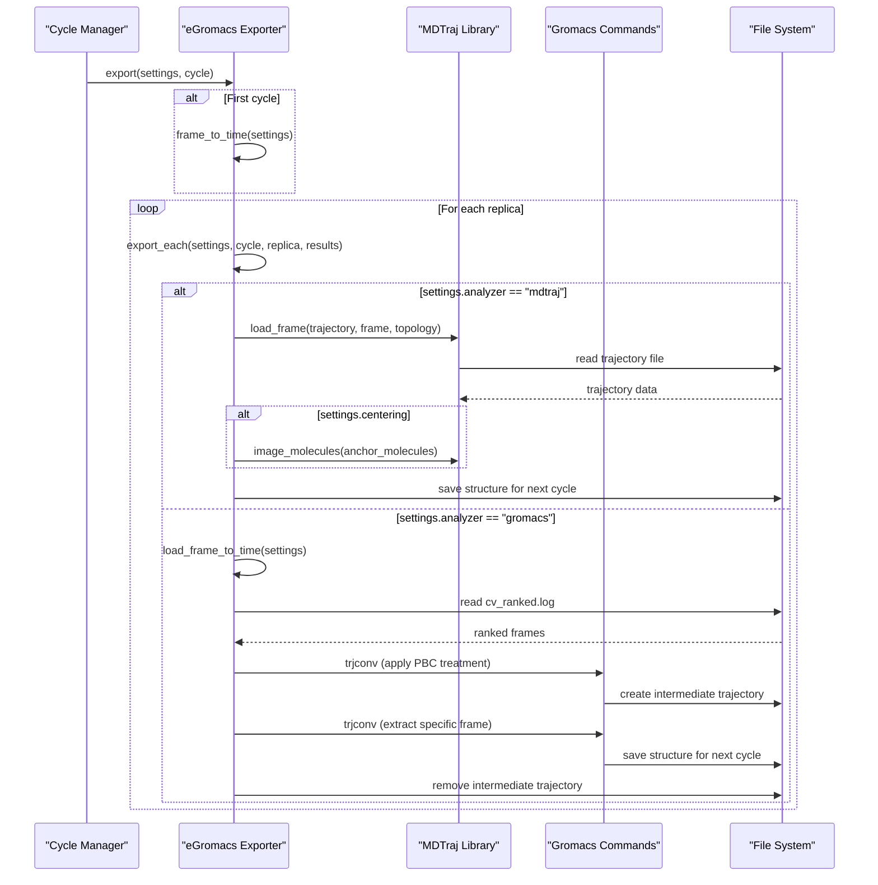
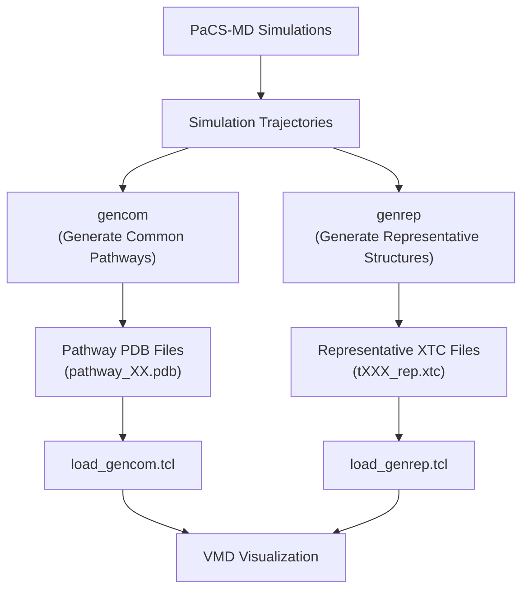
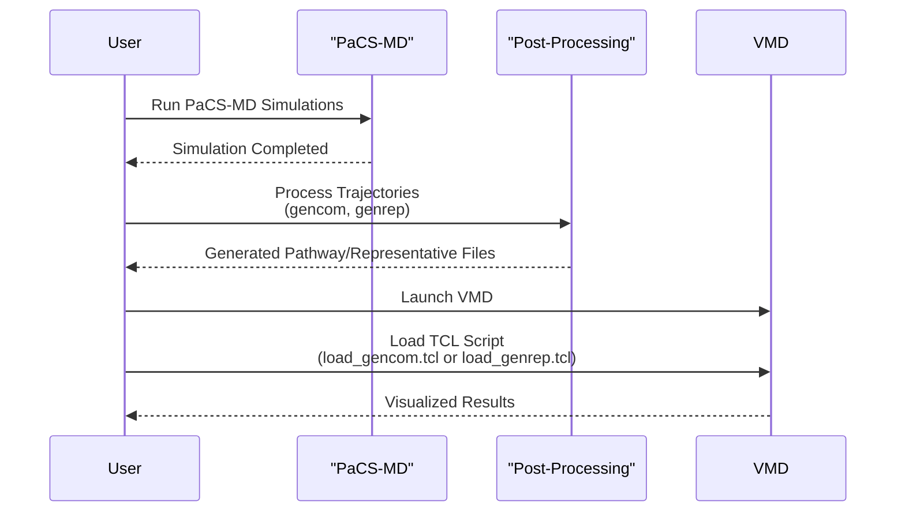

# Exporting and Visualization

Relevant source files

The following files were used as context for generating this wiki page:

- [pacs/mdrun/exporter/gromacs.py](pacs/mdrun/exporter/gromacs.py)
- [utils/load_gencom.tcl](utils/load_gencom.tcl)
- [utils/load_genrep.tcl](utils/load_genrep.tcl)

## Purpose and Scope

This document details the exporting and visualization components of the PaCS-Toolkit. It covers how simulation results are exported at each cycle of PaCS-MD and the provided utilities for visualizing these results using molecular visualization software. These components are crucial for transitioning between simulation cycles and for analyzing the generated pathways after the simulation completes.

For information about post-processing scripts for more advanced analysis, see [Post-Processing Scripts](#8.3).

## The Exporter System

The Exporter system is responsible for extracting selected snapshots from the current cycle's trajectories and preparing them as inputs for the next cycle. This forms a critical link in the iterative PaCS-MD workflow.

### SuperExporter Framework

The exporting system is built around a base `SuperExporter` class that defines the common interface for all exporter implementations. The specific implementation for Gromacs, `eGromacs`, extends this base class with Gromacs-specific functionality.

The exporter's primary responsibility is to extract the snapshots selected by the analyzer from the current cycle's trajectories and prepare them as starting points for the next cycle's simulations. This extraction process ensures the continuation of the enhanced sampling approach.

Sources: [pacs/mdrun/exporter/gromacs.py:14-19]()

### Export Methods

The `eGromacs` exporter supports two primary methods for exporting snapshots:

1. **MDTraj-based export** - Uses the MDTraj library to load and manipulate trajectory frames
2. **GMX-based export** - Uses Gromacs commands directly via subprocess calls

Both methods achieve the same goal but use different underlying technologies. The choice between them is determined by the `analyzer` setting in the configuration file.

#### MDTraj Export Method

When using the MDTraj export method, the exporter:

1. Loads the specific frame from the trajectory using MDTraj
2. Applies centering if configured (aligning molecules based on selected atoms)
3. Saves the selected structure as the input for the next cycle

This method leverages the flexibility and Python interface of MDTraj for efficient trajectory handling.

Sources: [pacs/mdrun/exporter/gromacs.py:35-66]()

#### Gromacs Export Method

The Gromacs export method uses direct Gromacs commands to:

1. Convert frames to time values (for accurate frame selection)
2. Apply PBC treatments (whole molecules or nojump for continuous trajectories)
3. Apply centering if configured
4. Extract the specific frame identified by the analyzer
5. Save the structure for the next cycle

This method is more direct when working with Gromacs and allows leveraging all Gromacs tools for trajectory manipulation.

Sources: [pacs/mdrun/exporter/gromacs.py:68-157]()

#### Frame to Time Conversion

For Gromacs-based exports, the exporter maintains a mapping between frame numbers and simulation time (in picoseconds). This mapping is created during the first cycle and used in subsequent cycles to ensure accurate frame selection by time rather than frame index.

Sources: [pacs/mdrun/exporter/gromacs.py:159-196]()

## Visualization with VMD

The PaCS-Toolkit includes TCL scripts for visualizing results with VMD (Visual Molecular Dynamics), a popular molecular visualization software. These scripts facilitate the visualization of:

1. Generated pathways (from `gencom` utility output)
2. Representative structures (from `genrep` utility output)

### Pathway Visualization

The `load_gencom.tcl` script visualizes common pathways generated by the `gencom` utility. It:

1. Loads the input structure (typically from the first cycle/replica)
2. Sets up protein and ligand representations
3. Loads multiple pathway files (pathway_XX.pdb) generated by `gencom`
4. Displays each pathway with a different color as a series of points

This visualization helps to identify common binding/unbinding pathways across multiple simulation runs.

Sources: [utils/load_gencom.tcl:1-46]()

### Representative Structure Visualization

The `load_genrep.tcl` script visualizes representative structures generated by the `genrep` utility. It:

1. Loads a reference topology file (rmmol_top.pdb)
2. Loads a specific representative trajectory (tXXX_rep.xtc)
3. Sets up appropriate representations for proteins and ligands
4. Displays the conformational changes or binding events

This visualization helps analyze specific representative trajectories identified by the toolkit.

Sources: [utils/load_genrep.tcl:1-37]()

## Visualization Workflow

The typical workflow for visualizing PaCS-MD results involves:

1. Running PaCS-MD simulations (complete workflow)
2. Processing trajectories with post-processing utilities (`gencom`, `genrep`)
3. Using the provided TCL scripts with VMD to visualize the results

### Customizing Visualization

The provided TCL scripts can be customized to modify visualization parameters:

1. In `load_gencom.tcl`:
   - Adjust the `n_trials` variable to match the number of pathways
   - Modify representation styles (NewCartoon, Licorice, etc.)
   - Uncomment membrane visualization if needed
   - Change point size (currently 6.0) for pathway visualization

2. In `load_genrep.tcl`:
   - Change the `trial` variable to select different representative trajectories
   - Modify representation styles to highlight specific elements

## Best Practices

1. **Frame Selection**: Ensure that all frame selections are based on analyzer rankings to maintain the enhanced sampling approach.

2. **PBC Treatment**: Consider your system type when choosing periodic boundary condition treatments:
   - Use `nojump` for continuous trajectories across boundaries
   - Use `whole` for maintaining whole molecules

3. **Centering**: Enable centering with appropriate selections to keep your molecule of interest centered in the visualization box.

4. **Visualization Preparation**:
   - Process full trajectories with `rmmol` before visualization to remove periodic jumps
   - Generate combined trajectories with `gencom` for pathway visualization
   - Extract representative structures with `genrep` for detailed analysis

5. **Resource Management**: For large trajectories, consider extracting only essential frames using the exporter's mechanisms to reduce file sizes and improve visualization performance.

---