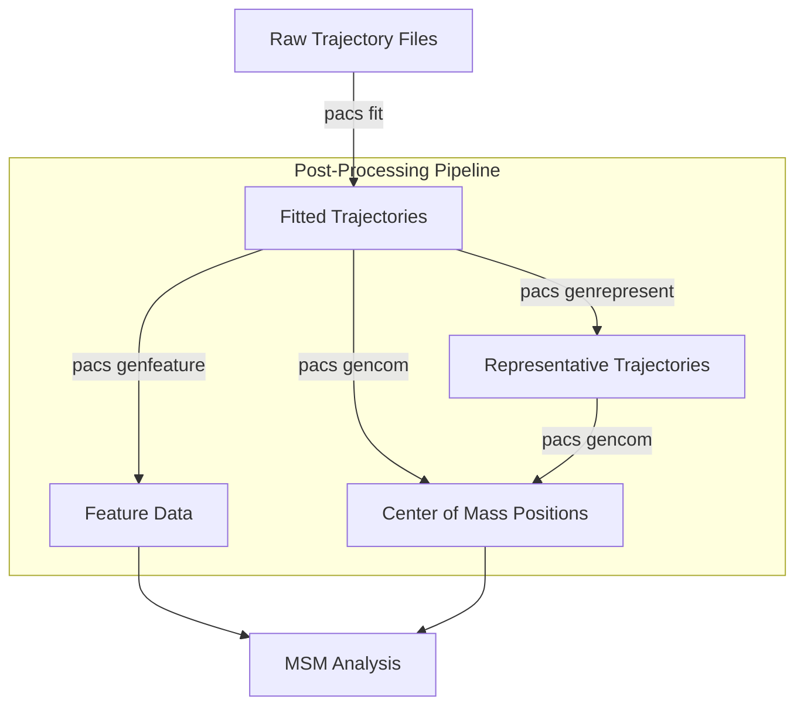
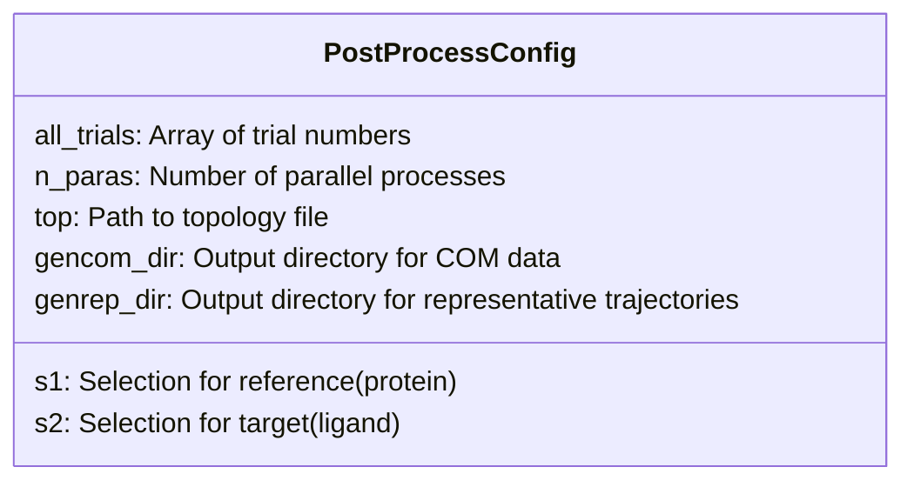
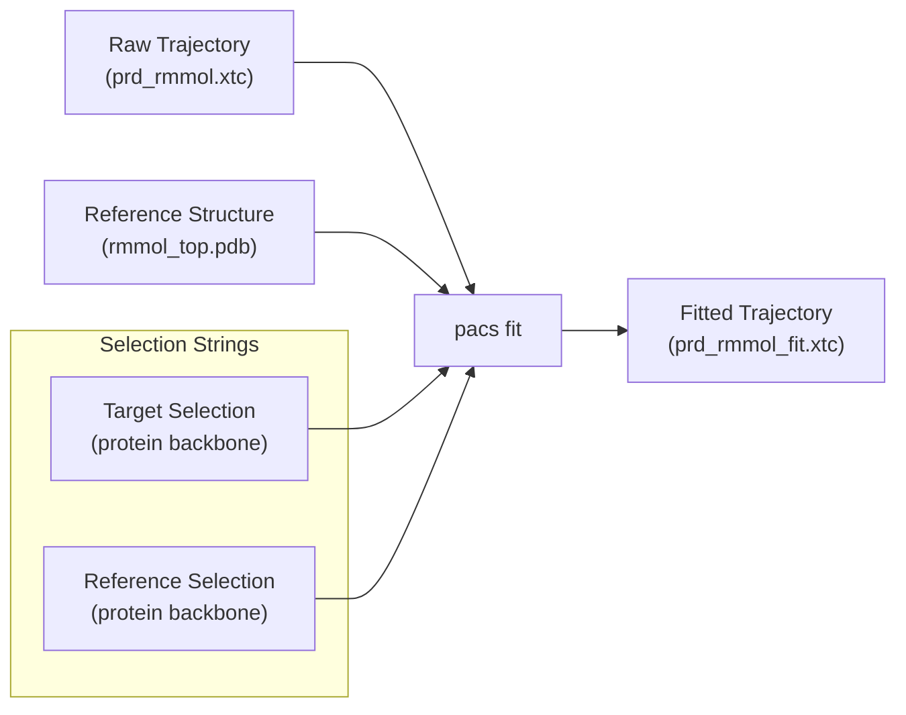
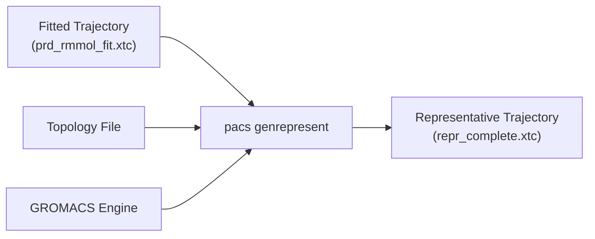
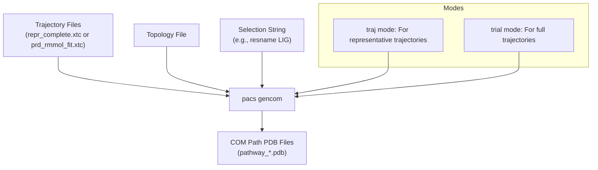
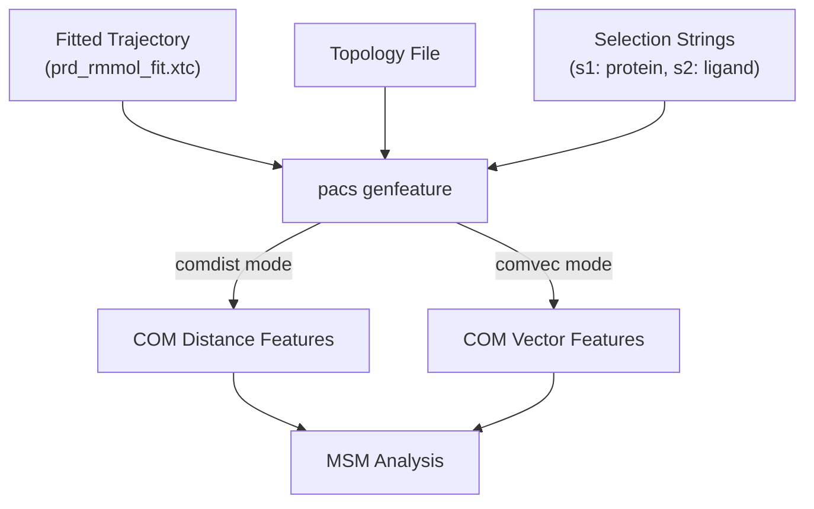

# Post-Processing Scripts

<details>
<summary>Relevant source files</summary>

The following files were used as context for generating this wiki page:

- [utils/post_process.sh](utils/post_process.sh)

</details>


## Purpose

This page documents the post-processing scripts and workflows used for analyzing simulation results generated by PaCS-MD simulations. Post-processing is a crucial step that transforms raw simulation data into analyzable features for extracting insights about molecular dynamics. This documentation focuses specifically on the standard post-processing workflow implemented in the PaCS-Toolkit and how to customize it for different simulation systems.

For information about job submission scripts for running PaCS-MD simulations, see [Job Submission Scripts](#8.1). For details on exporting and visualizing results, see [Exporting and Visualization](#8.2).

## Post-Processing Workflow Overview

The post-processing workflow in PaCS-Toolkit typically involves several sequential steps that prepare simulation data for analysis.



Sources: [utils/post_process.sh:41-99]()

## The Post-Processing Script

PaCS-Toolkit provides a comprehensive post-processing shell script (`post_process.sh`) that automates the standard post-processing workflow. This script performs several operations on simulation data from multiple trials:

1. **Fitting trajectories** - Aligns trajectories to a reference structure
2. **Generating representative trajectories** - Creates simplified trajectories that capture essential conformational changes
3. **Calculating center of mass (COM)** - Computes COM positions for selected parts of the system
4. **Feature generation** - Calculates features like COM distances and COM vectors for analysis

### Script Configuration

Before using the post-processing script, you need to configure certain parameters based on your simulation system:



Sources: [utils/post_process.sh:18-34]()

The most important configuration parameters include:

| Parameter | Description | Example |
|-----------|-------------|---------|
| `all_trials` | Array of trial numbers to process | `seq -w 01 30` (trials 01-30) |
| `n_paras` | Number of parallel processes | `15` |
| `s1` | Selection string for the reference structure (typically protein) | `"protein and name CA"` |
| `s2` | Selection string for the target structure (typically ligand) | `"resname LIG"` |
| `top` | Path to the topology file | `"trial001/cycle000/replica001/rmmol_top.pdb"` |

Sources: [utils/post_process.sh:18-34]()

## Post-Processing Steps in Detail

### 1. Trajectory Fitting

The first step is to fit the trajectories to a reference structure to remove overall translation and rotation, making analysis more meaningful. This is performed using the `pacs fit` command.



The command used for fitting is:

```
pacs fit trial mdtraj -t $i -tf prd_rmmol.xtc -top $top -r $top -ts "$s1" -rs "$s1" -p ${n_paras} -o prd_rmmol_fit.xtc
```

Where:
- `-t $i`: Trial number
- `-tf`: Input trajectory file
- `-top`: Topology file
- `-r`: Reference structure
- `-ts`: Target selection (what to fit)
- `-rs`: Reference selection
- `-p`: Number of parallel processes
- `-o`: Output trajectory file

Sources: [utils/post_process.sh:41-48]()

### 2. Generating Representative Trajectories

Representative trajectories condense the full trajectories into a smaller set of structures that capture the essential conformational changes. This is done using `pacs genrepresent`.



The command used is:

```
pacs genrepresent gmx -t $i -trj prd_rmmol_fit.xtc -top $top -g gmx_mpi
```

Where:
- `-t $i`: Trial number
- `-trj`: Input trajectory file
- `-top`: Topology file
- `-g`: GROMACS executable

The script also gathers all representative trajectories into a centralized directory:

```
cp trial$trial/genrepresent/repr_complete.xtc genrep/t${trial_str}_rep.xtc
```

Sources: [utils/post_process.sh:51-61]()

### 3. Generating Center of Mass (COM) Data

The `pacs gencom` command calculates center of mass positions for selected parts of the system, which is particularly useful for analyzing protein-ligand interactions:



The script performs COM calculations in two modes:

1. For representative trajectories:
```
pacs gencom traj mdtraj -trj trial0$i/genrepresent/repr_complete.xtc -top $top -r $i -s "$s2" -o $gencom_dir/rep_pathway_$i.pdb
```

2. For full trajectories:
```
pacs gencom trial mdtraj -t $i -trj prd_rmmol_fit.xtc -top $top -r $i -s "$s2" -o $gencom_dir/pathway_$i.pdb -sf 10
```

Where:
- `-trj`/`-t`: Trajectory file or trial number
- `-top`: Topology file
- `-r`: Reference identifier
- `-s`: Selection string for COM calculation
- `-o`: Output PDB file
- `-sf`: Skip frames (for full trajectories to reduce data size)

Sources: [utils/post_process.sh:64-84]()

### 4. Feature Generation

The final step is to generate features from the fitted trajectories that can be used in subsequent analyses such as MSM. The `pacs genfeature` command supports different feature types:



Two types of features are calculated:

1. Inter-COM distance (comdist):
```
pacs genfeature comdist mdtraj -t $i -tf prd_rmmol_fit.xtc -top $top -p ${n_paras} -s1 "$s1" -s2 "$s2"
```

2. Inter-COM vector (comvec):
```
pacs genfeature comvec mdtraj -t $i -tf prd_rmmol_fit.xtc -ref $top -ft "$s1" -fr "$s1" -top $top -p ${n_paras} -s1 "$s1" -s2 "$s2"
```

Where:
- `-t`: Trial number
- `-tf`: Trajectory file
- `-top`: Topology file
- `-p`: Number of parallel processes
- `-s1`/`-s2`: Selection strings for the two groups
- `-ref`: Reference structure (for comvec)
- `-ft`/`-fr`: Fitting selections (for comvec)

Sources: [utils/post_process.sh:87-99]()

## Customizing the Post-Processing Script

The post-processing script can be customized for different simulation systems by modifying several key parameters:

1. **Trial configuration**: Adjust the number of trials to process by modifying the `all_trials` array.
   ```bash
   all_trials=(`seq -w 01 30`)  # Process trials 01 through 30
   ```

2. **Parallelization**: Set the number of parallel processes based on your available computing resources.
   ```bash
   n_paras=15  # Use 15 parallel processes
   ```

3. **Selection strings**: Define appropriate selection strings for your molecular system.
   ```bash
   s1="protein and name CA"  # Selection for protein backbone
   s2="resname LIG"         # Selection for ligand
   ```

4. **File paths**: Update the topology file path and output directories as needed.
   ```bash
   top="trial001/cycle000/replica001/rmmol_top.pdb"
   gencom_dir="gencom"
   genrep_dir="genrep"
   ```

5. **Processing options**: Additional options can be passed to each command, such as frame skipping for `gencom` with the `-sf` parameter.

Sources: [utils/post_process.sh:18-34]()

## Integration with MSM Analysis

The features generated by the post-processing script (comdist and comvec) serve as input for Markov State Model (MSM) analysis, which can provide insights into the system's kinetics and thermodynamics. For details on MSM analysis, please refer to the [MSM Analysis](#7) section.

## Running the Post-Processing Script

To run the post-processing script:

1. Make sure the script is executable:
   ```bash
   chmod +x post_process.sh
   ```

2. Execute the script:
   ```bash
   ./post_process.sh
   ```

3. Optionally, you may need to activate the appropriate conda environment first:
   ```bash
   source (anaconda3_dir)/etc/profile.d/conda.sh
   conda activate pacstk
   ```

Remember that post-processing can be computationally intensive, especially for large numbers of trials or long trajectories. Consider running the script on a high-performance computing system for large datasets.

Sources: [utils/post_process.sh:12-16]()

## Summary

The post-processing scripts in PaCS-Toolkit provide a comprehensive workflow for analyzing simulation results, from trajectory fitting to feature generation. By following this workflow, users can prepare their simulation data for detailed analysis, including MSM analysis for extracting kinetic and thermodynamic information.

The main steps in the post-processing workflow are:
1. Trajectory fitting (`pacs fit`)
2. Representative trajectory generation (`pacs genrepresent`)
3. Center of mass calculation (`pacs gencom`)
4. Feature generation (`pacs genfeature`)

These steps transform raw simulation data into features that can be used to gain insights into molecular systems and their dynamics.

---