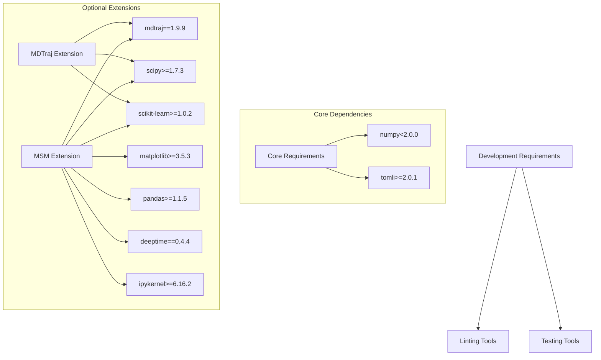
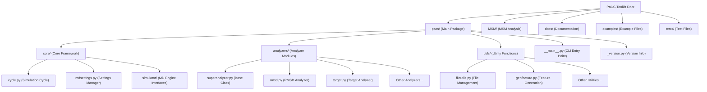
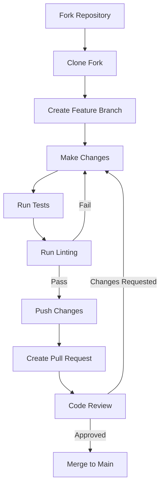
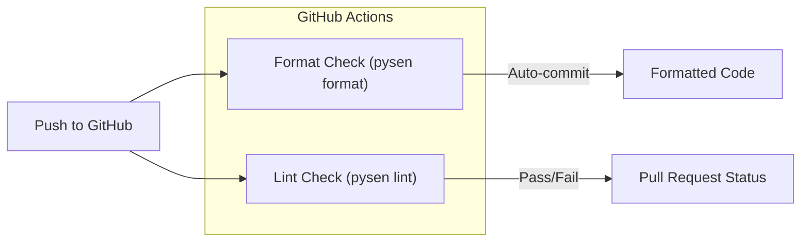
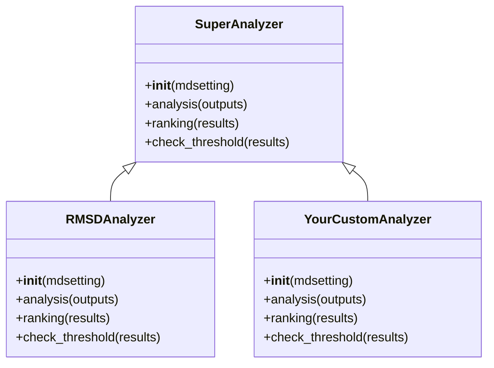
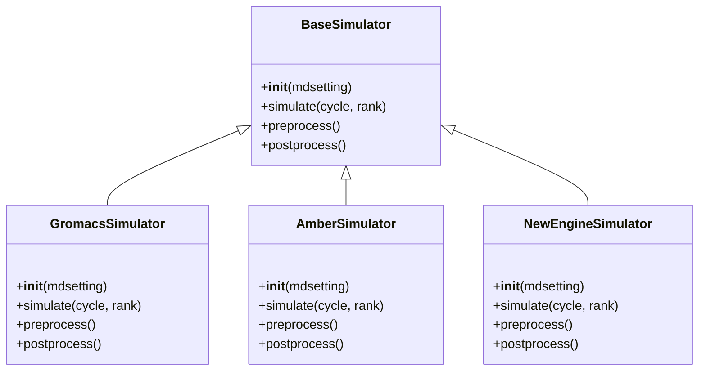
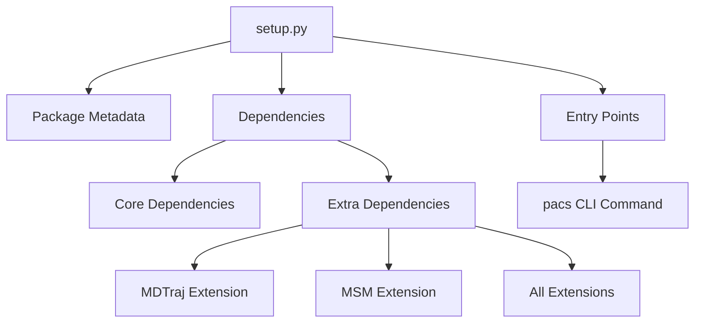
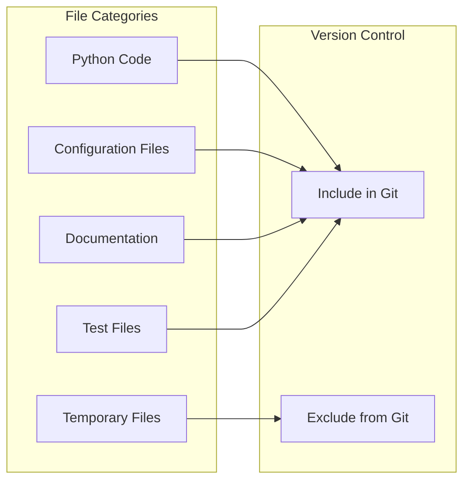

# Development

<details>
<summary>Relevant source files</summary>

The following files were used as context for generating this wiki page:

- [.gitattributes](.gitattributes)
- [.github/workflows/python_format.yaml](.github/workflows/python_format.yaml)
- [.github/workflows/python_lint.yaml](.github/workflows/python_lint.yaml)
- [.gitignore](.gitignore)
- [requirements.txt](requirements.txt)
- [setup.py](setup.py)

</details>


This page provides essential information for developers who want to contribute to the PaCS-Toolkit codebase. It covers the development environment setup, code organization, contribution workflow, and coding standards. For information about using the toolkit, see [Overview](#1) and [Quick Start Guide](#3).

## Development Environment Setup

Setting up a development environment for PaCS-Toolkit involves a few straightforward steps:

1. **Clone the repository**:
   ```bash
   git clone https://github.com/Kitaolab/PaCS-Toolkit.git
   cd PaCS-Toolkit
   ```

2. **Install development dependencies**:
   ```bash
   pip install -r requirements.txt
   pip install -r requirements_dev.txt
   ```

3. **Install the package in development mode**:
   ```bash
   pip install -e .
   ```

### Dependencies Overview

PaCS-Toolkit has a modular dependency structure that allows users to install only what they need.



Sources: [setup.py:32-62](), [requirements.txt:1-10]()

## Project Structure

The PaCS-Toolkit follows a modular architecture that separates different components of the system.



Sources: The project structure is inferred from the system architecture overview and patterns typical of Python projects

## Contribution Workflow

### Branch Management and Pull Requests



Sources: Common GitHub workflow practices

### Automatic Code Formatting and Linting

PaCS-Toolkit uses GitHub Actions to automatically enforce code quality standards:

1. **Automatic Formatting**: The `python_format.yaml` workflow runs on the main branch to format code.
2. **Linting Checks**: The `python_lint.yaml` workflow runs on push and pull requests to verify code quality.



Sources: [.github/workflows/python_format.yaml:1-36](), [.github/workflows/python_lint.yaml:1-34]()

## Coding Standards

### Code Style

PaCS-Toolkit follows standard Python coding practices:

- **PEP 8** for code style
- **Type hints** for function and method signatures
- **Docstrings** for all public functions, classes, and methods

### Tools Used for Code Quality

| Tool | Purpose | Configuration |
|------|---------|--------------|
| pysen | Orchestrates code quality tools | pyproject.toml |
| flake8 | Style guide enforcement | Via pysen |
| mypy | Static type checking | Via pysen |
| black | Code formatting | Via pysen |
| isort | Import sorting | Via pysen |

Sources: [.github/workflows/python_format.yaml:1-36](), [.github/workflows/python_lint.yaml:1-34]()

## Extending PaCS-Toolkit

### Adding a New Analyzer

One common extension point is adding a new analyzer. Analyzers inherit from the `SuperAnalyzer` class and implement specific analysis methods.



To create a new analyzer:

1. Create a new Python file in the `pacs/analyzers/` directory
2. Define a class that inherits from `SuperAnalyzer`
3. Implement the required methods: `analysis()`, `ranking()`, and `check_threshold()`
4. Register your analyzer in the appropriate configuration systems

Sources: Based on system architecture diagram showing analyzer inheritance

### Adding a New MD Engine Interface

Similarly, you can extend PaCS-Toolkit to support a new MD engine:



Sources: Based on system architecture showing simulator integration

## Package Management

PaCS-Toolkit uses setuptools for package management. The package has a modular structure with optional components.



The package uses extras_require to define optional dependency sets:

| Extra | Purpose | Dependencies |
|-------|---------|-------------|
| mdtraj | Enables analyzers using MDTraj | mdtraj, scipy, scikit-learn |
| msm | Enables MSM analysis | mdtraj, matplotlib, scipy, pandas, deeptime, ipykernel, scikit-learn |
| all | All optional features | All dependencies from mdtraj and msm |

Sources: [setup.py:8-69]()

## Testing and Documentation

### Testing Guidelines

When contributing code to PaCS-Toolkit, it's important to:

1. Write tests for any new functionality
2. Ensure all existing tests pass before submitting a pull request
3. Test with different configurations (core, mdtraj, msm, all)

### Documentation Guidelines

Documentation in PaCS-Toolkit comes in several forms:

1. **Code comments**: Explain complex algorithms and non-obvious decisions
2. **Docstrings**: Document the purpose, parameters, and return values of functions and classes
3. **Wiki pages**: Provide high-level explanations of system components
4. **Examples**: Demonstrate how to use various features

When adding new code, ensure that you update or create appropriate documentation.

## Version Control Guidelines

### Git Best Practices



The project uses `.gitignore` to exclude common temporary files and build artifacts.

Sources: [.gitattributes:1-2](), [.gitignore:1-168]()

## Release Process

The release process for PaCS-Toolkit involves:

1. Updating the version number in `pacs/_version.py`
2. Running final tests and quality checks
3. Creating a release tag in Git
4. Building and uploading the package to PyPI

Sources: [setup.py:6-10]()

---