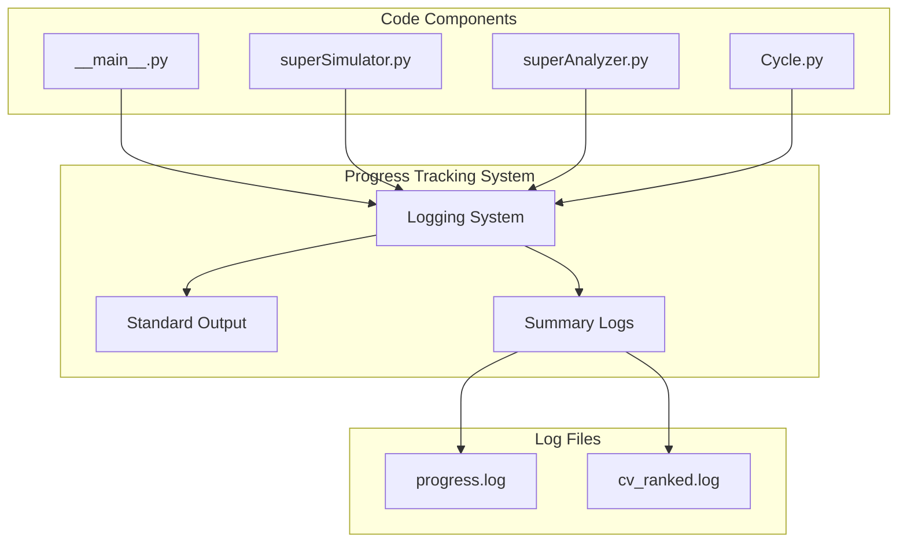
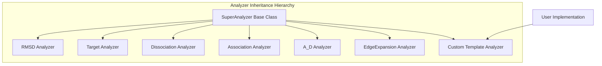
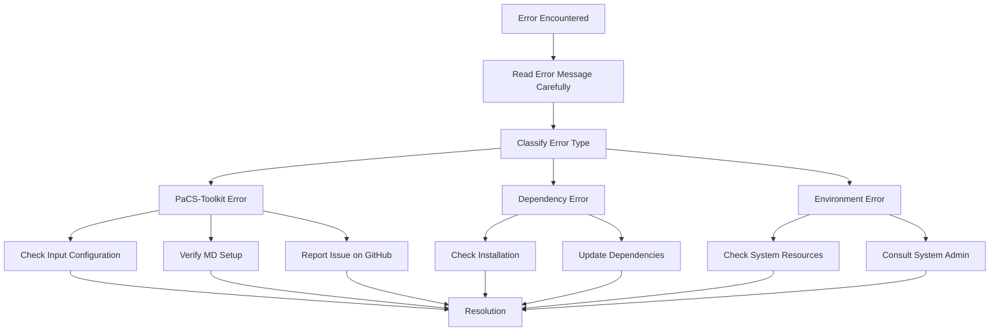
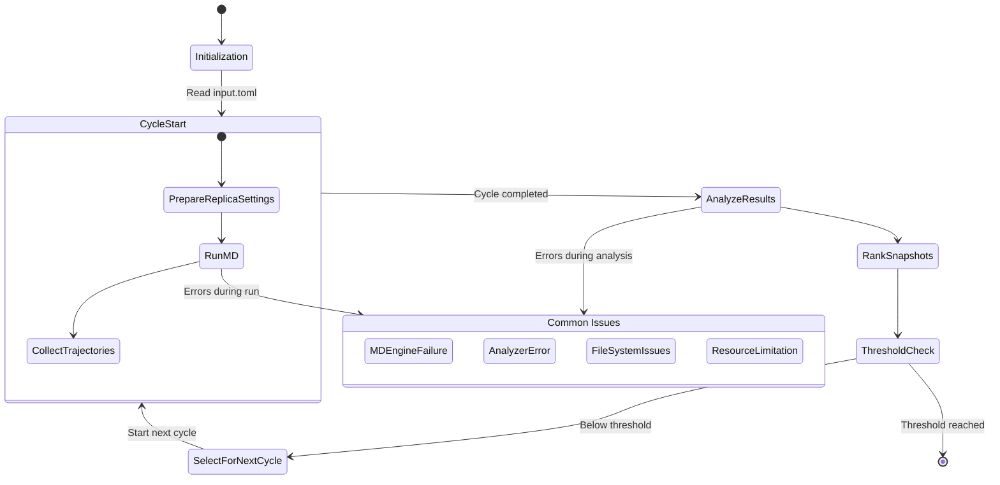

# FAQ

<details>
<summary>Relevant source files</summary>

The following files were used as context for generating this wiki page:

- [docs/src/FAQ.md](docs/src/FAQ.md)
- [docs/src/mdrun/analyzer.md](docs/src/mdrun/analyzer.md)

</details>


This page addresses frequently asked questions about using the PaCS-Toolkit. It covers common issues, troubleshooting tips, and clarifications about the functionality of PaCS-MD simulations. For detailed information about specific components, please refer to their respective documentation pages, such as [Analyzers](#5) or [Core Framework](#4).

## General Questions

### How can I check PaCS-MD progress?

You can monitor PaCS-MD progress through:

1. **Standard output logs**: The most direct method is to check the standard output or error streams.

```
INFO       2023-12-16 23:22:04  [    parser.py     -       parse      ] input_ims.toml was read successfully
INFO       2023-12-16 23:22:04  [   __main__.py    -      <module>    ] pacsmd version 0.1.1
INFO       2023-12-16 23:22:04  [   __main__.py    -        main      ] PaCS-MD starts
INFO       2023-12-16 23:22:04  [   __main__.py    -     prepare_md   ] MDsettings(..)
INFO       2023-12-16 23:22:04  [   __main__.py    -      pacs_md     ] cycle000 starts
INFO       2023-12-16 23:23:15  [superSimulator.py -  record_finished ] replica001 done
INFO       2023-12-16 23:23:18  [ superAnalyzer.py -      analyze     ] The top ranking CV is replica 1 frame 32 cv 1.864649296784787
```

2. **Progress log files**: If you're running on a supercomputer where log files aren't readily accessible, check `trialXXX/cycleXXX/replicaXXX/summary/progress.log`.

3. **Quick progress check**: Use this command to view progress across cycles:

```shell
head -n 1 trial001/cycle*/summary/cv_ranked.log | grep frame | awk '{print NR "," $6}'
```

This will output cycle numbers and their corresponding collective variable (CV) values:

```
1,1.864649296784787
2,1.9111852343506632
3,1.9179890510636395
...
```

### Progress Monitoring System



Sources: [docs/src/FAQ.md:16-65]()

### What should I do if there are no evaluation types that meet my needs?

If you can't find a suitable analyzer for your research needs:

1. Check if there are evaluation types still in development
2. Develop your own analyzer using the template system

You can create custom analyzers by extending the `SuperAnalyzer` class. For more details, see the [Template Analyzer documentation](#5.7).



Sources: [docs/src/FAQ.md:69-71](), [docs/src/mdrun/analyzer.md:1-123]()

## Simulation-Specific Questions

### Why does dissociation PaCS-MD take a lot of time or fail to complete?

This is often due to:

1. **Incorrect molecule selection**: Verify that your center of mass (COM) selections are appropriate.
2. **Structural limitations**: Some initial structures may not be suitable for dissociation based on their conformation.

To check COM selections, use:

```shell
$ pacs gencom traj mdtraj -s init.gro -t init.gro -ls "resname Lig" -o com_of_ligand.pdb
$ pacs gencom traj mdtraj -s init.gro -t init.gro -ls "resid 168 || resid 253" -o com_of_r168_r253.pdb
$ vmd -m init.gro com_of_r168_r253.pdb com_of_ligand.pdb
```

Sources: [docs/src/FAQ.md:74-84]()

### Is it okay if I obtain a minor dissociation pathway?

Minor dissociation pathways may be valid, but they could also result from:

1. Incorrect molecule selections
2. Unsuitable initial structures
3. Inadequate simulation parameters

Carefully evaluate whether the observed pathway makes physical sense based on your system. Compare your results with experimental data when possible.

Sources: [docs/src/FAQ.md:87-89]()

## Troubleshooting

### I got errors during running PaCS-MD. What should I do?

1. **Read error messages carefully**: Most errors provide clues about what went wrong.
2. **Check dependencies**: PaCS-MD relies on various libraries. Ensure they're properly installed and configured.
3. **Consider environment issues**: When running on supercomputers, some errors may be due to the computing environment rather than PaCS-MD itself.



Sources: [docs/src/FAQ.md:92-96]()

## Common Error Examples and Solutions

| Error Type | Possible Cause | Solution |
|------------|----------------|----------|
| `FileNotFoundError` | Missing input files or incorrect paths | Check file paths in input.toml and ensure all required files exist |
| `ImportError` | Missing dependencies | Install required packages with pip or use appropriate installation command |
| `KeyError` in input.toml | Missing or incorrectly formatted configuration | Check input.toml against documentation for required parameters |
| MD engine errors | Incorrect MD parameters or environment issues | Check MD engine documentation and ensure proper configuration |
| Out of memory errors | System too large or insufficient resources | Reduce system size, increase available memory, or optimize settings |

## Analyzer Selection Guide

Choosing the right analyzer is critical for successful PaCS-MD simulations:

| Analyzer Type | Use Case | Key Parameters |
|---------------|----------|----------------|
| Dissociation | Studying ligand unbinding or domain separation | `mask1`, `mask2` for COM calculation |
| Association | Studying binding events or domain association | `mask1`, `mask2` for COM calculation |
| Target | Finding transitions between known structures | `reference` structure, `mask` for alignment |
| RMSD | Sampling diverse conformations | `reference` structure, `mask` for alignment |
| EdgeExpansion | Exploring conformational space without reference | `mask` for PCA calculation |
| A_D | Studying systems with binding/unbinding equilibrium | `mask1`, `mask2`, distance ranges |

For research problems that don't fit these categories, consider implementing a custom analyzer using the template system.

Sources: [docs/src/mdrun/analyzer.md:1-123]()

## PaCS-MD Simulation Lifecycle



Sources: [docs/src/FAQ.md:16-65](), [docs/src/mdrun/analyzer.md:1-10]()