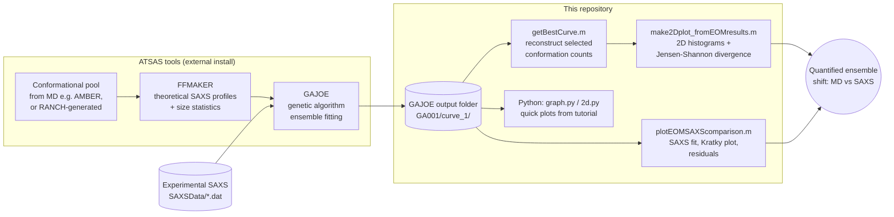

This page introduces the **H4 tail benchmarking** repository: what problem it solves, how its pieces fit together, and where a new developer should go next. It covers the repository's purpose, the underlying MD-to-SAXS comparison workflow, the layout of files and folders, and a guided reading path through the rest of this documentation. It intentionally stays at the conceptual level — implementation details live in the Deep Dive pages linked throughout.

Sources: [README.md](README.md#L1-L9)

## What This Repository Does

This repository provides tools to **compare intrinsically disordered protein (IDP) structural ensembles generated from molecular dynamics (MD) against small-angle X-ray scattering (SAXS) experimental data**. IDPs like the H4 histone tail do not adopt a single folded structure — they exist as a *cloud* of conformations. SAXS experiments probe that cloud as an ensemble average, but raw SAXS data alone cannot tell you *which* conformations are present. This repository bridges the two worlds: it takes an MD-generated conformational pool, refines it against SAXS data using the Ensemble Optimization Method (EOM), and quantifies how much the SAXS-consistent sub-ensemble differs from the full MD ensemble.

The working example throughout is the **H4 histone tail** — a 26-residue, fully disordered protein segment — from the paper: *Tong Wang, Egor S. Kolesnikov, Lois Pollack, Alexey V. Onufriev. "Combining atomistic simulation and solution scattering to reveal charge-driven histone H4 tail conformational changes" (2026, in submission)*. If you use this code, the README asks you to cite that paper. The project is licensed under Apache 2.0.


Sources: [README.md](README.md#L1-L9), [README.md](README.md#L27-L28)

## The Core Idea: One Pipeline, Two Comparisons

The scientific workflow has two halves. The **half you cannot run from this repo alone** is the EOM suite from the external ATSAS package: **RANCH** generates random conformations, **FFMAKER** computes theoretical SAXS profiles for each, and **GAJOE** uses a genetic algorithm (backed by CRYSOL) to select the sub-ensemble of conformations whose averaged profile best fits the experimental SAXS curve. The **half this repository owns** is everything *after* GAJOE: reconstructing which conformations the genetic algorithm kept, visualizing full-pool vs. selected-ensemble distributions, and computing the **Jensen-Shannon divergence (JSD)** — an information-theoretic measure of how different two probability distributions are — between the MD ensemble and the SAXS-refined ensemble.



Reading the diagram left to right: conformations enter from MD or RANCH, get converted to theoretical scattering by FFMAKER, and GAJOE optimizes a sub-ensemble against the experimental curve. Everything downstream of the GAJOE output folder is what this repository ships code for.

Sources: [README.md](README.md#L5-L17), [make2Dplot_fromEOMresults.m](make2Dplot_fromEOMresults.m#L185-L206), [plotEOMSAXScomparison.m](plotEOMSAXScomparison.m#L4-L16)

## Repository Layout at a Glance

The repository is deliberately flat — three MATLAB scripts at the root, and three folders of supporting data. Nothing needs to be built or compiled; the scripts are run directly against the data folders.

```
H4_tail_benchmarking/
├── getBestCurve.m                  ← helper: reconstructs GA-selected structure counts
├── make2Dplot_fromEOMresults.m     ← 2D histograms + Jensen-Shannon divergence
├── plotEOMSAXScomparison.m         ← SAXS fit, Kratky plot, residuals
├── ExampleData/
│   └── H4_tail_WT_ff19SB_OPC/
│       └── GA001/curve_1/          ← full example GAJOE output (100 GA cycles)
├── SAXSData/
│   ├── H4WT_150Na.dat              ← experimental SAXS: wild-type H4 tail
│   └── H4KQ_150Na.dat              ← experimental SAXS: K→Q (charge-neutralized) H4
├── Example_tutorial/               ← self-contained 20-conformation EOM demo
└── LICENSE.txt
```

Sources: [README.md](README.md#L10-L17)

| Path | Type | Purpose |
|---|---|---|
| `getBestCurve.m` | MATLAB function | Parses `GA_CYCLE_*.txt` files across all GA runs and counts how often each conformation was selected |
| `make2Dplot_fromEOMresults.m` | MATLAB script | Builds Rg–Ree and Dmax–Rg 2D scatter/histogram figures for full pool vs. EOM ensemble; computes JSD for Rg and Ree |
| `plotEOMSAXScomparison.m` | MATLAB script | Plots experimental SAXS vs. EOM ensemble fit, a dimensionless Kratky plot, and fit residuals |
| `ExampleData/H4_tail_WT_ff19SB_OPC/GA001/curve_1/` | GAJOE output | Complete worked example: 100 `GA_CYCLE_*.txt` files, `Rg_distr_001_1.txt`, `Size_distr_001_1.txt`, `CaCa_distr_001_1.txt`, `Volume_distr_001_1.txt`, `Size_list.txt`, `Ree_values.mat`, `profiles_001_1.fit` |
| `SAXSData/` | Experimental data | Two measured SAXS profiles: wild-type H4 and K-to-Q mutant at 150 mM Na |
| `Example_tutorial/` | Tutorial workspace | Minimal 20-conformation EOM run: RANCH inputs (`assignment.txt`, `protein.seq`), experimental data, and two Python plotting scripts |

Sources: [getBestCurve.m](getBestCurve.m#L2-L9), [make2Dplot_fromEOMresults.m](make2Dplot_fromEOMresults.m#L13-L39), [plotEOMSAXScomparison.m](plotEOMSAXScomparison.m#L8-L16), [assignment.txt](Example_tutorial/assignment.txt#L1-L2), [protein.seq](Example_tutorial/protein.seq#L1-L3)

> [!TIP]
> GAJOE v2.x **no longer writes a `best_curve.txt` file** (v1.3 did). The `getBestCurve.m` function exists precisely to reconstruct it from the `GA_CYCLE_*.txt` workfiles — but this only works if you answered **yes** to "Save workfiles with the entire GA runs?" during the GAJOE run. If you skip that prompt, the MATLAB analysis cannot recover which conformations were selected.

Sources: [getBestCurve.m](getBestCurve.m#L3-L9)

## The Analysis Scripts: One Entry Point Each

Both main MATLAB scripts follow the same beginner-friendly pattern: a **"User-defined parameters" block at the top of the file** where you set paths and options, then run the whole script. As the README puts it, "mostly the paths just need to be matched."

| Script | Key inputs you configure | What you get out |
|---|---|---|
| `make2Dplot_fromEOMresults.m` | GAJOE output `dir`, `nRuns` (GA repetitions, e.g. 100), `curvesPerEnsemble` (e.g. 20), axis limits, histogram bins | Two publication-quality figures (Rg vs. Ree; Dmax vs. Rg) with marginal histograms, printed mean/standard-error statistics, and JSD values quantifying MD-vs-EOM distribution differences |
| `plotEOMSAXScomparison.m` | GAJOE output `folder`, experimental `.dat` file, plot color, axis limits | Three panels: linear I(q) fit overlay, dimensionless Kratky plot, and interpolated residuals (I_exp − I_theor) |
| `getBestCurve.m` | Called by the 2D script: `dir`, `nRuns`, `curvesPerEnsemble` | A two-column matrix `[conformation index, selection frequency]` — the reconstructed "best curve" |
| `graph.py` (tutorial) | `folder` path to GAJOE output | `saxs_fit.png`, `rg.png`, `dmax.png`, `ree.png` |
| `2d.py` (tutorial) | `size_file` + `selected_dir` (GAJOE's `pdbs/`) | Rg–Ree scatter with marginal histograms highlighting GAJOE-selected conformations |

Sources: [make2Dplot_fromEOMresults.m](make2Dplot_fromEOMresults.m#L13-L27), [plotEOMSAXScomparison.m](plotEOMSAXScomparison.m#L8-L22), [getBestCurve.m](getBestCurve.m#L2-L4), [graph.py](Example_tutorial/graph.py#L23-L59), [2d.py](Example_tutorial/2d.py#L7-L41)

## What the Example Data Shows

The bundled `ExampleData` folder is a real GAJOE run against the wild-type H4 tail. Inside `GA001/curve_1/`, each `GA_CYCLE_N.txt` file is one independent genetic algorithm run — the log format shows generation number, best chi², and the dash-delimited list of selected conformation indices (e.g. `-122-180-257-...`). The distribution files (`Rg_distr`, `Size_distr`, `CaCa_distr`, `Volume_distr`) contain radius of gyration, maximum dimension, end-to-end distance, and volume distributions for both the full pool and the selected ensemble, while `profiles_001_1.fit` holds the experimental-vs-fitted scattering curve including χ². The companion `SAXSData/` folder holds the two experimental curves (WT and K-to-Q) that drive the charge-driven conformational-change story of the paper.

Sources: [GA_CYCLE_1.txt](ExampleData/H4_tail_WT_ff19SB_OPC/GA001/curve_1/GA_CYCLE_1.txt#L1-L15), [README.md](README.md#L12-L13), [plotEOMSAXScomparison.m](plotEOMSAXScomparison.m#L15-L16)

The `Example_tutorial/` folder is a **self-contained miniature of the whole pipeline**: `protein.seq` defines the 26-residue H4 sequence (`SGRGKGGKGLGKGGAKRHRKVLRDNI`), and `assignment.txt` tells RANCH to treat residue range 1–26 as `disordered`. The README documents a four-command walkthrough — `ranch`, `ffmaker`, `gajoe`, then two Python scripts — that takes you from sequence to final plots in minutes, using only 20 conformations.

> [!TIP]
> The 20-conformation tutorial pool exists **only to demonstrate the workflow mechanics**, as the README explicitly warns. For quantitative science, you need a substantially larger, well-sampled conformational pool, more GA generations, and more independent GA runs.

Sources: [README.md](README.md#L30-L36), [protein.seq](Example_tutorial/protein.seq#L1-L3), [assignment.txt](Example_tutorial/assignment.txt#L1-L2), [README.md](README.md#L89-L118)

## Hardware and Software Requirements

The analysis is deliberately lightweight: a standard computer with enough memory for "moderate intensity computing tasks" is sufficient, because the heavy lifting (MD simulation, CRYSOL profile calculation) happens in external tools. The external dependencies are: **ATSAS** (specifically GAJOE v2.1 recommended), **AMBER 24** (only if you generate your own MD ensembles), and **MATLAB R2021 or later**. The Python plotting scripts additionally need `numpy` and `matplotlib`.

| Dependency | Version | Needed for |
|---|---|---|
| ATSAS (RANCH, FFMAKER, GAJOE) | GAJOE v2.1 recommended | Pool generation, profile calculation, GA fitting |
| MATLAB | R2021+ | All three root analysis scripts |
| Python | numpy, matplotlib | Tutorial plots (`graph.py`, `2d.py`) |
| AMBER 24 | — | Only for generating new MD ensembles |

Sources: [README.md](README.md#L19-L25), [README.md](README.md#L102-L106)

## Suggested Reading Path

This documentation follows a Get Started → Deep Dive progression. A recommended route for a new developer:

1. **[Quick Start](2-quick-start)** — get the example data running end-to-end with minimal setup.
2. **[Software Requirements and Installation](3-software-requirements-and-installation)** — install ATSAS, MATLAB, and Python dependencies properly.
3. **[EOM Tutorial with ATSAS Tools](4-eom-tutorial-with-atsas-tools)** — run the 20-conformation walkthrough yourself.
4. **[Architecture Overview](5-architecture-overview)** — then understand *why* the pieces are shaped this way.
5. Follow the *EOM Pipeline Concepts* track ([RANCH](6-ranch-conformational-pool-generation) → [FFMAKER](7-ffmaker-theoretical-saxs-profiles) → [GAJOE](8-gajoe-genetic-algorithm-ensemble-fitting) → [GAJOE Output File Reference](9-gajoe-output-file-reference)) to master the external toolchain.
6. Finish with the *MATLAB Analysis Scripts* and *Python Plotting Utilities* tracks — starting with [Best-Curve Reconstruction from GA Cycles](10-best-curve-reconstruction-from-ga-cycles) and [Jensen-Shannon Divergence Quantification](12-jensen-shannon-divergence-quantification), which contain the repository's core scientific contribution.
7. For the biology behind it all, read the [H4 Histone Tail Case Study](17-h4-histone-tail-case-study), then see how to generalize in [Extending Workflow to Other IDPs](19-extending-workflow-to-other-idps).
