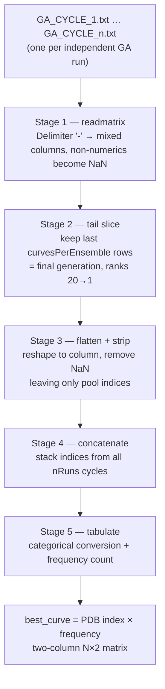
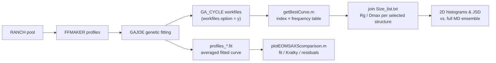

This page documents `getBestCurve.m`, the MATLAB utility that reconstructs the composition of the genetic-algorithm solution across all independent GAJOE cycles — a two-column table of conformational-pool indices and their selection frequencies. When ATSAS upgraded from GAJOE 1.3 to v2.x, the automatic `best_curve.txt` export disappeared; this function restores that capability by parsing the per-cycle workfiles that GAJOE v2–3 optionally saves. The page covers the workfile format the parser depends on, the reconstruction algorithm, the function contract, a worked example against the repository's bundled GAJOE output, and how the result connects to the rest of the analysis pipeline.

## Why This Script Exists: The GAJOE 1.3 → 2.x Regression

GAJOE is the genetic-algorithm engine of the Ensemble Optimization Method: it selects weighted sub-ensembles from a conformational pool whose averaged theoretical SAXS profile best fits the experimental data. GAJOE 1.3 wrote the composition of its solution directly to a `best_curve.txt` file. GAJOE v2–3 removed that export, but it retained an option to save the complete genetic-algorithm history as workfiles — provided the user explicitly enables it during the GAJOE session:

```
> Save workfiles with the entire GA runs? (default: no) ................ : y
```

The function's own header states its purpose plainly: *"Take output from GAJOE v2-3 and extract PDB numbers in all ensembles — Essentially recreates the best_curve.txt file generated from gajoe 1.3 that was removed from gajoe 2 for SOME reason"* ([getBestCurve.m](/getBestCurve.m#L2-L13)). If this option was not selected during the GAJOE run, no `GA_CYCLE_*.txt` files exist and the function has nothing to parse — this is the single most common failure mode, addressed in the troubleshooting table below.

## Anatomy of a GA_CYCLE Workfile

Each independent GA run produces one workfile named `GA_CYCLE_<run>.txt` in the GAJOE output folder (the repository ships a complete example with runs 1 through 100 under `ExampleData/H4_tail_WT_ff19SB_OPC/GA001/curve_1/`, alongside the standard GAJOE outputs such as `profiles_001_1.fit` and `Rg_distr_001_1.txt`) ([README.md](/README.md#L91-L98)). The workfile is one long log of the optimization: every generation records its top 20 ranked candidate ensembles, each line carrying four semantic fields:

```
Gener  Best
    1   20) chi^2: 35.26 - ensemble:  -122-180-257-374-751-953-1093-1382-1382-1509-1509-1944-1990-
```

The integers in the `ensemble` field are **indices into the RANCH conformational pool**, not PDB file names — the bundled example uses a 2,000-structure pool, indexed 1–2000, whose per-structure Rg and Dmax values are tabulated in `Size_list.txt` ([Size_list.txt](/ExampleData/H4_tail_WT_ff19SB_OPC/GA001/curve_1/Size_list.txt#L1-L6)). The example run converges dramatically: the first generation's rank-20 candidate sits at χ² = 35.26, while the final (1000th) generation's population spans only χ² ≈ 1.37–1.43 ([GA_CYCLE_1.txt](/ExampleData/H4_tail_WT_ff19SB_OPC/GA001/curve_1/GA_CYCLE_1.txt#L1-L3), [GA_CYCLE_1.txt](/ExampleData/H4_tail_WT_ff19SB_OPC/GA001/curve_1/GA_CYCLE_1.txt#L19982-L20001)).

This raw format is hostile to naive parsing: field separators (`-`) collide with the negative-sign convention of the ensemble list, ranks and χ² values are embedded in free text, and ensembles have variable member counts (5–15 in the example). The function sidesteps all of this with a single deliberate choice — parsing with `-` as the column delimiter, so every line decomposes into alternating numeric and non-numeric columns:

| Raw token(s) | Parsed column content | Survives NaN filter? |
|---|---|---|
| `1000` (generation) | numeric, but discarded context | Removed by tail-slice, not NaN |
| `1) chi^2: 1.37` | non-numeric text → NaN | No — stripped at [getBestCurve.m](/getBestCurve.m#L22-L23) |
| `ensemble:` label | non-numeric text → NaN | No — stripped |
| `858`, `1093`, `1463`… | pool indices | **Yes — kept** |
| trailing `-` → empty cell, short-row padding | NaN fill | No — stripped |

Sources: [GA_CYCLE_1.txt](/ExampleData/H4_tail_WT_ff19SB_OPC/GA001/curve_1/GA_CYCLE_1.txt#L1-L3), [getBestCurve.m](/getBestCurve.m#L19-L23)

> [!TIP]
> **Delimiter choice as robustness mechanism.** Because `readmatrix` with `"Delimiter", '-'` converts every non-numeric token (generation text, χ² strings, the `ensemble:` label) to NaN, and NaN-pads every row to the widest row's width, the single `~isnan` filter at [getBestCurve.m](/getBestCurve.m#L23) simultaneously removes headers, metadata, variable-width padding, and stray trailing blank lines. The parser never needs to know how many members an ensemble has — the data self-identifies as "the columns that are numbers."

## The Reconstruction Algorithm

The function executes a five-stage pipeline. Stages 1–3 run once per GA cycle; stages 4–5 aggregate across all cycles:



**Stage 1–3, per cycle.** The loop constructs each filename from the run number, reads it with the dash delimiter, then takes exactly the last `curvesPerEnsemble` rows: `raw(end-(curvesPerEnsemble-1):end,:)`. Since a workfile ends with the final generation's complete ranked population, this slice isolates the converged solution — rank 20 through rank 1 of the last generation. The slice is flattened column-wise and filtered through `~isnan`, yielding a clean column vector of pool indices ([getBestCurve.m](/getBestCurve.m#L19-L23)).

**Stage 4–5, global.** All cycles' index vectors are vertically concatenated into one master list, converted to `categorical`, and passed to `tabulate`, which produces unique-value/counts pairs. The extraction loop pulls the numeric indices and their frequencies into parallel arrays, and the function returns them bound as an N×2 matrix — one row per distinct pool structure that ever appeared in any converged ensemble, column 1 the pool index, column 2 its total occurrence count ([getBestCurve.m](/getBestCurve.m#L25-L39)).

## Function Signature and Parameters

```matlab
best_curve = getBestCurve(dir, nRuns, curvesPerEnsemble)
```

| Parameter | Type | Meaning | Example value (bundled data) |
|---|---|---|---|
| `dir` | char | Directory containing the `GA_CYCLE_i.txt` workfiles — the `curve_*` subfolder of the GAJOE output | `'ExampleData/H4_tail_WT_ff19SB_OPC/GA001/curve_1'` |
| `nRuns` | scalar | Number of independent GA cycles saved by GAJOE; drives the filename loop `GA_CYCLE_1..n` | `100` |
| `curvesPerEnsemble` | scalar | Ranked ensembles retained from each file's tail — must equal the rank population GAJOE reports per generation (20 in the example format) | `20` |
| `best_curve` (return) | N×2 double | Column 1: pool index (1–2000 in the example pool); column 2: occurrence count across all cycles | — |

Sources: [getBestCurve.m](/getBestCurve.m#L2), [getBestCurve.m](/getBestCurve.m#L19-L21)

## Worked Example Against the Repository Data

The bundled `ExampleData/H4_tail_WT_ff19SB_OPC/GA001/curve_1/` folder contains exactly 100 workfiles (one per `--times` GA run) from a 2,000-structure pool with 1,000 generations and a 20-ensemble ranked population each. The correct invocation is:

```matlab
best_curve = getBestCurve('ExampleData/H4_tail_WT_ff19SB_OPC/GA001/curve_1', 100, 20);
```

The result aggregates 100 runs × 20 converged ensembles ≈ 1,600 ensemble slots (before multiplicity expansion), so the frequency column reflects how strongly each pool structure is drawn into χ² ≈ 1.4 solutions across independent restarts — a far more stable statistic than any single run's rank-1 pick, because genetic-algorithm selection is stochastic and different runs can weight different near-equivalent conformers. To interpret indices structurally, join column 1 against `Size_list.txt`, whose first column is the same pool index and whose remaining columns give that structure's Rg and Dmax ([Size_list.txt](/ExampleData/H4_tail_WT_ff19SB_OPC/GA001/curve_1/Size_list.txt#L1-L6)).

## Interpreting the Output: Multiplicity and Population-Wide Aggregation

Two semantic subtleties determine correct use of the output. First, frequencies are **occurrence-weighted, not binary**: GAJOE permits repeated structures within an ensemble (note rank 1 of the final generation, where index `1734` appears four times — `-858-1093-1463-1734-1734-1734-1734-`), and every repetition contributes a count ([GA_CYCLE_1.txt](/ExampleData/H4_tail_WT_ff19SB_OPC/GA001/curve_1/GA_CYCLE_1.txt#L20001)). The frequency column therefore encodes selection *weight* — how much of the fitted ensemble's scattering mass each conformer carries — which is precisely what a `best_curve.txt` composition record must preserve. Second, the function aggregates the **entire final-generation population** (all 20 ranks), not merely the single best ensemble. This is a deliberate statistical choice: by generation 1000, all ranked members are converged near-solutions (χ² spread of only 1.37–1.43 in the example), so pooling them characterizes the full solution manifold rather than betting on one stochastic winner.

> [!TIP]
> **Frequencies are composition weights, not probabilities over structures.** Because repetition counts multiplicatively and each ensemble slot contributes, the sum of the frequency column equals the total member count across all retained ensembles — not the number of distinct structures. When comparing against the full MD ensemble downstream (e.g., for divergence calculations), treat the counts as weights over pool indices; do not normalize by N rows.

Sources: [getBestCurve.m](/getBestCurve.m#L29-L39), [GA_CYCLE_1.txt](/ExampleData/H4_tail_WT_ff19SB_OPC/GA001/curve_1/GA_CYCLE_1.txt#L19982-L20001)

## Prerequisites, Pitfalls, and Troubleshooting

The function assumes a specific GAJOE configuration and MATLAB environment. The GAJOE prerequisite is non-negotiable — workfiles are only written when the save option is answered `y` ([getBestCurve.m](/getBestCurve.m#L7-L9)), and the repository notes MATLAB R2021 or later may be required ([README.md](/README.md#L23-L25)); the frequency stage additionally relies on `tabulate`, which ships with the Statistics and Machine Learning Toolbox rather than base MATLAB.

| Symptom | Likely cause | Fix |
|---|---|---|
| `readmatrix` error or empty `best_curve` | GA_CYCLE workfiles never written | Re-run GAJOE answering `y` to *"Save workfiles with the entire GA runs?"* ([getBestCurve.m](/getBestCurve.m#L7-L9)) |
| Indices exceed pool size / frequencies look wrong | `dir` pointed at the GAJOE parent folder instead of the `curve_*` subfolder where workfiles live | Point `dir` at `.../GA001/curve_1` (matching the bundled example layout) |
| Output counts implausibly small | `curvesPerEnsemble` smaller than the actual rank population — tail slice silently discards converged rows | Set it to the ranked-ensemble count per generation (20 in the example format) |
| Crash in the `tabulate` stage | `nRuns` exceeds the number of saved cycles, producing an empty index vector | Match `nRuns` to the actual `GA_CYCLE_*.txt` count (100 in the example) |
| MATLAB errors on `tabulate` | Statistics and Machine Learning Toolbox not installed | Install the toolbox, or replace the counting block with an equivalent `unique(...)`/`histcounts` pattern |

Sources: [getBestCurve.m](/getBestCurve.m#L7-L9), [getBestCurve.m](/getBestCurve.m#L16-L30), [README.md](/README.md#L23-L25)

## Where This Fits in the Pipeline

`getBestCurve.m` occupies the post-GAJOE analysis tier of the workflow: it converts GAJOE's raw optimization history into an explicit, machine-readable solution composition that the rest of the MATLAB toolchain and the pool statistics can consume. The averaged intensity curve itself — the actual "best fit" plotted against experiment — comes from GAJOE's `profiles_*.fit` output and is handled separately by `plotEOMSAXScomparison.m`, which reads the fit file and renders the SAXS overlay, Kratky form, and residuals ([README.md](/README.md#L15-L17), [plotEOMSAXScomparison.m](/plotEOMSAXScomparison.m#L9-L17)).



For the conceptual machinery upstream — how GAJOE's genetic algorithm samples and scores ensembles, and what each workfile and distribution file contains — see [GAJOE Genetic Algorithm Ensemble Fitting](8-gajoe-genetic-algorithm-ensemble-fitting) and [GAJOE Output File Reference](9-gajoe-output-file-reference).

## Suggested Next Steps

Having reconstructed the solution composition, the natural progression within the MATLAB Analysis Scripts section is:

- [2D Ensemble Comparison Histograms](11-2d-ensemble-comparison-histograms) — feed the SAXS-refined ensemble (via these selections) and the full MD pool into the 2D comparison plots produced by `make2Dplot_fromEOMresults.m`
- [Jensen-Shannon Divergence Quantification](12-jensen-shannon-divergence-quantification) — quantify how far the GA-selected distribution sits from the parent MD distribution
- [SAXS Fit, Kratky Plot, and Residuals](13-saxs-fit-kratky-plot-and-residuals) — visualize the averaged fitted curve from `profiles_001_1.fit` that complements this composition-level view
