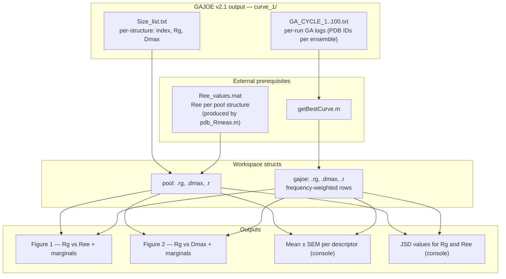
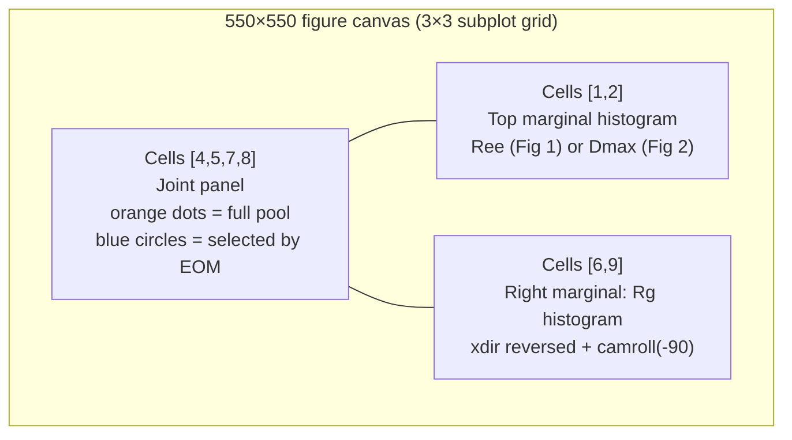
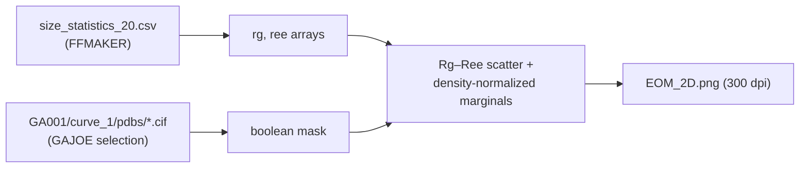
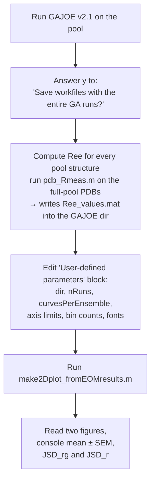

This page documents `make2Dplot_fromEOMresults.m` (repository root), the MATLAB script that visualizes how a SAXS-refined EOM ensemble deviates from the full MD conformational pool in joint two-dimensional descriptor space — **Rg vs Ree** and **Rg vs Dmax** — using joint scatter panels flanked by marginal histograms. The script also prints mean ± standard-error statistics and computes the **Jensen-Shannon divergence** between pool and ensemble distributions. A lightweight Python equivalent, `Example_tutorial/2d.py`, produces the Rg–Ree panel for the ATSAS tutorial workflow. Everything here assumes GAJOE v2.1 output has already been generated.

Sources: [make2Dplot_fromEOMresults.m](make2Dplot_fromEOMresults.m#L1-L18), [README.md](README.md#L15-L17), [Example_tutorial/2d.py](Example_tutorial/2d.py#L1-L9)

## Where This Script Sits in the Workflow

`make2Dplot_fromEOMresults.m` is the **post-GAJOE visualization stage** of the pipeline: it consumes GAJOE's raw text outputs, reconstructs which pool structures the genetic algorithm selected and how often, then overlays that frequency-weighted ensemble on the full pool. The scientific question it answers is direct: *does fitting the SAXS curve bias conformational selection toward more compact or more extended members of the pool?* The repository README states this explicitly — once GAJOE results are generated, run this script to generate the 2D comparison histogram and calculate the Jensen-Shannon divergence between the two distributions.

The script was adapted in May 2024 for GAJOE v2.1, which no longer emits a `best_curve.txt` file; the missing piece is reconstructed on the fly by the sibling function `getBestCurve.m`, covered in detail in [Best-Curve Reconstruction from GA Cycles](10-best-curve-reconstruction-from-ga-cycles).



Sources: [make2Dplot_fromEOMresults.m](make2Dplot_fromEOMresults.m#L1-L10), [README.md](README.md#L15-L17), [getBestCurve.m](getBestCurve.m#L1-L12)

## User-Defined Parameters

All configuration lives in the first code block under `%% User-defined parameters` — per the README, running either MATLAB analysis script mostly amounts to matching the paths here. The defaults are calibrated to the bundled example dataset (`ExampleData/H4_tail_WT_ff19SB_OPC/GA001/curve_1`, 100 GA runs, 20 curves per ensemble, 2000-structure pool).

| Parameter | Default | Meaning |
|---|---|---|
| `dir` | `ExampleData/H4_tail_WT_ff19SB_OPC/GA001/curve_1` | Path to a single GAJOE results directory |
| `nRuns` | `100` | Number of repeated GA runs ("Number of times you want the genetic algorithm repeated") |
| `curvesPerEnsemble` | `20` | Maximum number of curves per ensemble, as entered in GAJOE |
| `xlim_Dmax` | `[20 80]` | X-axis limits (Å) for the Dmax panel and its marginal |
| `ylim_Rg` | `[5 30]` | Y-axis limits (Å) shared by both figures' Rg axes |
| `xlim_R` | `[0 80]` | X-axis limits (Å) for the Ree panel and its marginal |
| `gajoeHistBins` | `15` | Bin count for the EOM-ensemble overlay histograms |
| `binsRg`, `binsDmax`, `binsR` | `22` each | Bin counts for the full-pool histograms and the JSD computation |
| `fontSize`, `axisFontSize` | `33`, `22` | Publication-quality label and axis tick font sizes |

Sources: [make2Dplot_fromEOMresults.m](make2Dplot_fromEOMresults.m#L13-L27), [README.md](README.md#L17)

## Input Contract: Files the Script Reads

The script binds to specific GAJOE v2.1 artifacts plus one externally generated file. Each has a strict column layout that the parsing code depends on.

| File | Producer | Content used | Parsed as |
|---|---|---|---|
| `Size_list.txt` | GAJOE (EOM pool stage) | One row per pool structure | Column 2 → `pool.rg`, column 3 → `pool.dmax` (column 1 is the structure index) |
| `Ree_values.mat` | External: `pdb_Rmeas.m` run over all full-pool PDBs | Variable `R` — end-to-end distance per structure | `pool.r = R(1:end)` |
| `GA_CYCLE_<i>.txt` | GAJOE v2.1 (requires workfiles saved) | Final-generation ensemble compositions, `-`-delimited PDB IDs | Flattened by `getBestCurve` into `[PDB number, frequency]` pairs |

The bundled example shows the `Size_list.txt` format concretely: row `1 → 9.25 → 26.79` means structure 1 has Rg = 9.25 Å and Dmax = 26.79 Å, and the file holds 2001 rows for a 2000-structure pool. A single `GA_CYCLE` file contains one ranked block of candidate ensembles (with their χ² scores) per GA generation — e.g. line `1 1) chi^2: 16.43 - ensemble: -156-359-734-792-...-` is generation 1's best ensemble, listing member PDB IDs delimited by dashes.

> [!TIP]
> The `GA_CYCLE_*.txt` files only exist if you answered **yes** to GAJOE's prompt *"Save workfiles with the entire GA runs? (default: no)"* — the default `no` will make `getBestCurve` fail with a missing-file error before any plotting begins.

Sources: [make2Dplot_fromEOMresults.m](make2Dplot_fromEOMresults.m#L30-L42), [getBestCurve.m](getBestCurve.m#L7-L27), [Size_list.txt](ExampleData/H4_tail_WT_ff19SB_OPC/GA001/curve_1/Size_list.txt#L1-L15), [GA_CYCLE_1.txt](ExampleData/H4_tail_WT_ff19SB_OPC/GA001/curve_1/GA_CYCLE_1.txt#L1-L21)

## From GA Cycles to a Weighted Ensemble Representation

The core data transformation is **frequency-weighted expansion** of the selected ensemble. `getBestCurve` returns a two-column matrix — PDB structure number and how many times the GA selected it across all runs and all final-generation candidate ensembles. The plotting script then converts each `(structure, frequency)` pair into that many identical rows of `(Dmax, Rg, Ree)` via `repmat`, producing the `gajoe` struct whose distributions reflect selection weight, not just membership:

```matlab
for n = 1:gaj
    D_Rep = repmat(Sizelist(bestcurve(n,1),3),bestcurve(n,2),1);
    Rg_Rep = repmat(Sizelist(bestcurve(n,1),2),bestcurve(n,2),1);
    R_Rep = repmat(R(bestcurve(n,1)),bestcurve(n,2),1);
    Dmax_gaj = [Dmax_gaj; D_Rep]; Rg_gaj = [Rg_gaj; Rg_Rep];
    R_gaj = [R_gaj; R_Rep];
end
gajoe.dmax = Dmax_gaj; gajoe.rg = Rg_gaj; gajoe.r = R_gaj;
```

The `pool` struct, by contrast, holds exactly one row per structure — an unweighted baseline. Every overlay in the figures and every statistical comparison (means, SEM, JSD) is therefore *weighted ensemble vs. uniform pool*.

Sources: [make2Dplot_fromEOMresults.m](make2Dplot_fromEOMresults.m#L45-L55), [getBestCurve.m](getBestCurve.m#L19-L39)

## Anatomy of the Two Figures

Both figures use a **3×3 subplot canvas trick**: the main joint panel occupies cells `[4,5,7,8]` (bottom-left 2×2 block), the top marginal histogram occupies `[1,2]`, and the right marginal occupies `[6,9]`. The right marginal is rendered horizontally then rotated into place with `set(gca,'xdir','reverse')` and `camroll(-90)`, so Rg increases outward from the joint panel. Full-pool points are drawn as MATLAB's default orange dots (`[0.8500 0.3250 0.0980]`) and EOM-selected structures as open blue circles (`[0.3010 0.7450 0.9330]`, `LineWidth` 2), with a `NorthWest` legend reading "full pool" / "selected by EOM".



The two figures differ only in the horizontal descriptor:

| Aspect | Figure 1 | Figure 2 |
|---|---|---|
| Joint panel axes | `R_ee (Å)` vs `R_g (Å)` | `D_max (Å)` vs `R_g (Å)` |
| Top marginal variable | `pool.r` / `gajoe.r` | `pool.dmax` / `gajoe.dmax` |
| Pool marginal bins | `binsR = 22` / `binsRg = 22` | `binsDmax = 22` / `binsRg = 22` |
| Ensemble overlay bins | `gajoeHistBins = 15` | `gajoeHistBins = 15` |
| Marginal normalization (Fig 1 only) | Peak-normalized: `BinCounts / max(BinCounts)` | Not normalized |

Note the normalization asymmetry: in Figure 1 the September 2025 revision peak-normalizes every marginal so pool and ensemble histograms are shape-comparable regardless of sample size, while Figure 2's marginals remain raw counts. Also, pool and ensemble overlays deliberately use different bin counts (22 vs 15), so visual overlap comparisons are qualitative.

> [!TIP]
> When adapting the axes limits (`xlim_Dmax`, `ylim_Rg`, `xlim_R`) to a new protein, recall that all three variables are reused across both figures and their marginals — a single edit re-scales the entire visualization, but values outside the limits are silently clipped from the display.

Sources: [make2Dplot_fromEOMresults.m](make2Dplot_fromEOMresults.m#L58-L111), [make2Dplot_fromEOMresults.m](make2Dplot_fromEOMresults.m#L134-L180)

## Statistical Summary Printed to the Console

After Figure 1, the script prints mean Rg, mean Ree, and the **standard error of the mean** (`std/sqrt(n)`) for both the full pool and the EOM-selected ensemble to the MATLAB command window. The equivalent Dmax block is present but commented out, and these are plain string expressions rather than formatted output — they appear as quoted character arrays on separate lines. This console summary complements the figure: the 2D panel shows *where* the ensemble shifts, the marginal shapes show *how broadly*, and the mean ± SEM quantifies whether the shift exceeds sampling noise.

Sources: [make2Dplot_fromEOMresults.m](make2Dplot_fromEOMresults.m#L116-L130)

## Built-in Jensen-Shannon Divergence

The final section quantifies the visual comparison. For each of Rg and Ree, both distributions are binned with `'Normalization','pdf'` (proper probability densities, unlike the peak-normalized display histograms), and the divergence is computed as `JSD = H(0.5·p1 + 0.5·p2) − 0.5·H(p1) − 0.5·H(p2)`, where `H` is Shannon entropy over natural log (`p.*log(p)` with NaN terms zeroed so empty bins contribute nothing). The method is credited in the comments to `plotIterativeAnalysis.m` from RNA-condensate analysis software, and was added in September 2025. Results `JSD_rg` and `JSD_r` print to the console as unsuppressed expressions.

A JSD near 0 means the SAXS-refined ensemble statistically mirrors the MD pool; larger values indicate selection bias toward specific conformational sub-populations. The full mathematical treatment, properties (bounded by `ln 2` for natural-log JSD), and interpretation guidance live in the dedicated page [Jensen-Shannon Divergence Quantification](12-jensen-shannon-divergence-quantification).

Sources: [make2Dplot_fromEOMresults.m](make2Dplot_fromEOMresults.m#L185-L234)

## The Python Alternative: `Example_tutorial/2d.py`

The tutorial folder ships a compact Python implementation of the Rg–Ree panel, designed for the 20-structure ATSAS demo rather than the large MATLAB pipeline. Its selection-identification strategy differs fundamentally from the MATLAB route: instead of reconstructing frequencies from `GA_CYCLE` logs, it globs the CIF filenames GAJOE deposited in `GA001/curve_1/pdbs/` and builds a boolean mask against the pool's filename column — so each selected structure is drawn once, unweighted. It parses FFMAKER's `size_statistics_20.csv` (fields 1, 3, and 6 in the whitespace-split line: Rg, Ree, structure filename), and asserts that every globbed selection exists in the pool file.



The figure uses a `GridSpec(2,2)` with `width_ratios=[4,1.3]`, `height_ratios=[1.3,4]` — the Pythonic analogue of the MATLAB 3×3 trick — with shared axes (`sharex`/`sharey`), coral for the pool, open dodgerblue circles for selections, `density=True` histograms over 12 `np.linspace` bins, and no console statistics or JSD.

| Capability | `make2Dplot_fromEOMresults.m` | `2d.py` |
|---|---|---|
| Panels | Rg–Ree **and** Rg–Dmax figures | Rg–Ree only |
| Selection source | `GA_CYCLE` logs via `getBestCurve` (frequency-weighted) | `pdbs/*.cif` glob (binary mask, unweighted) |
| Marginal normalization | Peak-normalized (Fig 1) / raw counts (Fig 2) | Density-normalized (`density=True`) |
| Console statistics | Mean ± SEM for Rg, Ree | Selected-structure name list + count assert |
| JSD computation | Yes (Rg and Ree) | No |
| Output | Two MATLAB figures + console | `EOM_2D.png` at 300 dpi |

Sources: [Example_tutorial/2d.py](Example_tutorial/2d.py#L8-L41), [Example_tutorial/2d.py](Example_tutorial/2d.py#L44-L107), [README.md](README.md#L100-L118)

## Running the Analysis Step by Step

The MATLAB route assumes the EOM pipeline (RANCH → FFMAKER → GAJOE, documented in [EOM Tutorial with ATSAS Tools](4-eom-tutorial-with-atsas-tools) and the deep-dive pages on [RANCH Conformational Pool Generation](6-ranch-conformational-pool-generation), [FFMAKER Theoretical SAXS Profiles](7-ffmaker-theoretical-saxs-profiles), and [GAJOE Genetic Algorithm Ensemble Fitting](8-gajoe-genetic-algorithm-ensemble-fitting)) has completed. From there:



| Symptom | Likely cause | Fix |
|---|---|---|
| Error opening `GA_CYCLE_1.txt` | Workfiles were not saved during GAJOE | Re-run GAJOE answering `y` to the save-workfiles prompt |
| Error on `load(Ree_values.mat)` | `pdb_Rmeas.m` was not run over the full pool | Generate `Ree_values.mat` first (per the script header comment) |
| Empty/scattered EOM overlay | `nRuns` / `curvesPerEnsemble` mismatch with the actual GAJOE run | Match values to what was entered at the GAJOE prompts |
| Points clipped from the panel | Data outside `xlim_Dmax` / `ylim_Rg` / `xlim_R` | Widen axis limits for the new system's descriptor ranges |
| Histograms barely overlap in scale | Pool (22) vs ensemble (15) bin counts and peak normalization | Treat marginals as shape guides; rely on JSD for quantitative comparison |

Sources: [make2Dplot_fromEOMresults.m](make2Dplot_fromEOMresults.m#L2-L8), [make2Dplot_fromEOMresults.m](make2Dplot_fromEOMresults.m#L13-L31), [getBestCurve.m](getBestCurve.m#L7-L9), [README.md](README.md#L23-L25)

## Interpreting the Output

Read the figures as a **selection-bias map**. Blue circles clustering toward one corner of the joint panel (e.g., low Rg with short Ree) means the SAXS curve preferentially selects compact members; spread across the orange cloud indicates the data cannot discriminate among pool conformers. The marginals make this univariate: a narrowed blue Rg peak versus the broad orange pool peak signals that SAXS constrains size but perhaps not shape, while concurrent narrowing in Ree and Rg marginals suggests coupled compaction. The printed SEMs tell you whether the blue mean shift is resolvable, and JSD condenses the whole comparison into one number per descriptor — compare `JSD_rg` against `JSD_r` to ask whether size or extension dominates the SAXS selection signal.

For the H4 histone tail context in which this example data was produced — and how WT vs K-to-Q charge-neutralized variants are compared with these tools — see [H4 Histone Tail Case Study](17-h4-histone-tail-case-study). Descriptor definitions and their physical meaning for IDPs are covered in [Structural Descriptors: Rg, Dmax, Ree](16-structural-descriptors-rg-dmax-ree).

Sources: [make2Dplot_fromEOMresults.m](make2Dplot_fromEOMresults.m#L58-L130), [make2Dplot_fromEOMresults.m](make2Dplot_fromEOMresults.m#L185-L234)

## Where to Go Next

- **Upstream**: [Best-Curve Reconstruction from GA Cycles](10-best-curve-reconstruction-from-ga-cycles) dissects the `getBestCurve.m` parsing logic this script calls at its start; [GAJOE Output File Reference](9-gajoe-output-file-reference) catalogs every artifact in `curve_1/` including `Size_list.txt`.
- **Downstream**: [Jensen-Shannon Divergence Quantification](12-jensen-shannon-divergence-quantification) expands on the entropy-based metric computed at the end of this script; [SAXS Fit, Kratky Plot, and Residuals](13-saxs-fit-kratky-plot-and-residuals) covers the companion script `plotEOMSAXScomparison.m` for the curve-level view.
- **Python track**: [SAXS Curve and Distribution Plots](14-saxs-curve-and-distribution-plots) documents `graph.py`, the sibling of `2d.py`; [Rg-Ree Scatter Plot with Marginals](15-rg-ree-scatter-plot-with-marginals) treats the Python figure design in depth.
