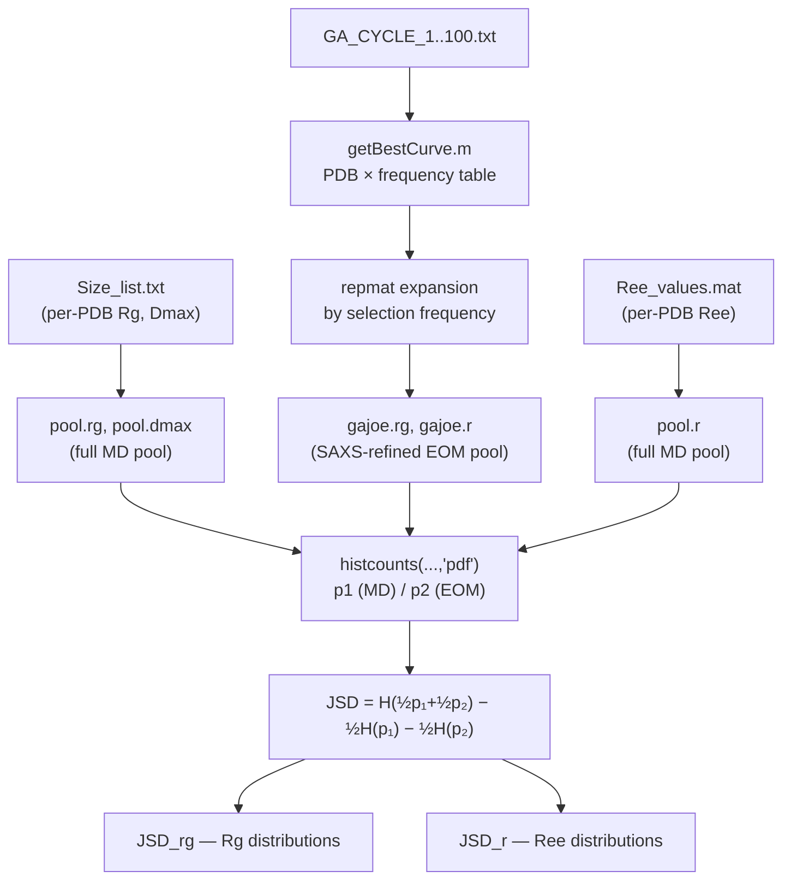
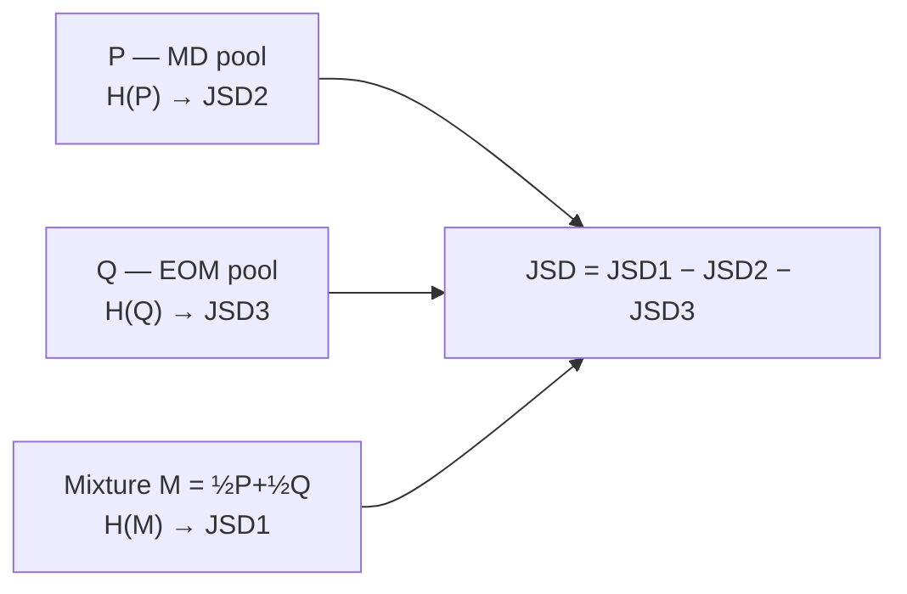

This page documents the **Jensen-Shannon divergence (JSD)** analytics stage embedded in `make2Dplot_fromEOMresults.m`, which quantifies — as a single scalar per structural descriptor — how far the SAXS-refined ensemble selected by GAJOE diverges from the full MD conformational pool. The divergence is computed independently for the **radius of gyration (Rg)** and **end-to-end distance (Ree)** distributions and printed to the MATLAB command window as `JSD_rg` and `JSD_r`. The stage was appended to the script in September 2025, with the method attributed to `plotIterativeAnalysis.m` from RNA-condensates analysis software. This page covers only the divergence mathematics, its implementation, and its numerical behavior; the visual 2D histograms produced by the same script are covered in [2D Ensemble Comparison Histograms](11-2d-ensemble-comparison-histograms).

Sources: [make2Dplot_fromEOMresults.m](make2Dplot_fromEOMresults.m#L185-L187), [README.md](README.md#L13-L14)

## Pipeline Position and Concept Map

The JSD computation is the **terminal stage** of `make2Dplot_fromEOMresults.m`: it runs after both publication figures have been rendered, reusing the same ensemble vectors (`pool.*` and `gajoe.*`) that drive the plots. Conceptually, the stage chains three transformations — ensemble construction from GA output, probability discretization via histogram binning, and a three-term entropy decomposition — producing two scalars. Note that the repository's Python utilities (`graph.py`, `2d.py`) are purely graphical and compute no divergence; MATLAB is the quantitative home of JSD in this codebase.

The `pool.*` vectors describe the entire conformational pool generated by MD, while the `gajoe.*` vectors reconstruct the *weighted* ensemble selected by the genetic algorithm — each selected structure is repeated as many times as it appears across the 100 GA runs. This weighting is what makes the divergence meaningful: it compares the **unbiased MD distribution** against the **SAXS-weighted selection**, revealing which conformational sub-populations SAXS data pulled toward.

Sources: [make2Dplot_fromEOMresults.m](make2Dplot_fromEOMresults.m#L185-L189), [make2Dplot_fromEOMresults.m](make2Dplot_fromEOMresults.m#L29-L37), [Example_tutorial/2d.py](Example_tutorial/2d.py#L1-L20)

## Mathematical Formulation

For two discretized distributions P (MD pool) and Q (EOM pool), the script computes the Jensen-Shannon divergence via the **mixture-entropy decomposition**:

$$\mathrm{JSD}(P \,\|\, Q) = H\!\left(\tfrac{1}{2}P + \tfrac{1}{2}Q\right) - \tfrac{1}{2}H(P) - \tfrac{1}{2}H(Q)$$

The code maps each term directly to named variables: `JSD1 = H(0.5.*p1 + 0.5.*p2)` is the mixture entropy, `JSD2 = 0.5.*H(p1)` and `JSD3 = 0.5.*H(p2)` are the halved component entropies, and the final value is `JSD1 - JSD2 - JSD3`. Shannon entropy itself is delegated to a local subfunction `H(p)` that returns `-sum(p.*log(p))`, with the standard convention **0·log(0) = 0** enforced by replacing `NaN` entries (MATLAB evaluates `0*log(0)` to `NaN` since `log(0) = -Inf`) before summation.

Because the entropy uses MATLAB's natural `log`, divergence values are expressed in **nats**, bounded by **[0, ln 2] ≈ [0, 0.6931]**. JSD equals 0 if and only if the two discretized distributions are identical, is symmetric in P and Q, and its square root is a true metric — properties that distinguish it from the asymmetric, unbounded KL divergence.

| Property | Value / Behavior | Basis in Code |
|---|---|---|
| Formula | H(M) − ½H(P) − ½H(Q) | `JSD1 - JSD2 - JSD3` |
| Logarithm base | e (nats) | `log` in subfunction `H` |
| Range | [0, ln 2] ≈ [0, 0.693] | natural-log bound |
| Symmetry | Symmetric in P, Q | mixture is `0.5.*p1 + 0.5.*p2` |
| Empty-bin handling | contributes 0 to entropy | `body(isnan(body)) = 0` |
| Descriptors covered | Rg and Ree only | Dmax vectors exist but no JSD block |

Sources: [make2Dplot_fromEOMresults.m](make2Dplot_fromEOMresults.m#L202-L206), [make2Dplot_fromEOMresults.m](make2Dplot_fromEOMresults.m#L221-L225), [make2Dplot_fromEOMresults.m](make2Dplot_fromEOMresults.m#L229-L234)

## Implementation Walkthrough

The stage occupies lines 185–234 and is deliberately minimal: two nearly identical blocks (one per descriptor) plus one shared subfunction. A key operational detail is the opening statement `figure('Visible','off')` — the `histogram()` calls render figures as a side effect, so the author suppresses their visibility to keep the divergence computation non-intrusive after the publication figures have already been produced. Both result variables are assigned **without a trailing semicolon** (`JSD_rg = ...`, `JSD_r = ...`), so values echo to the command window; nothing is persisted to disk automatically.

| Step | Lines | MATLAB Operation | Purpose |
|---|---|---|---|
| Suppress plotting | 189 | `figure('Visible','off')` | hide histogram side-effects |
| Discretize MD Rg | 191–192 | `histcounts(pool.rg, binsRg, 'Normalization','pdf')` | density vector p1 |
| Discretize EOM Rg | 195–196 | `histcounts(gajoe.rg, binsRg, 'Normalization','pdf')` | density vector p2 |
| Rg divergence | 202–206 | entropy decomposition | prints `JSD_rg` |
| Discretize + Ree divergence | 210–225 | same recipe with `binsR` | prints `JSD_r` |
| Entropy subfunction | 229–234 | `H = -sum(p.*log(p))` with NaN→0 | Shannon entropy, 0·log(0)=0 |

Two commented-out lines (`%mdpool = mdpool ./ max(mdpool)` and its EOM counterpart) record that **peak-normalization** was considered and abandoned in favor of `'Normalization','pdf'` — i.e., the histogram is scaled to integrate to unity rather than to peak at 1. This matters for reproducibility: switching normalization changes the absolute scale of reported values, so results from different script versions are not directly comparable.

Sources: [make2Dplot_fromEOMresults.m](make2Dplot_fromEOMresults.m#L189-L206), [make2Dplot_fromEOMresults.m](make2Dplot_fromEOMresults.m#L209-L225), [make2Dplot_fromEOMresults.m](make2Dplot_fromEOMresults.m#L193-L197)

## Inputs and Data Provenance

The divergence stage consumes four ensemble vectors assembled earlier in the same script. The full-pool descriptors come directly from GAJOE/FFMAKER output files in the results directory, while the EOM-side descriptors are *reconstructed* by expanding a PDB-number × frequency table across all 100 GA cycles — essentially resurrecting the `best_curve.txt` file that GAJOE v2 no longer emits. This reconstruction requires that GAJOE was run with **"Save workfiles with the entire GA runs" set to yes**, since the per-cycle selection files are the raw material.

| Variable | Source File | Construction |
|---|---|---|
| `pool.rg`, `pool.dmax` | `Size_list.txt` (cols 2, 3) | direct `importdata` column slice |
| `pool.r` | `Ree_values.mat` (variable `R`) | loaded from workspace file |
| `gajoe.rg`, `gajoe.r` | `GA_CYCLE_1..100.txt` via `getBestCurve` | `repmat` each PDB's descriptor by its GA selection frequency |

`getBestCurve` parses each cycle file with a `'-'` delimiter, keeps the last `curvesPerEnsemble` rows (the selected structures), flattens all 100 cycles into one list, and tabulates occurrence frequencies into the two-column `[PDBnum, frequency]` matrix. Because frequencies accumulate over `nRuns = 100` independent GA runs, the EOM distribution is effectively a **consensus ensemble** — a structure selected in many cycles contributes many copies, sharpening the corresponding histogram peaks and lowering entropy relative to a single-run selection.

Sources: [make2Dplot_fromEOMresults.m](make2Dplot_fromEOMresults.m#L13-L25), [make2Dplot_fromEOMresults.m](make2Dplot_fromEOMresults.m#L31-L37), [make2Dplot_fromEOMresults.m](make2Dplot_fromEOMresults.m#L42-L55), [getBestCurve.m](getBestCurve.m#L21-L29), [getBestCurve.m](getBestCurve.m#L31-L41)

For the full mechanics of that reconstruction, see [Best-Curve Reconstruction from GA Cycles](10-best-curve-reconstruction-from-ga-cycles); for how GA cycles are produced, see [GAJOE Genetic Algorithm Ensemble Fitting](8-gajoe-genetic-algorithm-ensemble-fitting).

## Bin Configuration and Numerical Behavior

Bin settings are the dominant tunable of this stage, and the script uses **different bin counts for plotting versus divergence**. The rendered marginal histograms use `binsRg`/`binsDmax`/`binsR` = 22 for the full pool but `gajoeHistBins` = 15 for the EOM ensemble; the JSD stage, however, recomputes both distributions from raw vectors with the *same* count (`binsRg` = 22 for Rg, `binsR` = 22 for Ree) — it does not reuse the plotted histograms. Any change to these user parameters at the top of the script silently alters reported divergence values.

| Context | MD Pool Bins | EOM Pool Bins | Normalization |
|---|---|---|---|
| Plotted marginals (first figure) | 22 (`binsR`) | 15 (`gajoeHistBins`) | peak-normalized (BinCounts/max) |
| Plotted marginals (second figure) | 22 (`binsRg`/`binsDmax`) | 15 (`gajoeHistBins`) | raw counts |
| **JSD computation (Rg)** | **22 (`binsRg`)** | **22 (`binsRg`)** | `'pdf'` (integrates to 1) |
| **JSD computation (Ree)** | **22 (`binsR`)** | **22 (`binsR`)** | `'pdf'` (integrates to 1) |

> [!TIP]
> `histcounts(x, nbins)` derives bin edges from each array's **own min–max range**, so `p1` and `p2` are evaluated on different grids: the element-wise mixture `0.5.*p1 + 0.5.*p2` implicitly assumes bin alignment that is not guaranteed. For rigorous cross-ensemble comparisons, compute shared edges first (e.g., `edges = linspace(min([pool.rg; gajoe.rg]), max([pool.rg; gajoe.rg]), binsRg+1))` and call `histcounts(x, edges, 'Normalization','pdf')` for both vectors.

> [!TIP]
> The `'pdf'` normalization makes bin heights integrate to 1 (Σp·Δ = 1), but the entropy sum uses the heights directly as probability masses. Reported JSD values are therefore best treated as **relative comparators under a fixed binning recipe** — consistent across runs of this script — rather than absolute entropies; magnitude depends on the chosen bin count and descriptor ranges.

Sources: [make2Dplot_fromEOMresults.m](make2Dplot_fromEOMresults.m#L12-L25), [make2Dplot_fromEOMresults.m](make2Dplot_fromEOMresults.m#L190-L197)

## Interpreting JSD_rg and JSD_r

The two printed scalars answer complementary questions about the SAXS-driven selection. `JSD_rg` measures how much compactness (Rg) was redistributed by fitting to SAXS data, while `JSD_r` measures redistribution of chain extension (Ree); for the H4 histone-tail case study, shifts in these descriptors encode the charge-driven conformational changes the pipeline was built to detect. The script additionally prints mean ± standard error for both descriptors of both ensembles immediately after the first figure, giving the directional context (which ensemble is more compact/extended) that a raw JSD lacks.

| Observation | Likely Interpretation | Suggested Action |
|---|---|---|
| JSD ≈ 0 | EOM ensemble statistically indistinguishable from MD pool | selection not driven by this descriptor; check the other one |
| 0 < JSD ≪ ln 2 | partial sub-population shift | compare printed means to identify direction |
| JSD approaching ln 2 (0.693) | distribution supports nearly disjoint | inspect axes limits and bin overlap; verify pool completeness |
| Value shifts when bins changed | resolution-dependent estimate | fix one binning recipe for all reported comparisons |

Because results are command-window output only, a reproducible workflow should capture them manually or add a semicolon plus explicit logging (e.g., writing `[JSD_rg JSD_r]` to a results file) before scaling the analysis across multiple GA result folders such as `GA001`, `GA002`, …

Sources: [make2Dplot_fromEOMresults.m](make2Dplot_fromEOMresults.m#L109-L128), [make2Dplot_fromEOMresults.m](make2Dplot_fromEOMresults.m#L202-L206), [make2Dplot_fromEOMresults.m](make2Dplot_fromEOMresults.m#L221-L225)

## Where to Go Next

Within the MATLAB analysis track, the natural continuation is the SAXS-facing half of the validation: [SAXS Fit, Kratky Plot, and Residuals](13-saxs-fit-kratky-plot-and-residuals) visualizes *how well* the selected ensemble fits the experimental profile whose selection pressure produced the divergence you just quantified. For the structural-theory background behind the Rg/Ree descriptors being compared, see [Structural Descriptors: Rg, Dmax, Ree](16-structural-descriptors-rg-dmax-ree); for the upstream GA machinery that defines the EOM ensemble, see [GAJOE Genetic Algorithm Ensemble Fitting](8-gajoe-genetic-algorithm-ensemble-fitting) and its companion [GAJOE Output File Reference](9-gajoe-output-file-reference).
