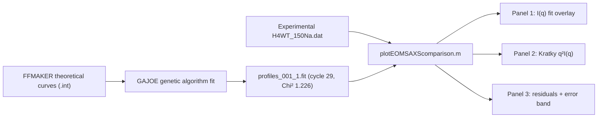
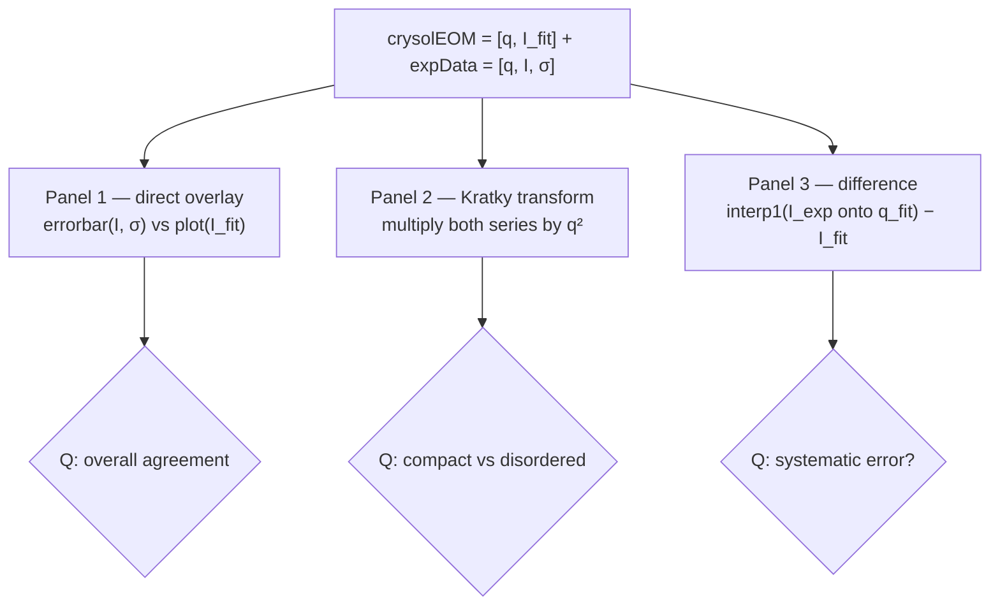
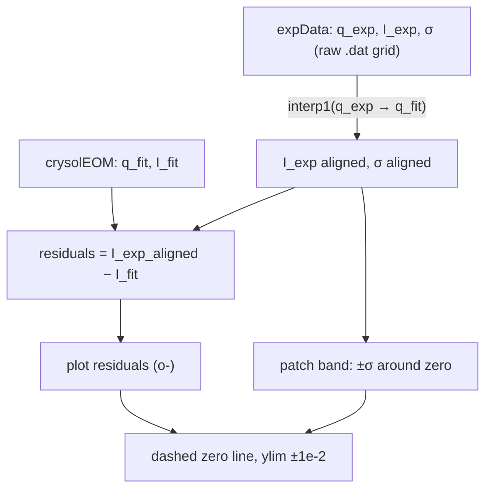

This page documents `plotEOMSAXScomparison.m`, the terminal visualization stage of the MATLAB analysis chain. The script produces a three-panel figure suite that answers a single question from three angles: **how well does the GAJOE-optimized ensemble reproduce the experimental SAXS curve of the H4 histone tail?** Panel 1 overlays the fitted ensemble intensity on the raw experiment, Panel 2 recasts both into Kratky form to expose conformational character (compact vs. disordered), and Panel 3 plots point-wise residuals against the experimental error band. It is a self-contained plotting script — no fitting, no computation of ensemble statistics — intended to be run after GAJOE fitting is complete.

Sources: [plotEOMSAXScomparison.m](plotEOMSAXScomparison.m#L1-L16), [plotEOMSAXScomparison.m](plotEOMSAXScomparison.m#L25-L97)

## Position in the Analysis Pipeline

The script sits at the end of the EOM pipeline and depends on exactly two artifacts: the `.fit` file written by GAJOE during the genetic-algorithm fit (containing the best cycle's reconstructed ensemble profile), and the original experimental scattering data in `SAXSData/`. Everything the script draws is derived from these two files — it performs no IO beyond `readmatrix` and no numerical fitting of its own. The `.fit` file consumed here is the same artifact catalogued in the [GAJOE Output File Reference](9-gajoe-output-file-reference), and its content traces back through the fitting described in [GAJOE Genetic Algorithm Ensemble Fitting](8-gajoe-genetic-algorithm-ensemble-fitting).

Sources: [plotEOMSAXScomparison.m](plotEOMSAXScomparison.m#L9-L16), [profiles_001_1.fit](ExampleData/H4_tail_WT_ff19SB_OPC/GA001/curve_1/profiles_001_1.fit#L1), [SAXSData/H4WT_150Na.dat](SAXSData/H4WT_150Na.dat#L1-L5)

## Input Contract: Two Files, Four Columns Each

The script's entire data model rests on two `readmatrix` calls with strict header-skipping rules. The experimental file `H4WT_150Na.dat` uses 4 header lines (a `### DATA` banner, blank comment lines, and the `Q, I(Q), Error` column legend), after which follow 53 whitespace-separated data rows. The GAJOE output `profiles_001_1.fit` uses exactly 1 header line — a summary line reporting `CYCLE: 29`, `Chi^2: 1.226`, `GENER.: 1000`, `ENSEMBLES: 50`, `CURVES: 9` — followed by 4 numeric columns: q, experimental intensity, experimental error, and fitted ensemble intensity.

| File | Path | Header lines | Column 1 | Column 2 | Column 3 | Column 4 |
|---|---|---|---|---|---|---|
| Experimental | `SAXSData/H4WT_150Na.dat` | 4 | q (Å⁻¹) | I(q) | σ(q) | — |
| GAJOE fit | `ExampleData/.../GA001/curve_1/profiles_001_1.fit` | 1 | q (Å⁻¹) | I_exp(q) | error (≈1e-17) | I_fit(q) |

The critical mapping happens on line 28: `crysolEOM = [fitFile(:,1), fitFile(:,4)]` — the script binds **column 4** (the fitted ensemble profile), *not* column 2 (which merely echoes the experimental intensity into the `.fit` file for convenience). Everything downstream is drawn from this two-column `crysolEOM` matrix.

Sources: [plotEOMSAXScomparison.m](plotEOMSAXScomparison.m#L15-L16), [plotEOMSAXScomparison.m](plotEOMSAXScomparison.m#L27-L28), [SAXSData/H4WT_150Na.dat](SAXSData/H4WT_150Na.dat#L1-L5), [profiles_001_1.fit](ExampleData/H4_tail_WT_ff19SB_OPC/GA001/curve_1/profiles_001_1.fit#L1-L2)

> [!TIP]
> The `.fit` file's third column (experimental error) contains near-zero values on the order of 1e-17 — visible in the raw file as `1.552584e-017`, `3.479447e-018`, etc. This is why the script **ignores that column entirely** and, for the residual panel's error band, re-derives σ(q) from the original `SAXSData/*.dat` file via interpolation. If you adapt this script to new data, never feed `fitFile(:,3)` into the error band: GAJOE's error column in `.fit` output is not the experimental uncertainty you want to plot.

## The Three Diagnostic Panels

The script generates one standalone figure and one stacked two-subplot figure. Each panel applies a different mathematical transform to the *same* two-column data, and each answers a distinct diagnostic question:

| Panel | Transform applied | Figure layout | Question answered |
|---|---|---|---|
| Fit overlay | none — raw I(q) vs q | Standalone `figure` | Does the ensemble curve track the experiment over the measured q-range? |
| Kratky plot | I(q) → q²·I(q) | `subplot(2,1,1)` | Does the ensemble show globular (bell-shaped) or disordered (rising/plateau) behavior? |
| Residuals | I_exp − I_fit at matched q | `subplot(2,1,2)` | Are deviations structured (systematic) or confined to the noise level? |

Sources: [plotEOMSAXScomparison.m](plotEOMSAXScomparison.m#L25-L28), [plotEOMSAXScomparison.m](plotEOMSAXScomparison.m#L47-L48), [plotEOMSAXScomparison.m](plotEOMSAXScomparison.m#L66-L67)

### Panel 1 — SAXS Fit Overlay

The first figure plots the experimental data as gray symmetric error bars (`errorbar(expData(:,1), expData(:,2), expData(:,3))`, where column 3 of the `.dat` file supplies σ) with the GAJOE ensemble profile as a thick line in a user-selected accent color (orange `[238 68 0]/255` for H4WT; a commented-out navy alternative exists for H4KQ). Both series share the same q-axis, clipped to `xlim_SAXS = [0 0.3]`. The legend distinguishes `SAXS experiment` from `EOM ensemble`, and axis labels use MATLAB's LaTeX interpreter for proper Å⁻¹ typesetting.

One caveat is stated in the script's own header comment: the scale factors between experiment and fit are purely visual — GAJOE's fitted scaling constants live in the `EOMfitScaling` RAW workspace and are **not** re-applied here. Any vertical offset between the two curves in this panel is a display artifact of GAJOE's internal normalization, not a physical discrepancy.

Sources: [plotEOMSAXScomparison.m](plotEOMSAXScomparison.m#L4-L6), [plotEOMSAXScomparison.m](plotEOMSAXScomparison.m#L11-L13), [plotEOMSAXScomparison.m](plotEOMSAXScomparison.m#L30-L45)

### Panel 2 — Kratky Plot (q²I(q) vs q)

The upper subplot of the stacked figure applies the conventional Kratky transform: both the experimental and fitted series are multiplied point-wise by q² (`expData(:,1).^2.*expData(:,2)` and `crysolEOM(:,1).^2.*crysolEOM(:,2)`). Crucially, the experimental error bars are transformed identically — σ becomes q²·σ — so the uncertainty envelope widens with q rather than staying flat, correctly representing how noise propagates under the Kratky weighting. The q-range and accent color are inherited unchanged from Panel 1.

Interpretively, this transform is the diagnostic heart of the workflow for intrinsically disordered proteins. A compact, globular particle produces a bell-shaped Kratky peak that decays toward the baseline, while a flexible/disordered chain yields a monotonic rise or extended plateau at high q. Agreement between the gray experimental Kratky curve and the orange ensemble Kratky curve in this representation is much more discriminating than the raw I(q) overlay, because q²-weighting amplifies exactly the mid-to-high-q region where conformational differences manifest.

Sources: [plotEOMSAXScomparison.m](plotEOMSAXScomparison.m#L47-L64), [plotEOMSAXScomparison.m](plotEOMSAXScomparison.m#L59-L60)

### Panel 3 — Residuals with Error Band

The lower subplot quantifies fit quality as the point-wise difference `I_exp − I_theor`, and its construction involves a subtle but important alignment step: the two input files sit on **different q-grids**, so the script interpolates the experimental intensity and its errors onto the theoretical curve's grid before subtracting. The residual is then drawn as a connected dot sequence, a gray semi-transparent `patch` band shows the ±σ(q) envelope around zero, and a thick black dashed line marks the zero level. The vertical window is fixed at `ylim_residuals = [-1E-2 1E-2]`.

Sources: [plotEOMSAXScomparison.m](plotEOMSAXScomparison.m#L66-L83), [plotEOMSAXScomparison.m](plotEOMSAXScomparison.m#L86-L97)

> [!TIP]
> Note the interpolation *direction*: the experimental data is resampled onto the theoretical grid (`interp1(expData(:,1), expData(:,2), xPoints_crysol)`), never the reverse. This guarantees residuals are evaluated exactly at the q-positions where GAJOE's ensemble profile is defined, and it also means the residual count equals the number of rows in the `.fit` file, not the `.dat` file. Additionally, line 86 zeroes out any `NaN` produced by extrapolation beyond the experimental q-range — `expErrs_interp_crysol(isnan(expErrs_interp_crysol)) = 0` — so the error band does not collapse or crash when the theoretical grid extends past the measured data.

## Configuration Surface

The script's customization points are deliberately minimal — a folder path, a color triple, and two axis-limit vectors — making it straightforward to repoint at a different force field's GA run or the H4KQ variant:

| Parameter | Default | Purpose | Adaptation example |
|---|---|---|---|
| `folder` | `ExampleData/H4_tail_WT_ff19SB_OPC/GA001/curve_1` | Location of the GAJOE `.fit` output | Point at a different `GA00X/curve_Y` run directory |
| `theColour` | `[238 68 0]/255` (orange, H4WT) | Accent color for fit curve and residuals | Switch to the commented `[46 80 122]/255` navy for H4KQ |
| `expData` filename | `SAXSData/H4WT_150Na.dat` | Raw experimental profile with σ | Swap to `H4KQ_150Na.dat` for the mutant |
| `xlim_SAXS` | `[0 0.3]` Å⁻¹ | Shared q-window across all panels | Widen/narrow to focus on a q-region of interest |
| `ylim_residuals` | `[-1E-2 1E-2]` | Fixed vertical scale for the residual panel | Adjust to the noise magnitude of your detector |

Sources: [plotEOMSAXScomparison.m](plotEOMSAXScomparison.m#L8-L20), [SAXSData/H4KQ_150Na.dat](SAXSData/H4KQ_150Na.dat#L1)

## Interpreting the Output

Reading the three panels together yields a compact fit-quality verdict. A sound ensemble fit shows the orange I_fit curve threading the gray error bars in Panel 1, matching Kratky behavior in Panel 2, and — most tellingly — residuals in Panel 3 that scatter *within* the gray ±σ band with no long-wavelength structure. Systematic, slowly-varying residual excursions outside the band (rather than white noise) indicate the ensemble is missing a conformational population — e.g., insufficient compaction or extension sampling in the RANCH pool, which is the input concern governed by [RANCH Conformational Pool Generation](6-ranch-conformational-pool-generation). The reported `Chi^2: 1.226` in the `.fit` header (cycle 29 of 100 GA cycles) provides the scalar companion to these visual diagnostics; how that best cycle is selected from the full GA trajectory is covered in [Best-Curve Reconstruction from GA Cycles](10-best-curve-reconstruction-from-ga-cycles).

Sources: [plotEOMSAXScomparison.m](plotEOMSAXScomparison.m#L76-L95), [profiles_001_1.fit](ExampleData/H4_tail_WT_ff19SB_OPC/GA001/curve_1/profiles_001_1.fit#L1)

## Where to Go Next

This page closes the MATLAB analysis loop: inputs come from GAJOE fitting, and the outputs are purely visual. To understand how `profiles_001_1.fit` was produced, proceed to [GAJOE Genetic Algorithm Ensemble Fitting](8-gajoe-genetic-algorithm-ensemble-fitting) and the [GAJOE Output File Reference](9-gajoe-output-file-reference). To see how the best cycle feeding this `.fit` file was reconstructed from `GA_CYCLE_*.txt` logs, read [Best-Curve Reconstruction from GA Cycles](10-best-curve-reconstruction-from-ga-cycles). For a Python-based companion that plots experimental curves and derived distributions, see [SAXS Curve and Distribution Plots](14-saxs-curve-and-distribution-plots); the biological interpretation of the H4WT vs. H4KQ comparison this script supports is developed in [H4 Histone Tail Case Study](17-h4-histone-tail-case-study).
