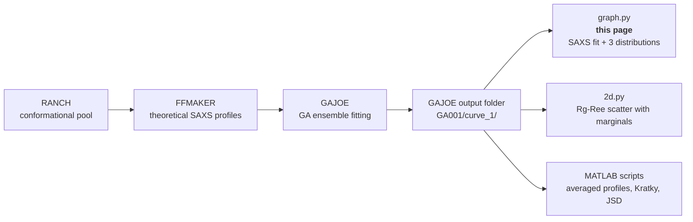
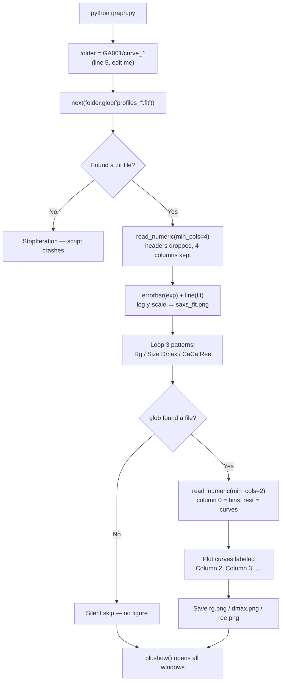

`graph.py` is the Python plotting utility that transforms a completed GAJOE fit into four publication-ready figures: one **SAXS fit overlay** (experimental data vs. genetic-algorithm ensemble fit) and three **structural distribution plots** (R<sub>g</sub>, D<sub>max</sub>, R<sub>ee</sub>). The script is deliberately minimal — roughly 60 lines, two dependencies, one editable path — making it an ideal first step for beginners who want to visually inspect EOM results before deeper quantitative analysis. This page explains what the script reads, how it parses GAJOE's mixed text/numeric files, how each figure is constructed, and how to customize or troubleshoot it.

This page covers only `graph.py`. Its sibling script `2d.py` (the R<sub>g</sub>–R<sub>ee</sub> scatter plot) is documented in [Rg-Ree Scatter Plot with Marginals](15-rg-ree-scatter-plot-with-marginals), and the underlying GAJOE fitting process is covered in [GAJOE Genetic Algorithm Ensemble Fitting](8-gajoe-genetic-algorithm-ensemble-fitting).

Sources: [graph.py](Example_tutorial/graph.py#L1-L62), [README.md](README.md#L100-L118)

## Where graph.py Fits in the EOM Workflow

In the repository's tutorial, `graph.py` is invoked at **step 4 ("Plot the results")**, after the three-step ATSAS chain (RANCH → FFMAKER → GAJOE) has produced a `GA001` output folder. The script consumes GAJOE's output files directly — it never touches the raw MD pool or the experimental `.dat` file again — so it can be re-run instantly after any new GAJOE fit. This makes it the fastest feedback loop in the pipeline: change GAJOE parameters, re-fit, re-plot.



The MATLAB scripts `plotEOMSAXScomparison.m` and `make2Dplot_fromEOMresults.m` operate on the same GAJOE outputs but serve deeper analysis (ensemble-averaged profiles, Kratky plots, Jensen-Shannon divergence) — those are covered in [SAXS Fit, Kratky Plot, and Residuals](13-saxs-fit-kratky-plot-and-residuals) and [2D Ensemble Comparison Histograms](11-2d-ensemble-comparison-histograms).

Sources: [README.md](README.md#L100-L118), [graph.py](Example_tutorial/graph.py#L5-L5)

## Dependencies and Setup

The script requires only `numpy` and `matplotlib` from PyPI, plus `pathlib` from the standard library. Installation and execution are two commands:

| Item | Value | Notes |
|---|---|---|
| Language | Python 3 | Standard-library `pathlib` for file discovery |
| Third-party packages | `numpy`, `matplotlib` | `pip install numpy matplotlib` |
| User-editable setting | `folder = Path("GA001/curve_1")` (line 5) | Must point at your GAJOE output directory |
| Run context | From the directory containing `GA001/` | The path in line 5 is **relative** |

Note the single configuration point: line 5 hard-codes the GAJOE output location as a relative path. The README instructs you to "set the GAJOE output directory in both scripts" before running — this is the line to edit. If you followed the tutorial and ran GAJOE inside `Example_tutorial/`, the default value already works.

Sources: [graph.py](Example_tutorial/graph.py#L1-L5), [README.md](README.md#L102-L113)

## Inputs: The Four GAJOE Files It Reads

The script discovers its inputs by **glob patterns** rather than fixed filenames, so it adapts to GAJOE's numbered output naming (`profiles_001_1.fit`, `Rg_distr_001_1.dat`, …). Four patterns drive the entire script:

| Glob pattern (line 40–43 / 24) | Physical quantity | X-axis label | Output figure |
|---|---|---|---|
| `profiles_*.fit` | Experimental I(q) + fitted ensemble I(q) | q (Å⁻¹) vs. I(q), log scale | `saxs_fit.png` |
| `Rg_distr_*.dat` | Radius of gyration distribution | R<sub>g</sub> (Å) | `rg.png` |
| `Size_distr_*.dat` | Maximum particle dimension distribution | D<sub>max</sub> (Å) | `dmax.png` |
| `CaCa_distr_*.dat` | End-to-end (Cα–Cα) distance distribution | R<sub>ee</sub> (Å) | `ree.png` |

Understanding the two file formats explains everything the script does:

**The `.fit` file** starts with a one-line text header — `CYCLE: 29  Chi^2: 1.226  GENER.:1000  ENSEMBLES: 50  CURVES: 9` — followed by rows of four numeric columns: q (Å⁻¹), experimental I(q), experimental error, and the fitted I(q). The script's parser skips the header automatically and reads columns 1–4 in that order.

**The distribution files** carry five header lines (average R<sub>g</sub> of the ensemble vs. pool, plus a column legend) followed by a value/frequency matrix: column 1 holds bin values, and each subsequent column is a frequency curve — typically **Pool freq.** (the full RANCH pool) and **Sel. freq.** (the GAJOE-selected ensemble). Comparing these two curves is the entire point of the distribution plots: it shows which region of conformational space the genetic algorithm promoted.

Sources: [graph.py](Example_tutorial/graph.py#L24-L44), [profiles_001_1.fit](ExampleData/H4_tail_WT_ff19SB_OPC/GA001/curve_1/profiles_001_1.fit#L1-L4), [Rg_distr_001_1.txt](ExampleData/H4_tail_WT_ff19SB_OPC/GA001/curve_1/Rg_distr_001_1.txt#L1-L9), [README.md](README.md#L91-L98)

## The Tolerant Numeric Parser: `read_numeric`

GAJOE output files mix descriptive text headers with whitespace-separated numeric bodies, so the script's first building block is a **forgiving parser** (lines 7–21) instead of `numpy.loadtxt`. Its logic, line by line:

1. **Split lines and tokenize** — each line is split on whitespace, with commas first replaced by spaces (line 11), handling both `1.5, 2.3` and `1.5  2.3` styles.
2. **Skip anything non-numeric** — a `ValueError` during float conversion causes the line to be silently dropped via `continue` (lines 12–13). This is precisely how the five-line R<sub>g</sub> header and the `CYCLE:` header vanish without special-casing.
3. **Enforce a minimum column count** — `min_cols` (3 for distributions, 4 for the fit) rejects truncated lines (line 14).
4. **Rectangularize the array** — rows are truncated to the *minimum* column count found across all rows (`ncols = min(map(len, rows))`, line 20), guaranteeing a clean rectangular NumPy array even when GAJOE files have ragged columns.
5. **Fail loudly on empty input** — if nothing numeric survived, a descriptive `ValueError` names the offending file (lines 17–18).

For a beginner, the takeaway is that this parser lets the rest of the script treat GAJOE files as plain matrices: `data[:, :4]` slices the fit file into `q, exp, err, fit` with a single unpacking line (line 27).

Sources: [graph.py](Example_tutorial/graph.py#L7-L27)

## Module 1: The SAXS Fit Plot (lines 23–37)

The first module visualizes **how well the selected ensemble reproduces the experiment** — the central quality check of the entire EOM workflow. The sequence is compact:

```python
f = next(folder.glob("profiles_*.fit"))       # first matching .fit file
data = read_numeric(f, min_cols=4)            # header skipped inside parser
q, exp, err, fit = data[:, :4].T              # transpose → four 1-D arrays
```

Plot construction follows standard scatter-fit conventions: experimental points as `errorbar` (dot markers with y-error bars), the GAJOE fit as a connected line, and — critically for SAXS — a **logarithmic y-axis** (`plt.yscale("log")`), because scattering intensity decays over several orders of magnitude and linear axes would crush the high-q region where structural detail lives. The figure is saved as `saxs_fit.png` at 300 dpi (print quality) after `tight_layout()` trims whitespace.

> [!TIP]
> The header of the `.fit` file is where GAJOE records fit quality — in the bundled example, `Chi^2: 1.226` at `CYCLE: 29` ([profiles_001_1.fit](ExampleData/H4_tail_WT_ff19SB_OPC/GA001/curve_1/profiles_001_1.fit#L1)) — but `graph.py` discards it during parsing. After plotting, always open the `.fit` file's first line yourself to record the χ² of the curve you are looking at, and remember that `next(folder.glob(...))` plots only the *first* matching profile when multiple GA runs exist.

Sources: [graph.py](Example_tutorial/graph.py#L23-L37)

## Module 2: The Structural Distribution Plots (lines 39–59)

The second module is a **table-driven loop**: a list of `(pattern, xlabel, output)` tuples defines all three distribution figures, and the loop body is shared. This is the pattern to study if you want to add a fourth distribution (for example `Volume_distr_*.dat`, which exists in the bundled example data but is not plotted):

```python
for pattern, xlabel, output in [
    ("Rg_distr_*.dat",   r"$R_g$ ($\AA$)",   "rg.png"),
    ("Size_distr_*.dat", r"$D_{max}$ ($\AA$)", "dmax.png"),
    ("CaCa_distr_*.dat", r"$R_{ee}$ ($\AA$)", "ree.png"),
]:
```

For each match, column 0 becomes the x-axis (the bin values in Å) and **every remaining column is plotted as a separate curve** (lines 52–53), labeled generically as `Column 2`, `Column 3`, … In the bundled example, that means two curves per figure — the full pool distribution and the GA-selected ensemble distribution. Their visual comparison answers the scientific question directly: for the H4 tail example, the selected ensemble's average R<sub>g</sub> (15.27 Å) exceeds the pool's (13.77 Å), so the `Sel. freq.` curve visibly shifts right relative to `Pool freq.` — SAXS selection favors extended conformations.

> [!TIP]
> The glob patterns expect the `.dat` extension, but GAJOE outputs documented in the README (and the files bundled in `ExampleData/`) use `.txt` — e.g. `Rg_distr_001_1.txt`. Because the loop silently `continue`s when no file matches (line 47), you get **no error, just three missing figures**. If your distributions don't appear, change the patterns to `*.txt` or rename the files.

Sources: [graph.py](Example_tutorial/graph.py#L39-L59), [Rg_distr_001_1.txt](ExampleData/H4_tail_WT_ff19SB_OPC/GA001/curve_1/Rg_distr_001_1.txt#L1-L5), [README.md](README.md#L94-L96)

## Execution Flow, Start to Finish

The complete runtime behavior — including the failure branches beginners encounter first — is summarized below:



Sources: [graph.py](Example_tutorial/graph.py#L5-L61)

## Customization Quick Reference

| What to change | Where (line) | Why / effect |
|---|---|---|
| GAJOE output directory | 5 | Point at `GA002`, another protein's run, or an absolute path |
| Distribution file extension | 40–43 | `*.dat` → `*.txt` if your GAJOE writes `.txt` outputs |
| Add a fourth distribution | 40–44 | Add e.g. `("Volume_distr_*.dat", r"Volume", "vol.png")` |
| Curve labels | 53 | Replace generic `Column {j+1}` with `Pool` / `Selected` for readability |
| Fit selection among multiple runs | 24 | `sorted(folder.glob(...))[0]` or explicit filename for reproducibility |
| Figure resolution | 37, 59 | `dpi=300` is print-ready; lower for quick drafts |

Sources: [graph.py](Example_tutorial/graph.py#L5-L59)

## Troubleshooting for Beginners

| Symptom | Root cause | Fix |
|---|---|---|
| `StopIteration` traceback immediately on start | No `profiles_*.fit` under `folder` — wrong relative path or script run from the wrong directory | Edit line 5 to the correct path; run from a directory that actually contains `GA001/` |
| SAXS fit appears, but no `rg.png` / `dmax.png` / `ree.png` | Extension mismatch: script globs `*.dat`, files are `.txt` (default silent skip) | Change glob patterns on lines 40–43, or rename files |
| `ValueError: No numeric data found in …` | File matched the glob but contains no parseable numeric rows | Verify the file is a GAJOE output and not empty |
| "Column 2"/"Column 3" labels are confusing | Generic auto-labels for each frequency column | Patch line 53 with meaningful names; for the standard two-column case these are Pool and Selected frequencies |
| Fit curve looks different from a colleague's plot | `next(glob)` picked a different cycle's `.fit` when several exist | List `folder.glob("profiles_*.fit")` first and select explicitly |

Sources: [graph.py](Example_tutorial/graph.py#L24-L47)

## Next Steps

With your four figures in hand, the natural progression through this repository is: study what each GAJOE output file contains in [GAJOE Output File Reference](9-gajoe-output-file-reference), then move to the sibling Python script [Rg-Ree Scatter Plot with Marginals](15-rg-ree-scatter-plot-with-marginals) to see how selected conformations compare against the full pool in 2D, and finally graduate to the MATLAB quantitative tools in [SAXS Fit, Kratky Plot, and Residuals](13-saxs-fit-kratky-plot-and-residuals) — which extend the fit visualization shown here with Kratky plots and residual analysis. To see these plots applied to real scientific conclusions, continue to the [H4 Histone Tail Case Study](17-h4-histone-tail-case-study).
