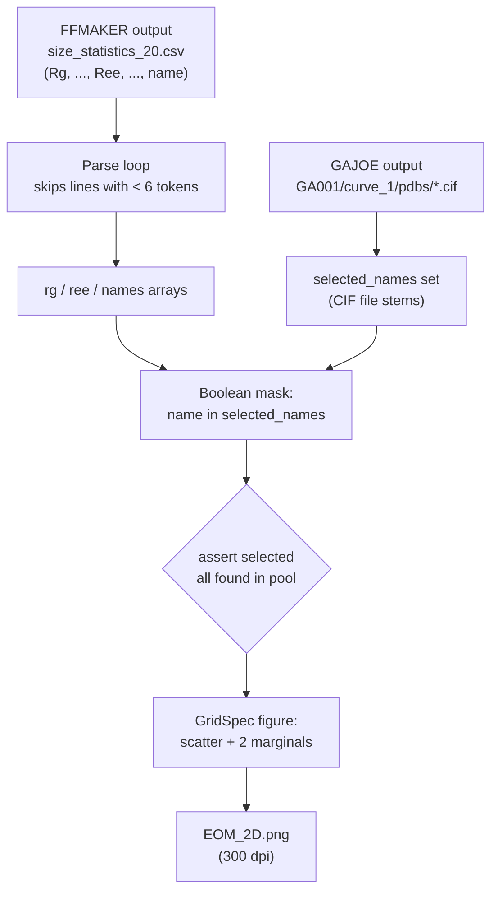

This page documents `Example_tutorial/2d.py`, the Python script that produces the repository's two-dimensional structural ensemble view: a scatter plot of radius of gyration ($R_g$) versus end-to-end distance ($R_{ee}$), decorated with marginal histograms. The plot answers a single, important question visually: *where in conformational space did the EOM genetic algorithm (GAJOE) pick its structures from, compared to the full generated pool?* You only need `numpy` and `matplotlib` to run it — no SAXS knowledge or ATSAS installation is required for this step.

Sources: [README.md](README.md#L115-L116), [2d.py](Example_tutorial/2d.py#L2-L5)

## What the Plot Shows and Why It Matters

In ensemble-optimization analysis, you start with a large pool of random conformations and let GAJOE select a small SAXS-consistent subset. If the selection is meaningful, the selected structures should *not* look like a random sample of the pool — they should cluster in a specific region of structural space. The scatter plot makes this visible in two dimensions at once: $R_{ee}$ (how stretched the chain is, x-axis) and $R_g$ (how compact it is, y-axis). The two marginal histograms then collapse each dimension separately, showing the distribution of each quantity alone — a standard joint-plot pattern that lets you judge both the correlation and the individual distributions in one figure.

Sources: [2d.py](Example_tutorial/2d.py#L58-L71), [2d.py](Example_tutorial/2d.py#L77-L95)

The script distinguishes two groups in the same figure:

| Group | Source of truth | Visual encoding |
|---|---|---|
| **Full pool** | Every row of the FFMAKER size-statistics file | Small solid coral dots (`s=20`, `alpha=0.7`) |
| **Selected by EOM** | CIF files in the GAJOE output `pdbs/` folder | Larger open circles with dodgerblue edges (`s=65`, `linewidths=1.5`) |

Sources: [2d.py](Example_tutorial/2d.py#L59-L71)

## Where the Data Comes From and How It Is Joined

The script consumes exactly two inputs, both configured as `pathlib.Path` objects near the top of the file. The first is `size_statistics_20.csv`, produced by FFMAKER, which stores one row per pool conformation with its structural properties ($R_g$, $D_{max}$, $R_{ee}$, volume, and the file name). The second is the GAJOE results directory `GA001/curve_1/pdbs/`, which contains the CIF structures GAJOE chose for the fitted ensemble.

Sources: [2d.py](Example_tutorial/2d.py#L7-L9), [README.md](README.md#L52-L58)

The parser reads this whitespace-separated file defensively: lines with fewer than six tokens (blank lines, headers) are skipped, column 0 becomes $R_g$, column 2 becomes $R_{ee}$, and column 5 is converted to a bare file name via `Path(p[5]).stem`. The "join" between the two data sources happens through these names: the script builds a set of stems from every `*.cif` file in the `pdbs/` folder and computes a boolean `mask` marking which pool rows were selected.

Sources: [2d.py](Example_tutorial/2d.py#L14-L34)

Before plotting, the script runs a lightweight integrity audit: it prints the pool size, the number of selected structures, and their names, then asserts that every selected CIF was actually found in the pool statistics. This assertion is your first line of defense against silent data mismatches.

Sources: [2d.py](Example_tutorial/2d.py#L36-L41)

> [!TIP]
> The pool↔selection join relies entirely on matching file-name stems. If any CIF in `GA001/curve_1/pdbs/` was renamed after GAJOE ran, the stem lookup fails — and the `assert` on line 40 stops the script with *"Some selected structures were not found in the pool!"* rather than plotting a subset that looks deceptively complete.

The complete data flow is summarized below. The diagram assumes you have already run the ATSAS tutorial steps: RANCH generated the pool, FFMAKER computed the statistics, and GAJOE produced the `GA001` results folder.



Sources: [2d.py](Example_tutorial/2d.py#L11-L41), [README.md](README.md#L38-L98)

## Figure Layout: A GridSpec Joint Plot

Rather than relying on seaborn's `jointplot`, the script builds the classic three-panel layout manually with `matplotlib.gridspec.GridSpec`, which gives you full control with only the base matplotlib install. A 7×6 inch figure is divided into a 2×2 grid where the bottom-left cell is the tall, wide main scatter panel; the top-left cell holds the $R_{ee}$ histogram; and the bottom-right cell holds the horizontal $R_g$ histogram. The top-right cell is deliberately left empty.

Sources: [2d.py](Example_tutorial/2d.py#L44-L56)

| Grid cell | Axes variable | Content | Axis sharing |
|---|---|---|---|
| `[1, 0]` (bottom-left) | `ax` | $R_{ee}$ vs $R_g$ scatter | — |
| `[0, 0]` (top-left) | `ax_top` | $R_{ee}$ histogram | `sharex=ax` |
| `[1, 1]` (bottom-right) | `ax_right` | $R_{eg}$ histogram, horizontal | `sharey=ax` |
| `[0, 1]` (top-right) | *(unused)* | empty | — |

Sources: [2d.py](Example_tutorial/2d.py#L46-L56)

Two layout details do the quiet work here. First, the width/height ratios (`[4, 1.3]` and `[1.3, 4]`) and the small spacing (`hspace=0.05`, `wspace=0.05`) pack the marginals tightly against the scatter, producing the seamless joint-plot look. Second, because the marginal axes *share* axes with the scatter, their limits stay synchronized with the data automatically — and the script then hides their tick labels (`labelbottom=False`, `labelleft=False`) to avoid duplicated numbers between panels.

Sources: [2d.py](Example_tutorial/2d.py#L46-L52), [2d.py](Example_tutorial/2d.py#L103-L104)

## Marginal Histograms: Making Pool and Selection Comparable

Each marginal is actually **two overlaid histograms**: the full pool in translucent coral and the selected subset in translucent dodgerblue, plotted with identical bin edges and `density=True`. Density normalization converts raw counts into a probability density, which is essential here because the pool may contain hundreds of structures while the selected ensemble has far fewer — without it, the selected histogram would be nearly invisible next to the pool's. The top panel bins $R_{ee}$ values; the right panel bins $R_g$ values with `orientation="horizontal"` so the bars grow toward the scatter's y-axis.

Sources: [2d.py](Example_tutorial/2d.py#L74-L95)

The bin edges are generated with `np.linspace(0, max(value) * 1.1, 12)`: twelve evenly spaced edge values starting at 0 and extending 10% past the largest data point, which yields equal-width bins covering the full data range plus headroom. Because both overlaid histograms in a panel receive the *same* edges array, the comparison is apples-to-apples.

Sources: [2d.py](Example_tutorial/2d.py#L74-L75)

> [!TIP]
> `density=True` plus identical bin edges is the entire statistical contract of the marginals. If you customize the script, change `bins_ree`/`bins_rg` for both overlaid histograms together — giving the pool and the selection different binning would silently distort the visual comparison, since bar heights would no longer be on the same density scale.

## Running and Customizing the Script

The standard workflow (from the repository's EOM tutorial) is to install the two dependencies, point the script at your GAJOE results, and run it from the `Example_tutorial` directory. The script writes its figure to `EOM_2D.png` at 300 dpi with tight bounding box, then opens an interactive window via `plt.show()`.

Sources: [README.md](README.md#L102-L113), [2d.py](Example_tutorial/2d.py#L106-L107)

```bash
python -m pip install numpy matplotlib
# edit size_file and selected_dir in 2d.py first
python 2d.py
```

Sources: [README.md](README.md#L104-L113)

The two knobs you must always set for your own data:

| Parameter | Default | Meaning |
|---|---|---|
| `size_file` | `size_statistics_20.csv` | FFMAKER size-statistics file for your pool |
| `selected_dir` | `GA001/curve_1/pdbs` | GAJOE output folder holding selected CIFs |

Sources: [2d.py](Example_tutorial/2d.py#L7-L9)

Common customization points, all localized to a few lines:

| What you want to change | Where in `2d.py` | How |
|---|---|---|
| Point size / highlight ring | lines 59–71 | adjust `s`, `linewidths`, `alpha` |
| Histogram resolution | lines 74–75 | change the `12` in `np.linspace` (edges) |
| Colors | lines 59–95 | replace `"coral"` / `"dodgerblue"` |
| Axis labels & font size | lines 98–99 | edit the `r"$R_{ee}$ ($\AA$)"` strings |
| Output filename / resolution | line 106 | change `"EOM_2D.png"` / `dpi` |

Sources: [2d.py](Example_tutorial/2d.py#L59-L107)

Troubleshooting quick reference, grounded in the script's actual behavior:

| Symptom | Likely cause | Fix |
|---|---|---|
| `AssertionError: Some selected structures were not found in the pool!` | CIF files renamed, or `selected_dir` points to the wrong `GA*` run | keep GAJOE's original names; verify the path |
| Both `Pool:` and `Selected by GAJOE:` print `0` / empty plot | statistics file is comma-separated (the parser splits on whitespace only) | convert commas to spaces/tabs first |
| `IndexError` or empty arrays on load | `size_file` path wrong, so the parser skipped every line | check the CSV exists relative to your working directory |
| Marginal histograms look misaligned with scatter | axes-sharing lines removed during editing | restore `sharex=` / `sharey=` in the `add_subplot` calls |

Sources: [2d.py](Example_tutorial/2d.py#L14-L22), [2d.py](Example_tutorial/2d.py#L40-L41), [2d.py](Example_tutorial/2d.py#L54-L56)

## How 2d.py Fits in the Repository's Plotting Toolbox

This script is the Python counterpart in a family of ensemble-comparison tools. It complements rather than replaces them: `graph.py` (same folder) plots the SAXS fit and 1D structural distributions from GAJOE text outputs, while the MATLAB scripts operate on the full-scale H4 benchmarking data in `ExampleData/`.

| Tool | Language | Input | Output | Catalog page |
|---|---|---|---|---|
| `Example_tutorial/2d.py` | Python | FFMAKER CSV + GAJOE `pdbs/` | `EOM_2D.png` joint scatter | this page |
| `Example_tutorial/graph.py` | Python | GAJOE `.fit` / `*_distr_*.dat` files | SAXS fit + 1D distribution PNGs | [SAXS Curve and Distribution Plots](14-saxs-curve-and-distribution-plots) |
| `make2Dplot_fromEOMresults.m` | MATLAB | GA cycle files, `Size_list.txt` | 2D histograms + JS divergence | [2D Ensemble Comparison Histograms](11-2d-ensemble-comparison-histograms) |

Sources: [graph.py](Example_tutorial/graph.py#L23-L59), [README.md](README.md#L15-L17), [2d.py](Example_tutorial/2d.py#L7-L9)

## Suggested Next Steps

To understand *where* the numbers on the axes come from, read [FFMAKER Theoretical SAXS Profiles](7-ffmaker-theoretical-saxs-profiles) (which produces `size_statistics_20.csv`) and [GAJOE Genetic Algorithm Ensemble Fitting](8-gajoe-genetic-algorithm-ensemble-fitting) together with [GAJOE Output File Reference](9-gajoe-output-file-reference) (which produces the `pdbs/` folder this script reads). For the physical meaning of $R_g$ and $R_{ee}$ and how they are defined for IDPs, continue to [Structural Descriptors: Rg, Dmax, Ree](16-structural-descriptors-rg-dmax-ree). To see this plotting step in the context of a complete analysis, follow the tutorial order in [EOM Tutorial with ATSAS Tools](4-eom-tutorial-with-atsas-tools), and finish with the full-scale application in [H4 Histone Tail Case Study](17-h4-histone-tail-case-study).
