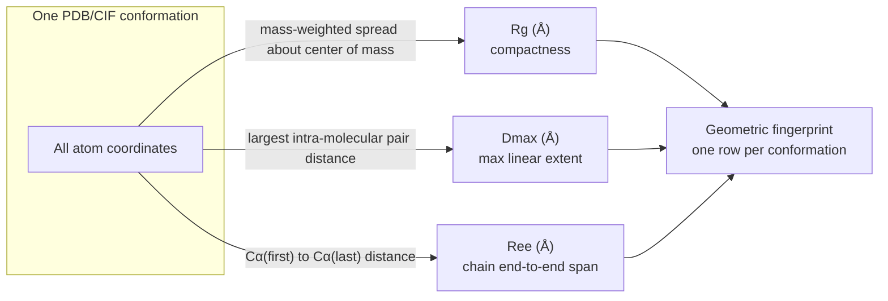
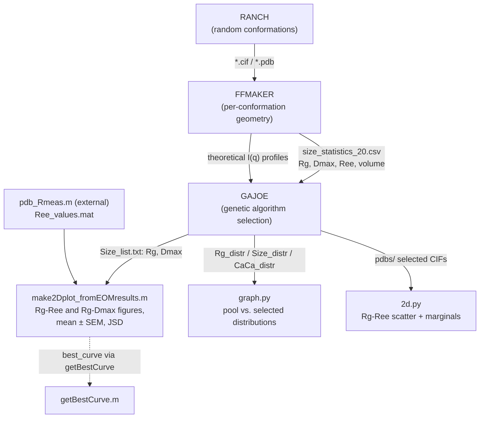

This page explains the three structural descriptors — **radius of gyration (Rg)**, **maximum dimension (Dmax)**, and **end-to-end distance (Ree)** — that parameterize every conformation in the H4 tail benchmarking workflow. These descriptors are the bridge between atomistic MD structures and SAXS-refined ensembles: RANCH generates conformations, FFMAKER measures them, GAJOE selects from them, and the MATLAB/Python scripts in this repository visualize and quantify how the selected ensemble's descriptor distributions shift relative to the full MD pool. You will learn what each descriptor measures, exactly which files store it, and how the analysis scripts read, weight, and compare it. This page assumes you have completed the [EOM Tutorial with ATSAS Tools](4-eom-tutorial-with-atsas-tools) and understand the pipeline at the level of [Architecture Overview](5-architecture-overview).

Sources: [README.md](README.md#L5-L17), [README.md](README.md#L56-L60)

## Why Three Descriptors Define an IDP Ensemble

Intrinsically disordered proteins like the 26-residue H4 tail (`assignment.txt` declares it `disordered`, and `protein.seq` provides the sequence `SGRGKGGKGLGKGGAKRHRKVLRDNI`) cannot be summarized by a single static structure. Instead, each conformation in the pool is reduced to a compact geometric fingerprint: **Rg** captures overall compactness (mass-weighted spread around the center of mass), **Dmax** captures the longest linear extent within the molecule, and **Ree** captures the span between the chain's first and last Cα atoms. Together they distinguish compact, globule-like, and extended conformations that SAXS measurements are sensitive to. The example data makes this concrete: the pool's average Rg is 13.77 Å while the SAXS-selected ensemble's average Rg rises to 15.27 Å — a compaction-versus-extension signature that is the central readout of the entire pipeline.

Prerequisite for the diagram: each box is a scalar derived directly from Cartesian coordinates; a single conformation yields one triple (Rg, Dmax, Ree), and a pool of N conformations yields N triples — the raw material for every distribution plot downstream.

Sources: [assignment.txt](Example_tutorial/assignment.txt#L1-L2), [protein.seq](Example_tutorial/protein.seq#L1-L3), [Rg_distr_001_1.txt](ExampleData/H4_tail_WT_ff19SB_OPC/GA001/curve_1/Rg_distr_001_1.txt#L1-L4), [Size_distr_001_1.txt](ExampleData/H4_tail_WT_ff19SB_OPC/GA001/curve_1/Size_distr_001_1.txt#L1-L4)

## Descriptor Data Flow Through the EOM Pipeline

The descriptors originate in the ATSAS tools and terminate in this repository's analysis scripts. The flow below shows where each descriptor is born and where it is consumed — this is the pattern to keep in mind when debugging "missing descriptor" errors.

Prerequisite for the diagram: solid arrows are file outputs produced by the named tool; the dashed arrow is an in-process function call; the external box covers the one descriptor (Ree) that GAJOE v2.1 does **not** populate in this workflow.

Sources: [README.md](README.md#L36-L98), [make2Dplot_fromEOMresults.m](make2Dplot_fromEOMresults.m#L30-L39), [graph.py](Example_tutorial/graph.py#L39-L59), [2d.py](Example_tutorial/2d.py#L8-L9)

## On-Disk Formats: Where Each Descriptor Lives

Each descriptor has one "per-conformation" home and one "distribution" home. The per-conformation records feed scatter plots and mean calculations; the distribution records are GAJOE's own binned histograms of pool versus selected frequencies. The verified formats, using the shipped example data (a 2000-conformation pool), are:

| File | Producer | Columns / content | Descriptor(s) |
|---|---|---|---|
| `Size_list.txt` | GAJOE | col 1 = conformation index, col 2 = Rg, col 3 = Dmax (2000 rows, no header) | Rg, Dmax |
| `size_statistics_20.csv` (FFMAKER) | FFMAKER | col 1 = Rg, col 3 = Ree, col 6 = conformation name (Dmax and volume in cols 2, 4) | Rg, Dmax, Ree |
| `Rg_distr_001_1.txt` | GAJOE | 4 summary header lines, then Rg \| Pool freq. \| Sel. freq. | Rg distribution |
| `Size_distr_001_1.txt` | GAJOE | 4 summary header lines, then Size \| Pool freq. \| Sel. freq. | Dmax distribution |
| `CaCa_distr_001_1.txt` | GAJOE | same layout, but all zeros in this example dataset | Ree distribution (unpopulated) |
| `Ree_values.mat` | `pdb_Rmeas.m` (run externally) | MATLAB variable `R` — one Ree per pool conformation | Ree |

The four header lines of each `*_distr` file are themselves a compact summary report: for example, `Rg_distr_001_1.txt` states *Ense Average Rg = 15.27*, *Ense Histogram Rg = 15.15*, *Pool Average Rg = 13.77*, *Pool Histogram Rg = 13.64*, and `Size_distr_001_1.txt` states *Ense Average Dmax = 47.33* versus *Pool Average Dmax = 42.69* — quantifying the ensemble's expansion relative to the pool before you plot anything.

Sources: [Size_list.txt](ExampleData/H4_tail_WT_ff19SB_OPC/GA001/curve_1/Size_list.txt#L1-L15), [Size_list.txt](ExampleData/H4_tail_WT_ff19SB_OPC/GA001/curve_1/Size_list.txt#L1996-L2000), [2d.py](Example_tutorial/2d.py#L12-L24), [Rg_distr_001_1.txt](ExampleData/H4_tail_WT_ff19SB_OPC/GA001/curve_1/Rg_distr_001_1.txt#L1-L6), [Size_distr_001_1.txt](ExampleData/H4_tail_WT_ff19SB_OPC/GA001/curve_1/Size_distr_001_1.txt#L1-L7), [CaCa_distr_001_1.txt](ExampleData/H4_tail_WT_ff19SB_OPC/GA001/curve_1/CaCa_distr_001_1.txt#L1-L5), [README.md](README.md#L56-L60)

## Reading Descriptors in MATLAB and Python

The two language stacks use different parsing conventions for the same descriptors, and knowing both is essential because the repository's full-featured analysis is MATLAB while the quick tutorial is Python. In MATLAB, `make2Dplot_fromEOMresults.m` loads Ree from `Ree_values.mat` (variable `R`) and imports `Size_list.txt` with `importdata`, then projects columns into a `pool` struct (`pool.dmax = Sizelist(:,3)`, `pool.rg = Sizelist(:,2)`, `pool.r = R(1:end)`). In Python, `2d.py` streams the FFMAKER CSV line by line, skipping short lines, and maps whitespace-split fields positionally: field 0 → `rg`, field 2 → `ree`, field 5 → structure name. `graph.py` takes a more defensive approach — its `read_numeric` helper tries to cast every whitespace-separated token to `float` and silently skips header lines that fail, which is why it can consume GAJOE's mixed header/distribution files unchanged.

| Aspect | MATLAB path (`make2Dplot_fromEOMresults.m`) | Python path (`2d.py` / `graph.py`) |
|---|---|---|
| Descriptor source file | `Size_list.txt` + `Ree_values.mat` | `size_statistics_20.csv` |
| Column mapping | col 2 → Rg, col 3 → Dmax, `.mat` → Ree | field 1 → Rg, field 3 → Ree, field 6 → name |
| Ree handling | loaded from external `Ree_values.mat` | read directly from FFMAKER CSV |
| Header handling | `importdata` / `.mat` load | skip short lines; float-cast try/except |

> [!TIP]
> The `CaCa_distr_001_1.txt` shipped in the example data is **entirely zeros** — GAJOE v2.1 did not compute Cα–Cα distances for this pool. That is why the MATLAB script never reads that file for Ree and instead requires a separately generated `Ree_values.mat` (see the script's header comment referencing `pdb_Rmeas.m`, a helper outside this repository). If your Ree histograms look degenerate, check this file first.

Sources: [make2Dplot_fromEOMresults.m](make2Dplot_fromEOMresults.m#L33-L39), [make2Dplot_fromEOMresults.m](make2Dplot_fromEOMresults.m#L1-L9), [2d.py](Example_tutorial/2d.py#L12-L24), [graph.py](Example_tutorial/graph.py#L7-L21)

## Weighting the Selected Ensemble

A subtle but decisive detail: the GA-selected "ensemble" is not a list of structures — it is a list of structure *occupancies*. `getBestCurve.m` parses all `GA_CYCLE_*.txt` files across the requested number of GA runs (`nRuns`), takes the last `curvesPerEnsemble` numeric rows of each (the selected structures), concatenates everything, and tabulates selection frequencies into a two-column result `[PDB number, frequency]`. `make2Dplot_fromEOMresults.m` then **expands** each selected conformation by repeating its descriptor values `bestcurve(n,2)` times with `repmat`, building weighted arrays `gajoe.dmax`, `gajoe.rg`, and `gajoe.r`. Consequently, the "EOM pool" histograms and scatter points represent occupancy-weighted descriptor distributions — a structure selected in 40 of 100 GA runs contributes 40 copies of its (Rg, Dmax, Ree) triple. This weighting is what makes pool-versus-ensemble comparisons statistically meaningful rather than set-membership counts.

Sources: [getBestCurve.m](getBestCurve.m#L19-L39), [make2Dplot_fromEOMresults.m](make2Dplot_fromEOMresults.m#L45-L55), [make2Dplot_fromEOMresults.m](make2Dplot_fromEOMresults.m#L13-L16)

## Summarizing Ensembles: Mean ± Standard Error

After weighting, the script prints a uniform summary statistic for each descriptor: the mean and the standard error of the mean, computed identically for the full MD pool and the GA-selected ensemble — `mean(x)` and `std(x)./sqrt(numel(x))` for Rg (active) and Ree (active), with the Dmax block present but commented out. This mirrors the average-vs-histogram distinction in GAJOE's own distribution headers (mean of raw values versus mean of binned histogram), and in the example data both methods agree closely (Rg ensemble average 15.27 Å vs. histogram 15.15 Å). When benchmarking force fields — the purpose of this repository — this pool-vs-ensemble delta is the primary quantitative signal, e.g., a SAXS-refined ensemble shifting toward larger Rg and Dmax indicates the experiment favors more extended conformations than the raw MD pool provides.

Sources: [make2Dplot_fromEOMresults.m](make2Dplot_fromEOMresults.m#L116-L130), [Rg_distr_001_1.txt](ExampleData/H4_tail_WT_ff19SB_OPC/GA001/curve_1/Rg_distr_001_1.txt#L1-L4), [Size_distr_001_1.txt](ExampleData/H4_tail_WT_ff19SB_OPC/GA001/curve_1/Size_distr_001_1.txt#L1-L4)

## From Descriptors to Quantitative Comparison: Jensen-Shannon Divergence

Means are blunt instruments; the repository also compares the *full shapes* of descriptor distributions using the **Jensen-Shannon divergence (JSD)** between the MD pool and the SAXS-refined ensemble. The implementation (added September 2025, adapted from RNA-condensate analysis tooling) is compact: both descriptor arrays are binned with the same fixed bin count (22 bins for Rg and Ree), converted to probability density functions via `histcounts(...,'Normalization','pdf')`, and JSD is assembled from a Shannon entropy helper `H(p) = -sum(p.*log(p))` as `JSD = H(0.5p₁+0.5p₂) − 0.5H(p₁) − 0.5H(p₂)`. The helper guards against the degenerate `0·log(0)` case by replacing `NaN` entries with 0. JSD is computed independently for Rg (`JSD_rg`) and Ree (`JSD_r`), returning values in nats that approach 0 when the distributions are indistinguishable — this is the number that says whether SAXS selection actually reshaped the ensemble's geometry. For a deeper treatment of the entropy machinery, see [Jensen-Shannon Divergence Quantification](12-jensen-shannon-divergence-quantification).

> [!TIP]
> Note the two different normalizations in this script: display histograms are normalized so the tallest bin equals 1 (`.BinCounts = .../max(...)`), while JSD histograms use proper PDF normalization. Reusing the display-normalized counts in an entropy calculation would silently corrupt the result — always reach for the `'Normalization','pdf'` variants when comparing distributions.

Sources: [make2Dplot_fromEOMresults.m](make2Dplot_fromEOMresults.m#L185-L206), [make2Dplot_fromEOMresults.m](make2Dplot_fromEOMresults.m#L209-L234), [make2Dplot_fromEOMresults.m](make2Dplot_fromEOMresults.m#L92-L110)

## Visualizing Descriptor Space

The descriptors are rendered in two complementary 2D projections, both in MATLAB and Python. The **Rg–Ree plane** is the workhorse: the MATLAB version (`make2Dplot_fromEOMresults.m`) draws the full pool as orange dots and the occupancy-weighted selected ensemble as blue open circles over fixed axes (`xlim_R = [0 80]`, `ylim_Rg = [5 30]`), flanked by normalized marginal histograms of Ree (top) and Rg (right, axis-reversed via `camroll(-90)`); the Python version (`2d.py`) reproduces the same layout with matplotlib `GridSpec` by masking the pool arrays against the CIF filenames found in `GA001/curve_1/pdbs`. The **Rg–Dmax plane** (`xlim_Dmax = [20 80]`) is the MATLAB-only second figure, useful because Dmax is the descriptor most directly constrained by the SAXS P(r) function, whereas Ree probes internal chain architecture that SAXS alone cannot resolve. Additionally, `graph.py` plots the raw pool-vs-selected frequency curves for all three descriptors from the `*_distr` files. Full walkthroughs of these figures live in [2D Ensemble Comparison Histograms](11-2d-ensemble-comparison-histograms), [Rg-Ree Scatter Plot with Marginals](15-rg-ree-scatter-plot-with-marginals), and [SAXS Curve and Distribution Plots](14-saxs-curve-and-distribution-plots).

Sources: [make2Dplot_fromEOMresults.m](make2Dplot_fromEOMresults.m#L58-L111), [make2Dplot_fromEOMresults.m](make2Dplot_fromEOMresults.m#L18-L26), [make2Dplot_fromEOMresults.m](make2Dplot_fromEOMresults.m#L134-L180), [2d.py](Example_tutorial/2d.py#L27-L95), [graph.py](Example_tutorial/graph.py#L39-L59), [README.md](README.md#L115-L117)

## How the Three Descriptors Cooperate

The descriptors are deliberately redundant — each is blind to a pathology the others catch. The concept map below summarizes their complementary roles in validating an ensemble:

| Descriptor | Sensitive to | Blind to | Primary producer | Consumed by |
|---|---|---|---|---|
| Rg | Global compactness | Internal asymmetry, chain closure | FFMAKER / GAJOE (`Size_list.txt`) | JSD, mean ± SEM, both scatter plots |
| Dmax | Longest extent (SAXS P(r) constraint) | Where mass sits within that extent | FFMAKER / GAJOE (`Size_list.txt`) | Rg–Dmax figure, mean block |
| Ree | Chain end-to-end architecture | Mass distribution along the chain | `pdb_Rmeas.m` → `Ree_values.mat` (MATLAB) / FFMAKER CSV (Python) | Rg–Ree figure, JSD, mean ± SEM |

Practical consequence: a compact-but-bent conformation can have small Rg yet large Ree; an extended-but-folded-back chain can have large Dmax yet modest Ree. Only the joint (Rg, Dmax, Ree) fingerprint disambiguates these cases, which is why the pipeline never relies on a single descriptor.

Sources: [make2Dplot_fromEOMresults.m](make2Dplot_fromEOMresults.m#L36-L39), [2d.py](Example_tutorial/2d.py#L14-L24), [README.md](README.md#L58-L58)

## Practical Checklist and Next Steps

When working with your own GAJOE output, verify the descriptor chain end-to-end before plotting: confirm `Size_list.txt` has one row per pool conformation (the example has 2000), confirm `Ree_values.mat` exists and contains variable `R` with matching length, set `nRuns` and `curvesPerEnsemble` to the values you entered in GAJOE, and adjust the axes limits (`xlim_Dmax`, `ylim_Rg`, `xlim_R`) and bin counts to your protein's size range. To understand where these descriptor files come from, read [RANCH Conformational Pool Generation](6-ranch-conformational-pool-generation) and [FFMAKER Theoretical SAXS Profiles](7-ffmaker-theoretical-saxs-profiles); for the complete inventory of GAJOE output files beyond descriptors, see [GAJOE Output File Reference](9-gajoe-output-file-reference); to see how descriptor shifts drive biological conclusions for the histone H4 tail, continue to [H4 Histone Tail Case Study](17-h4-histone-tail-case-study).
