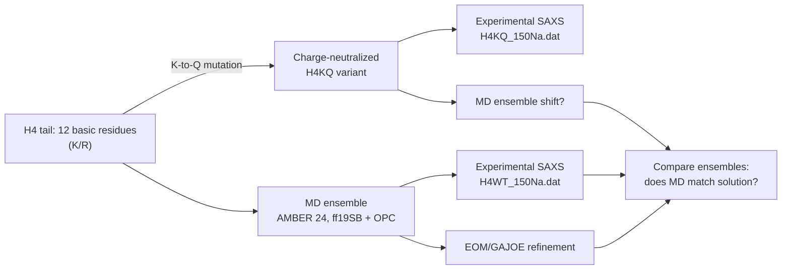
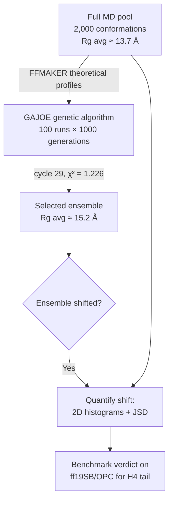
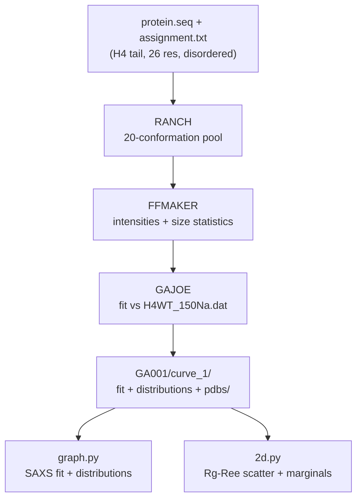

This page is the Deep Dive capstone of the documentation: it explains how every pipeline component documented so far — RANCH pool generation, FFMAKER profile computation, GAJOE ensemble fitting, and the MATLAB/Python analysis scripts — converges on one concrete scientific problem. The repository ships a complete, reproducible instance of this problem: the wild-type (WT) H4 histone tail, simulated in solution and benchmarked against experimental small-angle X-ray scattering (SAXS) data, alongside its charge-neutralized K-to-Q mutant for comparison. If you have followed the mechanics pages, this case study shows them working together on real data.

Sources: [README.md](README.md#L9-L19)

## Scientific Context: What Is Being Benchmarked

The case study originates from the paper *Combining atomistic simulation and solution scattering to reveal charge-driven histone H4 tail conformational changes* (Wang, Kolesnikov, Pollack, Onufriev, 2026, in submission), which this repository accompanies. The central scientific question is whether atomistic molecular dynamics (MD) ensembles of the intrinsically disordered H4 tail reproduce solution scattering measurements — and how the ensemble shifts when positive charges on the tail are neutralized by lysine-to-glutamine (K-to-Q) substitution. The folder naming `H4_tail_WT_ff19SB_OPC` encodes the simulation provenance directly: the AMBER `ff19SB` protein force field with `OPC` water, produced with AMBER 24 as stated in the software notes.

The benchmark logic is symmetric in both directions: SAXS validates whether the MD ensemble is physically realistic, and the MD ensemble provides residue-level structural interpretation for what SAXS measures indirectly. This two-way relationship is what makes the H4 tail a case study rather than a mere example — it is the evidentiary core of the associated paper.

Sources: [README.md](README.md#L11-L19), [README.md](README.md#L113-L114)

## The Molecule: Sequence-Level Definition of the H4 Tail

The H4 tail is defined at the sequence level in `Example_tutorial/protein.seq`: a 26-residue fragment `SGRGKGGKGLGKGGAKRHRKVLRDNI`, declared as chain `A` with residues 1–26 marked `disordered` in `assignment.txt`. This two-file pair is exactly what RANCH consumes to generate conformational pools — the `disordered` flag tells RANCH to treat the entire fragment as a flexible chain rather than inheriting secondary structure.

| File | Content | Role in pipeline |
|---|---|---|
| `protein.seq` | FASTA entry `>A` with 26-residue sequence | Defines the chain identity and sequence |
| `assignment.txt` | `A 1 26 disordered` | Declares chain A, residues 1–26, disordered region for RANCH |

Scanning the sequence reveals why this tail is a charge-driven system: it is densely packed with lysine (`K`) and arginine (`R`) residues — roughly half the fragment — including the acetylation-site lysines that the K-to-Q mutation targets. This charge density is the physical basis for the "charge-driven conformational changes" the paper investigates: neutralizing even a subset of these charges alters intramolecular electrostatic repulsion and therefore the tail's conformational distribution.

Sources: [Example_tutorial/protein.seq](Example_tutorial/protein.seq#L1-L3), [Example_tutorial/assignment.txt](assignment.txt#L1-L2)

## Case Study Data Assets

The repository organizes the case study into three directories, each serving a distinct role. `SAXSData/` holds the experimental ground truth, `ExampleData/` holds a complete GAJOE refinement result for the WT tail, and `Example_tutorial/` holds a miniature hands-on reproduction.

| Directory | Contents | Role |
|---|---|---|
| `SAXSData/` | `H4WT_150Na.dat` (53 q-points), `H4KQ_150Na.dat` (56 q-points) | Experimental SAXS profiles at 150 mM NaCl |
| `ExampleData/H4_tail_WT_ff19SB_OPC/GA001/curve_1/` | 100 `GA_CYCLE` files, `profiles_001_1.fit`, four distribution files, `Size_list.txt`, `Ree_values.mat` | Complete GAJOE v2 output for the WT tail |
| `Example_tutorial/` | `protein.seq`, `assignment.txt`, `H4WT_150Na.dat`, `graph.py`, `2d.py` | Minimal 20-conformation workflow demonstration |

Both experimental files use the standard three-column `.dat` format — q, I(q), error — with a 4-line header; the WT profile begins at q ≈ 0.0156 Å⁻¹ and the KQ profile at q ≈ 0.0199 Å⁻¹. The `150Na` suffix in both filenames records the ionic condition (150 mM NaCl) under which the scattering was measured, which matters because salt screens the very electrostatic interactions under study.

Sources: [SAXSData/H4WT_150Na.dat](SAXSData/H4WT_150Na.dat#L1-L7), [SAXSData/H4KQ_150Na.dat](SAXSData/H4KQ_150Na.dat#L1-L7), [README.md](README.md#L15-L19)

## The Refinement Run: Anatomy of GA001

`ExampleData/H4_tail_WT_ff19SB_OPC/GA001/curve_1/` is a saved GAJOE work directory for one genetic-algorithm curve, and its contents reveal the exact optimization settings used for the case study. The first line of `profiles_001_1.fit` states that the best cycle was **cycle 29** with **χ² = 1.226**, run for **1000 generations** across **50 candidate ensembles** with up to **9 curves per ensemble**. The presence of exactly 100 `GA_CYCLE_*.txt` files confirms the GA was independently repeated 100 times — matching the `nRuns = 100` setting in the analysis script.

| Artifact | Verified content | Meaning |
|---|---|---|
| `profiles_001_1.fit` | `CYCLE: 29 Chi^2: 1.226 GENER.: 1000 ENSEMBLES: 50 CURVES: 9` | Best fit achieved; χ² ≈ 1.2 indicates close agreement with experiment |
| `GA_CYCLE_1.txt` … `GA_CYCLE_100.txt` | ~20,000 lines each; records like `-103-329-460-…` list pool structure indices per generation | Full genetic-algorithm trajectory, savable only with GAJOE's "save workfiles" option |
| `Size_list.txt` | 2,000 rows; columns: index, Rg, Dmax | The full MD pool: 2,000 conformations with per-structure sizes |
| `Ree_values.mat` | Vector `R` of end-to-end distances | Computed independently from pool PDBs (see below) |
| `Rg_distr_001_1.txt`, `Size_distr_001_1.txt`, `CaCa_distr_001_1.txt`, `Volume_distr_001_1.txt` | Pool vs. selected frequency distributions | GAJOE's own comparison of full pool against SAXS-selected ensemble |

> [!TIP]
> The end-to-end distances in `Ree_values.mat` are not a native GAJOE output — the header of `make2Dplot_fromEOMresults.m` instructs you to compute R (Ree) over the full pool PDBs first and load the result into the workspace before the 2D plots will run. This is the one manual preprocessing step in the case study.

Sources: [ExampleData/H4_tail_WT_ff19SB_OPC/GA001/curve_1/profiles_001_1.fit](ExampleData/H4_tail_WT_ff19SB_OPC/GA001/curve_1/profiles_001_1.fit#L1), [ExampleData/H4_tail_WT_ff19SB_OPC/GA001/curve_1/GA_CYCLE_29.txt](ExampleData/H4_tail_WT_ff19SB_OPC/GA001/curve_1/GA_CYCLE_29.txt#L1-L8), [ExampleData/H4_tail_WT_ff19SB_OPC/GA001/curve_1/Size_list.txt](ExampleData/H4_tail_WT_ff19SB_OPC/GA001/curve_1/Size_list.txt#L1-L5), [make2Dplot_fromEOMresults.m](make2Dplot_fromEOMresults.m#L3-L6)

## What the Numbers Reveal: A Measurable Ensemble Shift

The distribution files quantify the case study's central observation. In `Rg_distr_001_1.txt`, the **selected ensemble** has average radius of gyration 15.15–15.27 Å, while the **full pool** sits at 13.64–13.77 Å. The SAXS-selected ensemble is thus measurably *more extended* than the raw ff19SB/OPC pool — the genetic algorithm systematically enriched for expanded conformations when fitting the experimental data. This is precisely the kind of MD-versus-solution discrepancy the benchmark exists to expose and quantify.

| Quantity | Full MD pool | SAXS-selected ensemble | Interpretation |
|---|---|---|---|
| Rg (average) | 13.64–13.77 Å | 15.15–15.27 Å | EOM enriches extended conformations |
| Pool size | 2,000 conformations | Frequency-weighted subset | GA selection over 100 runs |
| Fit quality | — | χ² = 1.226 | Theoretical profile matches experiment |

Sources: [ExampleData/H4_tail_WT_ff19SB_OPC/GA001/curve_1/Rg_distr_001_1.txt](ExampleData/H4_tail_WT_ff19SB_OPC/GA001/curve_1/Rg_distr_001_1.txt#L1-L10), [ExampleData/H4_tail_WT_ff19SB_OPC/GA001/curve_1/profiles_001_1.fit](ExampleData/H4_tail_WT_ff19SB_OPC/GA001/curve_1/profiles_001_1.fit#L1)

## Case-Study-Specific Analysis Scripts

Three MATLAB scripts form the case-study analysis layer, and all three are pre-configured to point at this exact dataset. Their user-defined parameters are the only things that need editing when reproducing the analysis on your own GAJOE outputs.

| Script | User-defined parameters (as shipped) | Output |
|---|---|---|
| `getBestCurve.m` | `dir`, `nRuns`, `curvesPerEnsemble` | Frequency table of pool structures selected by the GA |
| `make2Dplot_fromEOMresults.m` | `dir = 'ExampleData/H4_tail_WT_ff19SB_OPC/GA001/curve_1'`, `nRuns = 100`, `curvesPerEnsemble = 20`, axis limits, histogram bins | 2D Rg–Ree and Dmax–Rg scatter plots with marginals, means ± SE, JSD values |
| `plotEOMSAXScomparison.m` | `folder = 'ExampleData/H4_tail_WT_ff19SB_OPC/GA001/curve_1'`, WT/KQ color selection | SAXS fit overlay, dimensionless Kratky plot, residuals with error band |

`getBestCurve.m` exists to solve a version-compatibility problem: GAJOE v2 removed the `best_curve.txt` file that v1.3 emitted, so this function re-derives it by parsing all 100 `GA_CYCLE` files (delimited by `-`), tabulating which pool structures appear across all final ensembles, and returning `[PDBnum, frequency]` pairs. It only works if GAJOE was run with "Save workfiles with the entire GA runs" answered **yes** — the case study's `GA001` folder demonstrates what that output looks like.

Sources: [getBestCurve.m](getBestCurve.m#L2-L15), [getBestCurve.m](getBestCurve.m#L20-L43), [make2Dplot_fromEOMresults.m](make2Dplot_fromEOMresults.m#L14-L27), [plotEOMSAXScomparison.m](plotEOMSAXScomparison.m#L7-L14)

### Ensemble Comparison and Divergence Quantification

`make2Dplot_fromEOMresults.m` produces the flagship comparison figure of the case study: the full MD pool plotted as orange points and the EOM-selected ensemble as blue circles in (Rg, Ree) and (Rg, Dmax) space, with normalized marginal histograms added in September 2025. It also prints mean ± standard error for Rg, Dmax, and Ree of both populations — the quantitative summary underlying the ensemble shift table above.

The script then computes the **Jensen-Shannon divergence (JSD)** between the pool and selected-ensemble distributions for both Rg and Ree, binning each population as a probability density and evaluating JSD = H(½p₁ + ½p₂) − ½H(p₁) − ½H(p₂) via a local Shannon-entropy subfunction. The method is credited to the RNA condensates software's `plotIterativeAnalysis.m`. A low JSD means GAJOE's selection did not distort the pool distribution (MD matches solution); a high JSD quantifies exactly how far the SAXS-refined ensemble departs from the simulation.

> [!TIP]
> The histograms fed to the JSD use a shared bin count (`binsRg = binsR = 22`), so the divergence value depends on binning choice — keep bins fixed when comparing JSD across systems (e.g., WT vs. KQ) for the number to be meaningful.

Sources: [make2Dplot_fromEOMresults.m](make2Dplot_fromEOMresults.m#L84-L111), [make2Dplot_fromEOMresults.m](make2Dplot_fromEOMresults.m#L116-L130), [make2Dplot_fromEOMresults.m](make2Dplot_fromEOMresults.m#L185-L234)

### Fit Quality Visualization

`plotEOMSAXScomparison.m` closes the loop by overlaying the GAJOE ensemble profile against the experimental curve, then rendering a Kratky plot (q²I(q) vs. q — the standard IDP diagnostics that emphasizes mid-q deviations from Gaussian-chain behavior) and a residual panel. The residuals are computed by interpolating the experimental I(q) and error onto the CRYSOL q-grid, with the experimental uncertainty shown as a shaded band around zero — so the reader can judge whether deviations are within noise. The script reads `SAXSData/H4WT_150Na.dat` with 4 header lines skipped and `profiles_001_1.fit` with 1, and carries commented color definitions for switching to the KQ dataset (`[46 80 122]/255` in place of the WT orange `[238 68 0]/255`).

Sources: [plotEOMSAXScomparison.m](plotEOMSAXScomparison.m#L18-L24), [plotEOMSAXScomparison.m](plotEOMSAXScomparison.m#L55-L78), [plotEOMSAXScomparison.m](plotEOMSAXScomparison.m#L78-L103)

## The Comparative Dimension: WT vs. K-to-Q

The case study's scientific punchline lives in the WT-vs-KQ comparison. `SAXSData/` provides both experimental profiles at the same 150 mM NaCl condition, and `plotEOMSAXScomparison.m` encodes the intended visualization convention: orange for H4WT, blue for H4KQ. Repeating the full pipeline — pool generation, FFMAKER, GAJOE, and the three MATLAB scripts — on a KQ pool and swapping the dataset references yields directly comparable figures and JSD values between the charged and neutralized tails.

| Dimension | H4WT | H4KQ |
|---|---|---|
| Chemical change | Native lysines (positive) | Selected K → Q (neutral) |
| Experimental data | 53 q-points, q from 0.0156 Å⁻¹ | 56 q-points, q from 0.0199 Å⁻¹ |
| Plot color convention | `[238 68 0]/255` (orange) | `[46 80 122]/255` (blue, commented in script) |
| Role in benchmark | Reference ff19SB/OPC ensemble | Tests whether MD captures charge-driven shifts |

Sources: [SAXSData/H4WT_150Na.dat](SAXSData/H4WT_150Na.dat#L1-L7), [SAXSData/H4KQ_150Na.dat](SAXSData/H4KQ_150Na.dat#L1-L7), [plotEOMSAXScomparison.m](plotEOMSAXScomparison.m#L11-L14)

## Hands-On Miniature: Reproducing the Case Study in 20 Conformations

`Example_tutorial/` packages the entire case-study logic into a runnable miniature: a 20-conformation RANCH pool generated from the same H4 sequence, FFMAKER profiles, and a single quick GAJOE run (1 GA run, 100 generations, ensembles of 1–10 non-repeated conformers) fitted against a local copy of the WT data. The README is explicit that this scale is for workflow demonstration only — quantitative ensemble analysis requires far larger, adequately sampled pools like the shipped 2,000-conformation GA001 pool. The two Python scripts then mirror the MATLAB analysis at small scale: `graph.py` renders the SAXS fit and the Rg/Dmax/Ree distributions from the `GA001/curve_1` folder, while `2d.py` rebuilds the Rg–Ree scatter with marginals by matching `size_statistics_20.csv` rows against the CIF filenames GAJOE placed in `GA001/curve_1/pdbs/`.

For the complete command-by-command walkthrough of this miniature — including every GAJOE flag explained — see the dedicated tutorial page [EOM Tutorial with ATSAS Tools](4-eom-tutorial-with-atsas-tools); the per-file formats are catalogued in [GAJOE Output File Reference](9-gajoe-output-file-reference).

Sources: [README.md](README.md#L68-L78), [Example_tutorial/graph.py](Example_tutorial/graph.py#L12-L42), [Example_tutorial/2d.py](Example_tutorial/2d.py#L7-L39)

## Case Study Reading Map

The case study touches nearly every other page in this documentation, so here is the recommended traversal depending on your goal:

- **Understand how the pool was made** → [RANCH Conformational Pool Generation](6-ranch-conformational-pool-generation), then [MD Ensemble Generation with AMBER](18-md-ensemble-generation-with-amber) for the ff19SB/OPC simulation side.
- **Understand the fitting mechanics** → [FFMAKER Theoretical SAXS Profiles](7-ffmaker-theoretical-saxs-profiles) and [GAJOE Genetic Algorithm Ensemble Fitting](8-gajoe-genetic-algorithm-ensemble-fitting).
- **Decode the artifacts discussed above** → [GAJOE Output File Reference](9-gajoe-output-file-reference) for `profiles_*.fit` and distribution files, [Best-Curve Reconstruction from GA Cycles](10-best-curve-reconstruction-from-ga-cycles) for `getBestCurve.m` internals.
- **Rebuild the figures** → [2D Ensemble Comparison Histograms](11-2d-ensemble-comparison-histograms), [Jensen-Shannon Divergence Quantification](12-jensen-shannon-divergence-quantification), [SAXS Fit, Kratky Plot, and Residuals](13-saxs-fit-kratky-plot-and-residuals), plus the Python counterparts [SAXS Curve and Distribution Plots](14-saxs-curve-and-distribution-plots) and [Rg-Ree Scatter Plot with Marginals](15-rg-ree-scatter-plot-with-marginals).
- **Adapt the workflow to your own IDP** → [Structural Descriptors: Rg, Dmax, Ree](16-structural-descriptors-rg-dmax-ree) and [Extending Workflow to Other IDPs](19-extending-workflow-to-other-idps).
